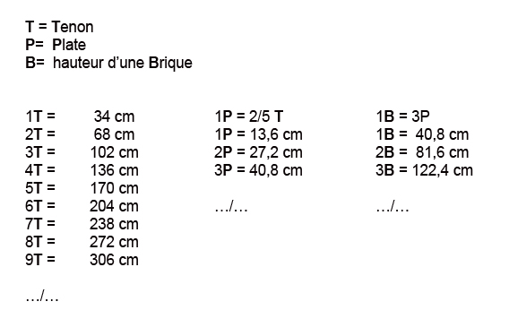
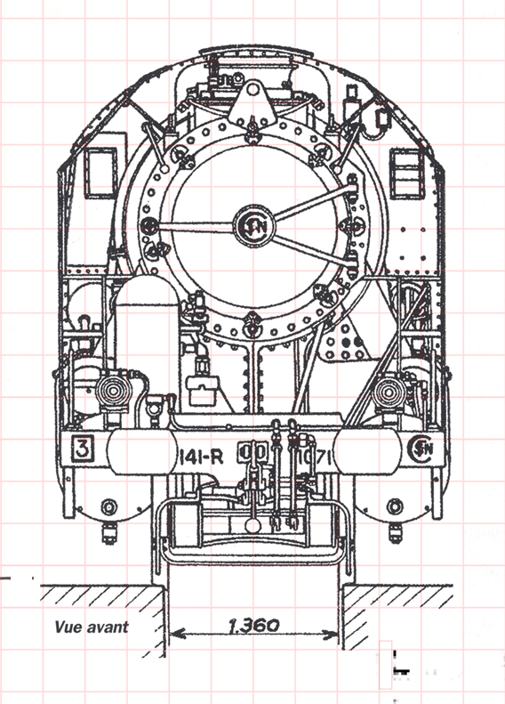
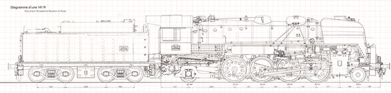

Cet article a pour objet d’apporter un complément de réflexion à celui écrit par Didier ENJARY [Echelles des maquettes LEGO®](/articles/echelles-des-maquettes-lego/) en juin 2004, en approfondissant le rapport d’échelle minifig.

La démonstration faite ci-dessous sur le rapport d’échelle minifig se base sur la minifig elle-même et l’écartement des rails des trains réels en voie dite "standard".

**DEMONSTRATION**

Si nous prenons la minifig LEGO® qui fait 4 cm de haut soit 5 tenons, ce personnage représente un homme de taille moyenne de 1m70 de haut.

Nous obtenons **1m70 / 5 = 34 cm** ... donc un rapport d’échelle de :  
1 Tenon = 8mm = 34cm soit du **1/ 42,5**.

Pour les trains qui roulent sur des voies dites "standards" : écartement = 1435 mm, l’écartement intérieur des roues du matériel roulant est de 1360 mm en général, pour la construction des trains LEGO®, nous mettons l’équivalent d’une brique de 4 tenons entre les roues.

Nous obtenons **4 x 34 cm = 136 cm** ... donc le rapport d’échelle **1/ 42,5** s’applique !!!

Ce qu’induit ce rapport d’échelle **1 / 42,5** ou 1**T** “Tenon” = 34cm :

**APPLICATION**

Un personnage de 1m70 de haut = 5**T**

Une porte de 2m de haut = 6**T** sur 1m de large = 3**T**

Un véhicule léger de 1m70 de large = 5**T**

Un camion 2m à 2m50 de large = 6 ou 7**T**

Un container de 2m43 de large = 7**T**

Un train de 2m80 à 3m de large = 8 ou 9**T**

**EXEMPLE**

Prenons une célèbre locomotive, une belle américaine, la **141R** pour ne pas la nommer, voici son diagramme « Vue de Face » sur lequel une grille d’un pas de 1 Tenon a été appliquée.

**141R+grille**

Nous obtenons une reproduction LEGO® qui pourrait avoir une largeur de 9 **T**enons, la vapeur avec ses pistons étant un peu plus large 3m 05 que les locomotives modernes 2m80 (8 **T**enons).

Et une longueur de 68 **T**enons = Locomotive + Tender

**BONNE CONSTRUCTION....** et en cas de besoin... à vos calculettes !
