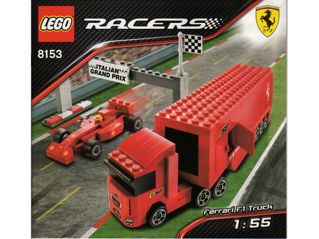
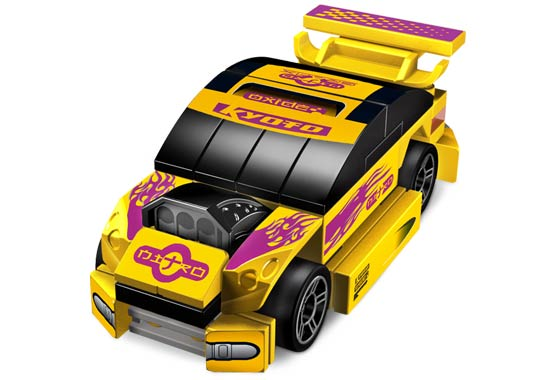
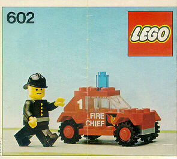
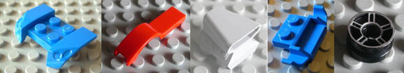
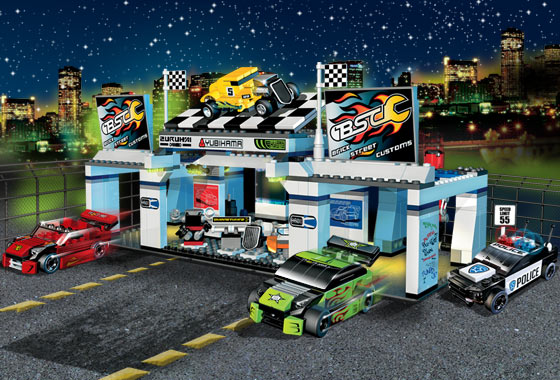
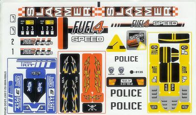
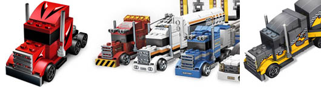

Le titre, succinct [^1], est par ailleurs énigmatique.

Sans doute un rapport d’échelle ([encore un](/articles/echelles-des-maquettes-lego/)) mais je doute que vous en soyez chagriné. En effet, avec la gamme "Ferrari", la société LEGO a étiqueté ses modèles avec de nombreux rapports d’échelle du 1:8 [8674](http://brickset.com/detail/?Set=8674-1) [^2] au 1:55 [8153](http://brickset.com/detail/?Set=8153-1) en passant par le 1:17 [8156](http://brickset.com/detail/?Set=8156-1) et le 1:24 [8142](http://brickset.com/detail/?Set=8142-1), sans doute pour satisfaire les collectionneurs soucieux de (pseudo) exactitude.

Mais revenons au 1:55.

Les aficionados comprennent rapidement que cette mesure se place dans la catégorie "microscale" - comprendre échelle en dessous de celle des minifigs. Cela peux sembler anodin, mais si vous décryptez le phénomène, cela signifie que la société LEGO abandonne ici une de ses marques de fabrique : la minifig. Nous reviendrons sur ce point plus tard.

Concrètement, le 1:55 s’est développé pleinement (depuis 2005, avec plus de 30 sets à ce jour) avec la gamme ["Tiny Turbos"](http://www.brickset.com/search/?query=tiny+turbos) - comprendre "petites sportives" [^3]. Une série de plusieurs véhicules, principalement des bolides de course, larges de 4 tenons, composés de quelques dizaines de pièces de petites tailles. Le principe est clair : des petits sets visant l’achat d’impulsion, un concept favorisant l’effet de collection (achats multiples) et un montage rapide pour un jeu immédiat. La cible est tout aussi claire : les jeunes garçons.

Mais est-ce vraiment un concept nouveau ? [^4] Oui et non. Non dans le sens où LEGO fait des "petites voitures" depuis longtemps. Les trentenaires ont débuté avec des sets comme le [673](http://www.brickset.com/detail/?Set=673-1).

Mais vous remarquez que ces sets présentent une très grande distorsion d’échelle entre la Minifig et le véhicule, certains confinant au ridicule (ci-dessus le 602), le personnage proposé ne pouvant en aucun cas prendre place dans l’automobile.

On peux trouver aussi une ressemblance de concept avec les fameuses "Majorettes". Le concept est ancien, il est éprouvé : des petits modèles que l’on peux emporter partout avec soi et une déclinaison à l’envie des modèles. Dans le cas de LEGO, l’abandon de la Minifig et l’usage de pièces plus petites conduisent à des modèles plus réalistes : comme dans le cas des Majorettes, on joue enfin avec des voitures qui ressemblent à celles que l’on peux voir à la télé.

Des éléments évidents d’innovation résident dans l’utilisation de pièces complètement nouvelles ou récentes (années 2000). Pour créer des modèles si réduits avec un tant soit peu de détails, il faut faire appel à des pièces de faibles tailles, soit spécifiques (passage de roue, grille de radiateur, bouche de prise d’air, spoilers...) soit plus versatiles ([slope 1x1x2/3](http://www.peeron.com/inv/parts/50746)).

La gamme originalement très centrée sur les voitures de course (formule1, circuit, rallye, piste) s’est enrichie de véhicules hétéroclites (limousine, pick-up, van), de camions, d’un hélicoptère ! ainsi que de modèles de bâtiments appartenant à l’univers routier (garage, station, gare de péage).

Des choix dans le design valent d’être soulignés :  
**–** les glaces (pare-brises, vitres) sont réduites au minimum, représentées par des pièces noires, donnant l’illusion de verres fumés.  
**–** la gamme est riche de planches d’autocollants avec pour principal objectif d’augmenter le réalisme et l’attrait graphique des modèles.

**–** l’emploi de pièces "phosphorescentes" (2008) permettent de prolonger le jeu après l’heure du coucher ;-)  
**–** des "réutilisations" de designs sont rendues possibles par les variations de couleurs (pièces et autocollants)

Le design de 2005 du "Flame glider" orange (8641) est judicieusement repris en jaune dans le "garage tuning" 8681 de 2007 ou en gris dans le "Brick Street Customs" 8154 de 2008.

Le camion rouge "Road hero" 8664 [^5] de 2006 est un incontournable aussi bien en gris et jaune dans le "Night crusher" 8134 de 2007 que dans le "Brick Street Customs" en blanc et bleu dans sa version rallongé, sans parler de ses trois déclinaisons bleu-blanc-rouge dans le "Bullet run" 8147.

Vous l’aurez compris, pour le public cible, le produit "Tiny Turbos" a gagné son pari. Toutefois, il n’est pas certain qu’il ait trouvé un public dans le monde des fans adultes : l’échelle n’est pas celle qu’ils affectionnent et les pièces "utiles" à leurs propres créations sont disponibles par ailleurs à moindres coûts (que faire de toutes ces roues ?). Un produit à conseiller avant tout aux papas qui veulent jouer aux "petites voitures" avec leur(s) fiston(s).

[^1]: Ceci n’est en aucun cas une incitation faite auprès d’autres potentiels auteurs à faire plus court.

[^2]: On retrouve aussi pour la licence Ferrari les rapports d’échelles aux 1:9 et 1:10...

[^3]: Plus précisément, cette gamme appartient à la gamme "Racers". La dénomination "Tiny Turbos" de 2005 ne persiste plus que sur le site web de LEGO. La dénomination "1:55" fait son apparition en 2008 sur les catalogues.

[^4]: On trouvera par exemple des analogies avec la gamme ["Race track"](http://www.brickset.com/search/?query=race+track%20datant%20de%202003)

[^5]: Un "long nose", à double essieux arrières, très américain, les Européens se tourneront vers le camion Ferrari présenté au tout début de cet article
