Suite à [l’article sur la revue de quelques capteurs HiTechnic](/articles/980/), des remarques et demandes me font penser que bien peu connaissent la possibilité offerte par des entreprises étrangères à LEGO, d’acheter des capteurs ou des interfaces développés spécifiquement pour le Kit NXT, ou compatibles. Voici un début de réponse à ces interrogations, sous forme de liste de produits actuellement disponibles.

## HiTechnic

-   **NXT Acceleration / Tilt Sensor\*** : Capteur de mouvement, donne les composantes x,y et z de l’accélération (en g)
-   **NXT Color Sensor V2\*** : Capteur de couleur, donne les composantes RGB de la couleur de la cible
-   **NXT Compass Sensor\*** : Capteur boussole, donne l’azimut (en °)
-   **NXT EOPD\*** : Capteur de distance (étalonnage en cm)
-   **NXT Gyro Sensor** : Capteur de rotation, donne l’accélération autour d’un axe (en °/s)
-   **NXT IRLink Sensor** : Interface qui permet au NXT de commander les trains, les kits Power-Functions et les Mindstorms RCX.
-   **NXT IRReceiver Sensor** : Capteur qui décode le protocole Power Function, pour interfacer les télécommandes PF avec le NXT
-   **NXT IRSeeker V2** : Interface qui donne la direction de la balle infrarouge, ou de la balise infrarouge
-   **HiTechnic Infrared Electronic Ball** : Balle de foot utilisée dans les concours Robocup Jr, et qui émet dans toutes les directions un flux infrarouge (cf. IRSeeker)
-   **IR Beacon** : Balise infrarouge pour le challenge "First Tech Challenge Hot Shot 2009 / 2010 Game". (cf. IRSeeker)
-   **HiTechnic Experimenter’s Kit** : Kit pédagogique permettant d’appréhender le monde des expérimentations électroniques.
    -   **NXT Prototype Board - Solderable**
    -   **NXT Prototyping Sensor Kit**
    -   **NXT Solderless Prototype Board**  
        Versions du kit, avec platine d’essai, essai, sans, ou à construire soi même.
-   **HiTechnic Sensor Multiplexer** : Interface permettant de mettre 4 capteurs actifs (I2C ou analogiques) sur la même entrée.
-   **NXT Touch Sensor Multiplexer** : Interface permettant de mettre 4 capteurs de contact (tout ou rien) sur une entrée du NXT
-   **NXT Extended Connector Cable Set** : Câble de différentes longueurs.

\* Ces capteurs ont été testé dans [l’article sur la revue de quelques capteurs HiTechnic](/articles/980/)

## Mindsensors

-   **NXTCam-v2** : Caméra avec intelligence embarquée, proposant un certain nombre de fonctionnalités, parmi lesquelles la possibilité de "traquer" huit tâches de couleur (que vous définissez), et de donner leurs coordonnées (sur la grille du capteur).
-   **NXTSumoEyes** : Capteur capable de renseigner le robot sur la présence d’obstacles à gauche, en face ou à droite du capteur. Peut être utilisé dans les robots SUMO, pour savoir où est l’adversaire, et ainsi mieux le pousser hors du ring...
-   **PSP-Nx-v3** : permet de connecter une manette de playstation2 au robot, pour le téléguider.
    -   **PSP-Nx Combo** : le même, avec la manette sans fil.
-   **NXTLineLeader** : capteur qui permet de suivre une ligne précisément, grâce à l’utilisation de 8 photodiodes disposées de front.
-   **ACCL-Nx-v3** : accéléromètre 3 axes (x,y,z) dont la sensibilité est réglable (2.5g, 3.3g, 6.7g, 10.0g).
-   **Realtime Clock for NXT** : Horloge qui compte en temps réel Secondes, minutes, heures, et l’année, et tient à jour la date et les années bissextiles.
-   **PPS35-Nx-v2** : Capteur de pression adapté au système LEGO pneumatique. Sensibilité de 0 à 35 PSI (0 à 240 kg/cm²).
-   **DIST-Nx-Long-v2** : Capteur de distance faisant appel à des capteurs SHARP. Sensibilité de 20 à 150 cm
    -   **DIST-Nx-Medium-v2** : le même, avec une sensibilité de 10 à 80 cm
    -   **DIST-Nx-Short-v2** : le même, avec une sensibilité de 4 à 30 cm
-   **NXTServo-v2** : Interface jusqu’à huit servos de modélisme. Commande possible à 90° ou 180°, et aussi ceux modifiés pour tourner continuellement.
-   **4AA Battery Holder with NXT Mount** : Kit contenant un boitier à piles, designer pour le NXTServo, avec des trous permettant de le monter avec des pièces LEGO.
-   **HS311 RC Servo with mounting kit for NXT** : Kit contenant un servo de modélisme, et la platine permettant de le monter avec des pièces LEGO.
-   **HS311 Continuous Rotation RC Servo with mounting kit for NXT** : Kit contenant un servo de modélisme modifié pour tourner continuellement, et la platine permettant de le monter avec des pièces LEGO.
-   **NXT Based Human Interface Device** : Interface permettant d’envoyer des messages de type HID vers un PC (se faisant passer pour un clavier USB). Peut servir à l’enregistrement de données, à la manipulation d’un fichier excel ou plus directement du PC.
-   **RXMux** : Interface permettant d’utiliser des capteurs de l’ancienne gamme Mindstorms (RCX)
-   **MTRMX-Nx** : Interface permettant d’utiliser les moteurs de l’ancienne gamme Mindstorms (RCX)
-   **PFMate** : Interface permettant de commander des récepteurs PowerFunctions.
-   **Magic Wand Kit** : Kit permettant de construire une baguette magique, affichant des messages dans l’air par rotation d’une ligne de LEDs.
-   **Sensor building kit for NXT with PCF8591 IC** : Kit permettant de construire ses propres capteurs analogiques, et de les interfacer en I2C.
-   **Sensor building kit for NXT with PCF8574 IC** : Kit permettant de construire ses propres capteurs digitaux, et de les interfacer en I2C.
-   **Port Splitter for NXT** : Kit permettant de connecter trois capteurs I2C ou trois moteurs sur un port. Les moteurs fonctionneront de concert, les capteurs I2C doivent avoir des adresses sur le bus différentes (Attention, les capteurs LEGO et les capteur HiTechnic ont la même adresse !).
-   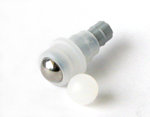
    
    **Ball Caster** : Caster (roue folle) qui est fourni avec deux billes, une métallique, une en plastique, pour s’adapter à la surface utilisée.
    
-   **FLEX-Nx** : Câbles flexibles pour NXT
    -   **Short Length Flexi-Cables for NXT** : câbles courts
    -   **Custom Cut Flexi-Cables for NXT** : câbles à la demande
-   **NXT Compatible (male) Plugs** - 10 pack ou 100 pack : connecteurs mâles permettant de créer des câbles sur mesure.
-   **NXT Compatible (female) Sockets** - 5 pack ou 110 pack : connecteurs femelles permettant de créer ses propres interfaces/capteurs.

## Codatex

[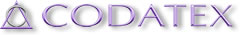](http://www.codatex.com/)

-   **RFID Sensor** : Kit qui contient un capteur RFID, et deux transpondeurs, ce qui permet, entre autre, de donner des ordres au robot ou de lui donner des repères dans un local. Un kit additionnel permet de commander 10 transpondeurs supplémentaires, élargissant le spectre des possibilités.

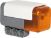

## Vernier

[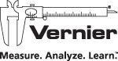](http://www.vernier.com/nxt/)

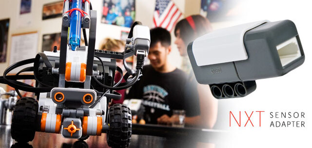

-   **NXT Sensor Adapter** : Interface permettant de connecter au NXT les capteurs de la gamme Vernier, acteur bien connu de l’éducation et de la mesure industrielle. A titre d’exemple, voici la liste des capteurs compatibles :
    -   Accéléromètres (±25g et ±5g)
    -   Baromètre (0.8 à 1.05 atm)
    -   Voltmètre (±0.5V, ±2V, ±10V)
    -   Colorimètre
    -   Sonde de conductivité
    -   Sonde de courant (±0.6 A)
    -   Sonde de tension différentielle (±6V)
    -   Capteur d’oxygène dissous
    -   Capteur de force linéaire (±10N, ±50N)
    -   Amplificateur d’électrode (pH)
    -   Sonde de température déportée (30m, -50°C à 150°C)
    -   Sonde de température renforcée (-40 à 135°C)
    -   Capteur de température de surface rapide (-25 à 125°C)
    -   Débitmètre
    -   Balance
    -   Capteur de pression gazeuse
    -   Dynamomètre
    -   Amplificateur d’instrumentation a gain réglable
    -   Capteur de lumière
    -   Capteur de champs magnétiques
    -   Capteur de teneur en oxygène de l’air
    -   Sonde rédox (-450 à +1100 mV)
    -   Sonde ph (0 à 14)
    -   Capteur d’humidité de l’air(0 à 95% (± 5%))
    -   Capteur de salinité de l’eau (0 à 50 ppt)
    -   Capteur de teneur en eau /porosité (0 à 45%)
    -   Sonomètre (35dB à 90 dB, 75dB à 130 dB)
    -   Thermocouple type-K (-200 à 1400˚C)
    -   Capteur de turbidité de l’eau
    -   Capteur UVA
    -   Capteur UVB

## LEGO Education

-   **NXT Temperature Sensor** : Le nouveau capteur de température corrige les défauts de l’ancienne version, à savoir :

-   -   Interface I2C, sans artefact de mesure,
    -   un câble long de 50cm, scellé au capteur, pour éviter les problèmes du à la proximité de liquides,
    -   Sonde de température en métal, étanche et blindée, autorisant l’immersion de la sonde (pas du capteur...)
    -   Meilleure résolution (12 bits), donnant une résolution maxi de 0,0625°C,
    -   Meilleure plage de mesure (-40 à 125 °C, mais LEGO recommande -20 à 110 °C), permettant de mesurer la température de l’eau bouillante.

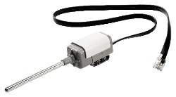

## POB Technology

-   **Dual-POB** : La Dual-POB est une carte équipée de différents connecteurs permettant la construction d’un robot avec des matériels qui ne sont pas toujours compatibles entre eux, par exemple : la brique NXT de LEGO et des servomoteurs standards. POB fournit les blocks Mindstorms pour utiliser toutes les possibilités d’Entrées/Sorties de la Dual-POB avec le NXT.

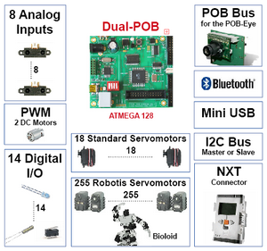

-   **POB-Bridge** : La POB-Bridge est une carte dédiée au Mindstorm NXT de LEGO. Elle permet de faire un pont robotique entre votre Mindstorm NXT LEGO et votre matériel robotique (capteurs, leds, POB-Eye). POB fournit les blocs Mindstorms pour utiliser toutes les possibilités d’Entrées/Sorties de la POB-Bridge avec le NXT. La POB-Bridge vous permet de :
    -   Faire l’acquisition d’une valeur analogique sur 5 entrées.
    -   Avoir 8 Entrées/Sorties numériques.
    -   Communiquer avec le Port Série.
    -   Connecter un POB-Eye pour reconnaître des formes.

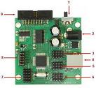

1.  Interrupteur Général
2.  Connecteur d’alimentation (6V to 12 V)
3.  4 Entrées/Sorties Numériques (5V TTL)
4.  Connecteur NXT
5.  4 Entrées/Sorties Numériques (5V TTL)
6.  Port Série
7.  5 Entrées analogiques
8.  Connecteur de programmation ICD2 Microship
9.  Connecteur POB-Eye

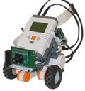

-   **POB-Eye II** : Cette carte embarque une caméra CMOS avec un micro-contrôleur 60MHz programmable, ce qui vous autorise à créer vos propres algorithmes de vision. Des primitives de reconnaissance de forme sont présentes en natives, et accessible en C, C++, Java, Basic et RISBEE (langage dédié).

Attention, l’utilisation de Pob-Eye II nécessite l’usage d’une des cartes Dual-POB ou POB-Bridge.

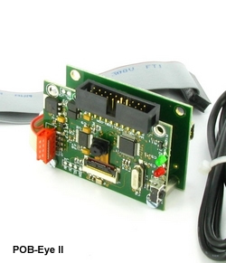

## techno-stuff

-   **NXT air pressure sensor** : Capteur de pression adaptable au système LEGO pneumatique
-   **NXT Motion sensor** : Capteur de mouvement capable de déceler humains et animaux.
-   **NXT IR Flame sensor** : Capteur Infrarouge capable de détecter une bougie, ou toute autre source infrarouge.
-   **UV Flame sensor\*** : Capteur Ultraviolet capable de détecter une bougie, y compris dans une pièce violemment illuminée (ce que ne peut faire le capteur précédent).
-   **Force sensor\*** : Capteur de pression, mesurant la force avec laquelle vous appuyez sur le bouton.
-   **Relay\*** : Interface prenant la place d’un moteur, et activant deux relais 2A/48V permettant de commander toute sorte de dispositifs, tels des pompes d’aquarium, des moteurs (en tout ou rien), des systèmes domotiques, des aiguillages de train, des lampes, etc...

\* Ces capteurs nécessitent un câble [adaptateur NXT-RCX](http://www.techno-stuff.com/Conversion.htm), vendu par LEGO par lot de 3, ou par techno-stuff à l’unité.

## Roues holonomiques

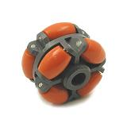

Ce sont des roues qui ont deux degrés de liberté, dans le sens de la marche (tourne autour de son axe, normal), et autour du "pneu" (comme si elle était en permanence sur la glace). Une petite [explication sur ces roues bizarres](http://sitecv.free.fr/holonome/holonome.htm), et une [autre](http://crap.gforge.inria.fr/wiki/doku.php?id=robotholo).

Ces roues font de très bonnes roues folles, ceux qui veulent se lancer dans la création de robots holonomes, vont devoir faire quelques [maths](http://www.planete-sciences.org/forums/viewtopic.php?f=5&t=13583)

-   **R76-4CM-ROLLER** : roue holonomes produite par [acroname](http://www.acroname.com/robotics/parts/R76-4CM-ROLLER.html), disponibles en pack de 3 ou à l’unité (cf photo), et en différents diamètres. Nécessite le collage d’une pièce LEGO pour interfacer.
-   **holonomicwheel** : roue holonome intégrant une forme dédiée aux LEGO, elle est produite par [holonomicwheel](http://www.holonomicwheel.com/).
