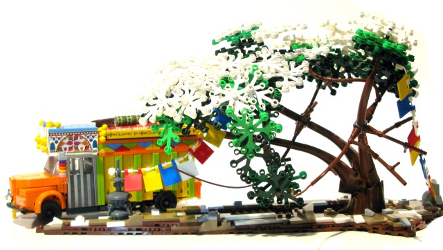
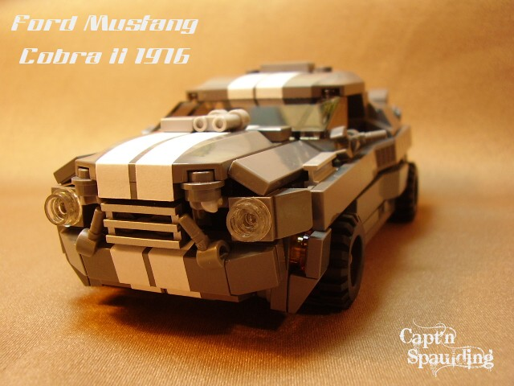
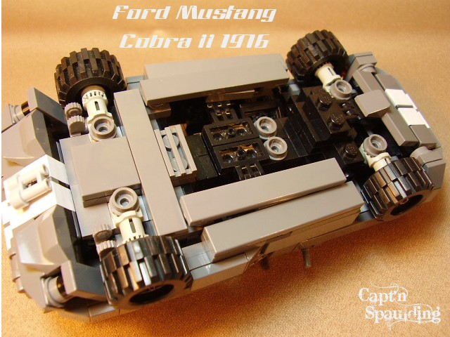
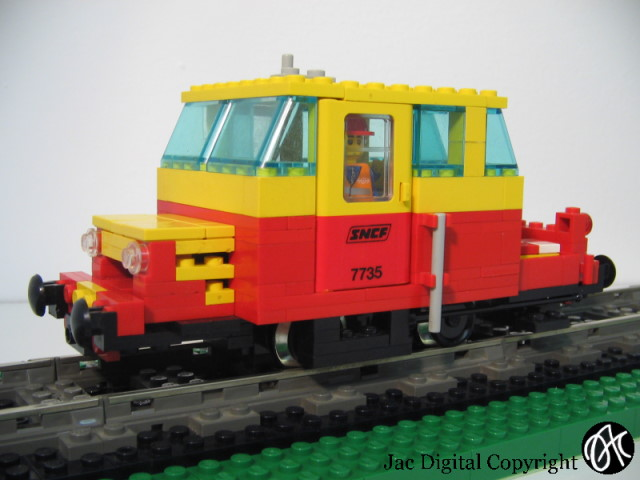

Lorsqu’on construit un modèle, on a le choix : se rapprocher au plus près de la réalité ou garder la jouabilité.

Un passionné de la construction avec des briques dans tout les sens (le SNOT), [Jordan Schwartz](http://www.brickstud.com/) a choisi pour thème les camions de l’Himalaya. Ils sont particuliers car très colorés, très haut, avec beaucoup de décorations qui correspondent à chaque chauffeur. La revue de cette création est parue dans le Brickjournal numéro 12.

**Diorama de Jordan SCHWARTZ**

Le rendu final est fabuleux. Le véhicule est placé devant un arbre, comme s’il était garé en bordure de route et le conducteur est descendu. Comme je vous le dis, c’est magnifique. Le camion est rutilant de peinture criarde. L’aspect joufflu du capot avant, bien particulier des Tata du coin est là. La haute benne de chargement est surmontée de couvertures et tissus.

Mais voilà, ce n’est plus jouable. Rien que pour prendre une photo il faut manipuler le modèle avec précaution. On voit d’ailleurs sur l’une d’elle une roue qui n’est pas bien remise en place. C’est donc une construction qui va prendre place sous une vitrine et que l’on se contentera de toucher avec les yeux, en essayant de trouver comment tel ou tel montage a été utilisé pour réaliser certaines parties.

C’est la reproduction fidèle d’un modèle réel. J’ai choisi un camion pour exemple, mais la diversité des thèmes est illimitée bien sûr. Pour exemple, cette magnifique Ford Mustang, construite par Captain Spaulding (Brickpirate)

**Muscle-car de CaptainSpaulding, photo de face**

**Muscle-car de CaptainSpaulding, vue de dessous**

Avantages :

-   Rendu excellent, très proche de la réalité. C’est du grand art quand c’est bien fait ;
-   On utilise des techniques de construction très innovantes. Parfois des pièces sont à peine coincées entre d’autres.

Inconvénients :

-   Pas de jouabilité, porte non fonctionnelle, pour exemple ;
-   Modèles très fragile ;
-   Volume des briques important suivant les montages ;
-   Créations très difficiles ;
-   Il est très difficile d’en faire une notice.

* * *

L’autre manière de construire n’est pas forcément plus simple, car pour arriver au résultat souhaité il faudra autant se creuser la tête pour placer les portes, des trappes, les roues ou quoi que ce soit d’autre qui permette la jouabilité d’un modèle.

Que ce soit pour du train, des véhicules des vaisseaux ou toute autre chose diverse, c’est une technique de construction qui peut paraître un peu vieillotte, au regard de ce qui se fait actuellement, mais qui tient la route !

D’ailleurs si on contemple le catalogue LEGO actuel, on trouve encore des modèles construits de cette manière, en "empilage de briques", mais avec des accès pour la jouabilité. Sans parler forcément des maisons qui n’ont pas de fond, mais des véhicules avec chauffeur, des bateaux avec pilote...

Vu que c’est ma manière de construire, je vais prendre un de mes modèles pour exemple. C’est une construction connue dont la notice figure dans le magasine [RAILBRICKS](http://railbricks.com/index.php) numéro 07. Si on veut rester fidèle à la réalité, les portes de cette petite draisine sont beaucoup moins large. Mais là n’est pas la vraie question dans ce type de construction.

**Ma draisine DU65**

J’ai pris ma petite draisine comme exemple pour montrer le montage des portes. Mais on peut en trouver des tas, de ce type encore.

Avantages :

-   Jouabilité ;
-   Les minifigs ont de la place ;
-   Accès facilité à certaines partie d’un modèle.

Inconvénients :

-   Modèles mal finis : certaines maisons sont trouées, pour exemple ;
-   Utilisation fréquente de "métapièces" ;
-   Utilisation plus importante des autocollants.

J’ai fait cet article juste pour expliquer et comparer, puis aussi parce que cela m’a amusé de le faire. Il existe autant de manière de construire que de type de pièces LEGO. Et heureusement, car notre imagination est libre et sans limite...

Choisis ton camp, l’Afol !
