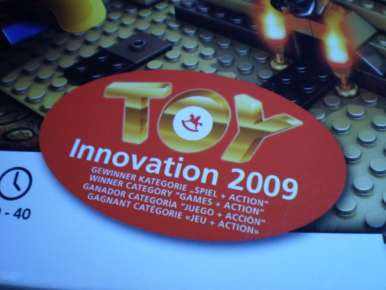
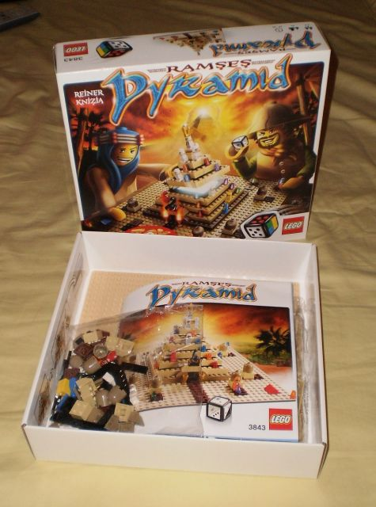
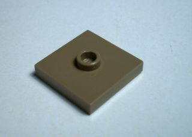
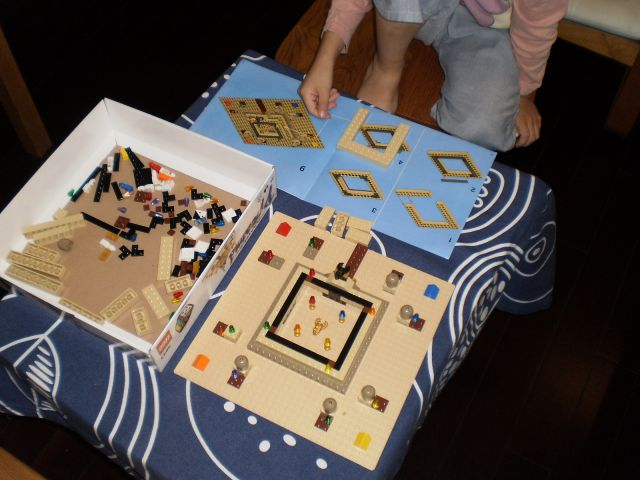
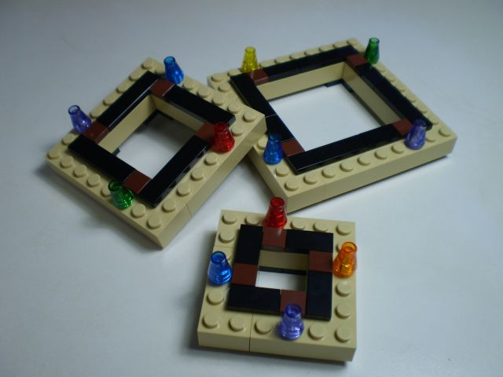
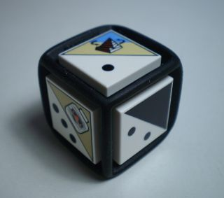
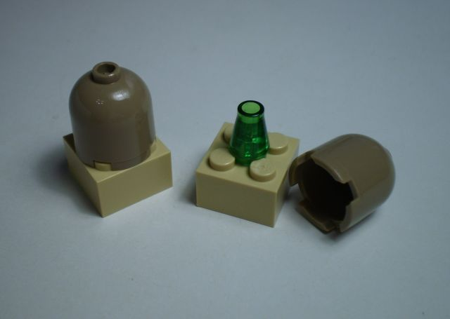
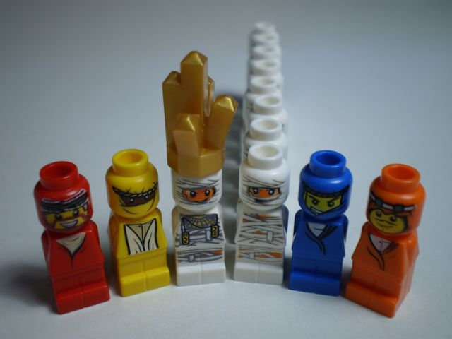

Et voici que la revue des dix jeux de société LEGO approche de la fin. Aujourd’hui je vais vous parler de l’avant dernier jeu de la collection, le dernier étant le Creationary (le Pictionary version LEGO) qui n’est pas vraiment nouveau puisque d’autres versions ont existé auparavant.

Revenons donc à Ramses Pyramid qui arbore fièrement sa récompense "TOY innovation 2009" dans un ovale rouge. Cette récompense est donc très prometteuse pour l’intérêt de ce jeu, et à vrai dire, c’est la raison pour laquelle je l’ai testé en dernier (enfin tout de même avant le Creationary bien sûr).

**Le logo de la récompense.**

L’ouverture de la boîte ne révèle rien de particulier à part bien sûr le retour de la plaque de base 32x32 en Tan.

**Ouverture de la boîte**

Pour ce qui est des nouvelles pièces, on remarquera aussi la Tile 2x2 avec un tenon central en Dark Tan.

**Nouvelle pièce !!**

On pourrait se demander la raison de cette nouvelle pièce, mais en fait, elle est totalement justifiée. En effet le jeu requière de bouger fréquemment ce que la notice appelle les "temples secrets". En fait il s’agit d’une brique 2x2 surmontée d’un dôme. Pour pouvoir les bouger facilement, il est préférable qu’ils ne soient tenus que par un seul tenon, d’où la base faite d’une tile 2x2 avec un tenon central. Cette nouvelle pièce fera le bonheur des MOCeurs, et espérons la voir apparaître rapidement dans d’autres couleurs.

La construction de la pyramide a donné un peu de fil à retordre à ma fille (comme les vraies pyramides dont la construction reste assez mystérieuse !), car il s’agit de construire des carrés avec 4 pièces identiques à chaque fois.

**Construction de la pyramide : aussi difficile que pour les vraies ?**

La pyramide est faite d’un empilement de carrés qui s’emboîtent sans se clipser sur des tenons. La raison est que la pyramide peut tourner durant la partie, donc son maniement doit être aisé. Notez aussi la présence des tiles 1x1 marron qui sont en fait juste des marqueurs pour placer les cônes transparents.

**Éléments de la pyramide**

Qu’en est-il du jeu maintenant ? Et bien oui, je peux dire qu’il mérite sa récompense, même si je le trouve un peu moins bien que [Lunar Command](/articles/995/). Le principe du jeu est assez simple : après un tour de piste autour de la pyramide les joueurs doivent gravir les étages de la pyramide et le premier arrivé au sommet gagne la partie. Un principe de jeu qui n’est pas sans rappeler celui de [Lava Dragon](/articles/978/). Néanmoins cette fois-ci il y a des momies qui descendent de la pyramide pour vous en empêcher. Si une momie atteint le même étage qu’un joueur (sur la même face), le joueur redescend au bas de la pyramide et la momie est retirée du jeu.

Comme dans toutes les boîtes de la gamme, il y a un dé à lancer au début de son tour. Le dé est un des plus décorés de la gamme. Il est fait de tiles 2x2 sérigraphiées comportant deux types d’information : un classique nombre de points pour déplacer son personnage, et un petit dessin représentant les actions spéciales que l’on peut faire.

**Le dé**

Pour déplacer son pion, on lance donc le dé et on le déplace du nombre de points indiqués. Toutefois, pour pouvoir gravir une marche de la pyramide, il faut remplir une de ces deux conditions :  
**–** soit on possède un cône coloré de la même couleur que celui sur la marche que l’on veut gravir ;  
**–** soit on désigne un temple secret, dont on retire le dôme pour montrer la couleur du cône à l’intérieur qui doit bien sûr être de la même couleur que celui sur la marche que l’on veut gravir.

**Les petits "temples secrets"**

Je vous ai dis qu’au début de la partie on faisait un tour de piste autour de la pyramide, et le but de ce petit tour est de collecter des cônes ou bien de regarder secrètement à l’intérieur des temples. Après avoir regardé secrètement ou non un temple il faut aussi le déplacer. Vous l’aurez donc compris, le jeu fait appel à votre mémoire, puisque pour progresser en haut de la pyramide il faut mémoriser l’emplacement des cônes de couleur dans les temples secrets qui n’arrêtent pas de bouger !

Pour ce qui est des actions spéciales indiquées par le dé, elles sont au nombre de trois :  
**–** la tête de momie fait descendre une nouvelle momie d’un étage, plus toutes les autres déjà engagées ;  
**–** la face noire permet le vol d’un cône chez un autre joueur ;  
**–** la pyramide permet de faire tourner la pyramide d’autant que l’on veut mais à partir d’un seul étage.

La rotation de la pyramide est une action redoutable, car elle permet d’éloigner une momie qui était sur la marche juste au dessus de son pion, ou bien d’amener une marche avec un cône dont on possède la couleur ou dont on connait l’emplacement dans un des temples secrets.

**Photo de famille**

Les règles alternatives proposent de jouer en mode coopératif. Un des joueurs doit atteindre le sommet de la pyramide avant que les huit momies n’aient atteint le bas de la pyramide. Il s’agit donc d’une course d’évitement où les joueurs vont dans le sens inverse des momies tout en cherchant à les éviter. Et croyez-moi les momies ont tendance à descendre vite, si bien que dans la majorité des cas, les joueurs n’arrivent pas à avancer avant que toutes les momies soient passées. En mode coopératif en revanche il devient sans doute plus facile d’atteindre le sommet. Par exemple si un joueur obtient le symbole de la pyramide au dé, il va cette fois-ci retirer les momies en face du pion le plus haut, donc il va aider l’autre joueur plutôt que d’essayer de l’handicaper.

## Mon Impression

Ramses Pyramid est effectivement un bon jeu faisant appel à votre mémoire et le principe de rotation de la pyramide introduit de la stratégie.

Je n’ai tout de fois pas vraiment aimé le tour de piste préalable pour collecter les cônes ou commencer à mémoriser les emplacements (je trouve cela un peu artificiel, on pourrait tout simplement attribuer les cônes au hasard au début de la partie). D’autre part je trouve qu’il y a trop d’éléments, ce qui fait que le principe du jeu est dilué. Par exemple je ne suis pas certain de la nécessité des cônes que l’on peut collecter et voler. A mon avis le jeu aurait gagné en force, s’il se contentait des temples secrets.

Personnellement, j’étais trop fainéant pour mémoriser les temples et suivre leur mouvement, donc j’avais plutôt tendance à grimper la pyramide du coté des cônes dont je possédais la couleur, c’est beaucoup moins fatiguant. Mais si on me retire cette possibilité alors je commencerais vraiment à jouer avec ma mémoire.

A la limite on pourrait même enlever les momies pour épurer encore plus le principe du jeu. Car à mon avis, ce qui fait l’intérêt de ce jeu, c’est la mémorisation des temple et la rotation de la pyramide. Mais, bonne nouvelle ! Comme c’est un jeu LEGO, on peut le personnaliser à souhait et le retrait de certains éléments n’est non seulement pas un problème, mais encore encouragé par la gamme des jeux de société LEGO.

Donc, je ne pourrais faire autrement que de vous recommander ce set !

A bientôt pour le dernier test.
