C’est en petit nombre, à six, que nous nous sommes rendus au LEGO World. Pourtant, avec nos 17 mètres de stand, nous avions une belle surface pour nous exprimer. Preuve qu’avec les années et l’expérience acquise, nous arrivons à nous organiser pour faire toujours plus grand.

Symbole de l’attractivité d’un tel voyage, c’était également le premier LEGO World pour deux d’entre nous, les deux Pierre. Denis est également passé deux jours voir comment se déroulait un tel évènement afin de tâter le terrain pour une éventuelle participation une année prochaine.

Il faut dire que le LEGOWorld, c’est la fête par excellence. Comme on dit, il y a de la brique partout ! Encore plus qu’à la maison !

## Le stand FreeLUG

Notre stand était divisé en trois parties distinctes :  
**–** la gamme Power Miners ;  
**–** une partie ville et train ;  
**–** et une partie médiévale.

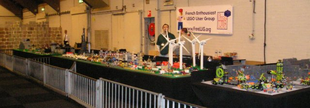

  
**Power Miners**

Seul stand AFOL consacré aux Power Miners, Manu proposait une nouvelle version de sa mine agrandie (et adaptée sur place à cause des tables) pour y accueillir l’ensemble des modèles de la gamme, y compris les combos. Les plus grands succès de son diorama ? Bob l’éponge et Patrick faisant des apparitions ponctuelles et les dernières nouveautés pour lesquelles le public demandait sans cesse où les trouver (visiblement pas encore sorties à ce moment là aux Pays-Bas).

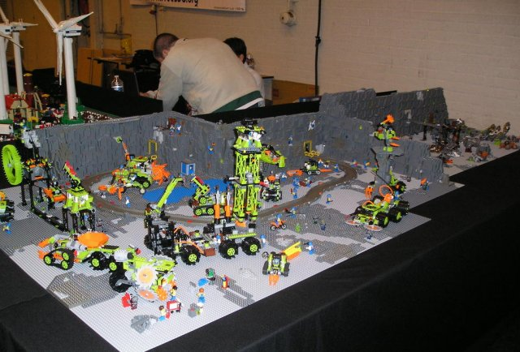

  
**La ville**

Pierre et Jérémy ont réalisé le diorama Ville qui était composé de sets officiels et personnels. Sur la droite, une zone d’éoliennes amenées par PierreC, Erik, Eric et Jérémy et commandées par ordinateur.

Jérémy a apporté quelques bâtiments modulaires (mairie du Town Plan, banque, cinéma du Town Plan),les maisons Creator, le garage, une zone plage avec le crousticrab de Bob et le mur d’escalade. Tout ceci sans oublier deux boucles de rails nous permettant de faire tourner deux trains.

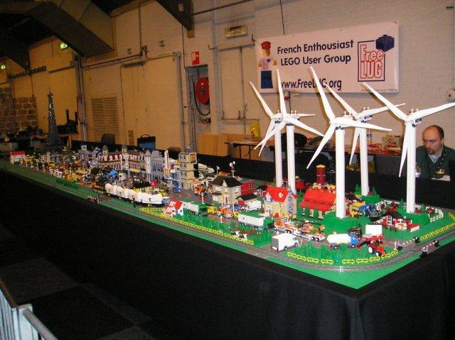

Pierre a, quant à lui, ramené trois Corner Cafe, un Green Grocer avec le Market Street et à la suite de ceci il y avait un bâtiment plus médiéval. En face, une petite place en angle, avec en mitoyen le Medieval Market réagencé... En bout du réseau, la Tour Eiffel, montée (et remontée) sur place, trônait parmi plusieurs touristes. De l’autre côté de la rue, une petite maison vivait sa vie avec son potager...

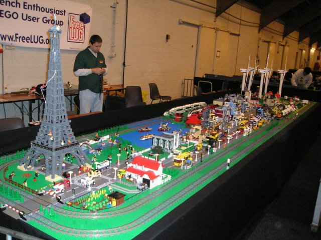

  
**Le Castle**

Eric a exposé une version imaginée ou inspirée de la porte noire de la trilogie du Seigneur des anneaux, présentée à Fanabriques 2009, et complétée avec un module complémentaire où l’on retrouve un autre lieu du livre : le marais des morts. Il y avait aussi deux maisons qui ont rejoint le village médiéval.

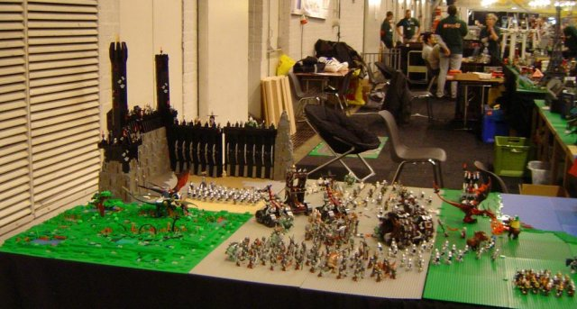

Ensuite, Pierre nous montrait son nouveau château, Quéribus, reproduction du vrai château éponyme. Il a été achevé la semaine précédente pour l’[exposition de Montluçon](/articles/1006/).

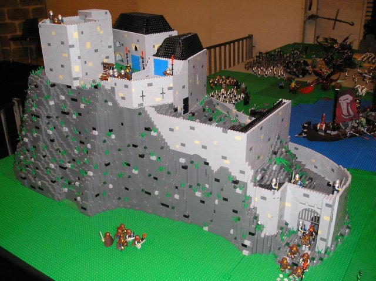

Suivait le village avec plusieurs variantes colorées du marché médiéval et pour lequel Manu a ressorti ses maisons de la [Japan-Expo 2008](/articles/782/).

Enfin, Erik a ressorti de ses cartons le château de Tonquédec, présenté au même endroit il y a six ans ! Mais il a été trop fainéant pour installer toutes ses armées et a simplement placé les orcs sur le champ de bataille devant la porte noire.

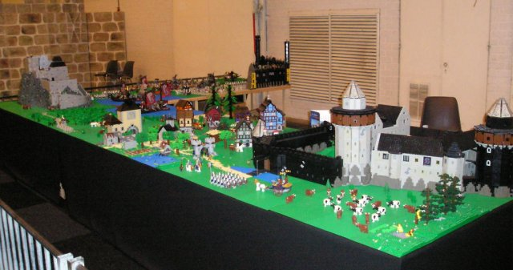

## Les autres stands

Le LEGO World, c’est aussi des rencontres et des échanges avec des membres d’autres LUGs étrangers, comme nos amis de BeLUG que nous connaissons bien mais aussi Sebastiaan "Aliencat" Arts, ambassadeur De Bouwsteen, Harald Roossien, ancien membre FreeLUG et ambassadeur LowLUG, Lluis Gibert, ambassadeur HispaLUG et cofondateur EuroLUG pour n’en citer que quelques-uns, sans oublier les designers LEGO, Mark et bien sûr Pierre qui a tenté de nous faire la surprise de sa présence, et aussi tous ceux que nous rencontrons au LEGO World depuis plusieurs années.

Alors tout ce petit monde, ça donne forcément plein de stands. Quelques photos en vrac plutôt qu’un long discours.

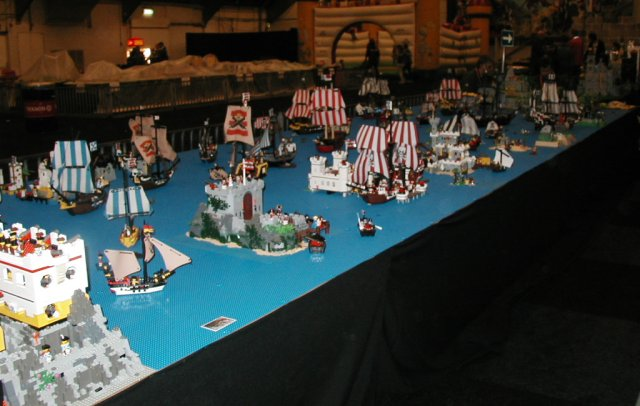

**Le stand BeLUG**

Grand diorama Pirates et Castle.  
Préparons les catapultes pour l’année prochaine !

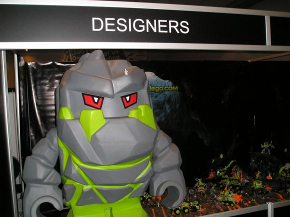

**Stand designers**

Présentation des PowerMiners, Space Police, Bionicle, et figurines ToyStory et Prince of Persia

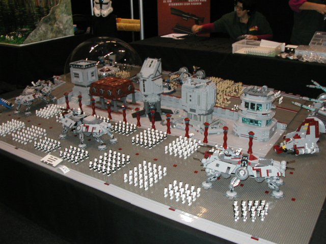

**StarWars**

Incontournable...

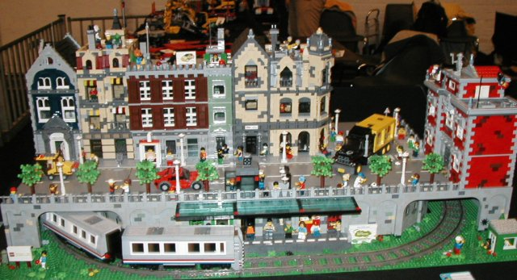

**Diorama d’Aliencat**

Sur le stand voisin au notre.

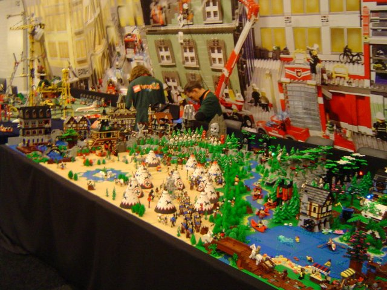

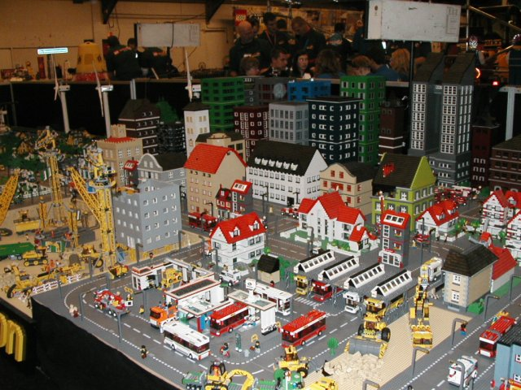

## Les activités

Six jours, cela peut paraitre long, pourtant il n’y a pas de quoi s’ennuyer.

Outre la tenue du stand et les rares contacts avec le public-qui-ne-parle-pas-français (meneer !), nous passions notre temps à arpenter les allées et plus précisément les espaces de vente.

Cela commençait avec les tentes LEGO où du vrac était proposé à 8 centimes le gramme. Cher, mais il faut surveiller régulièrement pour tomber sur les bonnes affaires, comme les pièces de l’Emerald Night train ou mieux encore à une heure de la fin du salon, des pompes et pistons pneumatiques.

LEGO proposait également des sachets de briques à 3 euro : burps, panels, vitres, etc. ainsi qu’un stand de goodies, et une boutique proposant les exclusivités du s@h sur lesquelles les exposants avaient droit à 15% de réduction.

Enfin, un hall dédié à la vente regroupait de nombreux revendeurs de pièces détachées et de sets d’occasion.

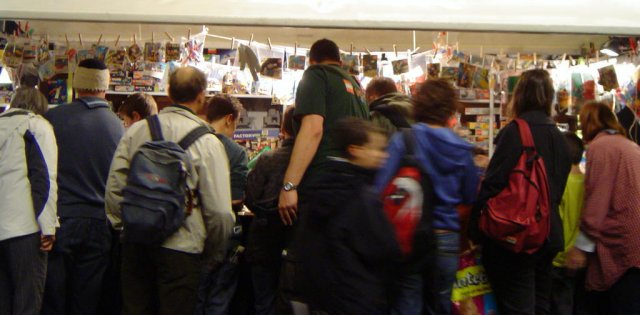

**Stand de vente**

Difficile d’accéder aux étalages en plein affluence !

Les plus courageux pouvaient assister aux concerts des starlettes locales.

Vendredi soir, des ventes spéciales étaient proposées à l’Intertoys (5% de réduction supplémentaire pour les exposants, sur le tarif déjà réduit), nouvel assortiment de sachets de briques, boîtes soldées et enfin des enchères de caisses de vrac de 20 kilos contenant des retours clients ou boîtes explosées. Grosse effervescence, surtout par la multiplicité des points de vente : nous ne savions plus où prendre de la brique !

Le même soir après le repas commun, était organisé un concours de construction où l’objectif était de reproduire le portrait de Jorgen Vig Knudstorp, CEO de LEGO, à partir de la [boîte 5585](http://www.brickset.com/detail/?Set=5585-1).

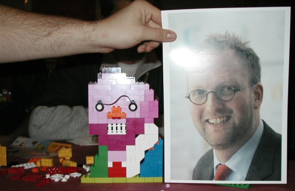

Samedi soir, nous avions droit à une présentation (en néerlandais...) marketing par une représentante de LEGO Benelux.

Au chalet, nous occupions le reste de nos soirées autour de quelques bouteilles et des jeux de société Minotaurus et Ramses Pyramid.

## Dans les bagages

Cette année, le package exposant contenait :  
**–** un calendrier de l’avent (au choix entre le pirate et le city) ;  
**–** une brique gravée 1x8 LEGO World 2009 ;  
**–** une plaque avec six tiles 2x2 spéciales LEGO World (En réalité 7 Tiles 2x2 suite à une erreur de dates ;-)) ;  
**–** un porte monnaie avec le logo LEGO World ;  
**–** un CD audio LEGO World Hits ;  
**–** le goodiebag distribué à la sortie contenant biscuit, bonbons (le tout immangeable) et le [sachet City 5627](http://brickset.com/detail/?Set=5627-1).

Une loterie a désigné un gagnant parmi les participants étant restés les six jours, et c’est Manu qui repart avec le Faucon Millenium UCS !

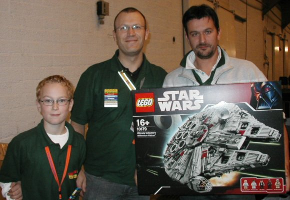

Côté achat, en plus des boîtes et quelques kilos de vrac, quelques goodies sont venus s’ajouter.

Nous avons également récupéré auprès du service consommateur LEGO qui tenait un stand deux cartons de posters LEGO StarWars que nous pourrons distribuer lors de nos prochains évènements.

## L’organisation

Un voyage de huit jours ne s’improvise pas. Forts de notre expérience de cinq LEGO World, nous connaissons bien les besoins.

Pour le transport, nous avons opté cette fois-ci pour la location d’une camionnette pour tout le matériel. Nous nous sommes donc répartis entre une voiture et le camion, le rendez-vous étant donné sur la région parisienne, permettant aux plus lointains de faire le trajet en deux jours et ainsi se reposer.

La veille du départ, nous avons réalisé quelques courses pour nous fournir en petits-déjeuners et éventuels repas du soir, pour contrer la nourriture hollandaise que nous supportons parfois mal, surtout sur une longue période...  
A retenir, plus de saucissons et de bouteilles, mais moins de petits déjeuners et beaucoup moins de pâtes :)

Les 12 mètres cube n’ont pas été de trop, particulièrement au retour que nous savons toujours beaucoup plus chargé que l’aller, la cause aux nombreux achats.

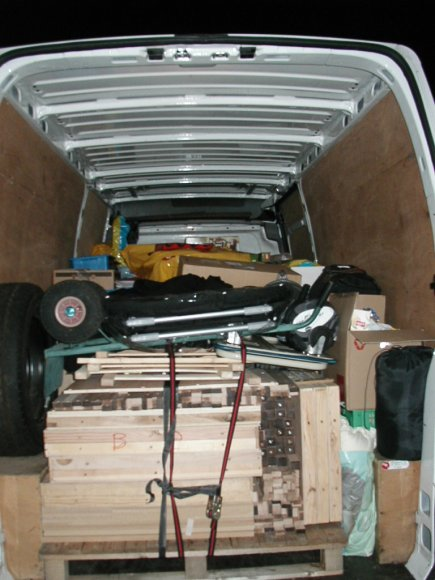

Sur place, nous avons profité de la navette mise à disposition matin et soir pour faire le trajet entre le hall d’exposition et le parc des chalets. L’occasion de faire plus ample connaissance avec d’autres Afols dans une promiscuité toute relative...

Nous avons également choisi de prendre l’ensemble des diners sur place afin de profiter des activités proposées. Cela nous évitait également la contrainte de prendre du temps à cuisiner et nous véhiculer par nous mêmes. Et il aurait été dommage de rater le buffet à volonté (bière comprise) chez Billy’s.

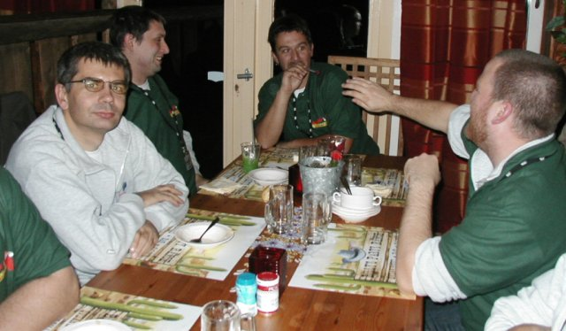

Côté hébergement, à six, nous occupions un chalet complet. La nuit supplémentaire est appréciable pour rentrer de jour, l’esprit à peu près reposé.

Côté matériel, nous avions prévu nos propres tables pour la partie Castle. En arrivant, les tables pour les trois dioramas étaient déjà installées, avec les nappes. Nous avons donc remplacé les tables de la partie Castle qui n’étaient pas très bonnes par les nôtres. Or nos tables provenaient de diverses personnes et étaient de différentes fabrications ! Et inexorablement certaines incompatibilités se sont présentées :  
**–** des trous de fixation entres tables pas toujours aux même endroits ;  
**–** des repérages d’éléments qui n’étaient que partiels ;  
**–** de la visserie différentes (donc pas les mêmes clés pour le montage) ;  
**–** des vis un peu courtes pour certains assemblages ;  
**–** aussi quelques différences de niveau qui ont fait des décalages de plusieurs millimètres (le sol n’était peut être pas aussi plat qu’il pouvait y paraitre).

Les fauteuils et le matelas glissé sous une table ont été appréciés. Comme pour toutes expositions, ne pas oublier les rallonges et multiprises.

Dans les détails divers, nous noterons :  
**–** un besoin de traduction des bulletins d’informations journaliers De Bouwsteen en anglais ou français, même si c’est de la traduction automatique. Heureusement que nos amis belges nous aidaient pour nous informer de l’essentiel.  
**–** l’absence de Jean-Louis ! Nous avons tout de même souhaité un bon anniversaire à Aurélia :)  
**–** une certaine discrétion de Jan Beyer qui n’est resté que quelques jours au salon, a-t-il fait une petite visite de notre stand ?  
**–** les 2 kg de pâtes pour 6 c’était beaucoup :) Merci à Manu notre cuisinier d’un soir !  
**–** la visite de Melody et Pierre au salon  
**–** prévoir des dictionnaires pour éviter la barrière de la langue lors des longues mais trop courtes soirées au chalet...

## Galeries photos

**–** [Galerie d’Erik](http://photos.freelug.org/main.php/v/brickerik/expositions/2009/LW2009/)  
**–** [Galerie d’Eric](http://photos.freelug.org/main.php/v/f1tvf/expositions/lw2009/)  
**–** [Galerie de PierreL](http://photos.freelug.org/main.php/v/pierrel/exposition/2009/LEGOWorld+2009/)

## Epilogue

Comme si six jours de LEGO à plein temps ne suffisaient pas, nous avons fait une halte sur le chemin du retour au [Picwic de Lomme qui organisait avec LEGO 4 jours de fête](http://photos.freelug.org/main.php/v/f1tvf/expositions/lomme/). Et voilà encore quelques achats supplémentaires...

Nous avons également planifié en route l’heure d’arrivée afin que Gilles puisse récupérer les tables pour l’exposition de la Ville du Bois. Fort heureusement, car le pauvre Jérémy n’avait plus la place dans sa voiture pour tout reprendre.

Le camion a été rendu dans la foulée, avec un petit dépassement du forfait kilométrique de quelques 66 kilomètres.

Bref, une organisation impeccable et rodée qui nous a permis de vivre cette semaine sans le moindre accroc.

L’année prochaine, ce sont les 10 ans du LEGOWorld, nous sommes attendus !
