Sortie en 2009, cette boîte est un véritable complément pour toute ville, puisqu’on quitte les traditionnels pompiers ou policiers pour boutique, restaurant et transport en commun.

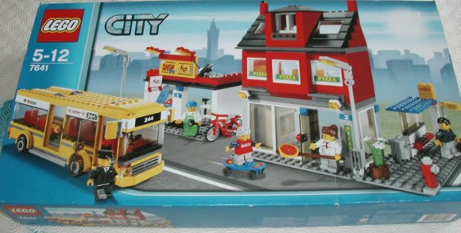

**–** Référence : 7641  
**–** Nom : La ville  
**–** Nombre de pièces : 483  
**–** Prix : [54,90 euro sur le s@h](http://shop.lego.com/ByTheme/Product.aspx?p=7641&cn=356&d=9)

## Le contenu

La boîte contient cinq sachets numérotés, un sachet avec les grandes plaques, deux notices et une planche d’autocollants (ici un peu pliée, mais surement dû au grand voyage de la boîte qui est passée par Montluçon, la Normandie et enfin les Pays-Bas avant d’arriver chez moi).

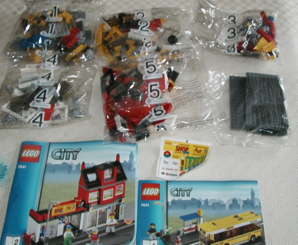

## L’arrêt de bus et le bus

Les deux premiers sachets (et la première notice) permettent de construire le bus et l’arrêt.

L’abri bus est plutôt simple, avec ses quelques accessoires : banc intégré au mobilier urbain, lampadaire, poubelle, pot de fleur, poteau avec pancarte.

On regrette l’absence d’un second autocollant pour les deux côtés de l’enseigne.

Le montage du bus se fait sans problème. Le designer a eu la sagesse d’y introduire un détrompeur en couleur (bleu/rouge) pour distinguer avant et arrière, le modèle devant être régulièrement tourné durant le montage des premières étapes. Allez, mais c’est bien pour chipoter, la convention _bleu à l’avant - rouge à l’arrière_ des aimants des trains des années 70 n’a pas été respectée :)

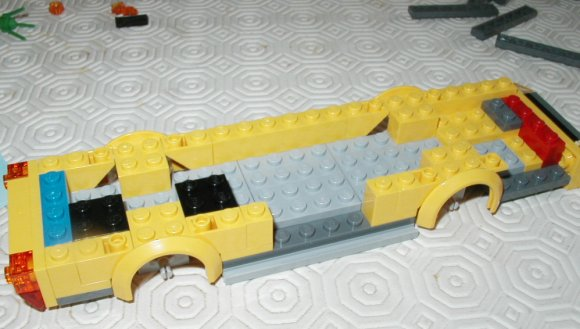

**Des détrompeurs en couleur**

L’utilisation des panels et le nouveau pare brise plat procurent une sensation de luminosité, propre à la génération des bus actuels entièrement vitrés. Il peut emporter jusqu’à 5 passagers assis. Je n’ai pas testé le bus en heure de pointe pour compter le nombre de minifigs qu’il peut embarquer debout.

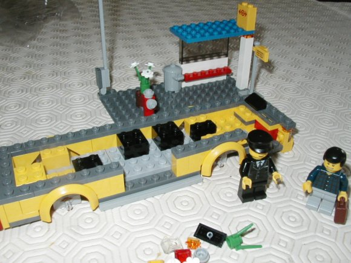

**A la fin du premier sachet**

Les portes battantes sont le seul vrai reproche que l’on pourrait faire.

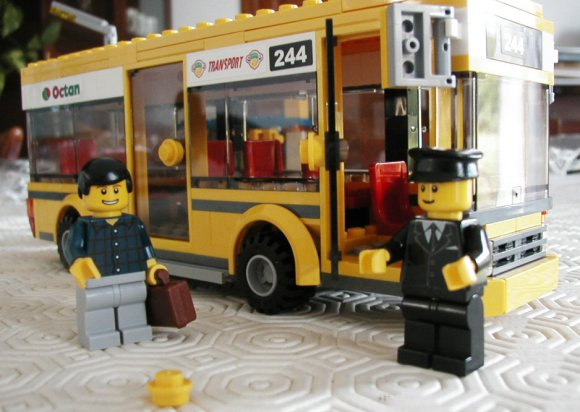

## La boutique de cycles

De petite taille, cette boutique se décompose en un espace vente et un espace atelier. Et elle traite aussi les planches à roulettes !

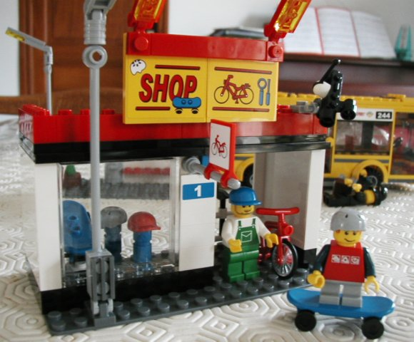

## La pizzeria

Intégrée dans un petit bâtiment, la pizzeria propose cuisine au rez-de-chaussée et salle à l’étage.

Le mécanisme pour l’ouverture du four à pizza est ingénieux mais hélas ne fonctionne pas très bien.

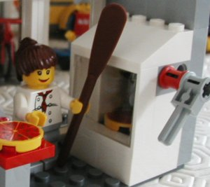

Baies vitrées, fenêtres, briques de toit, tous les éléments sont présents pour en faire toute sorte de bâtiments "civils".

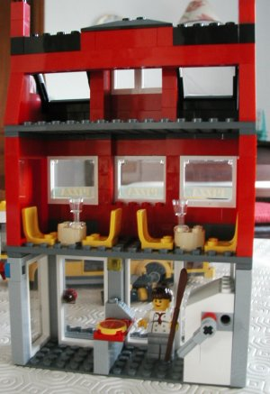

## Trois boîtes en une

Comme annoncé en titre, à la vue de l’historique de la gamme Ville de LEGO, nous pouvons dire que cette boîte reprend trois modèles sortis par le passé :  
**–** [l’arrêt de bus 379 de 1979](http://www.brickset.com/detail/?set=379-1)  
**–** [le centre moto 6699 de 1987](http://www.brickset.com/detail/?set=6699-1)  
**–** [la pizzeria Pizza Mamma 6350 de 1994](http://www.brickset.com/detail/?set=6350-1)

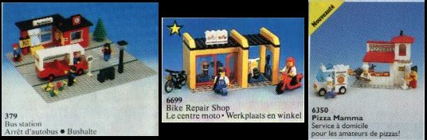

Petite comparaison de l’ensemble.

**Bus et arrêt de bus**

Bon, commençons tout de suite par poser les repères : 30 ans séparent les deux boîtes. Mais ce sont trente années sans bus dans la gamme City. On a bien eu [quelques cars pour équipes de foot en 2000](http://www.brickset.com/search/?query=3404-3407) mais rien dédié au transport public, si on fait exception du très particulier [Magicobus de la gamme Harry Potter](http://www.brickset.com/detail/?Set=4755-1), dédié au _transport d’urgence pour sorcières et sorciers en perdition_.

Alors forcément, on ne cherchera pas à comparer les deux. Si le 379 a tout le charme de la gamme LEGOLAND de l’époque, il proposait une vraie station de bus plutôt qu’un simple abri (abri pouvant compléter le [Triffouillis](http://photos.freelug.org/main.php/v/FreeLUG/Triffouillis/Abribus/)) avec les accessoires indispensables (horloge, tableau d’horaires et même panneau routier), tous manquants à son successeur.

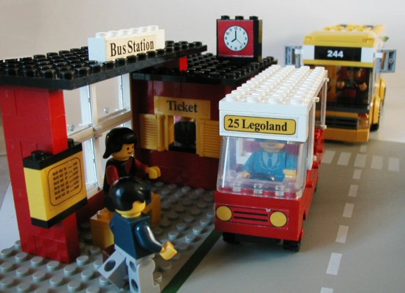

**Hum, je vais peut être attendre le suivant...**

Le style des lampadaires a évolué, quittant celui des années 80 pour un nouveau qui semble perdurer pour 2010 avec le [réparateur 3179](http://www.brickset.com/detail/?Set=3179-1).

Pour les grincheux des autocollants, dîtes vous qu’il y a 30 ans, on en collait déjà ! Les nouveaux tiendront-ils aussi longtemps ?

**La boutique de cycles**

Plus récente, la boutique de cycles n’a que 22 ans... Et à vrai dire, on y trouvait aussi des motos.

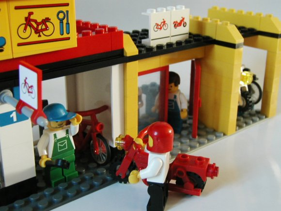

**Pour réparer les vieilleries, allez voir mon voisin.**

Dans le 7641, visiblement, le public visé est plus jeune, avec les planches à roulettes. On apprécie l’esprit visiblement partagé des deux boutiques/ateliers de réparation, allant jusqu’au logo du cyle quasi à l’identique. En même temps, il n’y a pas tellement de façon de représenter un vélo LEGO. On reprochera toutefois aux graphistes de ne pas avoir mis le dessin du vélo dans le même sens.

**La pizzeria**

Dans la gamme Ville, LEGO ne nous jamais trop gâté non plus côté restaurant. En pizzeria, nous avons la 6350 (également [rééditée en 2002 en Legend](http://www.brickset.com/detail/?Set=10036-1).

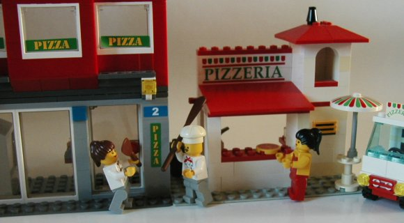

**De toute façon, mes pizzas sont les meilleures !**

Finalement, ce n’est peut-être pas le vieillissement des autocollants qu’il faut craindre, mais le jaunissement des briques :/

## Conclusion

Au final, c’est donc bien 3 boîtes que LEGO nous propose avec le 7641, même si le nombre de minifigs y est inférieur (5 contre un cumulé de 9 pour les 3 boîtes).

Et puis maintenant que LEGO revient avec des sets "civils", qui changent des traditionnels pompiers, policiers et autres services de secours, pourquoi bouder son plaisir ?

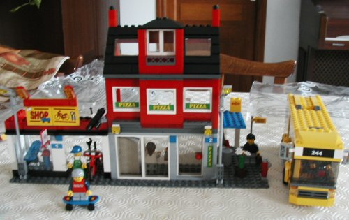

**L’ensemble**

Notez la numération (1,2) des bâtiments.

Un set à acquérir, par deux fois même pour celui qui voudra un bus supplémentaire et des pièces pour construire un petit immeuble de ville.
