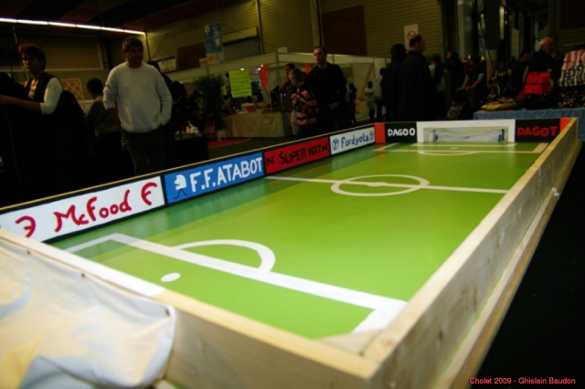
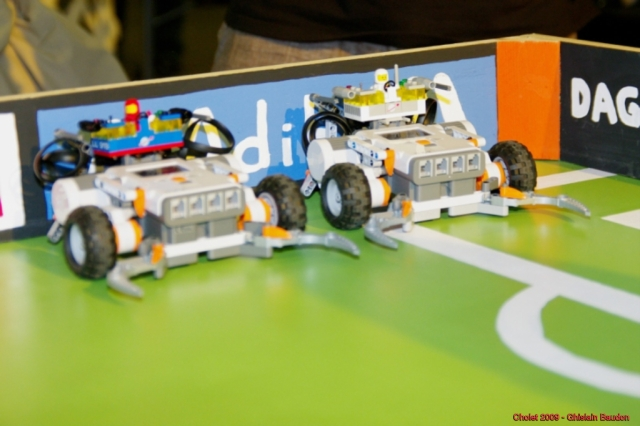
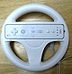
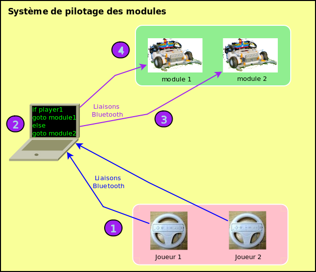

Lors du [weekend du modélisme et du jeu de Cholet](https://www.freelug.org/spip.php?article1022), deux NXT se sont affrontés sur un terrain de foot.

## Principe

Le NXTBall est un ersatz de [TechBall](/articles/862/) auquel il reprend les fondamentaux : deux modules pilotés à distance (les footballeurs) sur une aire limitée (le terrain de foot) doivent pousser une balle Duplo (le ballon) dans des orifices percés dans la bordure (les buts).

Sa pratique nécessite :

-   un terrain identique à celui du TechBall ;
-   deux modules [NXT](http://fr.wikipedia.org/wiki/Lego_Mindstorms_NXT) ;
-   deux [télécommandes Wiimote](http://fr.wikipedia.org/wiki/Wiimote) ;
-   un ordinateur compatible Bluetooth.

## Le Terrain

Les caractéristiques sont les mêmes que celle du TechBall. On y a juste ajouté un peu d’herbe pour faire plus réaliste.

**Le terrain de foot en bois**

## Les Modules

Les modules sont construits autour du NXT, sans beaucoup se préoccuper des contraintes de taille dans cette première version.

**Les 2 footballeurs**

Les deux modules sont construits avec les éléments des boîtes [8527](http://www.peeron.com/inv/sets/8527-1) et [8547](http://www.peeron.com/inv/sets/8547-1), sauf pour les postes de pilotage qui sont des rescapés des boîtes [Space Classic](http://www.peeron.com/inv/theme/LEGO/SYSTEM/Space/Classic) de mon enfance.

**Instructions - module**

**Instructions - cabine de pilotage**

**Instructions - montants des buts**

Les robots sont télécommandés, il n’y a pas de programme embarqué. Il faut juste qu’ils soient visibles d’un point de vue Bluetooth.

## Les télécommandes

La télécommande de la télé n’étant pas disponible, ce sont des [WII-Wheel](http://fr.wikipedia.org/wiki/Mario_Kart_Wii) (Wiimote + volant de Mario Kart) qui sont utilisées :

**La télécommande Wii**

L’accéléromètre a été désactivé, car trop sensible dans la configuration actuelle. Ce sont donc uniquement les touches qui dirigent les modules :

-   touche 1 : avancer
-   touche 2 : reculer
-   touche Up : tourner à gauche
-   touche Down : tourner à droite
-   touche A : arrêt d’urgence

Avec une petite difficulté pour certains : les modules ne tournent pas sur place. Il faut d’abord avancer ou reculer pour pouvoir tourner dans cette version.

## L’ordinateur

Un ordinateur équipé de Bluetooth est indispensable. Son rôle est de faire le lien entre les télécommandes et les modules.

**Principe de fonctionnement**

1.  Les ordres sont émis par les Wiimote suite à des actions du joueur ;
2.  L’ordinateur reçoit les ordres via Bluetooth ;
3.  Un programme informatique les interprète et prépare les commandes correspondantes ;
4.  L’ordinateur envoie les commandes vers les NXT via Bluetooth.

**Le programme informatique**

Il est toujours en cours de développement, mais [une première version est disponible sur la page SourceForge](http://atabot.sourceforge.net/).

Note : il est actuellement uniquement compatible avec [Linux](http://www.ubuntu-fr.org/), mais il devrait prochainement évoluer vers d’autres systèmes d’exploitation.

## Bilan

Malgré quelques imperfections (balle qui se bloque dans les corners, modules un peu gros), le système est jouable et intéresse beaucoup les jeunes (l’effet LEGO ou l’effet WII ?).

Les matchs peuvent rapidement se transformer en combat de sumo avec certains tempéraments belliqueux, mais les modules sont relativement solides. Comme dans les vrais matches, il faut juste un bon arbitre :-)

Enfin, lors du salon, plusieurs personnes ont trouvé dommage que les robots ne marchent pas, sans doute comme dans cette [vidéo](http://www.bldesign.ch/blog/matchdefootderobots). Heureusement, l’espoir demeure, car _En LEGO Tout Est Possible_...
