Quand nous créons nos modèles, nous représentons LE monde (réel) ou UN monde (imaginaire). Ce qui va nous intéresser ici n’est pas la modélisation des formes et fonctions mais la représentation des matières, universelles, comme le bois, la pierre ou le métal.

Hérésie.

C’est un commentaire que cette création a reçu à propos de l’effet "bois".

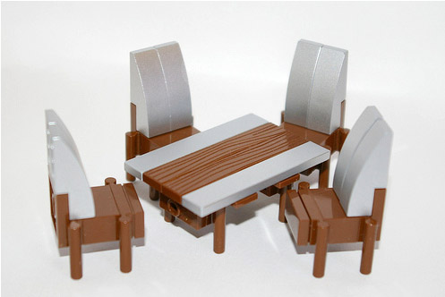

**wood & metal patio set par d-higdon**

En effet, représenter du bois avec du plastique n’est pas, a priori, une évidence. Mais nous y sommes accoutumés.

Alors comment représentons-nous les matières avec les pièces LEGO ? Comment certaines créations arrivent-elles à donner aussi bien l’illusion de la pierre, du verre ou du métal ?

Le premier truc est aussi le plus simple. A chaque matière correspond sa ou ses couleurs, comme le marron pour le bois. Mais d’autres choix sont plus étonnants.

Le second consiste à utiliser des décors (impression, autocollants), le plus connu étant probablement la plaque lisse 1x6 avec décor bois.

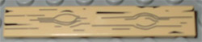

Le troisième consiste à choisir des pièces avec une surface structurée pour rappeler un motif connu.

En ce qui concerne la pierre, ces trois points sont fort bien abordés dans l’article du ["syndrome du grand mur gris"](https://www.freelug.org/spip.php?article368).

## Les couleurs

Certains choix de couleurs sont évidents : les marrons (brown) et les beiges (tan) pour le bois, le gris pour le métal et la pierre. Certaines couleurs sont d’ailleurs spécifiquement destinés à un emploi comme les couleurs chrome et métallique pour le métal ou les transparents pour le verre.

Mais le noir plein fait illusion pour les glaces fumées des mini racers,

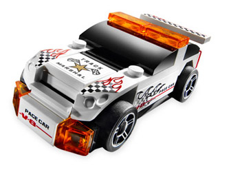

le blanc convient parfaitement pour le bouleau,

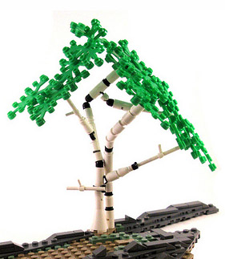

**Arbre par Sir Nadroj**

les oranges, bruns, rouge foncés (ou même le sand red - le rust est anecdotique) pour le métal rouillé.

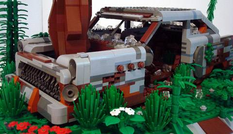

**Buick par Atomicbuilder**

On peut même penser à des verts pour le cuivre oxydé, comme c’est le cas avec ce toit

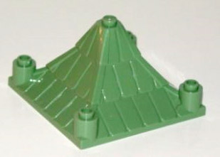

Les fans de médiéval savent aussi que des jaunes peuvent faire merveille pour des pierres de château.

## Les décors

Ils sont plus nombreux que l’on pense, outre la plaque lisse 1x6 déjà évoquée, on peut être étonné de ne pas avoir vu cette pièce DUPLO plus employée.

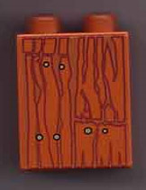

Des décors "stone" (pierre) sont aussi courants comme sur cette brique 1x2x5

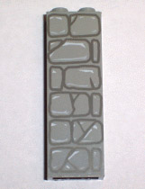

Le plus amusant étant de voir des briques sur des briques ;-)

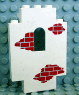

Le métal est aussi à l’honneur avec cette brique pentue 6x10 représentant un bardage métallique avec des marques de rouille.

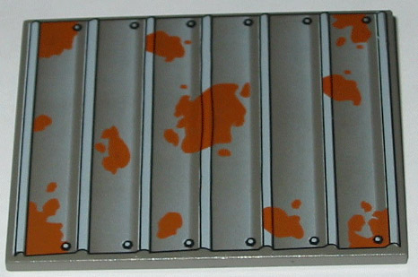

Les autocollants, plus difficiles à trouver, offrent de belles possibilités de donner des effets de matières.

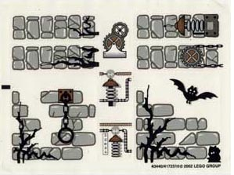

## Les structures

Une des structures de pièces la plus connue est sans doute la version "log" (bûche) des briques 1x2 et 1x4 et des panneaux 2x6x6 qui, en marron, sont massivement utilisés dans la série Western pour représenter les murs en rondins de bois.

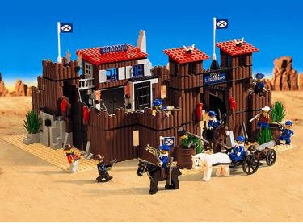

En ce qui concerne la pierre je ne peux que vous renvoyer à deux articles : d’abord le ["syndrome du grand mur gris"](https://www.freelug.org/spip.php?article368) déjà cité mais aussi à l’article sur le ["good enough"](/articles/999/).

Ajoutons qu’il existe une [metapièce](/articles/271/) structurée "pierre" : un [encadrement de porte](http://www.bricklink.com/catalogItem.asp?P=40242).

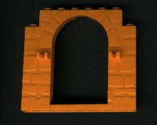

La brique 1x2 avec grille est dans sa version pearl grey utilisée pour représenter les parois des voitures passagers du Santa Fe.

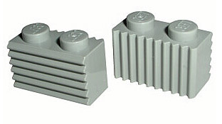

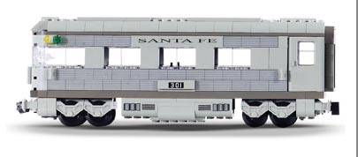

Bien sûr, cet article n’a rien d’exhaustif. Vous découvrirez bien d’autres manières de représenter les matières avec subtilité aussi bien dans les sets officiels que parmi les créations des fans. N’hésitez pas à faire partager vos découvertes en nous laissant un message et ainsi nous donner "matière" à réflexion.
