LEGO n’arrêtera donc jamais de nous proposer de nouveaux sets reprenant des vaisseaux emblématiques de la gamme Star Wars !

Ici, LEGO nous donne la possibilité de construire non pas un, mais deux sets ! Et oui, puisqu’il y a dans ce set pas moins de deux véhicules de combats : l’AT-OT walker et le Republic Dropship TLO-BA.

## La petite histoire

Le **TLO-BA** est une reprise [des canonnières TIO-BA](/articles/7676-republic-attack-gunship/), en tout point similaire, hormis l’espace de chargement destiné habituellement aux soldats qui est remplacé par un vide destiné quant à lui à recevoir des hexapodes AT-TE ou encore des AT-OT. Elle n’a été conçue que pour déposer rapidement ces hexapodes, c’est pourquoi elle ne possède qu’un faible armement.

_Fiche technique :_  
**–** Constructeur : Ingénierie Lourde de Rothana (filiale locale des chantiers de Kuat)  
**–** Modèle : Canonnière à répulseurs TLO/BA  
**–** Dimensions : L. 17,4m ; envergure 17m ; h. 6,1m  
**–** Vitesse max. : 600 km/h environ  
**–** Capacité d’emport : un hexapode AT-TE ou AT-OT  
**–** Equipage : 1 pilote, 1 copilote/canonnier  
**–** Armement : 2 lance-missiles ainsi que 4 rayons laser

L’**AT-OT Walker** est un hexapode qui a pour principale fonction le transport de troupes clones. Grâce à l’absence de toit, il permet d’emporter un plus grand nombre de clones. Cependant cela le rend plus vulnérable, c’est pourquoi il est généralement accompagné d’un AT-TE.

_Fiche technique :_  
**–** Constructeur : Ingénierie Lourde de Rothana (filiale locale des chantiers de Kuat)  
**–** Modèle : AT-OT Walker  
**–** Dimensions : L. 14,3m ; h. 5,8m  
**–** Propulsion : 8 pattes articulées  
**–** Capacité d’emport : 34 soldats clones, voire plus si ceux-ci se tiennent debout  
**–** Equipage : 1 pilote, 4 canonniers  
**–** Armement : 4 canons laser

## Description du set

**–** Numéro du set : 10195  
**–** Nom de la boîte : le Republic Dropship avec l’ AT-OT Walker  
**–** Gamme : Star Wars  
**–** Nombre de pièces : 1758  
**–** Nombre de Minifigs : 8  
**–** Prix moyen constaté : 260 euros

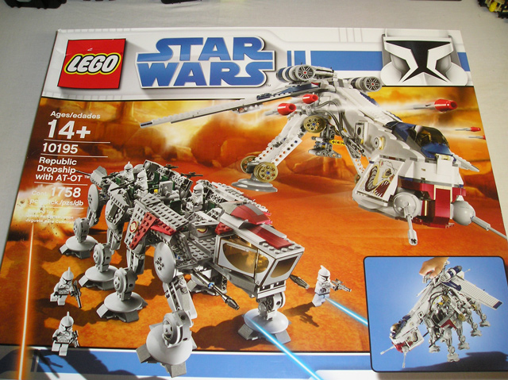

**La boîte**

Une belle grosse boîte qui met bien en scène le Republic Dropship avec l’ AT-OT Walker.

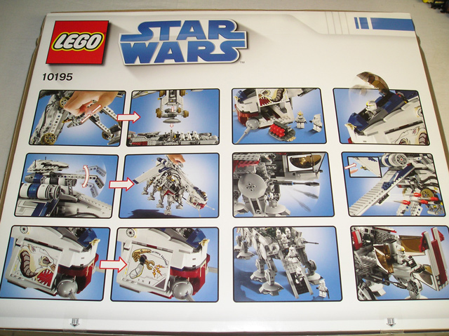

**l’arrière de la boite**

L’arrière de la boîte reprend l’ensemble des possibilités du set, et il y en a.

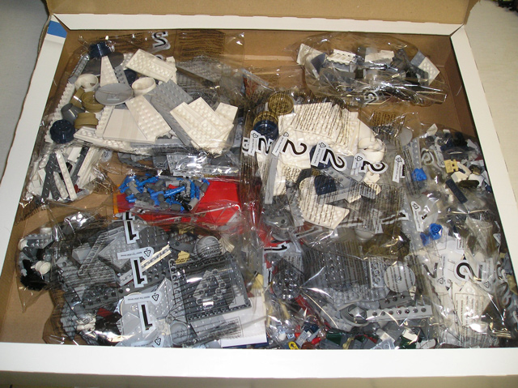

**Ouverture de la boîte**

Ouverture de la boîte : bien remplie, il y a du monde dedans !

**Le contenu**

Il y a donc 3 livrets de montage, 12 sachets numérotés 1, 10 sachets numérotés 2 + un sachet avec divers pièces. Bien évidement on retrouve une grande planche d’autocollants.

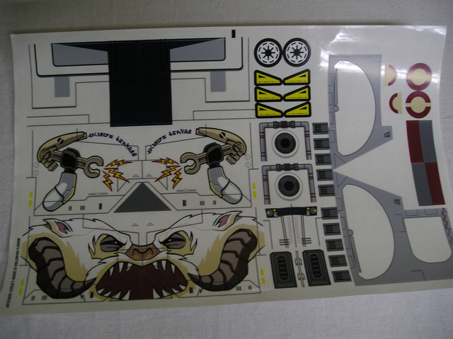

**La planche d’autocollants**

autocollants, autocollants, quand tu nous tiens... ;-)

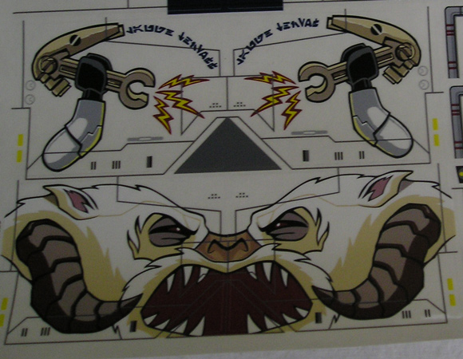

**le choix.....**

Comme pour le Republic Gunship, nous aurons le choix entre deux autocollants pour personnaliser notre canonnière. La tête d’un droïde arraché ou encore la tête d’un wampas.

Mmmmhh... que choisir ? :-D

## Montage de l’AT-OT

On commence par le montage de l’hexapode.

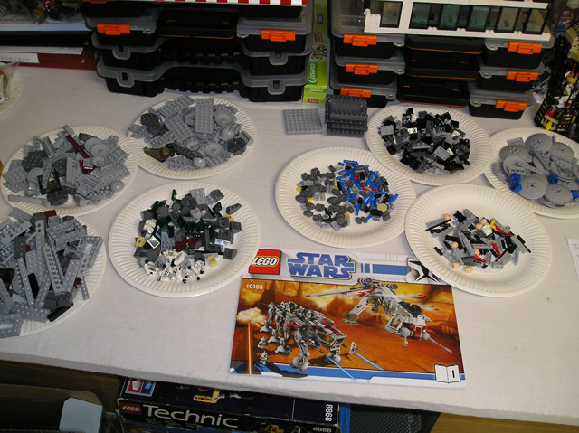

**les pièces pour l’ AT-OT...**

Un petit tri par sachet plus loin...

**les Minifigs en rang serré !**

...et on monte les Minifigs... Pas moins de 6 soldats clones avec un pilote !

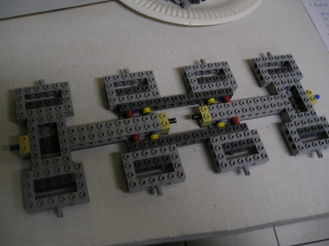

**étape 9, page 11**

Puis on commence à monter le corps de l’AT-OT, avec une structure Technic.

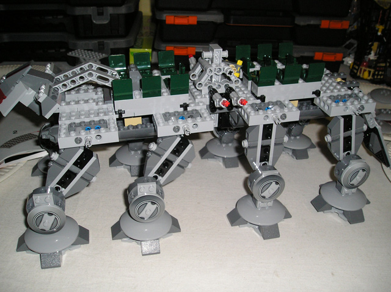

**étape 7, page 46**

Vient vite le moment où il monte sur ses pattes ! 8 pattes au total !

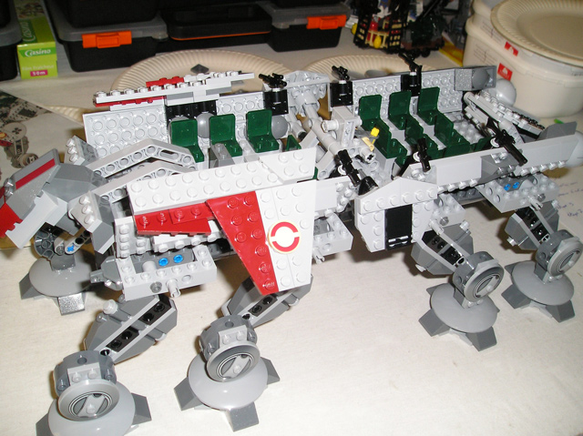

**étape 17, page 65**

Ensuite on finit le pourtour de la coque, c’est vrai, elle est un peu légère.

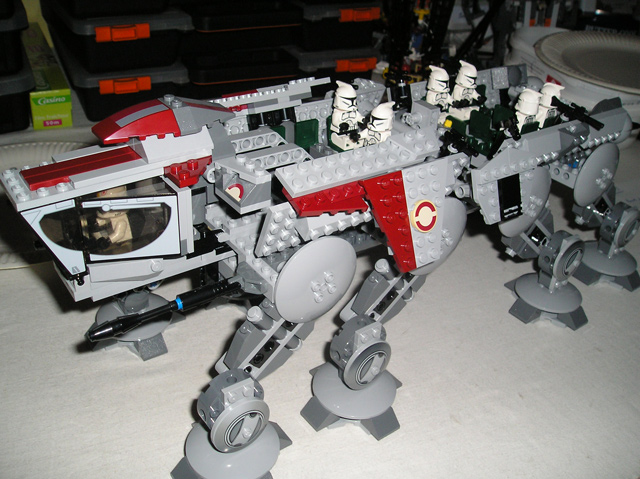

**étape 20, page 75 et fin du livret 1**

Et quand on a posé la cabine, l’ AT-OT est fini ! prêt à partir au combat en se faisant porter par le Republic Dropship.

C’est déjà fini ?

Bah non !!

## Montage du Republic Droship

Et oui, on attaque maintenant le montage de la canonnière.

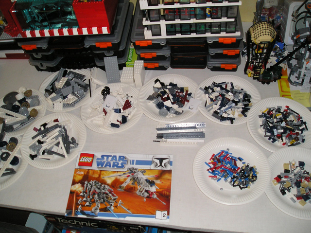

**les pièces pour le Republic Dropship...**

Encore pas mal de pièces. On ajoute ici un nouveau pilote clone (et de 8 minifigs).

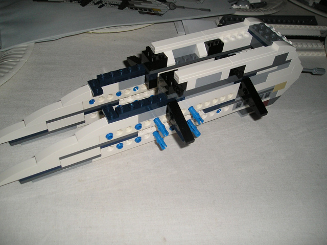

**étape 20, page 17, 2e livret**

On attaque par le haut de la canonnière.

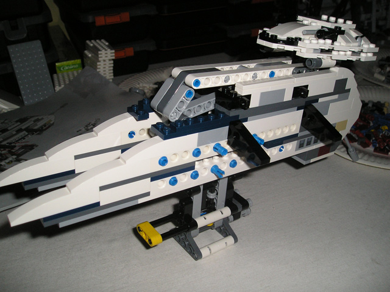

**étape 21, page 37, 2e livret**

Vient vite la structure pour la poignée et le système d’attache pour le transport de l’ AT-OT.

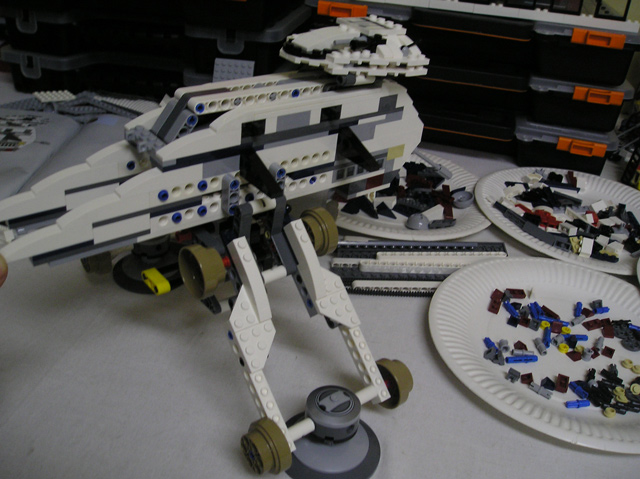

**étape 19, page 51, 2e livret**

On ajoute ensuite les ailes fictives qui maintiennent l’hexapode en réalité.

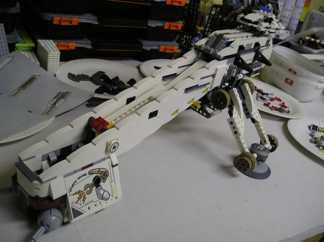

**page 11, 3e livret**

Puis l’avant est posé...

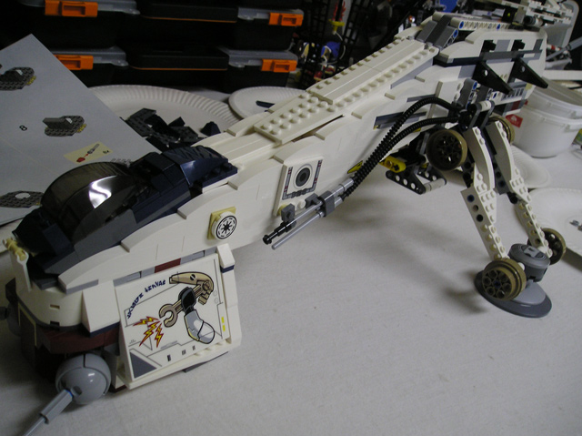

**page 24, 3e livret**

...avec la cabine de pilotage

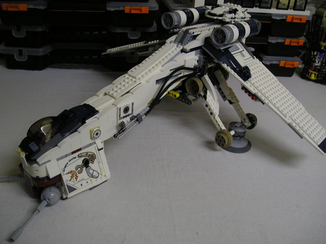

**page 55, 3e livret et fin....**

Et une fois que les ailes sont posées, le Republic Dropship est fini !

On ajoute alors l’ AT-OT en dessous.

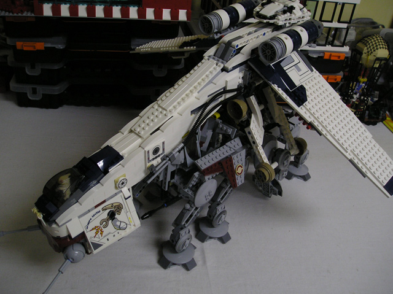

**le Republic Dropship avec l’ AT-OT Walker**

Et hop ! c’est parti pour le combat !

Ca fait une sacré belle "bête".

## Jouabilité

Bien évidement ce set nous propose une grande jouabilité.

**–** Tout d’abord, comme dans le Republic Gunship, il y a sous la cabine de pilotage un compartiment comprenant du matériel de guerre...

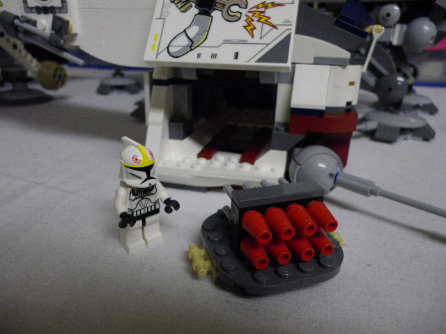

**base de lancement de missiles mobile**

Ici, c’est une petite base de lancement de missile mobile que l’on peut donc utiliser au cas où...

**–** Voici la poignée avec laquelle on porte la canonnière...

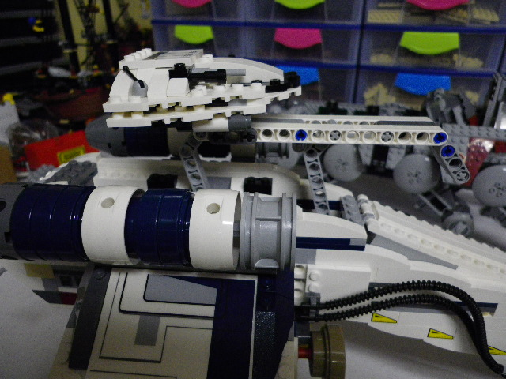

**la poignée**

Elle est plutôt bien faite, on n’a pas peur de la prendre par là, et aucune pièce ne nous reste dans les mains quand on repose le tout.

**–** Sur l’AT-OT on trouve la barre Technic par laquelle on accroche ensuite la canonnière.

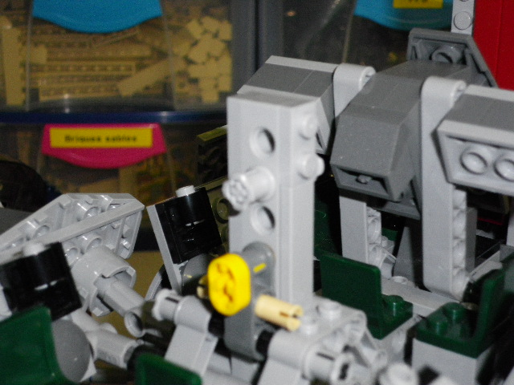

**l’attache sur l’ AT-OT**

**–** Voici donc le système d’attache sous la canonnière. C’est avec un élastique et quelques axes Technic que le tout fonctionne !

Tout d’abord quand il est ouvert, prêt à recevoir un hexapode.

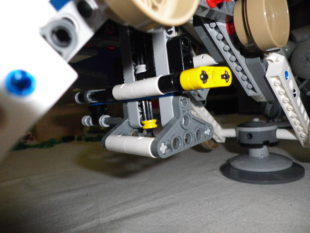

**système d’attache ouvert**

Et ensuite quand il est refermé...

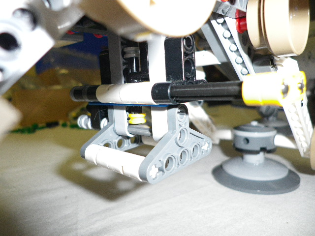

**système d’attache fermé**

Et là, c’est avec l’AT-OT attaché. On voit sur le bas la barre Technic grise qui est traversé par un axe Technic en gris foncé.

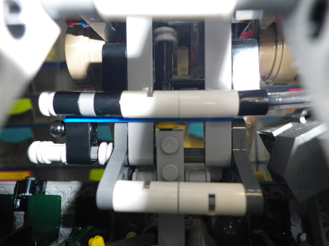

**le système d’attache en fonction**

Et ça marche plutôt bien !

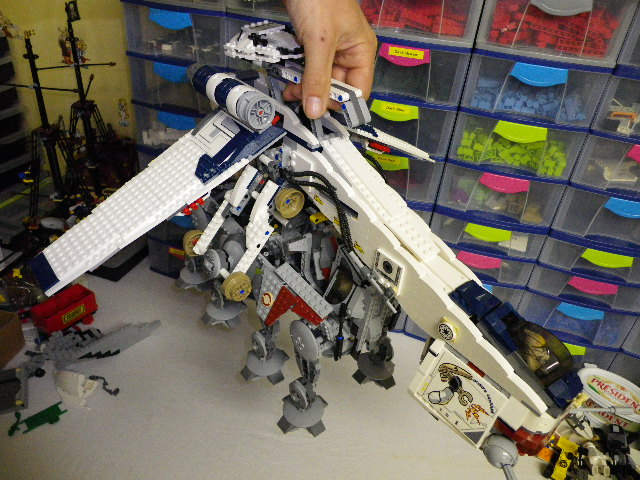

**en vol avec l’ AT-OT**

Et c’est là que le set prend toute sa grandeur.

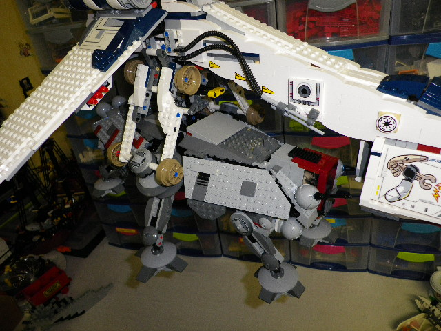

**en vol avec l’ AT-TE**

Il est bien évidement compatible avec le set [7675](http://www.peeron.com/inv/sets/7675-1) l’AT-TE Walker. On a pris soin d’enlever la tourelle du dessus sinon ça touche et tout est bancal.

## Conclusion

**–** Encore que du bonheur à construire un set de cette taille.  
**–** On a tout de suite envie de le prendre en main et de s’amuser avec en faisant voler le Republic Dropship avec l’ AT-OT en dessous, à toute vitesse ! et ça tient !  
 ;-D  
**–** Un très gros bon point pour le fait de la compatibilité avec le set 7675 l’AT-TE Walker. De belle perspective de mise en scène différente.  
**–** En ce qui concerne les Minifigs, 8 soldats clones, il n’en fallait pas moins.  
**–** 260€... cher... mais faisons une légère comparaison : set [7676](http://www.peeron.com/inv/sets/7676-1) Republic Attack Gunship (130€ avec un peu plus de 1000 pièces) + set [7675](http://www.peeron.com/inv/sets/7675-1) AT-TE Walker (100€ avec 800 pièces) = set 10195 Republic Dropship avec l’ AT-OT Walker pour 260€ et prés de 1800 pièces... bon ben c’est le juste prix alors ! ;-)  
**–** Pour conclure, un très beau set, superbe à mettre dans une bataille de clones/droides. Merci à l’équipe de designers LEGO de compléter cette gamme Star Wars déjà bien remplie :-D
