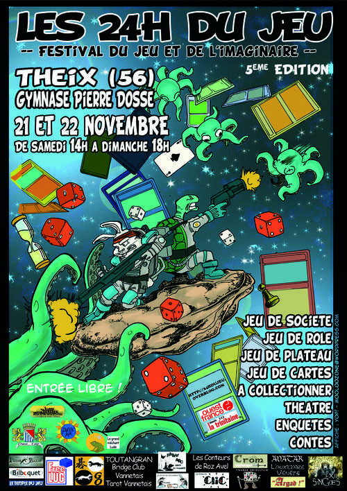

Les 21 et 22 novembre se déroulera la 5eme édition des "24H du jeu" à Theix près de Vannes (56, Bretagne).

[http://24hdujeu.over-blog.com/](http://24hdujeu.over-blog.com/)

Du samedi 14h au dimanche 18h **NON-STOP** : jeux de société, de rôle, de plateau, d’enquêtes...

Seront présents :  
**–** Jean-marc Barré et son réseau train/ferries nouvellement illuminé  
**–** et Ronan avec sa collection de 850 minifigs plus une maquette jouable du jeu de plateau le "Space Hulk" réalisée spécialement pour l’occasion.

Entrée libre,

Alors, de Bretagne ou d’ailleurs, venez nombreux, on compte sur vous.

