A l’occasion du second salon de _l’Univers du Jeu Réduit_ qui s’est tenu les 24 et 25 octobre derniers au Parc de la Meilleraie à Cholet, 38 passionné(e)s de la petite brique se sont donné(e)s rendez-vous et ont offert au public fort nombreux et chaleureux, un formidable spectacle légotique sur 250m2 de surface, presque le quart du hall !

Suite au mail de l’organisateur fin janvier, après avoir accepté la prise en charge du stand le plus grand possible, j’ai contacté patiemment mes collègues de FreeLUG, FestiBriques, BeLUG, et enfin à ma grande surprise ceux du forum Legopirates dont c’était la première sortie nationale (Dominick et sa famille , Thierry et sa fille , Jérôme et sa famille , David, Serge, Arnaud)

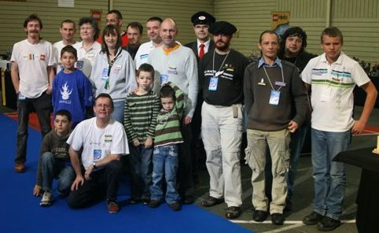

L’inscription close à plusieurs reprises suite aux défections et arrivées de dernière minute a permis aux exposant(e)s de peaufiner leur projet.

Plusieurs thèmes ont été présentés au public : StarWars avec des créations étonnantes chez Legopirate (lp), LEGO vintage, Technic par Arnaud, Patrick Ménard (qui remplaçait exceptionnellement et à la dernière minute Francois-Xavier et Marc de la Roche-sur-Yon), Techball par Ghislain, partie LEGO pour enfants par Brigitte, collection de 850 minifigs et GBB par Ronan, médiéval par Stéphane, diorama trains et ferries par moi-même et enfin diorama commun de 18mx3m par Jean-Claude, Denis, Daniela et leurs aides.

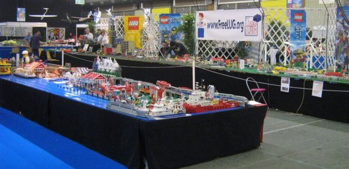

Sous les deux dioramas, le salon avait prévu une rangée de gros projecteurs multicolores style Olympia pour nous mettre en valeur.

Sans avertissement, le salon a éteint le hall (dimanche après midi) et nous étions alors sous les projecteurs pendant un long moment, je ne vous dis pas la classe et mes problèmes pour travailler... je ne voyais rien mais bon...

Le salon, malgré quelques alertes pluvieuses samedi, a été une grosse réussite et a même dépassé les espérances des organisateurs (14000 visteurs cette année au lieu de 12000 en 2007). LEGO France, exceptionnellement, a consenti à nous offrir des minifigs.

Le Courrier de l’ouest et France3 Pays de Loire ont bien relaté l’événement.

En conclusion, je remercie le salon pour la totale confiance placée en moi, Jouetland notre partenaire LEGO, Stéphane pour les nombreuses maquettes de brique gravée et de minifigs spéciales cholet 2009, Banban qui a eu la géniale idée de garder les briques malgré notre différend réglé depuis, et surtout tous les exposant(e)s, et enfin mon frère qui a réalisé une vidéo en HD complète du salon.

Vive CHOLET 2011 !  
_Jean-Marc coordinateur du grand Ouest_

* * *

## Une participation tardive

Arrivée très tardivement comme exposante, je me suis régalée de l’espace disponible pour ajouter ma petite touche au diorama de Jean-Claude et Denis. L’organisation de Jean-Marc était parfaite, les rencontres entre les fans de notre petite brique enrichissantes et les retrouvailles avec les amis sympathiques.

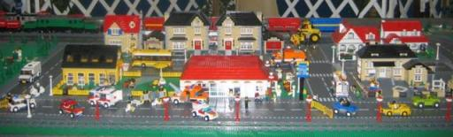

Merci aux organisateurs très sympathiques du salon, au responsable de Jouetland et bien sur à Jean-Marc.

_Daniela et Sylvain_

* * *

## Première participation

Histoire de participer et par amitié pour Jean-Marc, je me suis inscrite dès le début de ce projet.

Jusqu’aux jours précédents le jour J, je me sentais un peu hors jeu (classe Duplo) parmi ces ferrys, trains, grande roue, éolienne. Tous d’une grande notoriété. La gentillesse des organisateurs de Cholet, du responsable JOUETLAND et la participation de JCP et de Daniela expert en diorama à ce week-end m’ont permis d’installer mon atelier LEGO/château fort. Donc revenue dans mon élément ce fut un week-end inoubliable. Alain, lui n’a pas décroché des stands LEGO et est prêt à repartir.

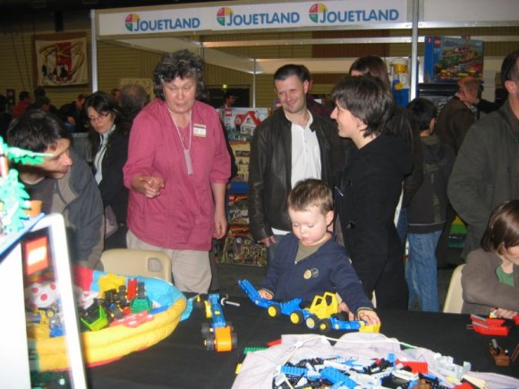

Pour les Freelugiens, je confirme pour participer juste un tout petit pas à franchir, mais prévoir d’en repartir accros.

_Brigitte Eury_

* * *

## Le local de l’étape

Natif de Cholet, c’est avec excitation que j’ai répondu à l’appel de Jean-Marc pour présenter un "NXTBall" (_article en cours de rédaction_). Après plusieurs phases de doute à cause d’une mise au point difficile, j’ai été pleinement satisfait par cette première participation sur ce salon que j’ai trouvé - sans chauvinisme aucun - absolument formidable.

Ce fut une expérience très forte qui m’a aussi permis de rencontrer plein de passionnés en tout genre, dont certains font vraiment des choses extraordinaires.  
Et puis, difficile de résister à tous ces regards d’enfants devant les LEGO !

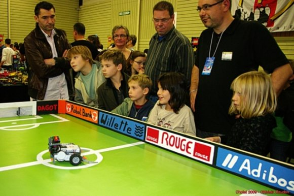

Grand merci donc à Jean-Marc, aux Freelugiens, aux LegoPiratiens, et bien sûr à tous les bénévoles Choletais.

_Ghislain - qui va évidemment recommencer._

* * *

## Une exposition très bien sous toutes les coutures. Même Julie en redemande ! C’est dire.

Il faut dire qu’on l’avait préparée cette exposition. Des échanges de mails innombrables par jour(s) et cela depuis le mois de juin voire bien avant. Jusqu’au vendredi 12h00 nous échangions encore.

Comme d’habitude, nous sommes arrivés à l’heure dite, heu avec 2h00 de retard. Il y en a qui commençait à s’inquiéter... Et pour cause, nous étions chargés d’apporter TOUT le réseau ferré.

Commence le rituel déchargement et mise en place. Et il y avait de quoi faire avec un diorama avoisinant les 13x2,4m. D’abord la réalisation du réseau, merci à [TD](/rubriques/57/) car on a beau le travailler pendant des semaines, impossible de le connaitre par coeur. Et puis la tuile, le truc qui n’arrive jamais, la malchance, la bérézina, bref tout ce que vous voulez, après 2h00 de construction du réseau (oui il fallait au moins cela), vers 22h00 le PC qui nous lâche. Plus d’accès au fichier TD et autres supports pour réaliser le diorama. Faut dire que huit jours avant, en visite à [KidExpo](/articles/1012/) on lui avait appris à voler sans succès (plusieurs composants endommagés).

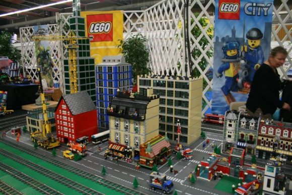

Le diorama a quand même pu être terminé suivant les plans grâce entre autre aux copies papier (Ah le papier). A 23h00, arrivée de l’équipe de renfort (suite famille Petit en la personne d’Edwige, Julie et Michael) pour la mise en place de la zone agricole et la finalisation de la ville. Tout cela sous les conseils avisés de Daniela et Brigitte jamais loin.

Bon il commence à se faire tard, il faut penser à manger. Et quel repas, ce n’est pas le tout d’exposer mais il faut que le reste suive. Et là tout avait encore été prévu. Nous avons bien mangé (et chaud grâce au four micro-ondes apporté par Brigitte) dans une ambiance qui en disait long sur ce qui allait se passer durant tout ce week-end.

Le lendemain matin après une nuit très courte au plus près de nos LEGO, finalisation du diorama et déjà les premiers visiteurs. Quel plaisir de voir les mines joyeuses de tous ces enfants petits et grands. Mais nous voilà déjà dimanche soir il faut penser à ranger, un au revoir qui traine un peu et puis il faut bien y aller à contre coeur, même si demain on travaille.

En conclusion, je voudrais remercier :  
**–** Jean-Marc pour nous avoir invités à cette manifestation en espérant que nous avons été à la hauteur de ses attentes ;  
**–** Denis avec qui cela fut un plaisir d’échanger et de travailler pour faire cette présentation ;  
**–** Daniela pour tout ce qu’elle a apporté. Je vous laisse imaginer toutes les retouches artistiques et de finition sans oublier quelques LEGO dont vous aurez tous noté la participation de la maison Haussmannienne ;  
**–** Brigitte pour son soutien et sa contribution. Il faut dire que cela aide beaucoup d’avoir deux femmes dans la réalisation d’un diorama... Toujours de bons conseils ;  
**–** enfin il faut remercier par une mention spéciale toutes les personnes qui ont participé de près ou de loin à cette présentation. Merci à Alain, Sylvain, Julie, Michael et Xavier.

Slt  
_JCP_

* * *

## Premier salon, premier commentaire

Pour une première exposition, c’était un peu long, mais c’était bien.

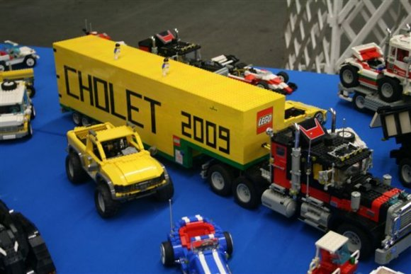

Ce que j’ai préféré le plus, c’est la grand roue et le diorama StarWars de la bataille de Hoth. Il y avait aussi plein de belles choses comme les villes, les pirates, etc. Le samedi soir, il y avait beaucoup de monde (nocturne). Enfin bref, c’était un bon week-end !

_Maxime fils de Boris_

* * *

## Exposition en uniforme

C’est avec un grand respect pour le costume que le public (petits et grands) a lui-même chargé et déchargé les camions à la gare de ferroutage.

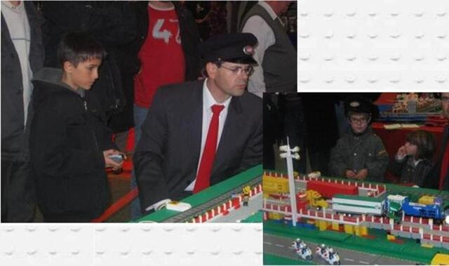

**Le chef de gare surveille les opérations avec son assistant !**

Ce fût un réel grand plaisir de contribuer au succès de cette (grande) constellation LEGO au milieu de l’univers du modèle réduit.

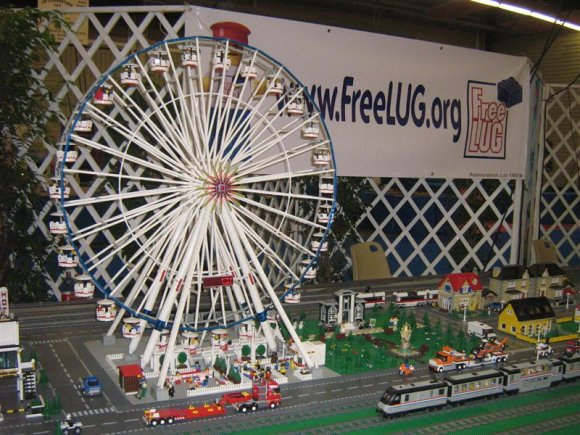

PS :  
Le couchage sur place a aussi été un grand moment source de souvenirs tenaces.

_DenisL_

* * *

## Le plein de rencontres

Une bien belle exposition,qui a permis de rassembler des afols d’horizons différents pour de très agréables rencontres au sein de FreeLUG et LegoPirate.

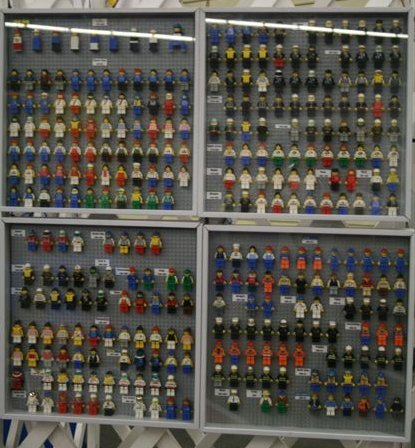

Vivement 2011

_Ronan_

* * *

## Un autre régional du salon

Cette exposition était super, ça donne envie de continuer et j’encourage tous les fans de LEGO à participer à des salons, l’ambiance a été excellente, on cause de LEGO tout un week-end (ça dépend de la durée de l’exposition...).

_Arnaud_

* * *

## Première sortie, premier succès pour LEGOPIRATE

Vendredi vers 17h avec ma fille et whiplash (Serge), on a tout embarqué dans sa Renault Espace et on a pris la route pour Cholet.

On a eu un peu de mal à trouver le parc expo, mais c’est parce qu’on ne connaissait pas la ville.

Bonne nouvelle, il n’y a eu aucune casse au transport. Arrivés sur place, on a retrouvé Jean-Marc et david.28, fait connaissance avec les exposants de FreeLUG qui étaient déjà là, on a tout débarqué, redisposé nos tables, monté nos dioramas, installé les Mocs. Puis, pause casse-croute au Mac DO.

Le lendemain, on a réceptionné WEND (Jérôme), Ar sparfel (Dominick) et Arnaud, on a fini d’installer et c’est parti pour deux jours de folie.

La zone LEGO couvrait 250m2 dont la plus grande partie était occupée par nos amis de FreeLUG et Jean-Marc qui ont assuré une belle présence et représentation.

Samedi 11h, arrivée des VIP, puis de 14h à 23h, le public. Il a plu toute la journée donc, les gens n’étaient pas trop nombreux, 4000-4500 environ.

Dimanche, ouverture de 10h à 18h, mais là, la météo clémente aidant, ça a été le grand rush, 14000 entrées, autant dire qu’on n’a pas eu le temps de souffler et si on n’avait pas commencé le démontage vers 18h15, à 19h, on y était encore.

Sinon, on a eu d’excellents rapports avec les autres exposants LEGO et avec les membres de FreeLUG en particulier. On a eu un bon contact avec le public, des gens sympathiques, curieux, intéressés. De fait, le soir, en plus d’en avoir plein les pattes, certains d’entre nous avait la voix un peu fatiguée.

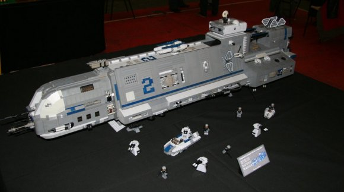

J’ai, pour ma part, trouvé peu de temps pour visiter les autres stands mais j’en ai vu pas mal quand même. Les réseaux de trains miniatures étaient très impressionnants. Comme l’était la course des 24h de MINI Z. des bolides R C incroyables. On a pu voir aussi quand même une superbe démonstration en bassin de modélisme naval et bien sur, on a profité à loisirs des stands de Jean-Marc et de FreeLUG, deux dioramas immenses et superbes... Mais, nous n’avons pour autant pas à rougir de la comparaison surtout pour une première. On a eu un joli succès quand même : le diorama d’Hoth d’ar sparfel, le diorama space classic de whiplash, et le UCS Mallory de moi même ont énormément plu au public.

En résumé, un week-end assez fatiguant, le stress de la première sans doute, mais vraiment très enrichissant, agréable. Au retour, nous étions à la fois soulagés d’en voir le bout, impatients de remettre ça, de retrouver les copains.

Enfin, voilà, c’était que du bonheur...

_Thierry (Mindrunner) un des exposants du forum Legopirate_

* * *

## Coming-out pour Legopirate !

« _Il y a une exposition de modélisme à Cholet en automne, il y aura des exposants Lego. Quelqu’un est-il intéressé pour exposer ?_ »

Les grandes aventures ont toutes un point de départ, celle-ci a pris la forme d’un simple message parmi tant d’autres sur le forum Legopirate. Quelques membres du forum ont donc pris la décision de tenter l’aventure. C’est à ce moment là que les choses se sont compliquées, chacun réfléchissant à ce qu’il allait amener, ici un diorama sur l’espace, là des sets officiels de la gamme Pirate et Star Wars ou encore un Moc d’envergure... A l’approche de la date de l’exposition, les craintes se faisaient grandissantes, les interrogations étaient nombreuses tant sur la disposition des tables, la circulation du public autour de nos dioramas, ou encore les risques de casse.

Heureusement, la présence bienveillante de Jean-Marc avec ses conseils et son expérience a permis de lever un certain nombre de doutes. Les conseils d’Erik ont également permis d’effacer les dernières appréhensions.

Le jour J est enfin arrivé ! Première rencontre dans la vraie vie pour les membres du forum. Passés les premières minutes, chacun reprend les habitudes prises sur le net et l’ambiance y est aussi bonne si ce n’est meilleure. Des visages sont enfin mis sur des pseudos.  
De l’installation au rangement, le temps s’est écoulé rapidement entre les nombreuses et riches discussions à propos de la petite brique, les partages d’expériences, ou encore les échanges teintés d’admiration avec le public. Effacées toutes les craintes et appréhensions du début.

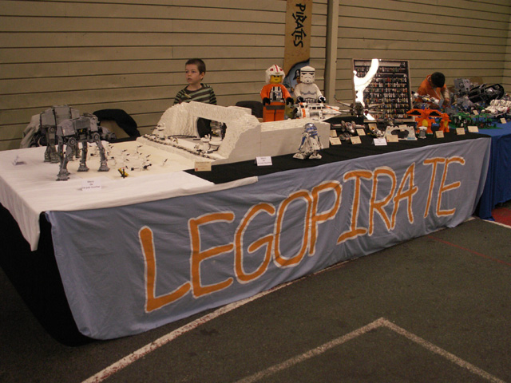

**L’Empire contre-attaque !**

Cette exposition fut l’occasion de revoir et rencontrer les membres de FreeLUG avec qui les échanges furent très agréables, entre partage d’expérience et discussions variées, toujours à propos de nos chères briques évidemment.

Cette exposition de Cholet sera marquante car il s’agit d’une exposition d’envergure qui a drainé un public nombreux, nous ne pouvions rêver mieux pour une première. C’était aussi la première pour les membres du forum Legopirate qui prend, par la même occasion, une autre dimension, ce qui est important pour la vie du forum. Une exposition qui en appellera d’autres, c’est le sentiment général après ce week-end enrichissant. Chacun est reparti avec de nouvelles idées, des envies d’amélioration de ses Moc ou dioramas. Le virus est pris, les expositions sont un moment à part dans la vie d’un Afol, le moment où il partage avec d’autres cette passion.

Un grand merci à tous les participants de cette exposition, elle fut réussie grâce à la convivialité qui y a régné. Un remerciement particulier pour Jean-Marc et la qualité de son organisation avant et durant l’exposition. Le virus est pris, vivement les prochaines expositions !

_Dominick_

* * *

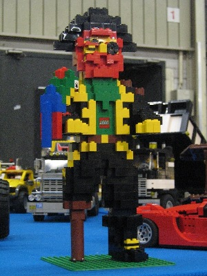

**A une prochaine rencontre sur d’autres océans !**

* * *

## Galeries photos

**–** [Galerie de Brigitte](http://photos.freelug.org/main.php/v/EURY/EXPO/)  
**–** [Galerie de Ghislain](http://photos.freelug.org/main.php/v/Dagobot/expo_cholet_2009/)  
**–** [Galerie de Daniela et Sylvain](http://photos.freelug.org/main.php/v/Daniela+et+Sylv1/Expositions/Cholet+2009/)  
**–** [Galerie de DenisL](http://photos.freelug.org/main.php/v/dlaurencon/Expo/cholet2009/)  
**–** [Galerie de Jean-Marc](http://photos.freelug.org/main.php/v/barr__/expositions/2009/cholet2009/)  
**–** [Topic sur Legopirate](http://www.legopirate.fr/forum/phpBB3/viewtopic.php?f=33&t=5025)
