Après les 929 Km/h atteints lors de Fana’briques 2008, voici la LGV de retour pour une nouvelle tentative de record, à l’occasion de la quinzième exposition "Ardèche Drôme Isère miniature" à Saint-Rambert-d’Albon qui s’est tenue les 7 et 8 novembre 2009.

## Descriptif du stand

Nous voila donc partis pour l’installation de la LGV, avec près de 30 mètres de long. En plus de la LGV sont présents un réseau 4,5V, deux réseaux 12V (rails bleus et rails gris) et plusieurs réseaux 9V.

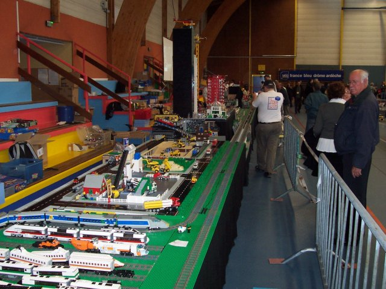

**Grande longueur**

On en voit pas le bout

Côté animation, en plus des trains et du funiculaire de Nicolas, Xavier a amené ses camions télécommandés, qui ont fait la joie des jeunes visiteurs, Yannick a agrémenté son diorama avec la barre de coupe de la moissonneuse en mouvement, ainsi qu’un système d’arrosage automatique et une roue à aube. Enfin, Sébastien a motorisé sa grue, pleinement fonctionnelle.

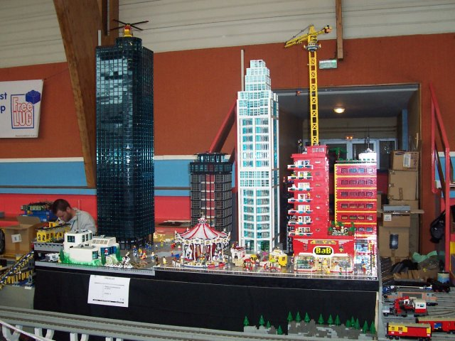

**Quartier des affaires**

PierroLego a presque atteint les 1100 Km/h samedi avec un TGV issu du set 7897, mais c’est Jac qui a obtenu le record dimanche. Ce week-end a été l’occasion de voir de nombreuses tentatives avec plus ou moins de réussite au moment de l’accélération ou du freinage, voyant ainsi se disloquer un TGV de la Poste, une loco-tonneau... avec le superbe record de Jac au final.

Il y a eu plus de 3700 visiteurs sur ces deux jours, ce qui est très satisfaisant pour les organisateurs. Il faut reconnaître que la publicité pour l’exposition avec l’annonce des records dans la presse écrite et radio a été rondement menée. Bravo l’ADImin !

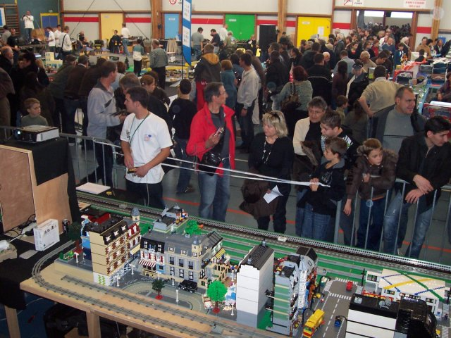

**L’affluence**

beaucoup de monde

* * *

J’ai passé un week-end assez intense : coordination d’une grosse exposition, organisation des tentatives de records, "comm" avec les autorités, etc. Je tiens à remercier l’ADImin et ses membres pour leur accueil. De même je voudrais remercier tous les membres FreeLUG qui ont su monter une exposition impeccable, aux "fous du régulateur" qui ont animé les records tout au long du week-end, aux "p’tits nouveaux" qui se sont lancés dans le bain, et à BàB pour sa logistique et sa LGV.

Nous avons donc eu deux records de vitesse : Jérôme et son prototype avec 1281,80 km/h ; et Pierre et son 7897 boosté avec 1100,35 km/h.

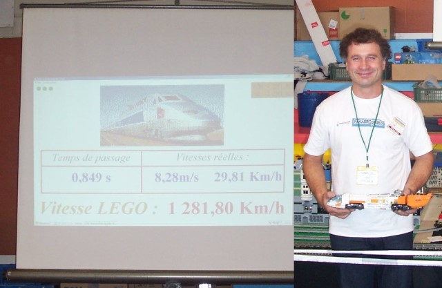

**Record de Jac**

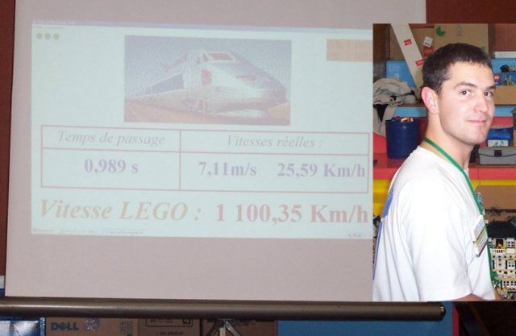

**Record de Pierre**

**Loys**

* * *

J’ai beaucoup apprécié ce week-end d’exposition, qui m’a donné envie de "faire du train LEGO". D’ailleurs, merci Pierrick pour le vrac qui m’a permis de créer la chose ci-dessous ;-) Vivement la prochaine exposition !

**Laurent**

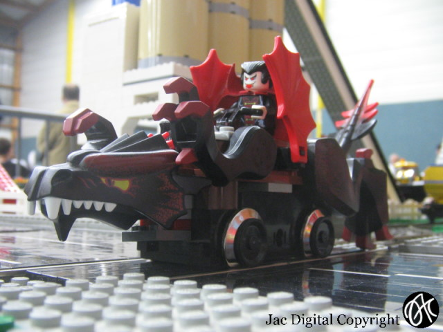

**Le prototype de Laurent, construit sur place.....**

* * *

Aie Aie Aie c’est allé très vite !!! Alors quelques chiffres pour bien fixer les esprits.  
**–** 74 : le nombre de tables à monter avant de pouvoir faire joujou. :-(  
**–** 639 : le nombre de runs effectués pendant les 16h d’ouverture de l’exposition. Ca fait quand même un run toutes les minutes et demi pause repas et reconstruction comprises.  
**–** 29.81 km/h : record de Jac avec son "Truc"  
**–** 25.59 km/h : record de Pierre avec son 7897 à peine modifié  
**–** 21.48 km/h : la moyenne des 100 meilleurs runs du weekend  
**–** au moins 5 : le nombre de fois que chaque concurrent a reconstruit son train à cause d’un freinage tardif ou d’une accélération hâtive.  
**–** 3 : le nombre de moteurs complètement HS pour tout le weekend. C’est vraiment pas beaucoup vu les chocs électriques qu’ils ont subis :-)

Voila un weekend bien réussi et vivement le prochain avec encore quelques mètres de plus pour aller encore plus vite.

**Xavier**

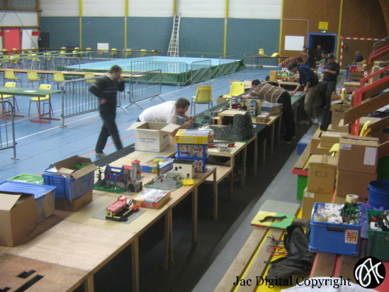

**Installation.**

* * *

Une superbe exposition, une grande ligne droite pour la LGV mais les arrêts ont été assez difficiles pour certains TGV. Pour le reste, il y avait de superbes dioramas : les immeubles de Denis, la ville de Laurent, la ferme de Yannick etc.

Encore Bravo

**Sébastien**

* * *

Cette exposition était pour moi la première où je présentais un diorama. Ce fut l’occasion pour moi de prendre pleinement conscience du travail que cela pouvait représenter, des difficultés pour tout transporter sans arriver le jour J avec un amas de pièce en guise de construction. Mais ce fut aussi pour moi une première de voir le regard des visiteurs impressionnés par la longueur du stand, par la vitesse et les crash des trains, par la hauteur des buildings de Denis.

Je tire d’ailleurs mon chapeau aux autres FreeLUGiens pour leur magnifiques travaux présentés, à Xavier et Denis pour leur ligne LGV, l’installation électrique, les tables, et à Loys pour l’organisation et l’agencement très homogène de ces nombreuses constructions.

Mais cette exposition fut surtout l’occasion de parler avec plein d’autres fans, de LEGO, de tables, de bottes de paille, de NXT et de plein d’autres choses, bref, de passer un excellent week-end.

Vivement la prochaine rencontre.

**Yannick**

* * *

Mon excitation grandissait au fur et à mesure que la date de cette exposition approchait. C’est donc tout excité que je suis arrivé sur place pour aider à finir de monter le support de la Ligne Grande Vitesse.

Les tables étaient en place. Il restait à mettre les nappes tout du long et pour finir, le décor. La Ligne Grande Vitesse de Denis, une fois mise en place, nous a encore une fois montré sa suprématie. Même si certains l’ont trouvée un peu trop courte (!!). Tiens, c’est pas marqué qu’elle mesurait 27m !!

Comme le signale Xavier par tous ces chiffres très intéressants, les rails de cette longue ligne droite n’ont pas eu le temps de refroidir. Les runs se sont succédés intempestivement. Soit pour faire des essais, soit pour s’amuser, tout simplement. C’était très prenant de faire des accélérations, et de voir passé son train ou proto (ce n’était pas un truc !) à toute vitesse devant nos yeux !

Mais l’établissement d’un record n’est pas chose aisée. Il a fallu plusieurs remontages, consolidations et recherches de pièces perdues, pour valider les essais. Lorsque le record est tombé, je surveillais l’arrêt de mon train, avant la courbe. C’est aux cris de joie que j’ai compris que j’avais encore battu ma vitesse de passage sur les 7m de la mesure. Mais, je suis encore étonné par cette vitesse. Pourtant, je suis sûr que l’on peut rouler encore plus vite...

Le policier en bout de ligne droite a dû halluciner, avec ses prises de vitesses !

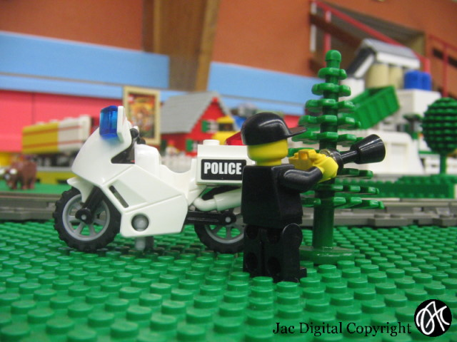

**Test de jumelles anti mur du son !**

A bientôt, pour une ligne droite plus longue, et des trains qui vont encore plus vite...

**Jérôme / Jac**

* * *

Pour notre première exposition, à Justin et moi, nous avions timidement préparé un diorama sur la ferme incluant beaucoup de modèles LEGO (tracteurs, silo, grange, maison...) ou d’inspirations de modèles LEGO (moissonneuse avec becs coupe maïs et gyrophare, étable modifiée...). Le tout agrémenté d’un moulin avec ailes motorisées pour le plaisir des enfants et de quelques créations (tonne à eau, chargeur télescopique, camion citerne).  
Stressé comme un joueur de CFA qui serait propulsé dans un match avec l’équipe pro en Ligue 1, l’accueil des ténors de notre association m’a de suite mis à l’aise.

En plus d’être une exposition très réussie de par la qualité des dioramas, cela nous permet encore une fois de se rencontrer, de faire connaissance avec d’autres membres (pour ma part : Thierry, Daniel S, Xavier C, Sébastien). Merci aussi aux visiteurs d’un jour ou du week-end.

Il faut déjà penser à la suite et on a du travail, car la barre est vraiment de plus en plus haute. Il s’imposera peut-être de faire des présélections pour assurer le niveau pour les manifestations les plus en vues.

En attendant, un grand merci à tous et à notre représentant Loys.

**Daniel R.**

* * *

Après Fana’briques 2008, cette exposition était la deuxième occasion pour moi de faire rouler des trains à grande vitesse sur la LGV. En effet, à Rosheim, n’ayant que de vieux moteurs à ma disposition (dont 2 avaient vite grillé), je n’ai pas vraiment pu défendre les chances de mon Shinkansen T700. Rendez-vous était donc pris à Saint-Rambert pour essayer de faire mieux.

Ayant profité d’un contact aux US et d’une promo à 13 USD sur les moteurs 9V, j’ai acquis 10 moteurs neufs spécialement pour l’occasion et assemblé un train officiel 4511 avec 8 véhicules (2 locomotives et 6 wagons). Avec ces deux trains (le 4511 léger et le Shinkansen lourd et trapu) et ces 10 moteurs, je comptais bien faire un maximum d’essais en changeant la configuration des trains, le nombre des moteurs et leur répartition.

[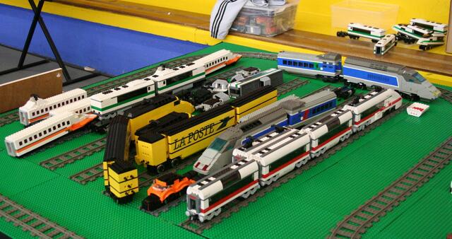](https://www.freelug.org/IMG/jpg/TGV_au_repos.jpg)

**Les TGV au repos**

Durant l’expo, j’ai ainsi fait rouler mon Shinkansen avec 4, 6, 8 et même 10 moteurs (ce qui ne fait rien gagner en vitesse mais qu’est ce que ça freine bien par contre) sans dépasser les 860 km/h. De même, avec le train 4511 en configuration 4 moteurs identique à celle de Pierre L., mon meilleur chrono correspond à 865 km/h alors que Pierre flirtait allégrement avec les 1000 km/h. Dimanche après-midi, j’ai réalisé quelques vidéos des trains sur la LGV (dont celle du record de Pierre) que vous pouvez visionner dans ma galerie.

Que faut-il conclure de cette expérience ? Que les moteurs neufs nécessitent un rodage (hypothèse de Denis), que les composants ne sont pas les mêmes d’une année sur l’autre (hypothèse de Philo), que les moteurs les plus récents ont été plus bridés par LEGO pour plus de sécurité (mon hypothèse), que 4 moteurs suffisent pour un TGV léger...  
En tout cas, j’ai passé un super week-end à voir rouler ces trains, à faire rouler les miens (parfois avec chute de la table pour le plus grand plaisir du public et provoquant l’effarement des modélistes), à discuter avec les autres exposants et le public. J’ai particulièrement apprécié l’ambiance entre AFOLs et la compétition de vitesse qui a plus fait l’objet d’une saine stimulation entre participants pour établir la meilleure marque que d’une rivalité entre concurrents. J’en profite d’ailleurs pour remercier Loys pour le sérieux de son organisation.

[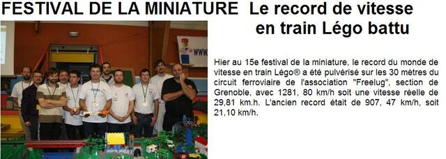](https://www.freelug.org/IMG/jpg/Record_dans_le_Dauphine.jpg)

**Article paru dans le Dauphiné avec une photo de la fine équipe.**

A Rosheim, les trains ont flirté avec les 20 km/h. A Saint-Rambert, ils ont flirté avec les 30 km/h. Je propose que nous lancions le projet 40 km/h pour une prochaine sortie de la LGV avec des moteurs 9V équipés de roues de plus grand diamètre. Mais ceci est une autre histoire.

**Daniel S.**

* * *

Et de 2 ans d’expositions...

Effectivement, j’ai fait ma première exposition à Saint-Rambert en 2007... Deux ans après et quelques expositions, on continue...

Une belle édition, avec de nombreux participants, de nouvelles têtes, et beaucoup de remontages de train ;-)

J’ai juste ramené une centrale à béton dans la partie camions PFS avec les routes en snot de Xavier, et j’ai réalisé une tour Ferrari pour le quartier d’affaire de Denis avec un chantier juste à côté.

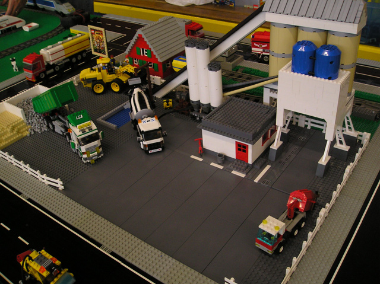

**La centrale à béton qui a touné à plein régime durant tout le week end...**

Je n’ai pas ramené grand chose... mais je me suis bien amusé à faire tous ces runs sur la lgv.

Merci à tous pour ce super week end ! :)

Et à très vite !

**Pierre L. / Pierrolego**

* * *

Comme mes prédécesseurs l’ont dit, le week-end a été très agréable, aussi bien coté accueil que visiteur.

J’ai basé ma participation sur un concept : « Espace de liberté » - j’en ai donc offert trois :  
**–** Le premier derrière le stand où une caisse de vrac a permis à certains AFOLs et KFOLs de construire pendant le week-end ;  
**–** Le second sur le diorama a permis à quelques uns d’entre nous de créer plusieurs scènes ;

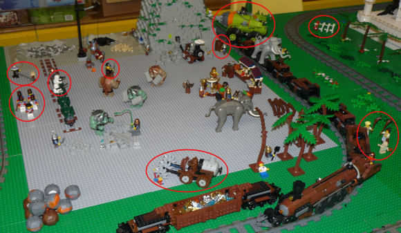

**Le module dimanche après-midi**

En rouge, les éléments qui sont apparu au cours du week-end

**–** Et enfin le troisième en bout de ligne droite, un jardin doux et ombragé permettait aux trains de se détendre paisiblement devant le Taj Mahal.

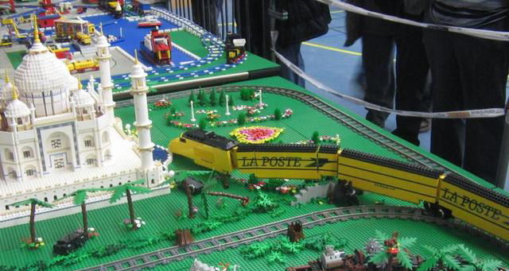

**Un TGV qui a fait le mur**

Cette exposition a aussi été l’occasion de présenter, pour la seconde fois, la Loco-tonneau au public. Tous le monde a donc pu observer ce magnifique engin aux capacités dynamiques remarquables.

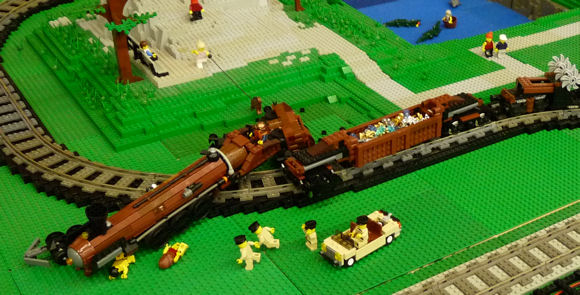

**La Loco-tonneau dans ce qu’elle sait faire de mieux**

A noter tout de même que cet engin a fait 860km/h en marche arrière avec aux commandes un nain aux yeux bandés. Ce qui en fait, tout simplement la locomotive à vapeur en bois pour nains la plus rapide du monde en marche arrière !

**Pierrick**

* * *

Comme pour Yannick et d’autres, c’était aussi ma toute première exposition avec un module funiculaire desservant le quartier des affaires de Denis. Merci pour la confiance et la qualité de la coordination de Loys et Denis. Après six mois de préparation, échange de dessins, modification du layout sur BlueBrick, j’ai découvert les fameuses tables BaB, les problèmes de transport des Mocs ("c’est pas cassé, c’est juste démonté"), les ajustements de dernière minute, les questions du public ("c’est vraiment tout en LEGO ?"), les virages de train non contrôlés, la joie de jouer avec un réseau de 30m, les yeux éclairés des enfants pouvant jouer au funiculaire avec la télécommande PFS.

**Nicolas / CoLego**

* * *

Que dire de plus après tout le monde à part que pour moi aussi cela a été une superbe exposition !

J’ai pu exposé pour la troisième fois mon château de Quéribus (après [Montluçon](/articles/1006/) et le [LEGOWorld](/articles/1013/))

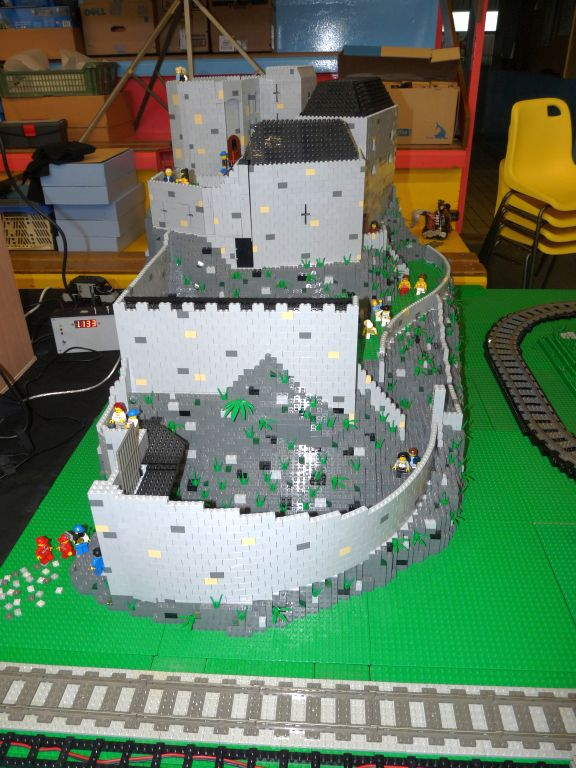

**Quéribus**

J’ai aussi pu, comme mes petits camarades, me tester à la grande vitesse, pour moi dans la catégorie prototype.

[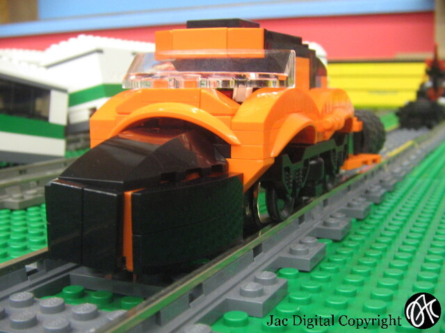](https://www.freelug.org/IMG/jpg/Photo-48.jpg)

**Mon Prototype à Grande Vitesse**

Encore un bon moment passé en la compagnie de Freelugiens toujours aussi accueillants avec les nouveaux ! Car pour certains c’était leur première, alors que pour Pierrolego et moi c’était l’occasion de fêter nos deux ans d’expositions. Et quoi de mieux que de faire cela sur les lieux de notre première pour l’exposition de [Saint-Rambert 2007](/articles/683/) ! De là à dire que Saint-Rambert est une exposition parfaite pour les premières, il n’y a qu’un pas !

**Pierre C. / Tribolego**

* * *

## Une bien belle expérience

Lassé des expositions LEGO, je venais là me ressourcer au contact d’Afols du sud. Lassé des expositions LEGO où le train prend trop de place, je venais là me détendre pour découvrir des engins de chantier et autres modèles paisibles.

Arrivé sur place, la surprise, la vraie ! Une montagne de trains, de rails et de LEGO. Des mètres de rails et de rames. Des trains, et encore des trains et encore des trains. Ca change des expositions classiques ! Mais quel plaisir !

A titiller la manette, on se fait des sueurs froides. De moins en moins froides à force d’accidents. Pas de record pour le TGV La Poste. Quoique, le nombre d’accidents ?  
De belles constructions, de nouvelles têtes et un accueil chaleureux de la part des organisateurs ainsi que de Loys, Denis et Xavier me laisseront de beaux souvenirs.

**Thierry**

* * *

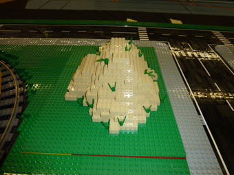

**The MOC !!!!!**

Bon, tout a déjà été écrit ! Mais j’écris quand même que j’ai moi aussi passé un super meilleur week-end et que je n’arrive pas à me lasser de ces expositions où chacun y trouve sa place, avec sa vision des LEGO et sa sensibilité.

J’ajouterai quand même aussi que je suis très content de ma modification de la motorisation du carroussel lui permettant de tourner des heures sans problèmes ;-)

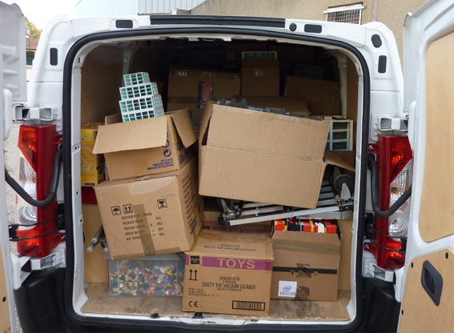

Bon, tout y est !

Je ne reviens pas non plus sur la LGV de seulement 27m... mais bon, ca va déjà vite avec 27m. Mais je peux quand même déjà annoncer que je viens de ’lancer la fabrication’ d’une extension à cette LGV (environ au moins 10 m de plus de LGV ’spéciale LGV’ et je réfléchis aussi aux courbes...). A suivre donc pour une troisième sortie de la LGV allongée et modernisée pour la connectique électrique (ceux qui ont fait le montage savent de quoi je parle) dans une prochaine exposition encore à définir.

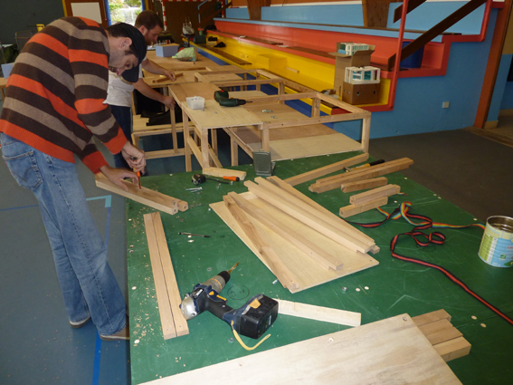

**Dernière finition**

"Quand un TD est bien préparé, ya pu rien à faire ..."

Et j’ai failli l’oublier : la coupe, nous avons même eu une coupe ! Jac, ne la perd pas ;-)

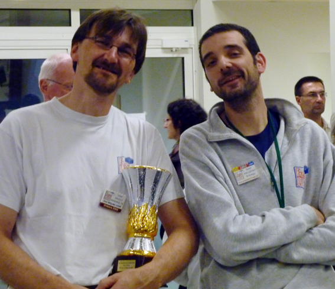

People !

**Denis / cdhd**

* * *

## Coupures de presse

**–** [L’article dans le Dauphiné.](http://www.ledauphine.com/index.jspz?article=218791)  
**–** [Aujourd’hui en France du 2009/11/09](http://photos.freelug.org/main.php/v/JAC/Exposition/Expositions2009/St-ambert+-2009/img148.jpg.html)

## Galeries photos

**–** [Galerie de Xavier Duvert](http://photos.freelug.org/main.php/v/XavierD/Expo+St+Rambert/)  
**–** [Galerie d’Erik](http://photos.freelug.org/main.php/v/brickerik/expositions/2009/2009_StRambert/)  
**–** [Galerie de Nicolas Carel](http://photos.freelug.org/main.php/v/nicolas_carel/StRambert2009/)  
**–** [Galerie de Daniel Stoeffler](http://photos.freelug.org/main.php/v/DanSto/Saint-Rambert_08/)  
**–** [Galerie de Sébastien Hamon](http://photos.freelug.org/main.php/v/sebhamon/Saint+Rambert+2009/)  
**–** [Galerie de Pierrik](http://photos.freelug.org/main.php/v/-PZ/Exposition/st+ramber+09/)  
**–** [Galerie de JAC](http://photos.freelug.org/main.php/v/JAC/Exposition/Expositions2009/St-ambert+-2009/)  
**–** [Galerie de Daniel&Justin](http://photos.freelug.org/main.php/v/rigal_daniel/expositions/st_rambert_2009/)  
**–** [Galerie de Pierrolego](http://photos.freelug.org/main.php/v/pierrel/exposition/2009/strambert/)  
**–** [Résumé sur le site de Fanabriques](http://fanabriques.free.fr/index.php?conect=&action=articles&catid=2&scatid=&artid=64)
