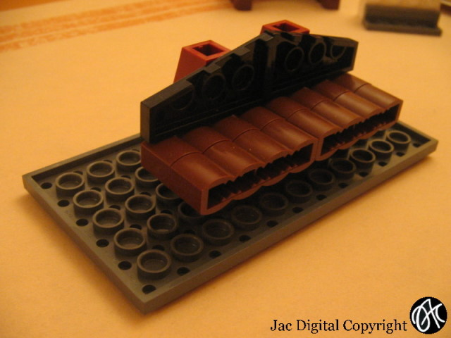
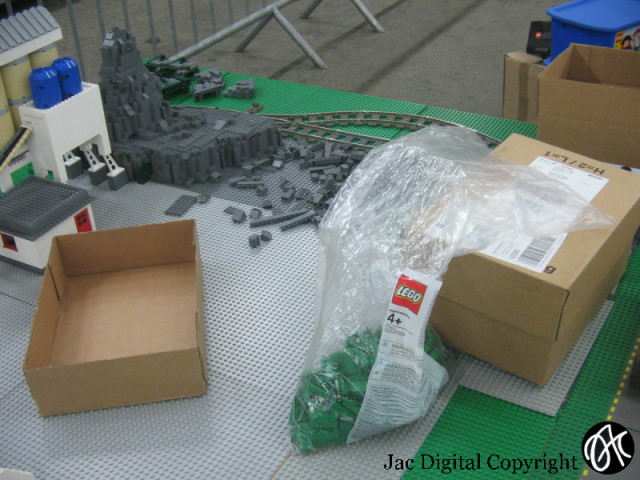
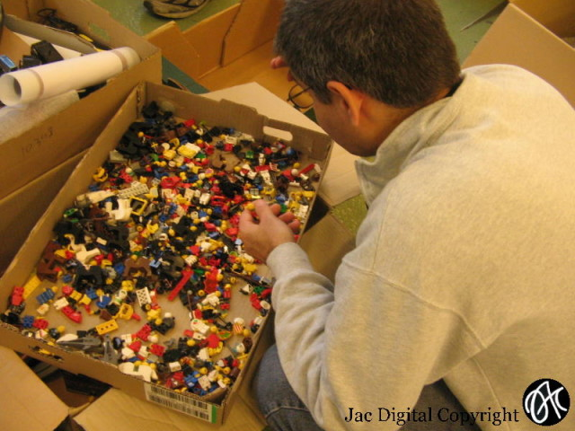

La plupart du temps, lorsque nous participons à une exposition, les constructions sont préparées à l’avance : villages, villes, grands quartiers, lacs, rivières, routes, voies ferrées... La construction par module permet de s’entendre avec les voisins pour s’accorder.

Mais on peut aussi jouer la carte de l’improvisation. Il faut venir avec un stock de pièces conséquent, comme Pierrick, et ne pas avoir peur de s’étaler ni de manquer de pièces.

Lors de la [rencontre au restaurant de Saint-Etienne](/articles/979/), Pierrick est arrivé avec le bateau pirate [6243](http://guide.lugnet.com/set/6243). Ils nous a construit un banc, seulement avec les pièces de cette boîte. Voilà un exemple concret de ce que cela peut donner.

**Le banc de Pierrick pour le concours.**

Un autre exemple, avec la colline en travaux de Pierre L, construite sur place, à l’occasion de l’exposition [Volca-N-Ho rails](/articles/1028/) à Cournon d’Auvergne. Un gros sacs de briques gris-foncées déballé sur la table et une fois les éléments principaux installés, la colline peut prendre forme. Le résultat est tout aussi sympathique.

**Vrac de pièces vertes. La colline est presque finie.**

Pour ma part, je préfère construire mes modules (c’est à dire que chaque bloc est fait sur une plaque de base de 32x32), tranquillement chez moi, avec mon stock de briques à disposition. Mais l’expérience montre que, malgré des logiciels performants pour prévoir les réseaux et les échanges de mails, l’assemblage entre modules peut poser quelques soucis. J’ai donc pris l’habitude d’emporter dans les cartons, des pièces permettant de me coller au mieux, et de rattraper les erreurs. Une fois rassemblé, plus rien ne se distingue, et il doit être difficile de repérer ce que chacun a fait pour le public.

Par contre je ne vois pas la construction du réseau entièrement sur le principe de l’improvisation. Il faut quand même un peu de rigueur au début. Mais de toutes façons, lorsqu’on place des minifigs pour représenter des scènes amusantes, l’improvisation est tout de même là.

**Préparation des personnages.**
