La Ville Du Bois (91) a accueilli son sixième Salon des Passionnés les 14 et 15 novembre 2009.  
Parmi de nombreux autres passionnés (collectionneurs, nostalgiques, gourmands, bricoleurs, sportifs...) une équipe de 12 membres de FreeLUG s’est réunie pour présenter un stand à multiples facettes.

Le challenge de cette année était de proposer un ensemble plongé dans la pénombre. Cette ambiance feutrée fut, pour nous, la première occasion de se lancer dans l’animation lumineuse particulièrement soignée de nos maquettes.

Plus de la moitié des 13 heures de montage fut consacrée à l’installation de l’infrastructure du stand (28 tables modulaires et 22 tables standard, 45 m de nappes, 6 barnums, distribution électrique et éclairages de chaque activité, guirlandes électriques)

[Vidéo du montage](http://photos.freelug.org/main.php/v/gmifr/Expositions/LVB_2009/LVB2009_interval_montage1.avi.html) (Patientez pendant le téléchargement)

Heureusement le "fil de fer en cuivre" de Gilles a été omniprésent, et nous a permis de résoudre les nombreux cas de fixation et accrochages divers ;-))

[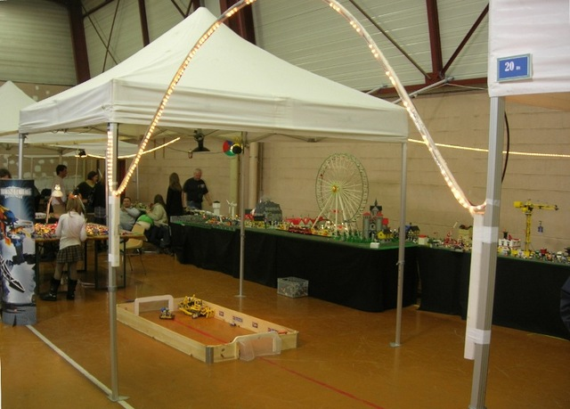](https://www.freelug.org/IMG/jpg/Vue_generale.jpg)

La fête n’aurait pas été complète sans la fanfare qui a accompagné le vin d’honneur de l’inauguration en présence des officiels.

[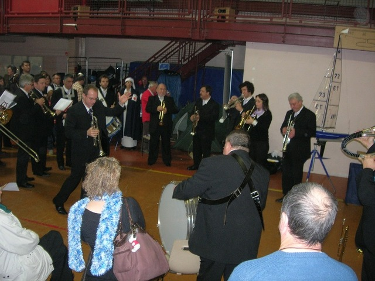](https://www.freelug.org/IMG/jpg/La_Fanfare.jpg)

Passons au petit tour du stand en images.

Malgré la difficulté de faire de belles photos de nuit, chacun des participants vous présente ci-dessous son module.

## La maquette maritime (Jean-Marc)

Bonjour tout le monde.

Entre Cholet et La Ville du Bois, avec l’aide de mon collègue de la section trains HO miniatures, nous avons terminé dans les temps la seconde partie illuminée du diorama maritimo-ferroviaire, le résultat général fut à la hauteur de mes attentes, et je pense que le voeu (exigeant) de Denis a été exaucé également. Merci à Gilles et Denis pour la réparation express de 2 leds. En parlant de Fanfare, bonjour mes oreilles pendant mes démonstrations...

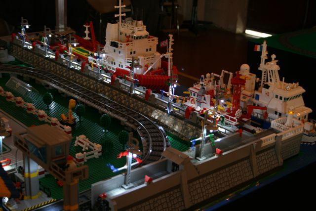

**La jetée de nuit**

Le week-end fut excellent à tous les niveaux, de la bonne humeur, je salue au passage l’intronisation de Pascal et Lydie dans le petit monde des exposants.

_Jean-Marc_

## La gare de triage (Gilles - Philippe)

Ma petite brique à cet article pour souligner que Gilles a eu bien raison d’insister pour qu’on le fasse ce triage. On s’est bien amusé et ses lampadaires ont été tout simplement magnifiques dans la pénombre, la classe !

[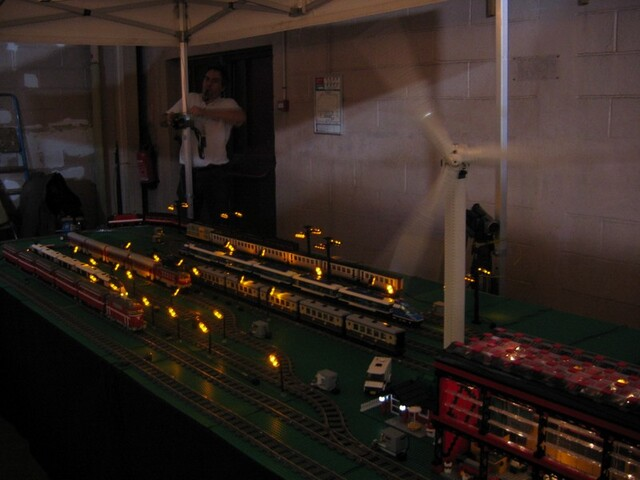](https://www.freelug.org/IMG/jpg/Gilles_Philippe_et_Jeremy_1600x1200_.jpg)

**Gilles et Philippe**

Les trains ont bien circulé pendant ces deux jours et malgré la longueur du réseau, même Pascal placé à l’autre bout s’amusait de voir passer les rames dans ses pattes et les aiguillages bouger tout seuls :) Un peu de démolition, comme d’habitude, "on ne fait pas rouler des trains LEGO sans casser des MOCs" (dicton du jour...). Remarquons tout de même que les deux croisements placés sur la voie principale ont certainement participé à cette animation... non mais quelle idée je vous jure ! Nous avons fini par en virer un au bout d’une demi-journée. Déjà qu’on a du mal à suivre deux trains à la fois, mais quand ils risquent de se croiser, ça corse carrément l’affaire :) Sylvain Senior ne me contredira probablement pas. Encore une magnifique exposition où je suis redevenu enfant au milieu de mes trains à hauteur des yeux. Merci Denis, je pense que notre plaisir à exposer et jouer était perceptible par les visiteurs.

_Philippe_

## Le camping et la ferme (Daniela - Sylvain)

Le camping a été installé derrière le croisement des rails. Il est vrai que les pauvres vacanciers avaient du mal à rester calmes avec tous ces trains qui déraillaient autour d’eux.

[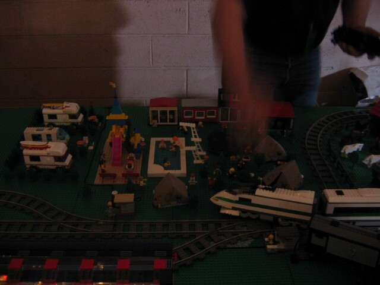](https://www.freelug.org/IMG/jpg/Daniela_Sylvain_1600x1200_.jpg)

A la ferme, c’était beaucoup plus calme. Les agriculteurs travaillaient au champ, à la tombée de la nuit, sous les yeux presque fermés des vaches et des chevaux.

[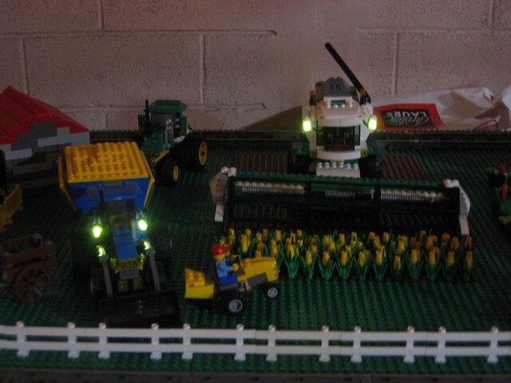](https://www.freelug.org/IMG/jpg/Daniela_et_Sylvain_1600x1200_.jpg)

_Daniela et Sylvain_

## La mine de diamants (Jérémy)

Pour ce module, il a fallu construire à la verticale sur environ 60cm et donc prévoir pas mal de renfort pour faire tenir la structure (piliers de fenêtres Creator).  
La mine est posée sur 2 plaques 48x48 : pas facile à transporter car je n’ai pas prévu de pouvoir démonter en étages. :)

On peut donc y voir deux galeries de mines, l’intérieur est éclairé avec des guirlandes led à piles, recouvertes de diamants ou de plaques rondes 1x1 transparentes.  
Les leds permettaient d’avoir suffisamment de lumière tout en gardant la lumière ambiante que l’on peut avoir à l’intérieur d’une vraie mine.

[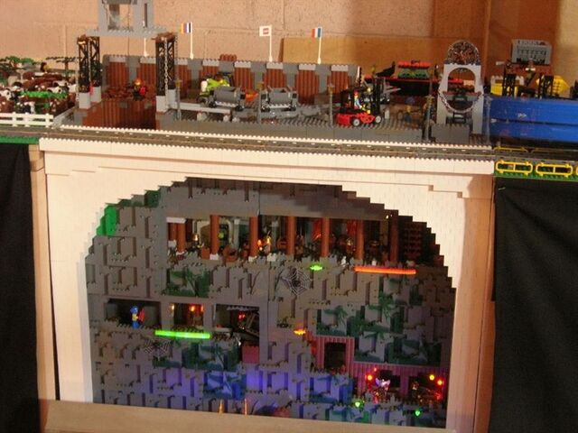](https://www.freelug.org/IMG/jpg/La_mine.jpg)

Le dimanche, Denis a rajouté une lumière noire, ce qui a augmenté la brillance de certaines pièces en avant-plan (rochers, monstres Power Miners, araignées, diamants...).  
Une arche en premier plan permettait de faire passer une voie de chemin de fer à 60 cm de hauteur sur 96 tenons.  
Le raccord et la décoration entre le haut de la mine avec le reste du layout n’a pu se faire que le samedi, une fois la mine posée en conditions réelles.

_Jérémy_

## La campagne / Le camp Scout (Daniela - Denis)

Les scouts se sont installés au pied d’un château d’eau et d’une petite éolienne. Ils souhaitaient aussi la tranquillité, mais à leur grand surprise, sur la route pas loin de là, il y avait des énormes embouteillages. Afin de trouver la raison de ce vacarme, un éclaireur est parti chercher l’explication. "C’est à cause d’un parc d’attractions pas loin !" dit-il à son retour. "Ne serait-il pas agréable d’aller y faire un tour ?"

[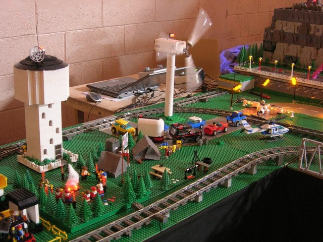](https://www.freelug.org/IMG/jpg/Le_camp_scouts.jpg)

**Les Scouts autour du feu de camp**

_Daniela, Denis et Syvain_

## Le Volcan en éruption (Gilles)

Un volcan... J’ai de temps en temps regretté d’avoir eu cette idée ;-), car à la fin, tout n’était pas comme prévu au début. Des idées de départ n’ont pas été réalisées, ou n’étaient pas fonctionnelles... Mais d’autres ont pris leur place.

[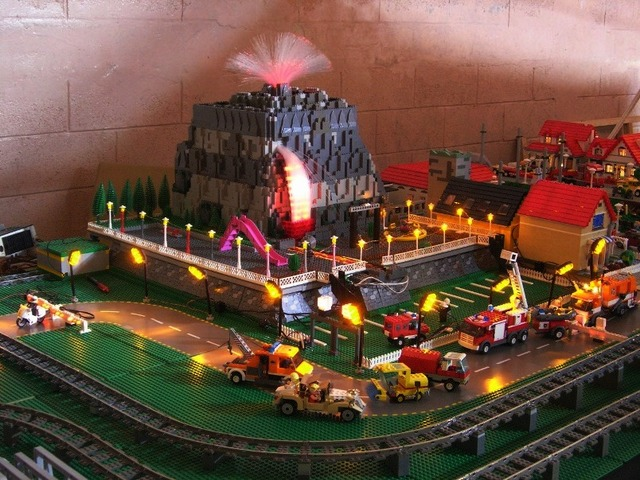](https://www.freelug.org/IMG/jpg/Le_volcan2.jpg)

L’idée de Denis de faire une exposition dans l’obscurité nous a fait pas mal réfléchir et pour ma part, obligé à ressortir mon fer à souder qui n’avait pas chauffé autant depuis bien longtemps... Mais l’ambiance donnée au "stand" FreeLUG était au rendez-vous.

Comme toujours, nous nous sommes bien amusés et le public en a pris plein les yeux (nous aussi).  
Le démontage a bien sûr été plus rapide que le montage. Heureusement.

Remarque pour Denis : Dans deux ans, j’amène l’escabeau... Laisse le tien... Nous l’avions surnommé l’escabeau de la mort... Car il avait déjà bien vécu ;-)

_Gilles_

## Le village (Daniela - Sylvain)

Le petit village était paisible et les gens heureux d’être chez eux dans leurs petites maisons chaleureusement illuminées.

[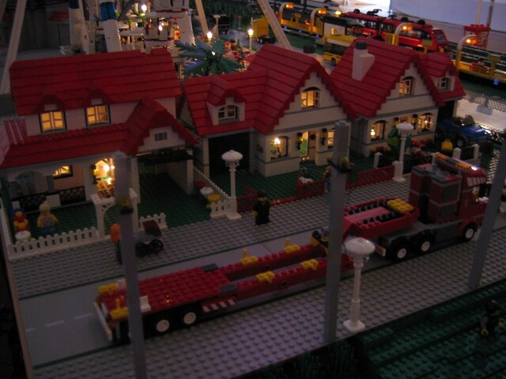](https://www.freelug.org/IMG/jpg/Daniela_et_Sylvain_detai_1_1600x1200_.jpg)

Certains sont tout de même sortis pour se faire un petit restaurant entre amis dans la pizzeria du village, mais ils avaient beaucoup de mal à trouver leur chemin, car par un mystère inexplicable, les lampadaires dans les rues étaient tous en panne.  
Une équipe d’intervention a été envoyée rapidement sur place, mais, malgré tous leurs efforts, ils n’ont pas réussi à résoudre le problème.  
Mystère...

[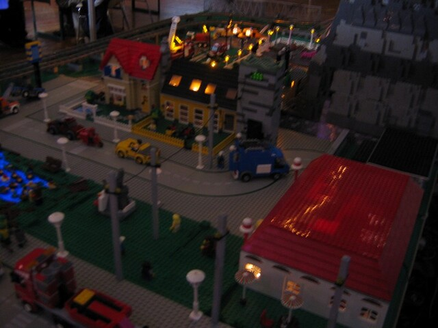](https://www.freelug.org/IMG/jpg/Daniela_et_Sylvain_detail_1600x1200_.jpg)

_Daniela et Sylvain_

## La Grande Roue (Denis)

Pour sa troisième sortie (après [PicWic](https://www.freelug.org/spip.php?article927) et [Cholet](https://www.freelug.org/spip.php?article1022)) en exposition, la grande roue avait revêtu sa parure de lumière. En effet, le néon de lumière noire installé juste au-dessus faisait ressortir les nombreux 1x1 fluo implantés sur le pourtour et les bras de la belle.

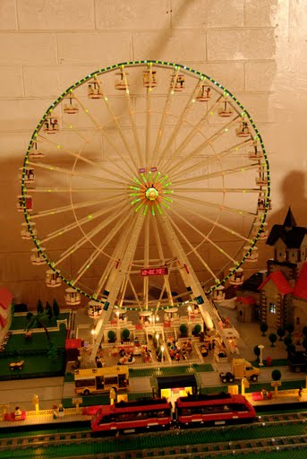

**La Grande Roue étincelante (Photo : P. Nowottnick)**

Quant au sol, les 8 lampadaires ont été équipés de loupiotes permettant aux impatients possesseurs de ticket, d’attendre leur tour dans la file pour admirer, de haut, l’ensemble du salon.  
La caisse et la baraque à frites étaient également éclairées.

La mini gare et les lampadaires du quai brillaient eux aussi.

_Denis_

## L’église de St Nectaire et son marché médiéval (Didier)

C’était jour de marché au quartier médiéval. Les curieux venaient photographier l’église romane et les croyants s’y recueillir. Quelques intrus se sont malicieusement introduits dans le bâtiment, les voyez-vous ?

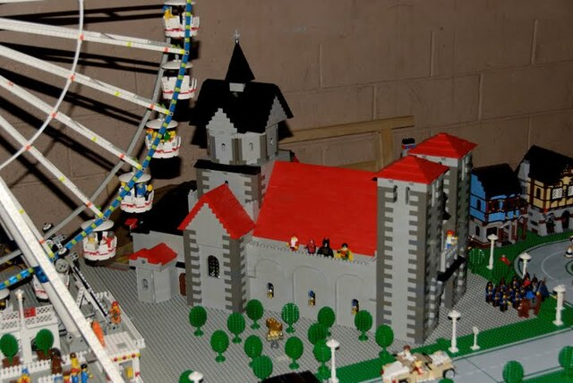

**Bel ouvrage ! (Photo : P. Novottnick)**

_Didier_

## La maison en feu (Florian - Denis)

Mon module est une maison en feu. Les flammes en papier crépon sont actionnées par un ventilateur. Les camions de pompier ont tous des gyrophares qui clignotent et les lampadaires s’allument.  
"Pas besoin de s’inquiéter, les sapeurs pompiers sont là pour éteindre l’incendie."

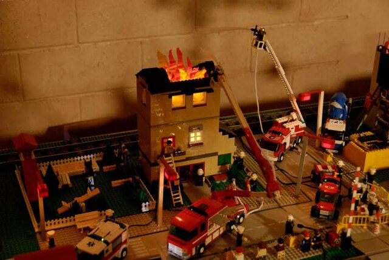

**Les pompiers s’affairent (Photo : P. Nowottnick)**

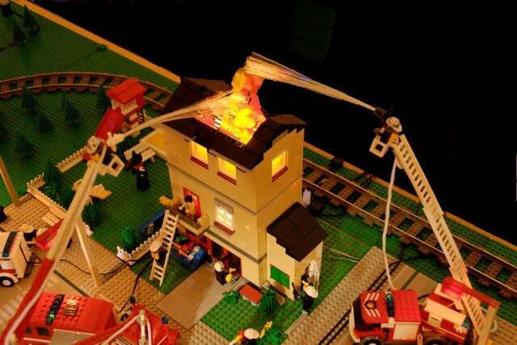

**Vite, noyons l’incendie ! (Photo : P. Novottnick)**

## Le chantier et sa manifestation (Sébastien)

Dernière et ultime sortie de la grue 7905 après quelques modifications (motorisation des mouvements et éclairage) par rapport au modèle original. Elle est mise en scène pour la construction d’un immeuble de type [Brickciel](https://www.freelug.org/spip.php?article148)

[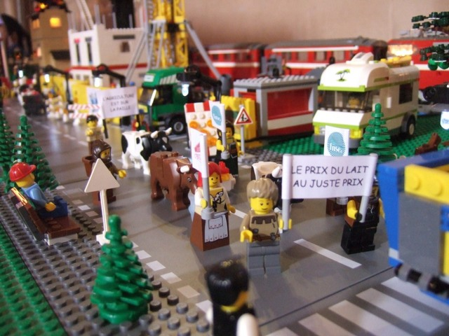](https://www.freelug.org/IMG/jpg/DSCF5114-philo.jpg)

**Manifestation d’agriculteur (photo de Philo)**

Pour agrémenter le tout, nos chers agriculteurs ont entrepris une manifestation pour réclamer plus de revenus au "président Minifig", mais aura-t-il le budget pour !!

_Seb_

## La ville lumière (Nicolas)

Le thème de la pénombre de cette année m’a donné l’idée de créer un quartier de Miami, et bien sûr le quartier Art Déco. Ce sont de petits immeubles aux couleurs pastels avec des façades pleines de détails. Ces immeubles avec leurs larges terrasses sont souvent très animés.  
En traversant la rue, vous trouverez un célèbre café et une gare à la verrière en forme de vague.  
Enfin, si vous avez un petit creux, allez donc faire un tour au restaurant, de l’autre côté de la rivière.

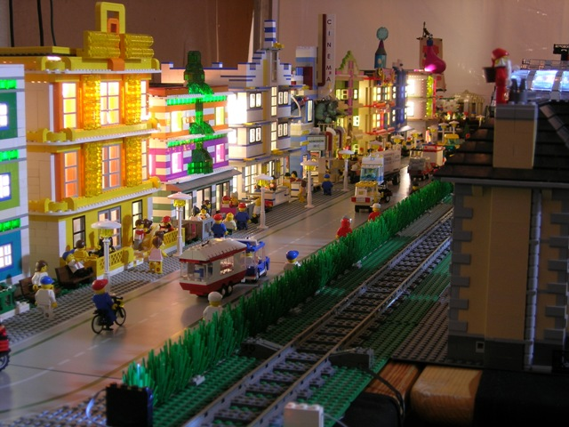

**La grande Avenue**

Encore plein de souvenirs en tête pour cette très belle exposition et un grand merci à Denis de nous avoir chaleureusement invités.

_Nicolas_

## La gare de fret et sa rotonde (Pascal)

L’idée m’est venue en lisant une revue de train miniature, mais les problèmes sont vite arrivés. Comment électrifier les rails du pont tournant et motoriser celui-ci ?

Après avoir presque tout résolu, raccorder le module au réseau FreeLUG fut pour moi une grande satisfaction.

[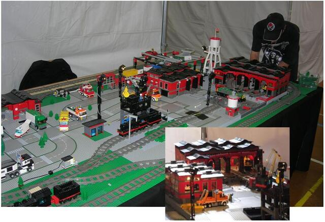](https://www.freelug.org/IMG/jpg/Rotonde.jpg)

**La gare de fret et la rotonde**

Je remercie énormément mes co-exposants pour leur aide et leur patience.

j’espère pouvoir recommencer bientôt l’expérience.

_Pascal_

* * *

## [Vidéo du diorama](http://photos.freelug.org/main.php/v/gmifr/Expositions/LVB_2009/LVB_2009M.avi.html)

(Cliquez sur ce lien et patientez plusieurs minutes pendant le téléchargement)

* * *

D’autres animations ont été proposées au public :

## Le stade de Techball

En bonne place, le techball a attiré les curieux. Les plus téméraires s’y sont essayés. Surpris par la maniabilité des engins, le public est resté médusé devant leurs circonvolutions (plus ou moins volontaires !).

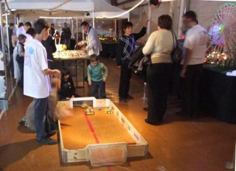

**Un terrain de jeu**

## La table de construction

Une double table était à la disposition des constructeurs, improvisateurs, designers, architectes, sculpteurs, rêveurs de toutes sortes.

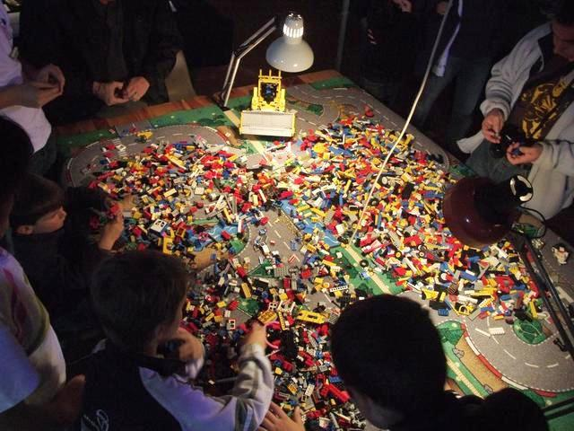

**Le Bull est prêt pour le rangement !**

## La table de jeux

A la table de jeux, il y avait toujours du monde curieux de voir ce qu’on y faisait. Il y avait un jeu inventé par Florian, un puzzle de LEGO CITY ainsi que les jeux de société qui seront commercialisés prochainement par LEGO.  
Mon activité de devinette sur le thème du sport, qui avait déjà fait un tour à [Fana’briques 2009](https://www.freelug.org/spip.php?article948) était présente également et les participants au jeu étaient heureux de repartir avec un petit cheval marron.

[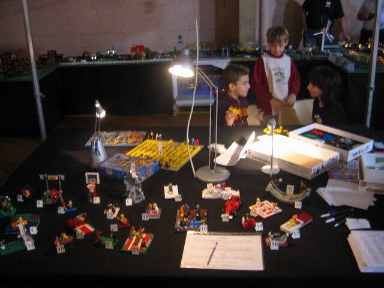](https://www.freelug.org/IMG/jpg/Table_des_jeux_1600x1200_.jpg)

_Daniela et Sylvain_

## Le tapis DUPLO

Les plus jeunes ont pu s’amuser avec une large collection de LEGO DUPLO mis à disposition.  
Les petites filles ont pu trouver vaches cochons chevaux poules pour construire des fermes, les petit garçons ont  
eux trouvé des véhicules afin d’agrémenter leurs garages.  
Les négociations entre parents et enfants ont parfois été rudes afin de quitter l’univers DUPLO.

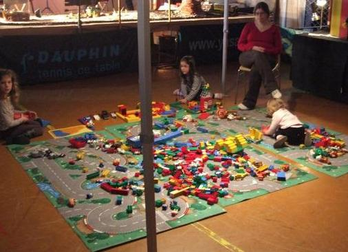

**Les petits te remercient Nicolas.**

## Le concours

Il s’agissait de dénombrer les pièces de la tour en ruine exposée sur le stand.  
Résultat du comptage en fin d’exposition : 307 pièces.

Les 20 réponses les plus proches de cette valeur ont été récompensées par des lots offerts par Gilles, Sébastien et Denis (ils en sont ici remerciés).

Le gagnant est Antoine, avec une estimation de 306 pièces.  
Il a remporté le gros lot offert par le Magasin Oxybul de Ballainvilliers : Le camion de Police (Boîte N°7743).

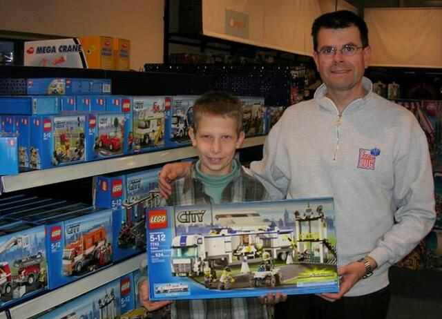

**Antoine et son premier prix - Bravo !**

**Liste des gagants du concours**

## Le final

Enfin, après le démontage du dimanche soir, Pascal, le nouveau venu et primo-exposant a souhaité nous offrir un verre pour arroser son intégration. Belle initiative fort appréciée.

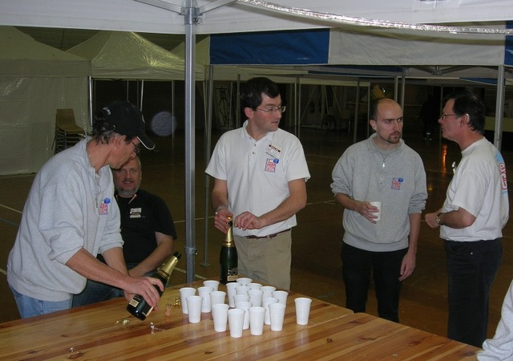

* * *

## En résumé :

Un week-end très intense.

Merci aux Freelugiens exposants venus de loin (Morbihan, Charente et Loiret) et à ceux venus en visiteurs.

Merci aux visiteurs passionnés, futurs membres de l’association, d’origine du Val d’Oise et du Val de Marne qui se sont manifestés, ils sont les bienvenus.

Merci au "Club des Roussettes", l’organisateur, pour son  
invitation et son accueil. Merci également à notre partenaire, le magasin OXYBUL de Ballainvilliers.

Nous espérons avoir enchanté le public qui, bien souvent, a manifesté son admiration.

Rendez-vous est pris pour 2011 avec un thème probable "Jouet et Jouer".

N’hésitez plus, venez exposer et partager votre passion !

A bientôt.

## Galeries de photos

**–** [Galerie de Daniela](http://photos.freelug.org/main.php/v/Daniela+et+Sylv1/Expositions/2009+la+Ville+du+Bois_001/)  
**–** [Galerie de DenisL](http://photos.freelug.org/main.php/v/dlaurencon/Expo/LVDB+2009/Photos/)  
**–** [Galerie de Sébastien](http://photos.freelug.org/main.php/v/sebhamon/La+Ville+Du+Bois+2009/)  
**–** [Galerie d’Erik](http://photos.freelug.org/main.php/v/brickerik/expositions/2009/LaVilleDuBois/)  
**–** [Galerie de Gilles](http://photos.freelug.org/main.php/v/gmifr/Expositions/LVB_2009/)
