Après la série d’articles sur les capteurs tierce partie, j’ai eu envie de faire le tour des capteurs de la gamme LEGO Mindstorms (l’ancienne RCX et la nouvelle NXT), et de proposer des bouts de code NXC pour les exploiter avec les briques NXT.

## Bricxcc et NXC, installation

**BricxCC** (Bricx Command Center) est un environnement de développement sous Windows (et avec un peu de bricolage sous MAC OS X), qui permet de programmer les briques NXT dans un langage proche du C, le **NXC** (Not eXactly C).

Pour l’installer, il vous faut la dernière version en date de [Bricxcc](http://sourceforge.net/projects/bricxcc/files/bricxcc/). Téléchargez aussi la dernière [mise à jour](http://bricxcc.sourceforge.net/test_release.zip) de Bricxcc.

Cette dernière mise à jour contient une version du firmware optimisé pour tirer partie des avancées du langage NXC (tableau multidimensionnels, parallélisation de l’exécution du code, mathématiques avancées).

Pour communiquer avec la brique NXT, et si vous n’avez pas installé le programme fourni par LEGO, il vous faudra installer le [driver NXT 1.02](http://mindstorms.lego.com/en-us/support/files/default.aspx#Driver). [De la documentation est disponible](http://mindstorms.lego.com/Support/Updates/), les "developer kit" sont très instructifs, LEGO ayant fait le choix de l’open source, beaucoup d’informations utiles sont dispersées tout au long des documents.

**Installation**

-   **exécutable bricxcc** pour installer bricxcc
-   **archive de mise à jour** à décompresser, puis "copier/coller" sur le répertoire de l’installation de bricxcc.
-   **driver NXT** connectez le NXT directement via l’USB, s’il est n’est pas reconnu, installez le driver.

Pour vérifier que tout est en place, télécharger le firmware optimisé dans le NXT, si c’est bon, vous avez fini, sinon, lisez la documentation très bien faite de bricxcc (en anglais), et recommencez l’installation.

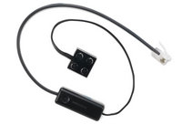

**Cable de conversion RCX <-> NXT**

## Clavier

Le NXT a 4 boutons en face avant.

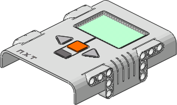

**NXT - Clavier**

| Bouton |  | Constantes |  | Valeur |  | Forme, couleur |
| --- | --- | --- | --- | --- | --- | --- |
| BTN1 |  | BTNEXIT |  | 0 |  | Rectangle, gris foncé |
| BTN2 |  | BTNRIGHT |  | 1 |  | Triangle <, gris clair |
| BTN3 |  | BTNLEFT |  | 2 |  | Triangle >, gris clair |
| BTN4 |  | BTNCENTER |  | 3 |  | Carré, orange |
|  |  | NO\_OF\_BTNS |  | 4 |  |  |

-   **ButtonCount(btn, reset)** renvoie le nombre de fois que le bouton btn a été appuyé et relâché, depuis que son compteur a été remis à zéro. Si reset est à true, remise à zéro du compteur après lecture.

value = ButtonCount(BTN1, true);

-   **ButtonPressed(btn, reset)** renvoie un booléen si le bouton btn est appuyé. Si reset est à true, remise à zéro du compteur après lecture.

value = ButtonPressed(BTN1, true);

-   **ReadButtonEx(btn, reset, out pressed, out count)** combine les deux fonctions précédentes, et remplie pressed par l’état appuyé, et count par le compteur. Si reset est à true, remise à zéro du compteur après lecture.

ReadButtonEx(BTN1, true, pressed, count);

-   **ButtonPressCount(btn)\*** renvoie le nombre d’appuis sur le bouton btn.

-   -   **ButtonLongPressCount(btn)\*** renvoie le nombre d’appuis "longs" sur le bouton btn.

-   **ButtonReleaseCount(btn)\*** renvoie le nombre de relâchés sur le bouton btn.

-   -   **ButtonShortReleaseCount(btn)\*** renvoie le nombre de relâchés "courts" sur le bouton btn.

-   -   **ButtonLongReleaseCount(btn)\*** renvoie le nombre de relâchés "longs" sur le bouton btn.

\* Pour chacune de ces 5 fonctions, on a la fonction Setxxx qui force le paramètre à une valeur donnée : ainsi **SetButtonReleaseCount(btn, value)** force le nombre de relachés du bouton btn à value.

SetButtonReleaseCount(BTN1, 10); // force à 10 le nombre de relâchés du bouton exit

-   **ButtonState(btn)** renvoie l’état du bouton btn, selon la grille suivante :

| constantes d’état du bouton |  | Valeur |  | État du bouton |
| --- | --- | --- | --- | --- |
| BTNSTATE\_PRESSED\_EV |  | 0x01 |  | appuyé puis relâché |
| BTNSTATE\_SHORT\_RELEASED\_EV |  | 0x02 |  | relâché court |
| BTNSTATE\_LONG\_PRESSED\_EV |  | 0x04 |  | appui long |
| BTNSTATE\_LONG\_RELEASED\_EV |  | 0x08 |  | relâché long |
| BTNSTATE\_PRESSED\_STATE |  | 0x80 |  | appuyé |

-   **SetButtonState(btn, value)** force l’état du bouton btn.

SetButtonState(BTN1, BTNSTATE\_PRESSED\_EV); // force l'état du bouton exit à "appuyé"

[Voici un exemple de gestion de menu avancée](http://www.norgesgade14.dk/nxt_scanner/menu.html), avec menu déroulant plein écran, rubriques dynamiques, navigation au clavier et double clic. Ce projet est très impressionnant, il s’agit d’un [scanner piloté par NXT](http://www.norgesgade14.dk/nxt_scanner.php), avec sauvegarde dans un fichier de l’image résultante.

## Capteurs

**Constantes et variables "capteurs" en NXC**

Il y a 4 entrées, numérotées en interne 0, 1, 2, et 3. Or elles sont marquées 1, 2, 3, et 4 sur le boitier du NXT. Pour vous aider, des constantes **S1**, **S2**, **S3**, et **S4** ont été définies, et désignent les ports tels que labellisés. Les variables **SENSOR\_1**, **SENSOR\_2**, **SENSOR\_3**, et **SENSOR\_4** ont aussi été définies, et appellent la mesure du capteur.

x = SENSOR\_1; // lit le capteur connecté en 1, et stocke la valeur reçue et traitée en x

Comme pour les boutons du clavier, chaque capteur a ses constantes d’état, qui sont constamment remis à jour.

| Constantes d’état |  | état du capteur |
| --- | --- | --- |
| Type |  | Type de capteur |
| InputMode |  | Mode de traitement de la mesure |
| RawValue |  | valeur brute de la mesure |
| NormalizedValue |  | valeur normée |
| ScaledValue |  | valeur traitée |
| InvalidData |  | Invalide la donnée traité |

**Sensor(port)** renvoie la valeur traitée du capteur connecté en port (doit être S1..S4). Sensor(S1) est identique à SENSOR\_1, les deux lancent la mesure.

x = Sensor(S1); // lit le capteur connecté en 1, et stocke la valeur reçue et traitée en x

**SensorType(port)** renvoie la valeur du type configuré pour le capteur connecté en port (doit être S1..S4). cf. ci-dessous pour l’explication sur les types.

x = SensorType(S1); // Type du capteur

**SensorMode(port)** renvoie la valeur du mode configuré pour le capteur connecté en port (doit être S1..S4). cf. ci-dessous pour l’explication sur les modes.

x = SensorMode(S1); // Mode des données du capteur

**SensorRaw(port)** renvoie la valeur brute du capteur connecté en port (doit être S1..S4). Elle évolue dans l’intervalle \[0..1023\], et est issue de la numérisation sur 10 Bits, à 333 Hz.

x = SensorRaw(S1);

**SensorNormalized(port)** renvoie la valeur normée du capteur connecté en port (doit être S1..S4).

x = SensorNormalized(S1);

**SensorScaled(port)** renvoie la valeur traitée du capteur connecté en port (doit être S1..S4). SensorScaled(S1) est identique à Sensor(S1).

x = SensorScaled(S1);

**SensorInvalid(port)** renvoie le booléen de bonne exécution de la mesure du capteur connecté en port (doit être S1..S4).

x = SensorInvalid(S1); // Mesure OK?

**SensorBoolean(port)** renvoie le résultat (0/1) de la conversion booléenne. Une pente peut être définie en utilisant **SetSensorMode()**.

x = SensorBoolean(S1); // 0/1?

**ClearSensor(port)** remet à zéro le compteur associés au capteur, configuré pour mesurer des données quantitatives, comme les pas de capteurs de rotation, ou les compteurs d’impulsions.

ClearSensor(S1); // RAZ compteur

**ResetSensor(port)** remet à zéro les données capteur, après un changement de type ou de mode à la volée dans le corps du programme.

ResetSensor(S1); // RAZ capteur

**Types et Modes "capteurs" en NXC**

Les ports d’entrée du NXT sont capables de s’interfacer avec quantité de capteurs, mais c’est le programme qui précise au NXT le **Type** de capteur connecté. En NXC, il y a 17 types de capteurs reconnus, plus le type "capteur non configuré". **SetSensorType()** configure le type de capteur, qui peut changer au cours de l’exécution du programme. Mal configurer un type de capteur expose à une mesure erratique, et donc à un comportement erratique du robot.

| Type de Capteur |  | Capteur |
| --- | --- | --- |
| SENSOR\_TYPE\_NONE |  | capteur non configuré |
| SENSOR\_TYPE\_TOUCH |  | capteur de contact NXT ou RCX |
| SENSOR\_TYPE\_TEMPERATURE |  | capteur de température RCX |
| SENSOR\_TYPE\_LIGHT |  | capteur de luminosité RCX |
| SENSOR\_TYPE\_ROTATION |  | capteur de rotation RCX |
| SENSOR\_TYPE\_LIGHT\_ACTIVE |  | capteur de luminosité NXT avec source allumée |
| SENSOR\_TYPE\_LIGHT\_INACTIVE |  | capteur de luminosité NXT avec source éteinte |
| SENSOR\_TYPE\_SOUND\_DB |  | capteur de niveau sonore NXT en dB |
| SENSOR\_TYPE\_SOUND\_DBA |  | capteur de niveau sonore NXT en dBA |
| SENSOR\_TYPE\_CUSTOM |  | capteur particulier (pas utilisé) |
| SENSOR\_TYPE\_LOWSPEED |  | capteur I2C sans source 9V(pin 1 inactive) |
| SENSOR\_TYPE\_LOWSPEED\_9V |  | capteur I2C avec source 9V(pin 1 active) |
| SENSOR\_TYPE\_HIGHSPEED |  | capteur rapide, RS485 (pas utilisé) |
| SENSOR\_TYPE\_COLORFULL |  | capteur de couleur-Led blanche |
| SENSOR\_TYPE\_COLORRED |  | capteur de couleur-Led rouge |
| SENSOR\_TYPE\_COLORGREEN |  | capteur de couleur-Led verte |
| SENSOR\_TYPE\_COLORBLUE |  | capteur de couleur-Led bleue |
| SENSOR\_TYPE\_COLORNONE |  | capteur de couleur-Led éteinte |

**SetSensorType(port, const type)** configure le type de capteur, port doit être S1..S4, type, l’un de ceux du tableau.

SetSensorType(S1, SENSOR\_TYPE\_TOUCH); // configure le port 1 avec un capteur de type "contact"

Le **Mode** précise comment les données brutes (raw value) venant du capteur (dont on a préalablement défini le type...) vont être traitées (processed value). Certains modes n’ont de sens qu’avec certains types de capteurs, ainsi **SENSOR\_MODE\_ROTATION** n’est utile qu’avec un capteur de rotation...

| Mode de Traitement |  | Traitement |
| --- | --- | --- |
| SENSOR\_MODE\_RAW |  | donnée brute (sur 10 bits) 0 à 1023 |
| SENSOR\_MODE\_BOOL |  | valeur booléenne (0 ou 1) |
| SENSOR\_MODE\_EDGE |  | compte le nombres de transitions booléennes(0 à 1, 1 à 0) |
| SENSOR\_MODE\_PULSE |  | compte le nombres de périodes booléennes, pulsations |
| SENSOR\_MODE\_PERCENT |  | valeur de 0 à 100 |
| SENSOR\_MODE\_FAHRENHEIT |  | degrés F |
| SENSOR\_MODE\_CELSIUS |  | degrés C |
| SENSOR\_MODE\_ROTATION |  | rotation (16 impulsions par rotation) |

**SetSensorMode(port, const mode)** configure le mode de traitement des données provenant du capteur, port doit être S1..S4, mode, l’un de ceux du tableau ci dessus.

SetSensorMode(S1, SENSOR\_MODE\_RAW); // mode "raw", données brutes x = SENSOR\_1; //lit le capteur

Le NXT fournit une conversion booléenne pour tous les capteurs, quelque soit le mode choisi (ex. SENSOR\_MODE\_PERCENT ). Cette conversion est basée sur une hystérésis. Toute valeur "raw" inférieure à 460 sera vue comme un 1, toute valeur "raw" supérieure à 562 sera traduite par un 0. Une pente \[0..31\] peut être rajoutée au mode choisi, si la valeur "raw" change plus que ce seuil en 3 ms (333 fois/s), la conversion booléenne change de valeur selon le sens, 0 pour une augmentation, 1 pour une diminution. Cela permet de suivre des phénomènes très rapides.

SetSensorMode(S1, SENSOR\_MODE\_RAW + 10); // mode raw, pente de 10 x = SENSOR\_1; //lit le capteur

Le langage NXC permet de définir le type et le mode en même temps, pour les combinaisons standards d’utilisation d’un capteur donné.

| Combinaison |  | Type |  | Mode |
| --- | --- | --- | --- | --- |
| SENSOR\_TOUCH |  | SENSOR\_TYPE\_TOUCH |  | SENSOR\_MODE\_BOOL |
| SENSOR\_LIGHT |  | SENSOR\_TYPE\_LIGHT |  | SENSOR\_MODE\_PERCENT |
| SENSOR\_ROTATION |  | SENSOR\_TYPE\_ROTATION |  | SENSOR\_MODE\_ROTATION |
| SENSOR\_CELSIUS |  | SENSOR\_TYPE\_TEMPERATURE |  | SENSOR\_MODE\_CELSIUS |
| SENSOR\_FAHRENHEIT |  | SENSOR\_TYPE\_TEMPERATURE |  | SENSOR\_MODE\_FAHRENHEIT |
| SENSOR\_PULSE |  | SENSOR\_TYPE\_TOUCH |  | SENSOR\_MODE\_PULSE |
| SENSOR\_EDGE |  | SENSOR\_TYPE\_TOUCH |  | SENSOR\_MODE\_EDGE |

**SetSensor(port, configuration)** permet de définir la configuration (type/mode) d’un capteur. port doit être S1..S4, configuration l’une des combinaison du tableau ci dessus.

SetSensor(S1, SENSOR\_TOUCH); //configure le port 1 pour le traitement d'un capteur de contact

## Cable de conversion RCX<->NXT

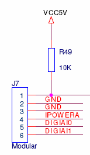

**NXT schéma d’un port d’entrée**

Le NXT à une interface d’entrée à six câbles

| Pin |  | Couleur |  | Nom |  | Fonction |
| --- | --- | --- | --- | --- | --- | --- |
| 1 |  | Blanc |  | ANA |  | Entrée analogique, avec résistance de tirage (10K) ou Source de tension (I2C) 9V |
| 2 |  | Noir |  | GND |  | Masse analogique |
| 3 |  | Rouge |  | GND |  | Masse numérique |
| 4 |  | Vert |  | IPOWERA/Vcc |  | Source de tension (I2C) 4,3V |
| 5 |  | Jaune |  | DIGI0/CLK |  | Ligne Horloge I2C |
| 6 |  | Bleu |  | DIGI1/DATA |  | Ligne Données I2C |

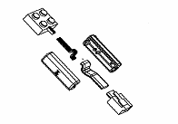

**Schéma du câble de conversion**

Pour pouvoir utiliser des capteurs initialement développer pour le RCX (pour rappel, interface 2 fils, protégée des inversions par pont de diode, mesure et alimentation véhiculées par les mêmes fils), l’astuce consiste à connecter les pins 1 et 2 du NXT, avec les deux conducteurs du câble RCX. Pour lire la valeur du capteur, il faut faire appel à des fonctions déclenchant la numérisation du port (sur 10 bits, 333 fois par seconde) , par le microprocesseur du NXT.

[Voici une description du mode opératoire de la soudure des câbles](http://philohome.com/nxtcables/nxtcable.htm), des photos, etc... N’hésitez pas à vous balader sur ce site, c’est une véritable mine d’or, et à questionner Philo, qui, comme son site (en anglais) ne le laisse pas deviner, est français.

LEGO vend ces câbles sous forme de kit de trois , sous [la référence 8528](http://shop.lego.com/ByCategory/Product.aspx?p=8528)

## Capteurs NXT

Des fonctions particulières sont définies en NXC pour accéder aux capteurs NXT standards :

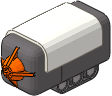

**NXT - Capteur de contact**

**Capteur de contact (analogique)**

**SetSensorTouch(port)** configure le port S1..S4 pour recevoir un capteur de contact (RCX ou NXT).

SetSensorTouch(S1); // contact en 1 x = SENSOR\_1; //lit le capteur

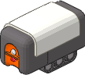

**NXT - Capteur de luminosité**

**Capteur de luminosité (analogique)**

**SetSensorLight(port)** configure le port S1..S4 pour recevoir un capteur de luminosité (source de lumière active).

SetSensorLight(S1); // luminosité en 1, source active, en % x = SENSOR\_1; //lit le capteur

**NXT - Capteur de niveau sonore**

**Capteur de niveau sonore (analogique)**

Ce capteur est un capteur d’amplitude sonore, il délivre le niveau de bruit ambiant. Vous trouverez des [informations intéressantes sur ce capteur](http://www.convict.lu/htm/rob/NXT_sound_sensor.htm)\], des projets de têtes chercheuses de sons, et auto directrices notamment. Ce capteur pourrait faire bien plus, car son connecteur arrière ressort le flux capturé par le micro, amplifié en pin 6. Or les pins 6 (DIGIAI1) des ports d’entrées pourraient être configurées pour faire de la capture de signaux analogique à 8000 Hz, et donc être capable de fournir après traitement du signal, les fréquences et les puissances, et [donc ouvrir la voie à la reconnaissance vocale sur NXT](http://instruct1.cit.cornell.edu/courses/ee476/FinalProjects/s2006/XL76_SL362/XL76%20SL362/index.html)... mais il faudrait un firmware spécialement écrit pour ouvrir cette possibilité, et je n’en ai pas les compétences. [Plus d’informations](http://forums.nxtasy.org/index.php?showtopic=3107)

**SetSensorSound(port)** configure le port S1..S4 pour recevoir un capteur de niveau sonore (dB).

SetSensorSound(S1); // son en 1, en dB x = SENSOR\_1; //lit le capteur

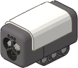

**NXT - Capteur colorimétrique**

**Capteur de couleur (analogique)**

Le capteur de couleur est assez particulier, il enferme une led RGB qui peut être commandée, et un capteur de couleur. Pour reproduire le comportement du capteur sous l’environnement de programmation LEGO, le capteur peut distinguer 6 couleurs, dont la valeur est normée selon la table suivante :

| Constante |  | Valeur |  | Couleur détectée |
| --- | --- | --- | --- | --- |
| INPUT\_BLACKCOLOR |  | 1 |  | Noir |
| INPUT\_BLUECOLOR |  | 2 |  | Bleu |
| INPUT\_GREENCOLOR |  | 3 |  | Vert |
| INPUT\_YELLOWCOLOR |  | 4 |  | Jaune |
| INPUT\_REDCOLOR |  | 5 |  | Rouge |
| INPUT\_WHITECOLOR |  | 6 |  | Blanc |

**SetSensor(port, SENSORCOLORxxx)** permet d’initialiser le capteur, et de commander la LED RGB.

SetSensor(S1, SENSOR\_COLORFULL); // allume la led en blanc x = SENSOR\_1; //lit le capteur, 6 couleurs

Pour aller plus loin, NXC fournit la procédure **ReadSensorColorEx(port, colorval, raw, norm, scaled)**, fournit la couleur détectée, ainsi que les composantes RGB "raw" (brutes) et "norm" (normées) de la couleur réellement détectée. Cela permet une plus grande plage d’utilisation du capteur. Cependant, pour utiliser la procédure **ReadSensorColorEx()**, il faut utiliser des tableaux de variables, selon la structure suivante

| Constante |  | index du tableau |
| --- | --- | --- |
| INPUT\_RED |  | 0 |
| INPUT\_GREEN |  | 1 |
| INPUT\_BLUE |  | 2 |
| INPUT\_BLANK |  | 3 |

Voici un exemple de code pour utiliser le capteur :

int colorval; // couleur détectée unsigned int raw\[\]; //tableau des composantes RGB brutes unsigned int norm\[\];//tableau des composantes RGB normées int scaled\[\]; SetSensorColorFull(IN\_2);// allume la LED RGB, en blanc while (true) { ReadSensorColorEx(IN\_2, colorval, raw, norm, scaled) TextOut( 0, LCD\_LINE1, "colorval = " ); NumOut( 80, LCD\_LINE1, colorval ); TextOut(0, LCD\_LINE2, "red = " ); NumOut (80, LCD\_LINE2, norm\[0\]); TextOut(0, LCD\_LINE3, "blue = " ); NumOut (80, LCD\_LINE3, norm\[1\]); TextOut(0, LCD\_LINE4, "green = " ); NumOut (80, LCD\_LINE4, norm\[2\]); TextOut(0, LCD\_LINE5, "blank = " ); NumOut (80, LCD\_LINE5, norm\[3\]); Wait(100); // 10 mesures par seconde }

Ce capteur a été comparé à celui developpé par HiTechnic, dans un très bon [article de Philo](http://www.philohome.com/colcomp/cc.htm).

**NXT - Télémètre à ultrasons**

**Télémètre à ultrason (I2C)**

Comme le télémètre à ultrason est un capteur I2C, sa valeur ne peut être lue par l’intermédiaire de la procédure standard _Sensor(port)_. Pour initialiser le port en mode I2C, il faut préalablement à la mesure, utiliser **SetSensorLowspeed(port)**. Utiliser ensuite **SensorUS(port)** adresse le port S1..S4 pour recevoir la donnée provenant le télémètre, i.e. la distance à l’obstacle en cm.

SetSensorLowspeed(S4); // configure le port 4 en I2C x = SensorUS(S4); // renvoie la distance en cm

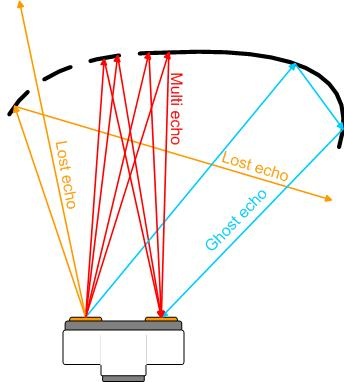

Les capteurs ultrasoniques sont vraiment très pratiques, quand on en connait [les inconvénients](http://www.societyofrobots.com/sensors_sonar.shtml). La distance effectivement mesurable est limitée, en éloignement car la déperdition de puissance de l’onde dans l’air est importante, ce qui limite pratiquement la portée du capteur. Elle est limitée aussi en proximité, car il faut "protéger" le récepteur de l’émission de l’onde, et donc la mesure ne peut se faire qu’après un certain temps, or le temps dans le cas présent, c’est une distance... De plus, les ondes émises sont sensibles à la géométrie, la densité et l’état de surface de l’obstacle. Elles ricochent, ou se perdent, ou reviennent plusieurs fois (multi-trajets).

Une des limitations du capteur LEGO vient que par défaut, il émet en continu, et ne peut pas directement être commander en "ping" (choix du moment de la mesure), l’autre est que l’accés aux 7 autres mesures (car le capteur fait jusqu’à 8 mesures de l’écho) ne sont pas elles aussi disponibles. il y a là du code pour accéder aux registres I2C à faire pour exploiter à son maximum le capteur. Le fait que l’on ne puisse pas déterminer le moment de la mesure peut être génant si l’on utilise plusieurs capteurs Ultrasoniques (phénomène de cross-talk). Des expérimentations et du codage donc... On en parle là, [la documentation du protocole I2C du capteur est disponible en appendice 7 du Hardware dev kit](http://nxtasy.org/2007/02/28/ultra-sound-sensor-goes-ping-ping).

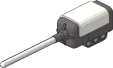

**NXT - Capteur de température**

**Capteur de température (I2C)**

Le nouveau capteur de température corrige les défauts de l’ancienne version, à savoir :

-   -   Interface I2C, sans artefact de mesure,
    -   un câble long de 50cm, scellé au capteur, pour éviter les problèmes du à la proximité de liquides,
    -   Sonde de température en métal, étanche et blindée, autorisant l’immersion de la sonde (pas du capteur...)
    -   Meilleure résolution (12 bits), donnant une résolution maxi de 0,0625°C,
    -   Meilleure plage de mesure (-40 à 125 °C, mais LEGO recommande -20 à 110 °C), permettant de mesurer la température de l’eau bouillante.

Il n’existe pas d’API spécifique (encore) sous NXC pour ce capteur, il faut donc écrire le code qui permet d’accéder aux registres I2C du capteur. En voici un exemple, par John Hansen, qui donne la température \*10, pour simuler la décimale. [Discussions et codes autour de ce capteur sur le forum nxtasy.org](http://forums.nxtasy.org/index.php?showtopic=3753)

// 12 bit convert mode byte bufSetTempMode\[\] = {0x98, 0x01, 0x60}; byte bufReadTemp\[\] = {0x98, 0x00}; task main () { SetSensorLowspeed (S2); I2CWrite(S2, 0, bufSetTempMode); int status = I2CCheckStatus(S2); while(status > NO\_ERR) status = I2CCheckStatus(S2); Stop(status < NO\_ERR); while(true) { byte count = 2; string outBuf; int temp; long rawtemp; if (I2CBytes(S2, bufReadTemp, count, outBuf)) { rawtemp = (outBuf\[0\]\*256 + outBuf\[1\])\*10/16; temp = (rawtemp/16); if (rawtemp > 20470) temp -= 2560; } else { temp = 999; } NumOut(0, LCD\_LINE2, temp,false); Wait(100); } }

## Capteurs RCX

Les capteurs RCX doivent être connectés via le câble de conversion à la brique NXT. Ils sont donc vus par le NXT comme des capteurs analogiques, et ne bénéficient pas tous de procédures spécifiques, mais ont des modes et des types associés, facilitant leur exploitation.

**RCX - Capteur de contact**

**Capteur de contact (analogique)**

**SetSensorTouch(port)** configure le port S1..S4 pour recevoir un capteur de contact (RCX ou NXT).

SetSensorTouch(S1); // contact en 1 x = SENSOR\_1; //lit le capteur

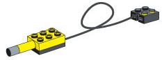

**RCX - Capteur de température**

**Capteur de température (analogique)**

**SetSensor(port, SENSOR\_CELSIUS)**

Configure le port S1..S4 pour recevoir un capteur de température RCX, avec mesure convertie en degré Celsius.

SetSensor(S1, SENSOR\_CELSIUS); x = SENSOR\_1; //lit le capteur

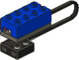

**RCX - Capteur de luminosité**

**Capteur de luminosité (analogique)**

Ce capteur est utile pour détecter la [présence d’obstacles](http://www.philohome.com/radarcar/radarcar.htm), la résolution de labyrinthes par suivi de murs, mesurer la garde au sol de [robots équilibristes](/articles/211/), ou "lire" le sol, pour le suivi de lignes ou du ring pour les robots SUMO, ou déterminer [la "couleur" de plates](http://www.philohome.com/cardreader2/cardreader.htm) pour la commande par bandes (RFID préhistorique ???).

**SetSensorType(port, SENSOR\_TYPE\_LIGHT)** configure le port S1..S4 pour recevoir un capteur de luminosité RCX (source de lumière active). Ne pas oublier d’utiliser **SetSensorMode(port, SENSOR\_MODE\_PERCENT)** pour configurer le mode (ici %).

SetSensorType(S1,SENSOR\_TYPE\_LIGHT); // capteur RCX de luminosité en 1, source active SetSensorMode(S1, SENSOR\_MODE\_PERCENT); // en % x = SENSOR\_1; //lit le capteur

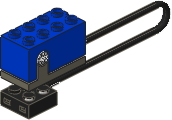

**RCX - Capteur de rotation**

\>**Capteur de rotation (analogique)**

Ce capteur est très utile, pour l’odométrie, comme pour le suivi de consignes moteurs. [Il est basé sur un disque rompant un faisceau](http://www.philohome.com/sensors/legorot.htm), et donc est très facile à mouvoir, contrairement au servomoteur NXT qui embarquent lui aussi un encodeur, mais dont le déplacement est contrarié par le moteur. Les précisons sont aussi différentes, le capteur de rotation RCX compte 16 pas par tour, (soit une précision de 22,6°), alors que le servomoteur renvoi une information précise au degré près. Cependant, plus de pas par rotation peuvent être obtenus en jouant sur les rapports d’engrenage, au détriment de la facilité de mise en rotation (par frottement).

**SetSensor(port, SENSOR\_ROTATION)** Configure le port S1..S4 pour recevoir un capteur de rotation, selon la configuration ad-hoc (16 pas par rotation). Il faut veiller à remettre à zéro le compteur au début de séquences de déplacement, grace à **ClearSensor(port)**.  
Un exemple de code bien connu est le rattrapage de commandes moteur pour faire "aller droit" un robot (très basique, mais ça fonctionne et c’est facile à comprendre !).

task main() { SetSensor(IN\_1, SENSOR\_ROTATION); //capteur de rotation en 1, connecté au moteur A ClearSensor(IN\_1); // remise à zéro du compteur SetSensor(IN\_3, SENSOR\_ROTATION); //capteur de rotation en 3, connecté au moteur C ClearSensor(IN\_3); // remise à zéro du compteur while (true) { if (SENSOR\_1 < SENSOR\_3) //vitesse plus grande en 3 {OnFwd(OUT\_A, 75); Float(OUT\_C);} //commande A, "floating" en C else if (SENSOR\_1 > SENSOR\_3) // vitesse plus grande en 1 {OnFwd(OUT\_C, 75); Float(OUT\_A);} commande C, "floating" en A else {OnFwd(OUT\_AC, 75);} //vitesses égales, commandes en A et C } }

On peut aussi faire [des choses plus exotiques](http://www.nxtprograms.com/extra/PF_remote/index.html), comme permettre à une télécommande Power-Functions de donner des ordres à un NXT...
