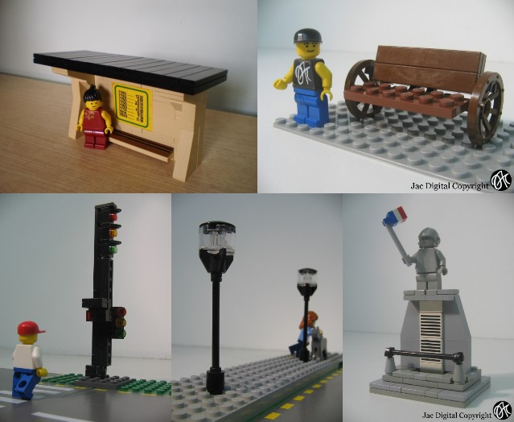

Dans nos dioramas, nous essayons tous de faire des animations. Elles nous viennent de notre imagination, et sont construites suivant les emplacements que l’on donne au mobilier urbain.

Mais quel mobilier urbain construire ? Quelles idées aurions-nous pour faire là un banc, là une borne d’incendie particulière ou un pot de fleurs ? C’est de là qu’est née l’idée du _Triffouillis des briques_.

Dans cette galerie, vous trouverez toute sorte d’idées pour construire ces petits objets qui font qu’une ville est faite de telle manière. Ils contribuent à son cachet par leurs formes, leurs types de construction. Ce que permet cette galerie, outre la banque de données qui est sans cesse enrichie, c’est l’aspect complètement libre qu’elle a. Aucun style imposé, tant que l’objet correspond au thème demandé.

A l’heure où je vous présente cette galerie, vous pouvez trouver des bancs, des feux tricolores, des bornes d’incendie, des lampadaires, des bacs à fleurs et j’en passe d’autres. Aucune n’est fermée. C’est à dire que, à tout moment, elles peuvent être complétées par de nouvelles constructions.

**Quelques exemples.....**

Vous aussi, si une idée vous vient pour un des thèmes proposés, n’hésitez pas à joindre votre création.

["Le Triffouillis des briques"](http://photos.freelug.org/main.php/v/FreeLUG/Triffouillis/).
