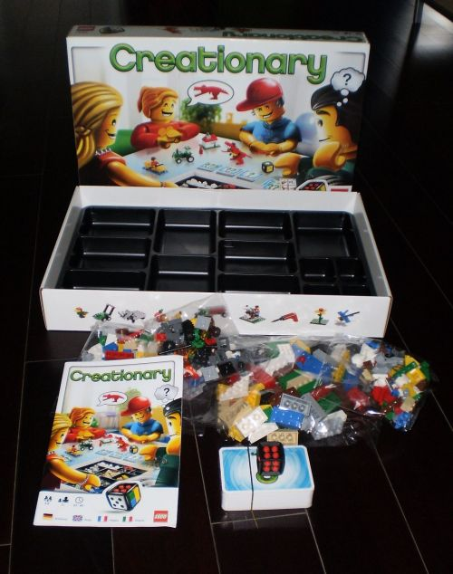
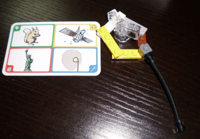
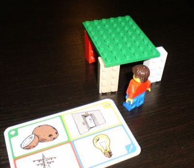
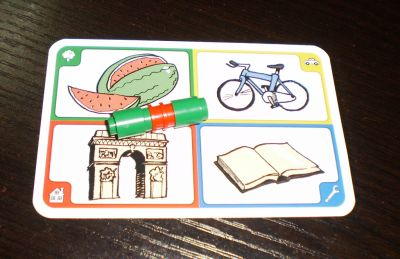
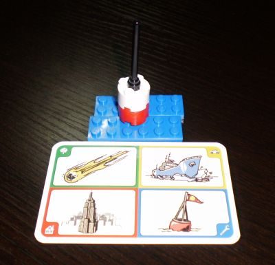
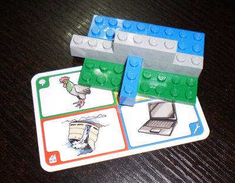
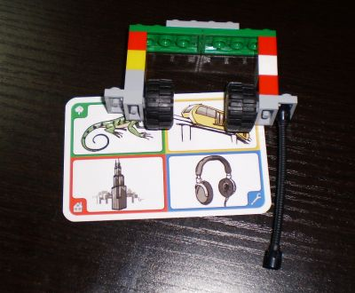
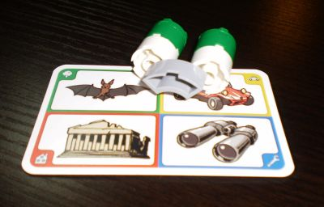
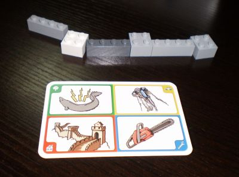
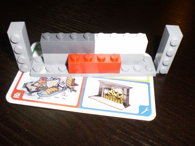

Et voilà enfin le dernier article sur la gamme des jeux de société LEGO. On finit en beauté avec la plus grosse boîte, la plus emblématique, à savoir le Creationary dont le nom s’inspire du non moins célèbre jeu de société Pictionary (aussi connu en France sous le nom de ["Dessinez c’est gagné !"](http://fr.wikipedia.org/wiki/Dessinez_c'est_gagn%C3%A9)).

Quoi de plus normal, puisque le principe du Creationary est le même que celui du Pictionary à savoir faire deviner des mots, mais cette fois au lieu de dessiner, vous l’aurez compris, les joueurs construisent les objets avec des briques LEGO.

Il est à noter que ce n’est pas la première fois que TLC édite ce genre de jeu. Il y a eu au moins une version antérieure, le [Constructionary](http://www.bricklink.com/catalogItem.asp?G=GA08539) (du moins je suppose que le principe du jeu est similaire, vu que je n’y ai pas joué moi-même), mais la nouvelle gamme de Jeux de Société a donné l’occasion à TLC d’éditer une nouvelle version. Quoi de plus normal puisque les LEGO sont avant tout un jeu de construction !

L’ouverture de la boîte révèle cette fois des casiers réalisés dans un plastique terraformé. J’ai envie de dire enfin ! Je m’attendais à voir un système de rangement similaire dans toutes les boîtes précédentes (du moins les plus grosses) sans succès.

**Ouverture de la boîte**

La notice conseille de trier les briques par couleur, mais bien sûr comme tout MOCeur qui se respecte je n’en ferai rien ; j’ai trié les pièces par type et non par couleur. Le triage par forme est beaucoup plus efficace lorsque qu’on réalise des modèles.

Sous le désormais célèbre dé, vous remarquerez aussi un paquet de cartes sur lesquelles sont inscrits les mots à deviner. Mais là surprise, il n’y a pas de mot inscrit mais seulement des dessins, et cela pour diminuer les coût de production. En effet avec des dessins pas besoin de localiser les cartes, entendez par là qu’il n’est pas nécessaire de les traduire ni de produire différentes versions de jeu dans toutes les langues.

A n’en pas douter, ce jeu a de quoi ravir les AFOLs. Néanmoins, j’ai voulu le tester avec des amis absolument pas du tout versés dans la petite brique danoise, même si bien sûr, la plupart ont eu quelques briques en main étant enfant (mais pas tous). Et là surprise ! Comme pour le Pictionary où ce ne sont pas forcément les pros du dessin qui gagnent, au Creationary les MOCeurs invétérés ne sont pas forcément avantagés. En effet la palette de pièces est très réduite, il faut donc être très schématique, et tenter de refouler tous les réflexes de MOCeurs qui vous empêchent d’assembler quoi que ce soit de peur que ce soit moche ou parce que vous voulez absolument utiliser une pièce qui n’est pas dans la boîte. En guise d’exemple je vous livre mon horrible monocle (qui a tout de même été deviné) :

**Un monocle**

Le rapide coup d’oeil à la notice est une grande déception. En effet les règles sont plutôt assez brouillonnes. Les règles précisent que les joueurs disposent d’un temps limité pour faire deviner les mots mais les règles ne précisent pas combien de temps : 1 minute, 5 minutes ? A vous de voir. Pas non plus de sablier comme dans le Pictionary. Il n’y a pas non plus de plateau de jeu pour noter la progression des joueurs. De plus l’utilité de la tile 2x2 avec le "x2" sérigraphié qui se clipse sur le dé, n’est pas non plus expliquée dans la règle. Bref le jeu semble se limiter à sa plus stricte simplicité : faire deviner des mots en les construisant et compter les points (en gardant près de soi les cartes qu’on a réussi à faire deviner).

Les règles proposent différents modes de jeu (par équipe, collaboratif, plusieurs constructeurs, ou un seul, etc.). J’opte pour la première variante de jeu, à savoir une seule personne construit, tous les autres tentent de deviner. Si un joueur devine dans le temps imparti il reçoit un point de victoire et le constructeur aussi. Le choix d’avoir un seul constructeur était à mon avis plus raisonnable car on était quand même six joueurs. Autrement il y aurait eu des batailles de pièces phénoménales. L’assortiment de pièces de la boîte n’est pas énorme et plusieurs joueurs ont exprimé le regret de ne pas avoir de pilier (des briques 1x1x5 auraient très bien fait l’affaire). Ce fut le cas par exemple du joueur qui nous a pondu ce magnifique ascenseur :

**Un ascenseur (hum hum)**

Il faut dire que ce joueur était probablement le moins doué d’entre nous. Il nous a aussi construit une magnifique pastèque (qui a quand même été devinée après qu’il ai répondu "oui" à la question "Ca se mange ?") :

**Une pastèque (hum hum)**

Vous avez sans doute remarqué qu’il y a 4 dessins sur la carte. La seule raison est de légitimer l’utilisation du dé LEGO. En effet avant de tirer une carte, le joueur constructeur lance le dé qui détermine une des quatre catégories : nature, véhicule, bâtiment et objet. Le fait de connaitre la catégorie aide quand même à deviner le mot.

Un autre joueur a soigné les couleurs comme pour sa bouée et son barrage, et il est vrai que les couleurs ont beaucoup aidé, surtout pour le barrage :

**Une bouée**

**Un barrage**

Mais la plupart du temps les couleurs étaient aléatoires. Comme pour ce magnifique casque ou les jumelles de ce troisième joueur :

**Un casque audio**

**Des jumelles**

Parfois les joueurs ne cherchaient même pas à assembler les briques comme pour cette schématique muraille de Chine d’un quatrième joueur :

**La muraille de Chine**

Et pour finir, voici une cheminée qui a donnée beaucoup de difficulté au dernier joueur, pour une raison inconnue les devineurs croyaient y voir une chaine hifi :

**Une cheminée**

## Mon impression

Malgré un livret de règles complètement farfelu, le Creationary reste un "must have" de tout AFOL qui se respecte. Et ce pour la simple raison qu’il permet de faire jouer vos amis non AFOL aux LEGO sans aucun complexe. Et qui sait, peut-être cela leur donnera l’envie de replonger dans leur LEGO et de sortir de leur dark age ! C’est vraiment un jeu pour tous les âges et ma fille de 4 ans a pu y jouer aussi avec les mots les plus simples (les cartes sont réparties en trois piles selon leur difficulté). Je serais aussi curieux de voir une partie entre AFOLs, et je ne doute pas que cela arrivera lors de futures rencontres.

Je vous le recommande donc très chaudement, et n’oubliez pas de l’amener lors d’un prochain repas d’AFOLs ou sur une exposition en manque de visiteurs, je suis sûr que vous passerez un bon moment.

Ceci conclut la série d’articles que j’ai écrits sur la gamme, je vous donne donc rendez-vous pour un prochain article sur un tout autre sujet !

Jouez bien !!
