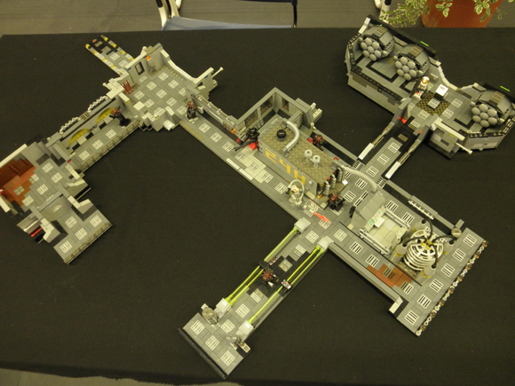
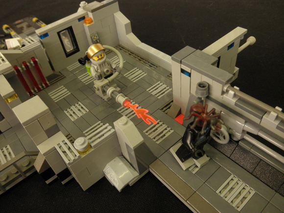

Theix, petite ville située à 10 km de Vannes (Morbihan) a accueilli pour sa cinquième édition les 24 heures de Jeux dans sa grande salle omnisports.

Au programme de ces jeux, j’ai retrouvé avec plaisir et nostalgie de vieux jeux en bois qui demandaient beaucoup d’adresse et d’habileté, il y avait aussi des jeux de rôle très variés et totalement inconnus pour moi.

Quant à moi, dans un univers complètement différent des salons de la maquette, et à la demande de l’organisateur, j’ai exposé mon grand réseau qui a eu un gros succès auprès du public de 4 à 80 ans, surtout les filles, les femmes (Ndla : c’était surtout pour épater leurs copains, maris...).

A ce propos, j’ai été très surpris par le côté bon enfant, convivial, familial, beaucoup de jeunes même après minuit. Pour ma part, malgré les 24h, le réseau n’a pas eu de problèmes techniques sauf deux leds à ressouder.

Avec moi, Ronan était de la partie, son stand a été très remarqué en particulier son étonnant space hulk.

Avec un millier de visiteurs et malgré la pluie, le salon a été une réussite populaire dont les organisateurs très jeunes pour la plupart peuvent être fiers de leur travail.

Un nouveau rendez-vous a été pris fin mai 2010 et nous invitons les passionnés LEGO à exposer leurs créations sous forme de jeux (techball par exemple).

Merci à FreeLUG pour le prêt de 2 boites de jeux LEGO.

Maintenant, je laisse la parole à Ronan, coordinateur pour Theix

jean marc

* * *

Invité pour la deuxième année par la "Ligue des Rôlistes Extraordinaires" représentée par Thomas Munnier, c’est avec plaisir que Jean-Marc (électron libre breton) et moi-même avons répondu présents, cette grande fête du jeu était l’occasion de soutenir l’association AXEL’AIR qui fait de l’accompagnement aux enfants malades.

L’ambiance est très différente de celle d’une exposition de modélisme : imaginez une grande salle, plein de tables, une montagne de jeux de société à disposition, des jeux en bois (Toutangran), des jeux de rôles avec leurs passionnés, du warhammer, une organisation jeune et dynamique, et un public plutôt familial en journée et jeune rôliste la nuit. Une exposition sans stress ni horaire.

J’ai réalisé pour l’occasion une maquette du jeu de plateau "Space Hulk", un vaisseau abandonné envahi d’aliens que 5 marines suréquipés doivent anéantir.

**Space Hulk, mission 1**

L’idée de ce MOC est venue de l’organisateur des "24H du jeu" Thomas Munnier, qui, en novembre 2008 lors de la quatrième édition, m’avait demandé si je connaissais un ou des AFOLs intéressés pour réaliser une maquette du jeu "Space Hulk". N’ayant trouvé personne pour relever le défi, je me suis lancé... et voila le résultat.

Mon GGB basketteur était aussi de la partie, branché sur le secteur, il est maintenant beaucoup plus précis et régulier dans ses lancers francs, un succès auprès du public.

Jean-Marc et moi-même ne sommes par sûrs de pouvoir être présents pour la sixième édition en mai prochain, je serai content de pouvoir aider quelques Afols à y participer,  
lieu idéal pour une première exposition, sans stress ni jugement.

Je vous tiendrai au courant,

Ronan

* * *

**–** [Photos de Jean-Marc](http://photos.freelug.org/main.php/v/barr__/expositions/2009/Theix/)  
**–** [Photos de Ronan](http://photos.freelug.org/main.php/v/ronan/nov09/)  
**–** [Le blog des 24h](http://24hdujeu.over-blog.com/)  
**–** [Leurs photos](http://24hdujeu.over-blog.com/album-1514118.html)
