Dans la gamme Creator, la boîte réf. 4958 propose de réaliser une araignée, un crocodile et un dinosaure animés avec des éléments PFS. Cette courte revue se propose de vous les faire découvrir et de vous donner envie d’acquérir la boîte.

Proposée pendant quelques jours sur le legoshop à 50% de son prix de référence de 90 euros, le stock de cette boîte s’est retrouvé épuisé très vite. L’examen du contenu en explique la raison puisqu’en plus des presque 800 pièces Technic, il y avait un ensemble d’éléments PFS dont la somme des prix individuels dépasse déjà les 45 euros du prix de la boîte en promotion.

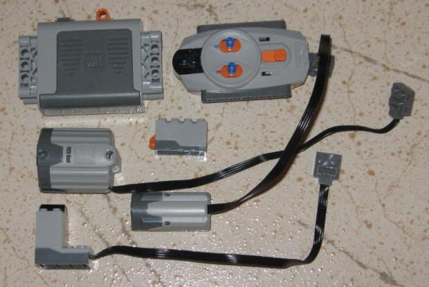

**Elements PFS**

Les 6 éléments PFS de la boîte 4958 dont la brique sonore.

Pour vous décrire rapidement les trois montages proposés, je vais procéder du plus simple au plus complexe.

Le plus simple des montages alternatifs (réalisé en environ une heure) est donc l’araignée qui présente un design sympathique avec son gros abdomen chargé de piles puisque construit sur le boitier à piles, les 8 pattes attachées au corps intégrant les 2 moteurs et la tête construite autour du récepteur infrarouge.

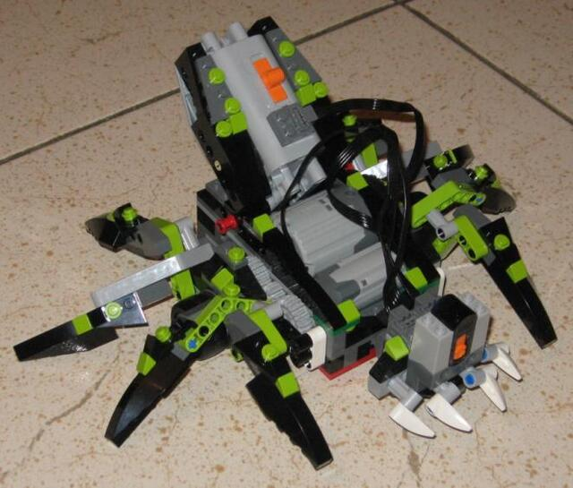

**Araignée entière**

L’araignée montée et entière.

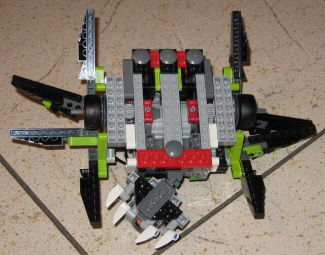

**Araignée renversée**

Vue du dessous de l’araignée où l’on voit bien les roues motrices.

Le montage est compact mais s’avère décevant puisqu’aucune articulation n’est animée : l’araignée se déplace en roulant et c’est le mouvement qui "anime" les pattes ou la tête de façon aléatoire. Bon, on reste un peu sur sa faim mais cela encourage à passer au deuxième modèle alternatif.

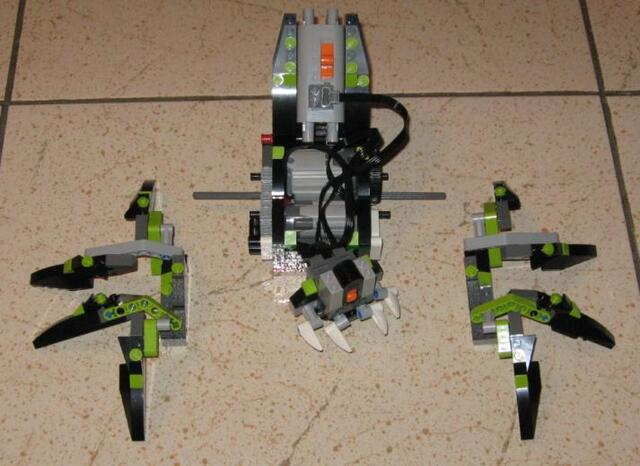

**Araignée démembrée**

L’araignée démembrée montrant le caractère factice des pattes.

Le crocodile est un peu plus long à monter que l’araignée (compter deux heures) mais on comprend vite qu’il reprend le principe de l’araignée pour ce qui est des pattes et de la queue non animées mais propose une tête animée. En effet, le queue remue de façon aléatoire et les pattes ne font qu’être entrainées par le mouvement de rotation des roues qui font réellement le déplacement de la bête.

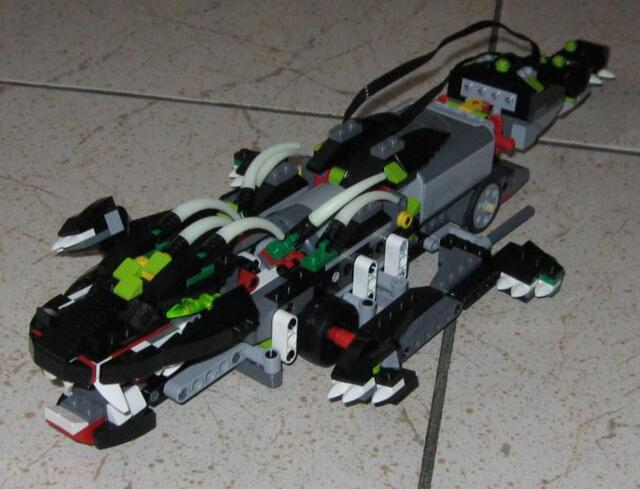

**Crocodile entier.**

Le crocodile monté et entier.

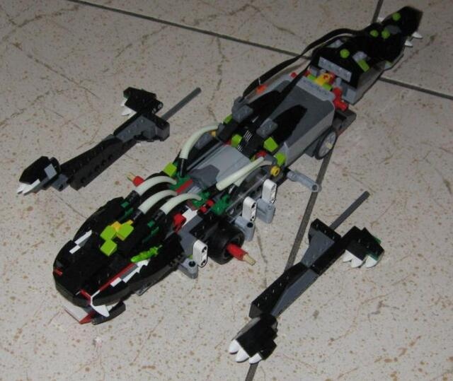

**Crocodile démembré**

le crocodile démembré où l’on voit que les pattes sont factices et ne servent pas à avancer.

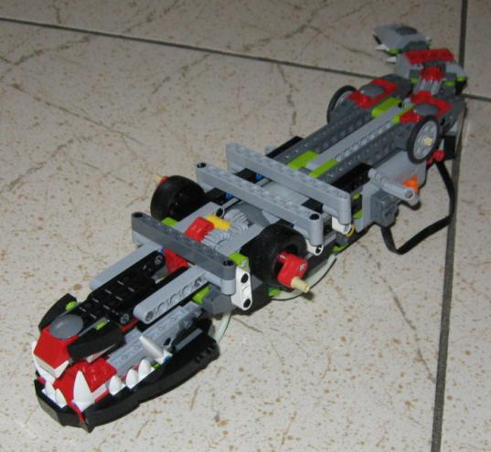

**Crocodile renversé**

Le crocodile renversé où l’on voit les 3 axes de rotation décentrés.

Pour ce qui est de l’animation de la tête, elle se réduit au strict minimum c’est à dire à un mouvement de mâchoires ce qui donne un aspect agressif après tout assez réaliste.

Bon, on passe au T-Rex en espérant encore plus d’animations y compris sonore.

Cette fois le montage utilise presque toutes les pièces de la boîte et prend environ trois heures. La couleur des pièces employées et les cornes de la tête et du dos donnent un look très Godzilla au T-Rex ce qui n’est pas déplaisant en fin de compte.

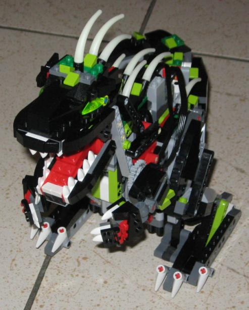

**Godzilla de face.**

Le T-Rex au look de Godzilla vu de face.

Le dinosaure est finalement plus compact qu’attendu : dans le corps de la bête, sont intégrés le boitier à piles, les deux moteurs et le récepteur. La queue n’est pas motorisée et va donc osciller d’un coté à l’autre avec la marche du petit monstre.

[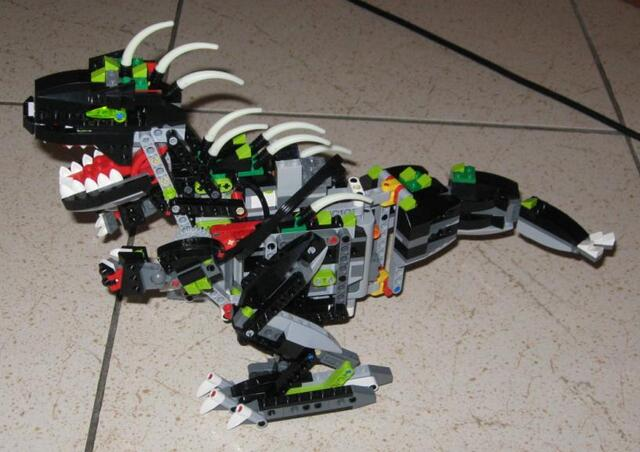](https://www.freelug.org/IMG/jpg/dino_2.jpg)

**Godzilla de profil**

Le T-Rex vu de profil.

Le gros moteur est réservé à la marche qui est reproduite de façon assez réaliste même s’il avance lentement. Afin de le faire marcher, chaque patte est doublée : une à l’intérieur qui s’occupe vraiment de la marche du bipède avec la plante des pieds en caoutchouc et une patte extérieure plus décorative qui suit le mouvement de celle à l’intérieur tout en assurant la stabilité lors de l’avancement avec ses grands pieds.

[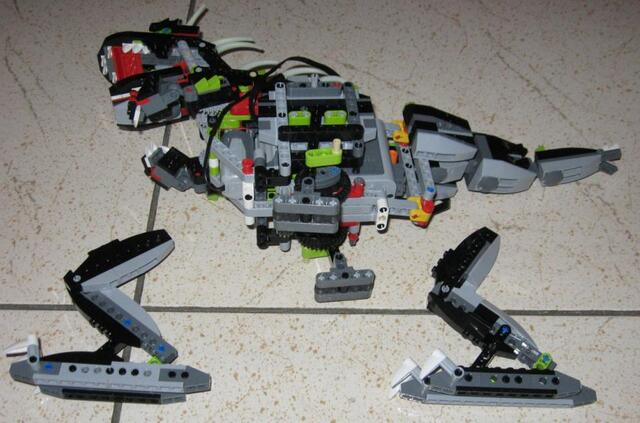](https://www.freelug.org/IMG/jpg/dino_3.jpg)

**Godzilla démembré**

le T-Rex avec les grandes pattes partiellement factices séparées du corps et les véritables petites pattes.

Le petit moteur anime les mâchoires dont le mouvement actionne le bouton de la brique sonore ce qui permet au T-Rex de gronder tout en ouvrant la bouche.

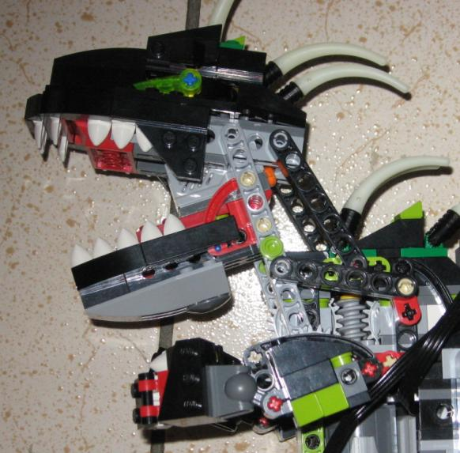

**Tête de Godzilla**

Gros plan de la partie avant du T-Rex où l’on distingue la brique sonore dans la bouche actionnée lorsque la mâchoire se ferme.

Conclusion : n’hésitez pas à acheter cette boîte si vous la trouver à un prix intéressant, ne serait-ce que pour les pièces.
