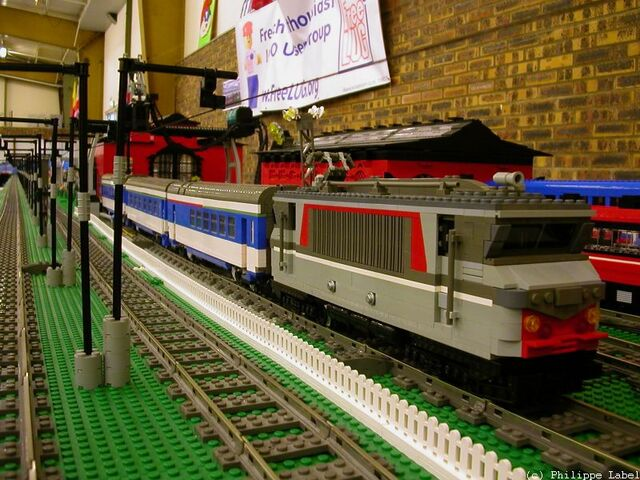
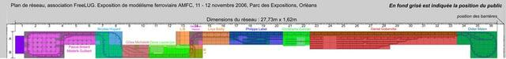
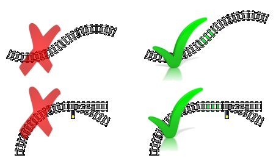
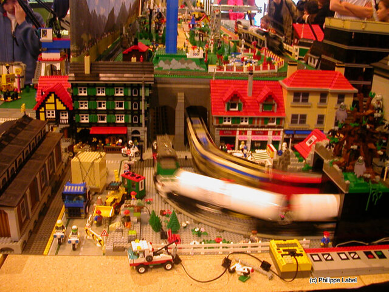
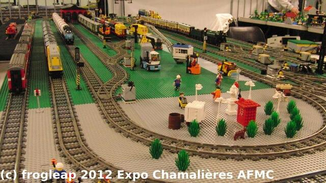
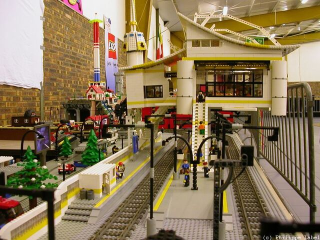
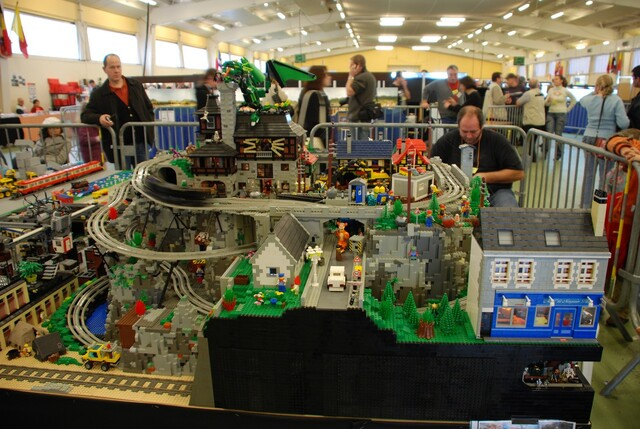

FreeLUG participant souvent à des salons de modélisme, le train LEGO a la part belle du gâteau. Mais concevoir un réseau, à la fois esthétique et fonctionnel sur une grande surface nécessite la prise en compte de quelques recommandations. Nous avons essayé dans cet article de regrouper nos expériences et de faire le point.

## Les grands principes

**Le sens de circulation**

En France (sauf Alsace), les trains circulent à gauche sur les voies doubles. Donc si vous prévoyez deux boucles indépendantes et imbriquées, faites tourner les trains en respectant le sens de circulation sur la voie de gauche. Même inconsciemment, les visiteurs apprécieront.

**Les boucles**

Une boucle, deux boucles, trois boucles... Si vous voulez changer les trains sans tout mettre en vrac sur le bord du stand, il faudrait que chaque boucle puisse accéder au triage si il y en a un de prévu. Mais un triage peut poser plus de problèmes qu’il n’en résout, souvent pour des raisons de place ou de temps de préparation du diorama.

On peut donc parfois préférer des trains à quai dans une gare, de part et d’autre de la voie principale, qu’un triage trop compliqué.

**Une belle rame à admirer sur sa voie de garage. Réalisation "Brickerik". Orléans 2006.**

L’idée générale étant d’éviter les wagons en vrac, avec les risques de chute et l’impression de "pas fini" donnée aux visiteurs.

Vous pouvez aussi envisager une ou plusieurs voies de changement de rames cachée derrière le décors et accessibles aux animateurs du stand.

**Typologie classique d’un réseau d’exposition**

Grossièrement, trois catégories peuvent être distinguées :  
**–** la boucle simple et sa variante le "réseau étagère" ;  
**–** les deux boucles imbriquées et variantes incluant des croisements de niveau ou par ponts ;  
**–** l’aller-retour avec gares aux extrémités.

**Un réseau "étagère" de 27 mètres, l’union fait la force. Orléans 2006.**

Les deux premières catégories sont de loin les plus répandues, avec des variantes permettant de faire illusion. Le "réseau étagère" a une forme générale en os de chien avec une boucle de retournement à chaque bout et une voie double entre les deux. Dans ce cas, l’illusion de la voie double est efficace si le réseau est long et les boucles de retournement plus ou moins cachées.

Ne pas oublier de faire circuler les trains dans le sens des aiguilles d’une montre sur la voie de gauche. Deux boucles imbriquées permettent facilement de créer de belles sections en voie double.

La dernière catégorie, l’aller-retour, oblige à une gestion fine des arrêts en gare, voire une automatisation.

On peut également ajouter la LGV, toute particulière (voir plus loin).

## La circulation des trains

**–** Les courbe-contre-courbe sont à bannir absolument, il faut placer au moins un rail droit entre les deux courbes inversées ;  
**–** Il faut toujours mettre un rail droit devant un aiguillage ;

**–** Il vaut mieux éviter les croisements à niveau, source d’accidents quand plusieurs trains tournent, sauf si il n’y a qu’une seule rame par boucle ;  
**–** Essayez d’éviter les aiguillages en voie déviée pour la ligne de circulation principale ;  
**–** Prévoyez plusieurs alimentations ; en répartir les points d’alimentation régulièrement autour du réseau. En gros, pas plus de 10 mètres de réseau par bloc d’alimentation.

## Le dimensionnement du réseau

**–** Les voies de garage : prévoir deux voies de garage de plus que le nombre de rames à faire circuler. Dimensionner les voies de garage en fonction de la longueur des rames à faire circuler ;  
**–** L’emplacement des voies : accessible pour la maintenance (déraillement, etc.). Évitez les tables de plus de 2 modules de large (192 tenons) ou évitez d’avoir des trains en milieu du diorama.

Sur les (très) grands dioramas, il est souvent préférable d’avoir deux ou trois réseaux plus petits et indépendants avec chacun une circulation, plutôt qu’un seul grand réseau avec une seule circulation.

Vous aurez alors :  
**–** Une meilleure animation visuelle avec plus de trains en circulation ;  
**–** Une simplification des problèmes d’alimentation électrique ;  
**–** Un diorama plus facile à concevoir, avec 2 ou 3 sous-dioramas pouvant avoir chacun une spécificité de thème.

## L’esthétique du train qui roule

**–** Envisagez des zones cachées (tunnel etc.) pour offrir un côté surprise : les enfants aiment toujours guetter la sortie du tunnel ;  
**–** Prévoyez des voies doubles et des croisement de trains, pas forcément à niveau (risque de collision), mais en ponts ;  
**–** Faites passer les rames longues sur les ponts ou les viaducs, ça impressionne les photographes ;  
**–** Favorisez les circuits permettant la circulation simultanée d’au moins deux trains.  
**–** Prévoyez des voies de garage visibles au public pour exposer les rames "qui en jettent" lorsqu’elles ne roulent pas.

**Les trains se croisent et se cachent, le spectacle est réussi. Paris 2005.**

## Organisation et mise en oeuvre

**Respect du gabarit**

Pour vérifier que tout passe sans toucher le décors, faites un essai (avant ouverture au public) avec la rame la plus grosse en largeur. Pensez aux débords des engins très longs dans les virages.

Vous pouvez vous inspirer du [gabarit de FreeLUG](http://wiki.freelug.org/Gabarit), en gardant à l’esprit qu’il s’agit d’un gabarit roulant : c’est à dire que le décors statique doit être plus loin que ça.

Si vous prévoyez zéro briques de différence entre le gabarit roulant (les trains) et le gabarit statique (le décors), le risque est très élevé qu’un coin de brique vienne arrêter net la rame lancée à pleine vitesse et qui tangue toujours un peu sur les rails. Spectacle assuré... mais involontaire.

**Schéma du réseau**

Il y a plusieurs logiciels pour dessiner un réseau de train LEGO sur votre ordinateur. Nous en retiendrons seulement deux.

**–** [BlueBrick](http://bluebrick.lswproject.com/). Nous vous recommandons fortement cet outil pour organiser le plan de votre stand et le partager avec les autres participants. Il est compatible avec les fichiers TrackDesigner et offre beaucoup plus de fonctionnalités que ce dernier. En outre, écrit par un adhérent (Alban Nanty), le support est parfait.

**–** [TrackDesigner](http://members.home.nl/john.hielema/train_depot/tddl20.htm). Outil parfois utile pour des détails très particuliers, mais totalement abandonné par son développeur depuis des années. Si vous débutez avec ces outils, préférez-lui BlueBrick.

**LGV, ligne à grande vitesse**

Une LGV, c’est avant tout une longue ligne droite avec en plus si possible des courbes à grand rayon en utilisant la technique ’droite-courbe-droite-courbe’ ou en utilisant les rails courbes modifiés par Xavier.

Il est aussi possible de relever le virage d’une ou deux plates à glisser sous la voie de la courbe coté externe. Cela permet de faire rouler les trains plus vite et de façon plus réaliste.

Il est aussi possible de construire complètement une LGV spéciale comme ce qu’à fait l’équipe de BàB. Mais cela est une autre histoire. [Voir la construction du matériel de voie pour la LGV](/articles/1220/) et [le règlement de la course en version 3](/articles/1687/).

**Matériel**

**–** Assurez-vous d’avoir assez de rails et d’aiguillages pour le jour J.  
**–** Essayez de faire rouler des rames le plus homogènes possibles, assez longues pour le spectacle mais pas trop pour la maniabilité.

**Des rames longues et homogènes. Chamalières 2012.**

## Les incontournables (ou presque...)

**Le triage**

**–** Prévoir deux voies de garage de plus que le nombre de rames à faire circuler.  
**–** Dimensionner les voies de garage en fonction de la longueur des rames à faire circuler.  
**–** Prévoir en entrée/sortie du triage une voie latérale d’attente aussi longue que la plus longue rame pour une mise en circulation fluide.

**La gare**

A placer devant le public mais pas sur la voie de circulation principale, plutôt sur une voie déviée. Les rames doivent pouvoir s’y arrêter.

**Une gare sur un réseau "étagère". Orléans 2006. Réalisation "Chimère".**

## Ajouter de la diversité

On peut aussi ajouter tout ce qui roule sur rail :  
**–** réseau monorail ;  
**–** métro ;  
**–** tramway.

Dans ce cas, un très petit réseau peut suffire car ce qui compte alors, c’est la variété que cela apporte dans l’ensemble.

**Plusieurs niveaux, plusieurs modes de transport. Un long moment à tout observer. Réalisation "LeGnome". Orléans 2008.**
