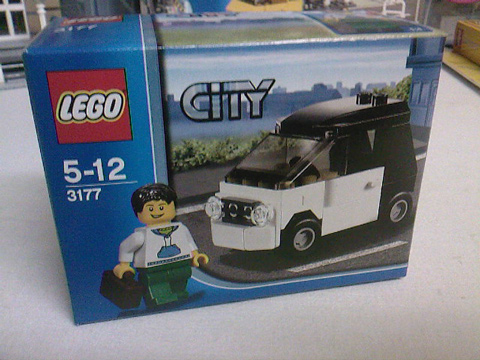
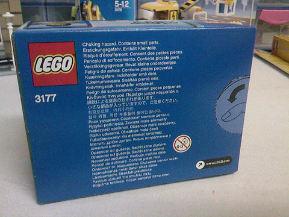
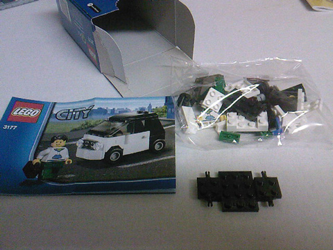
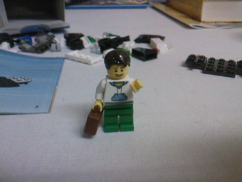
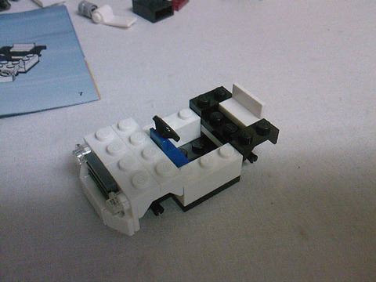
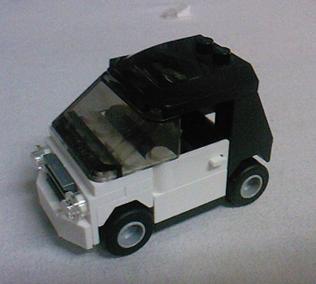
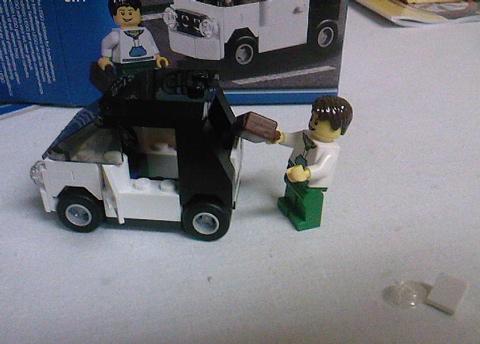
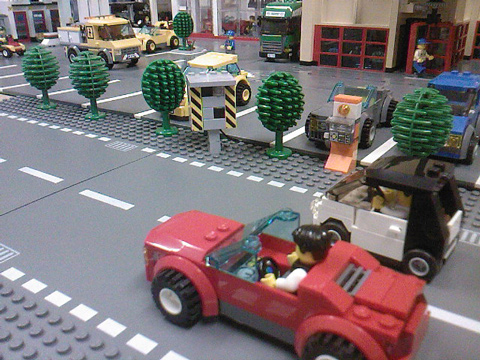

LEGO a le plaisir de nous sortir des petites boîtes, faciles à monter, idéal pour compléter nos villes. C’est donc dans la lignée de la [décapotable](https://www.freelug.org/spip.php?article1043) que je vais vous présenter le set 3177, la petite voiture !

Appelé "la petite voiture", elle n’en rappelle pas moins la célèbre Smart.

## La boîte

**–** Numéro du set : 3177  
**–** Nom de la boîte : la petite voiture  
**–** Gamme : CITY  
**–** Année : 2010  
**–** Nombre de pièces : 43  
**–** Nombre de minifig : 1  
**–** Prix moyen constaté : 5€ , disponible sur le [shop](http://shop.lego.com/ByTheme/Product.aspx?p=3177&cn=339&d=9)

Voici donc l’avant de la boîte. On voit bien la minifig.

**La boîte**

A l’arrière, et ben, pas grand chose. Si ce n’est qu’ils précisent qu’il y a un risque d’étouffement, et qu’il y a des petites pièces... Houla ! le montage risque donc d’être dangereux !!

 :-D

**L’arrière**

On ouvre donc avec précaution la boîte en fermant bien la bouche. ;)

**Le contenu**

Et on y découvre la notice, un sachet de pièces et le châssis.

## Le montage

On commence alors le montage, tout naturellement et comme d’habitude par la minifig.

**La minifig**

C’est un magnifique torse auquel on a droit. Une capuche est sérigraphiée à l’arrière.

On attaque ensuite la voiture.

**En cours de montage**

Rien de bien particulier pour une boîte avec 43 pièces.

**Voiture terminée**

On fini donc sans encombre.

## Conclusion

**L’ensemble**

En conclusion, une bien jolie petite voiture. On continue donc de compléter les rues de notre ville.

Toujours pas d’autocollant pour la plaque d’immatriculation, tant pis, on piquera ceux que l’on a en trop des autres sets.

Donc, pour 5€, on a une petite voiture avec une minifig bien habillé et sa valise.

**Qui va se faire flasher ?**
