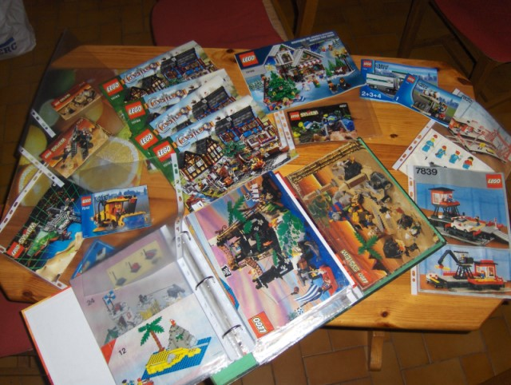
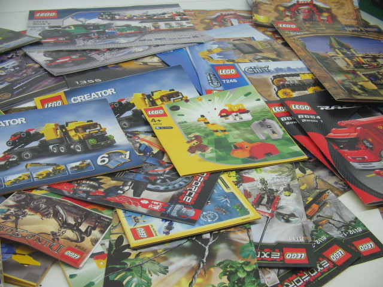

Un bon moyen pour augmenter son stock de briques, est de fouiner dans les vides greniers. J’en fais pas mal dans ma région et je trouve donc de la briquette. Il y en a de moins en moins chaque année malheureusement, mais c’est un autre sujet !

Il m’arrive d’avoir, en plus des pièces LEGO, des notices que je range soigneusement dans un même endroit.

Je me promets de m’y attarder à un moment perdu pour leur faire honneur, les ranger et les protéger correctement. Pourtant, les moments perdus, vous savez qu’ils sont rares à retrouver ! Un après-midi, je décidais de me mettre enfin au classement de ces fameuses notices qui, à force de stockage rapide, finissaient par devenir un tas négligé, voire même reboutant. Ce qui n’est pas la fonction première d’une notice de montage de sets LEGO ! Presque deux années d’une tâche remise au lendemain, sans jamais la faire !

En septembre j’avais prévu quand même que ce jour arriverait puisque j’ai profité des offres de la rentrée pour acheter aux meilleurs prix, des classeurs et des pochettes plastiques. Le tout afin de protéger mes chères notices mises à l’écart et négligées.

**Rangement en classeur.....**

Six heures de travail plus tard, quelle ne fut pas ma surprise de constater une quantité importante de plans en double ou en triple ! Prenant tout de même deux classeurs, alors que je n’ai pas non plus des milliers de notices.

Sans être collectionneur pur et dur, il est très difficile de jeter quoi que ce soit estampillé de la marque LEGO. C’est valable pour les notices, même en piteux état (comme si c’était un papyrus égyptien !), mais aussi pour toutes les briques cassées, fondues, mordues (ça peut servir pour un custom...), publicités, catalogues et tout ce qui pourrait exister... Je me dis qu’une notice abîmée c’est mieux que rien, alors je garde !

Il m’est donc venu une idée : « et si mes doubles, je les échangeais... car franchement les vendre... »  
J’ai vraiment du mal à passer à la vente d’article LEGO même si je le fais de temps à autre.

Et j’ai repensé aux matinées dans ma cour d’école où l’on échangeait, négociait nos vignettes Panini afin de compléter notre album de foot (qui pour ma part maintenant m’étonne encore que je m’y sois intéressé !).

**Du vrac de notices en double.....**

Après discussion avec mon Maître Jacdï (et oui, je suis le padawan de Maître QUI-GON-JAC !), nous vous proposons d’effectuer une bourse d’échange des notices à chaque rencontre AFOL. Pour ma part, l’échange se portera sur mes notices en double, mais certains AFOLs ne sont passionnés que de certains thèmes et ne garde que ce qui les intéresse dans celui-ci (je n’ai pas réussi à me consacrer à un thèmes précis...). Cette première bourse d’échange se tiendra lors de l’[Assemblée Générale FreeLUG de cette année 2010](/articles/1067/).

Pour cette bourse il peut y avoir plusieurs directions à suivre :

1) Pas de règles, chacun voit avec son partenaire d’échange et fait sa popote ! (ce qui se fera implicitement soit avec la méthode 2 ou 3).

2) Créer des règles pour facilité une harmonisation dans l’échange sur des critères comme la rareté (lien avec l’âge, la diffusion (cf. sets publicitaire, promotionnels, etc.), la distribution des sets (présents qu’aux USA, qu’en Europe) ou des sets récents mais tellement chers donc rares... Je pense à la notice du Millénium Falcon plusieurs KG.... Bon encore que je ne sais pas si beaucoup l’auront en double celle-là ! Mais c’est évident que là, l’échange doit être à la hauteur si c’est possible.

L’état de la notice (car moi j’ai du très neuf en passant par du très usé voire pas complet, ben oui je ne jette rien je vous dit !), taille de la notice, nombre de notices pour un set (cf Creator souvent 3 manuels, les nouveaux set notices numéroté dans les éléments etc.). Du coup, quelque fois l’échange ne pourra pas être possible.

Ces critères cités sont ceux qui me viennent à l’esprit pour harmoniser un échange et que celui-ci soit le plus équitable possible sans qu’il y ait intervention d’argent !

3) Faire un échange par rapport à une « côte » genre Bricklink. Exemple : ainsi une personne va échanger 4 notices d’une valeur totale de 25 dollars contre 2 notices d’une valeur total de 24.5 dollars. Après, ces côtes sont-elles fiables ou raisonnées ? Et surtout, que de travail avant pour toutes les recherches ou avoir une connexion au moment de l’échange pour donner une valeur aux notices et procéder aux échanges etc.

Personnellement, je préfère la seconde solution mais je me prêterai à toute proposition. Ce sont des ouvertures de voies à approfondir peut-être. Nous sommes ouverts à d’autres modes opératoires donc n’hésitez pas à intervenir.

D’ores et déjà je vous conseille d’effectuer un listing des notices (N° de sets) que vous avez déjà. Cela demande du temps donc plus vite c’est fait plus vite vous serez opérationnel. En effet moi-même, vu le nombre, je ne sais pas exactement ce que j’ai. Des fois, je suis surpris d’avoir telle ou telle notice et des fois même surpris de ne pas avoir certaines que je pensais détenir !

Ah si, je rajoute pour les tête de linotte donc pour mon maître QUI-GON-JAC : "Ne pas oublier chez vous cette liste et l’avoir le jour de la rencontre AFOL avec vos doubles !".

On peut aussi effectuer le listing de ses doubles mais vu qu’on les emmène avec soi, ce n’est pas obligatoire. C’est à vous de voir.

Voilà encore un moyen de passer un moment convivial entre passionnés, puis aussi de faire en sorte d’enrichir notre collection de notices. Alors bienvenue à vous sur ces prochains lieux d’échanges.
