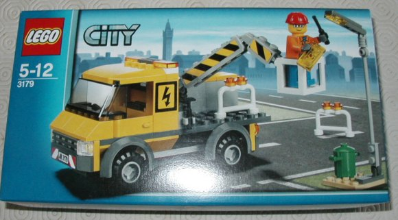
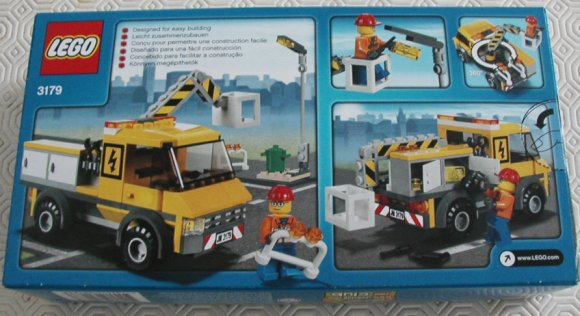
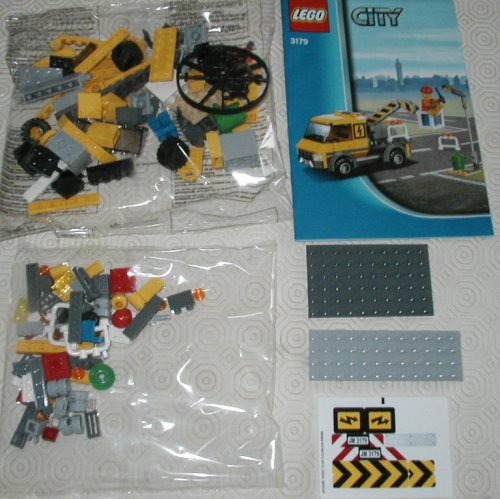
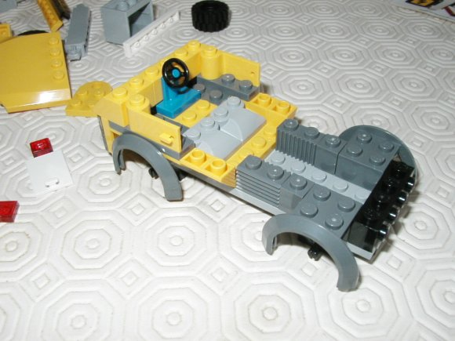
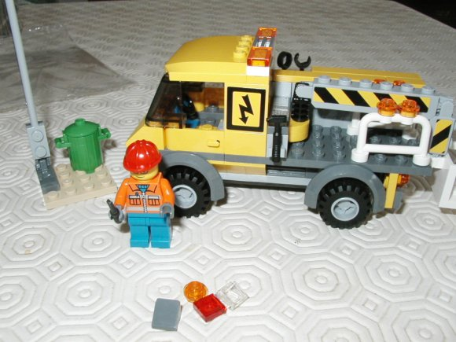
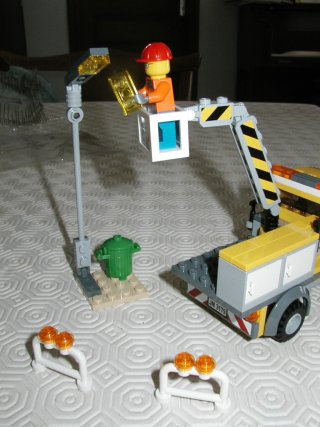
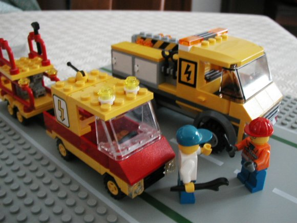
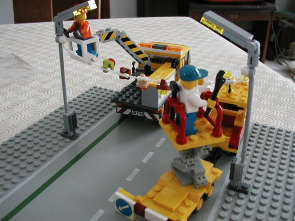

En entrée de la gamme City 2010, nous trouvons, entre autres, ce camion de réparation.

**–** Référence : 3179  
**–** Nom : Le camion de réparation  
**–** Nombre de pièces : 118  
**–** Prix : 12,50 euro sur le [s@h](http://shop.lego.com/ByTheme/Product.aspx?p=3179&cn=339&d=9)

Au verso, quelques photos de mise en scène, et indication sur la fonction de rotation du bras.

## Le contenu

Dans la boîte, on trouve deux sachets (dont l’un étrangement grand pour son contenu), deux plaques, une notice et une planche d’autocollants.

Rien d’exceptionnel jusqu’à là.

## Le montage

Petite boîte, le montage se fait très facilement. Pour ce modèle, point de châssis monobloc. Tout est fait de plates et de briques comme dans le vieux temps des années 80.

On apprécie les autocollants bien dimensionnés qui laissent de la marge tout autour, facilitant leur pose.

L’aspect asymétrique du véhicule est plaisant, c’est inhabituel et pas forcément un exercice simple. Son côté baroudeur devrait lui permettre d’atteindre les lieux les plus reculés de nos campagnes pour les réparations électriques suite à une tempête...

La nacelle pivote et s’élève, cela parait bien évident.

En accessoires, en plus des deux barrières, l’ensemble vient avec une poubelle verte et un lampadaire au design similaire de ceux de [la ville](/articles/1016/). En complément très sympathique, un des coffres contient des ampoules de rechange pour le lampadaire !

* * *

En 1989, nous avions également une petite camionnette de réparation, la [6671](http://www.brickset.com/detail/?Set=6671-1) qui, elle, était dotée d’une remorque avec nacelle élévatrice.

Le logo électrique est très proche, mais on reprochera encore aux graphistes de ne pas avoir su conserver le même.

Le 3179 pourra facilement acquérir la bande rouge de son ancêtre en remplaçant quelques pièces si on souhaite uniformiser la flotte.

**Deux nacelles ne sont pas de trop pour retirer les décorations de Noël**

## Conclusion

Un joli petit camion aux accessoires sympas, à posséder si votre ville est équipée en lampadaires (ou alors, ce peut être un prétexte pour l’équiper ;) ).
