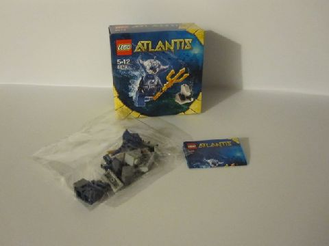
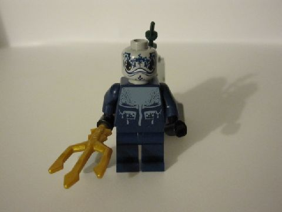
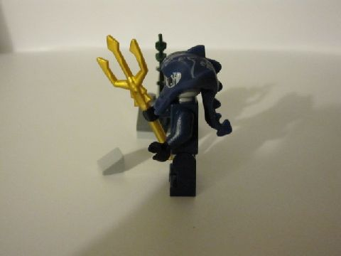
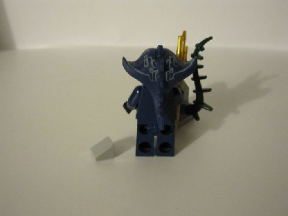
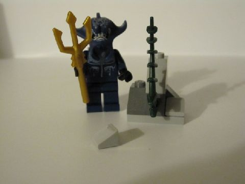

Le guerrier manta n’a qu’un but : empêcher quiconque d’approcher l’ancienne citée engloutie de l’Atlantis.

**–** Référence : 8073  
**–** Nom : Le guerrier Manta  
**–** Nombre de pièces : 13  
**–** Prix : 2,90 euro sur le s@h

Ce set fait parti de la gamme "Impulse" donc petite boîte avec un sachet pour les pièces et la notice, pas d’autocollants non plus.

**1 sachet et une notice**

Le montage est très rapide pour ce type de set sans difficulté, alors attardons-nous plutôt sur le guerrier par lui-même.

**Sans masque**

**Profil**

**Dos**

Un rocher, un guerrier en embuscade... La suite au prochain article : Le propulseur sous-marin.

