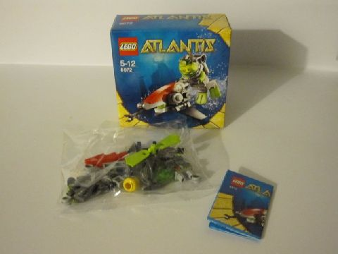
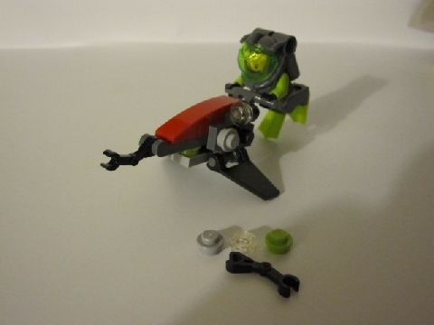
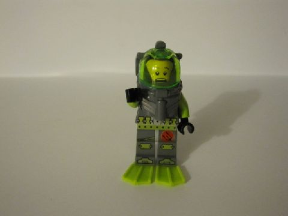
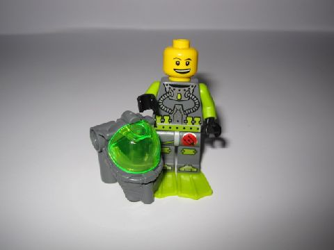
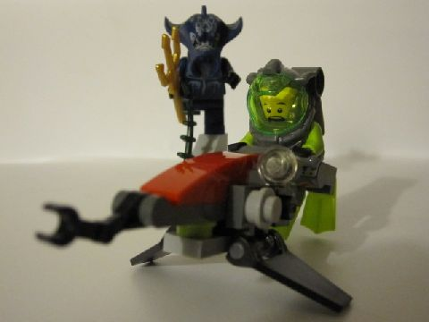

Poursuivons la découverte de la gamme Atlantis par le deuxième set Impulse de la série : Le propulseur sous-marin.

**–** Référence : 8072  
**–** Nom : Le propulseur sous-marin  
**–** Nombre de pièces : 23  
**–** Prix : 2,90 euro sur le s@h

La boîte comme pour [le guerrier Manta](/articles/1065/) contient un sachet de pièces et une notice, toujours pas d’autocollants.

**La boite un sachet de pièces et une notice**

Le montage se fait sans problème et au final, on obtient

**Le propulseur sous-marin**

Comme pour [le guerrier Manta](/articles/1065/), attardons-nous un peu sur le plongeur

**Le plongeur des profondeurs**

Tête double face, scaphandre grande profondeur (la visière est fixe) et palmes couleur lime du plus belle effet.

**Ouf il fait chaud sous le casque**

Et hop on retire le casque et on retrouve le sourire... Pas de cheveux une fois le casque enlevé, va falloir y remédier plus tard.

**Attention au guerrier Manta**

La suite sera : Le crabe des profondeurs.
