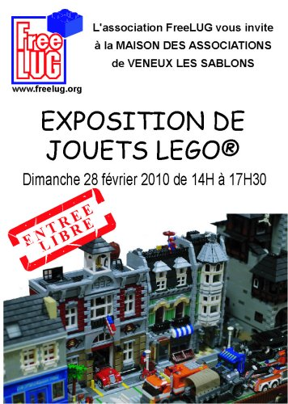

Nous profitons de notre assemblée générale pour ouvrir nos portes lors d’une exposition le dimanche 28 février.

Elle se déroule :  
**–** à la maison des associations, rue du Port à Veneux-les-Sablons, à côté de Fontainebleau (77) ;  
**–** le dimanche 28 février de 14h00 à 17h30 ;  
**–** entrée libre !

Pour les adhérents FreeLUG, les festivités commencent dès le samedi 27, à partir de 10h00, à la même adresse.

L’assemblée générale à proprement parlé débutera à 15h00 le samedi. Les cotisations pourront être récoltées au plus tard jusqu’à 14h30. [Tous les détails utiles sont précisés dans la convocation](http://www.freelug.org/priv_article.php3?id_article=1059). Consultez aussi [le planning des activités](/articles/1074/).

