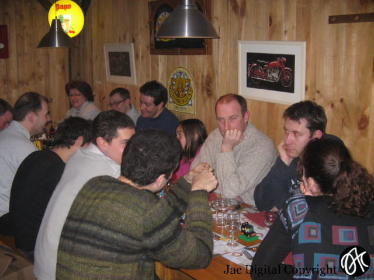
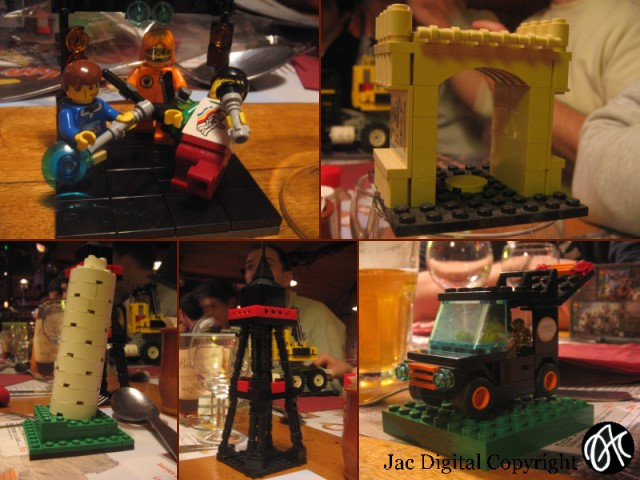
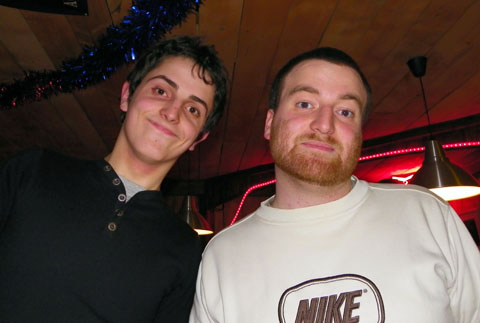
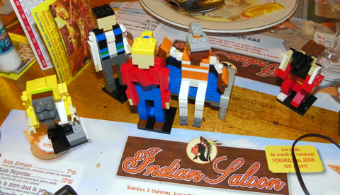
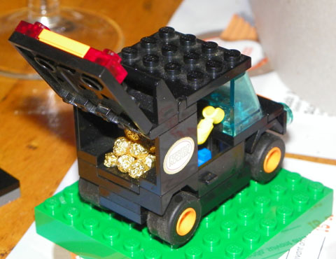

Pour cette première rencontre de l’année, nous avions choisi de nous retrouver en Auvergne. Après [Lyon](/articles/848/) et [Saint-Etienne](/articles/979/), c’est à Riom (63) que nous nous sommes donnés rendez-vous pour un repas "AFOL" le 23 janvier 2010.

Quatorze fans étaient attendus pour déguster un repas délicieux, écouter de la musique des années "80" et surtout parler de notre chère petite brique.

C’est avec joie et un peu d’angoisse, tout de même, que j’attendais les derniers arrivants à ce grand restaurant indien. C’était facile à trouver, puisque situé en bordure de voie express. De plus, un spot d’une portée d’au moins 500m marque l’endroit. L’Indian Saloon se voit de loin !

**Photo de notre "petit" groupe qui attend les plats, sans s’impatienter.**

Une fois que tout le monde a pu être installé autour de la grande table, nous avons pu déguster un apéritif. Ensuite, l’entrée, le plat principal et enfin, le dessert. Tout cela très bon, mais le principal, surtout, était que nous soyons réunis pour parler de vive voix et échanger nos idées sur tous ce qui concerne les LEGO !

Il y avait un petit concours de MOC, sans prétention à lot, mais juste pour s’amuser. Nous avons découvert de très belles réalisations, même si la base était très petite.

**Quelques jolies MOC étaient sur la table....**

Enfin, encore une belle soirée souvenir, même si la musique était un peu forte. Peut-être que certains regretteront de ne pas avoir pu écouter "Sister Sledge"... Mais pour moi, ce n’est pas grave, je préfère Indochine !

_Jérôme/Jac_

* * *

Sylvie et moi-même avons passé une super soirée, bien content de découvrir tout ce petit monde fan de la brique. Et tout au long de la soirée nous sommes passés de surprise en surprise, par exemple mon voisin de table nous a initiés au grand jeu du "je monte mes LEGO dans le sachet" autant dire trop drôle depuis on est fan. Nous avons au final passé une super soirée, reçu plein de cadeaux et bien contents d’avoir fait ces rencontres, merci à tous et en particulier à JAC qui nous a préparé la soirée comme un chef.

_Jérôme/Cheub_

* * *

Hop hop hop pour l’Indian, suivez le laser avec Indochine dans la voiture...

Oh des nouveaux (ça fait super plaisir), des anciens (ça fait toujours autant plaisir.

OOOOOOOOOOOOHHHHHHHHHHHHH c’est déjà fini...

Whaou !!! j’ai gagné les enchères !!!!

Allez, vivement le prochain

_Xavier/Brikolego_

* * *

OOOOuahouwww !! Quelle superbe soirée !!

Depuis le temps que je voulais parler et rencontrer des LEGOmen, c’est fait ! Je dois dire que j’ai été très bien accueilli, j’ai été séduit par mon voisin d’en face qui a fait des figurines comme celles de LEGOLAND !!

J’ai aussi acheté des mini figurines Blacktron et Mtron afin de les insérer dans une maquette de l’espace. Le restaurant était très bien, j’aurais bien voulu danser mais ce sera pour une prochaine fois peut-être !!

A bientôt !

_Lionel/Liogo_

* * *

Bonne soirée, content de retrouver d’autres fans et de faire de nouvelles connaissances, à refaire. Ma fille Camille (9 ans) en garde aussi un bon souvenir puisqu’elle est repartie avec une dizaine de personnages.

A bientôt

_Franck_

* * *

Ce fut un bon petit repas dans la lignée de ceux de Lyon et Saint Etienne. J’ai pu rencontrer de nouvelles personnes et dans une ambiance festive nous avons bien rigolé. Vivement le suivant.

PS : Vive Indochine ;)

_Etienne/Kit Fisto_

* * *

Une supère soirée en bonne compagnie. On parle LEGO et tout ce qui tourne autour. Ces restaurants nous permettent de se voir plus régulièrement.

Merci à Jac pour cette première rencontre de l’année.

C’est quand et où le prochain ?

_Pierre/PierroLego_

* * *

Merci JAC pour cette sortie au restaurant si bien organisée ! (et pour m’avoir supporté aussi la journée du lendemain :D)

Merci à tous ceux qui sont venus partager ce petit moment de détente entre amis autour de nos briques préférées !

Vivement le prochain, peut-être sur Lyon cette fois ?

_Pierre/Tribolego_

* * *

Supère soirée, Jac n’a rien oublié : bon repas, bonne musique et surtout _très bonne ambiance_. Les boîtes de LEGO ont intrigué nos voisins de table petits et grands.  
Nous sommes repartis après avoir remporté l’enchère du train de Noël.

Merci Jac pour cette bonne soirée, le déplacement en valait le coup. A renouveler.

_Daniel, Fred et Béa/Beadan_

* * *

Pas de long discours pour ce soir.

Une bande de gens "un peu bizarre"

Pardon, c’est pas la bonne photo. Je disais donc : une bande de gens "un peu bizarre" se sont donnés rendez-vous à l’Indian Saloon

même que l’ambassadeur est venu avec sa voiture chargée de Ferrero Rocher

Cool.

_Didier/Sixtuds_

* * *

## Galerie photos

**–** [Photos de Jac](http://photos.freelug.org/main.php/v/JAC/Exposition/Expositions2010/SoireeIndian/)
