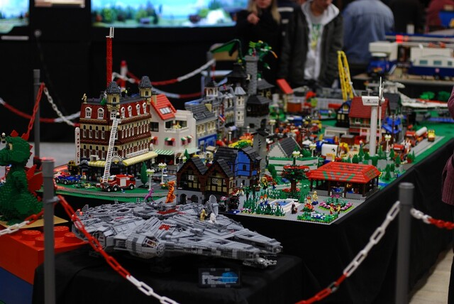
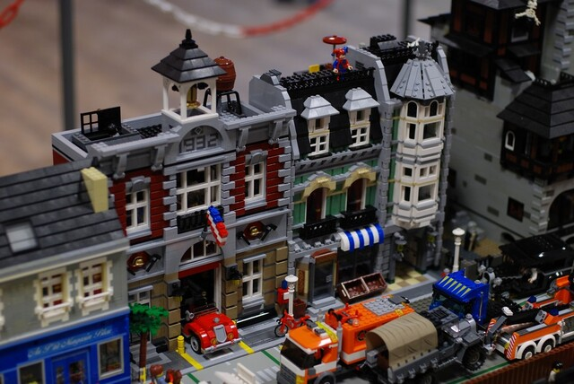
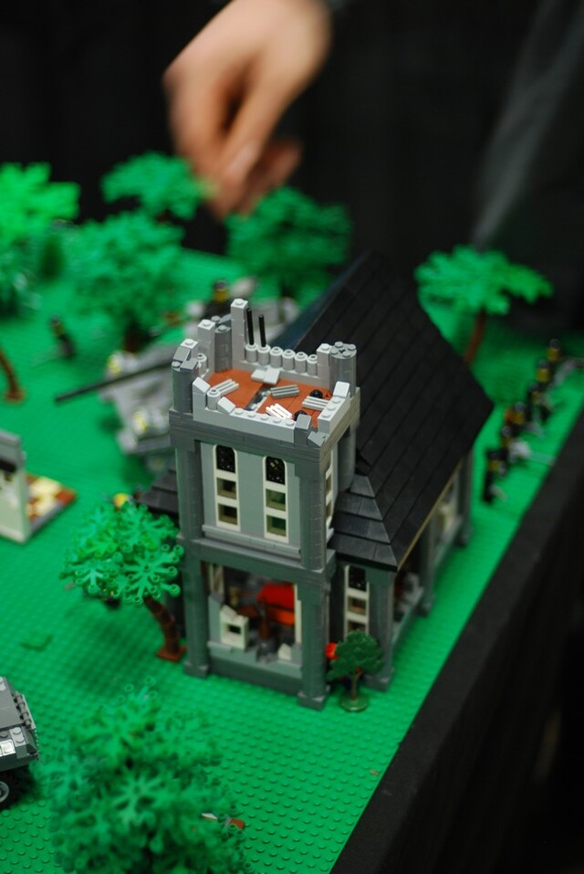
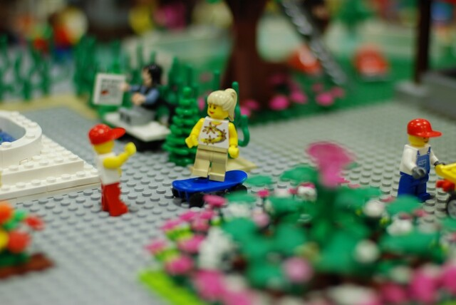
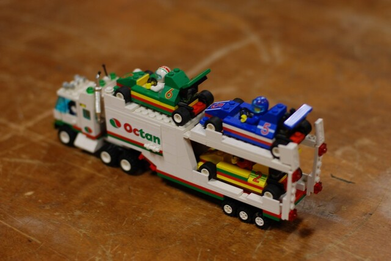

Les organisateurs de l’exposition ferroviaire de Bolbec ont une fois de plus fait appel aux trains LEGO. Cela devient pour nous un rendez-vous annuel, et cette fois-ci, nous étions trois.

**Exposition**

Nous avons apporté un réseau de trains 12V, accompagné de sa ville avec des créations mais aussi quelques belles boîtes LEGO avec le célèbre Corner Café, et la toute récente caserne de pompiers.

Une présentation partielle du jeu Warm Battle Bricks a fait sensation auprès du public, très étonné de voir des "boîtes" LEGO Armée ! ( "... tiens, je ne savais pas que LEGO faisait des boîtes Militaires ?..." ). Médérik et Jean-Gérald vous expliqueront leur jeu lors de l’exposition de Beaunes et l’AG en février.

Pour le moment, il faudra vous contenter des photos ;)

Florence de son côté nous a apporté son village médiéval, et le jardin fleuri qui l’accompagne.

Il a trouvé sa place en bordure du village, et commence à prendre de la place... Bientôt un module à elle seule !

La ville a été relativement longue à s’installer, car remettre en place la signalisation, les personnages, les réverbères, et la ligne électrique prend du temps, surtout avec les questions du public.

Mais à force d’exposer, je me suis rendu compte que les spectateurs aiment nous voir installer, construire, aménager, bref, jouer avec nos LEGO.

Le samedi a été une journée bien chargée au niveau de l’installation, et un nombre raisonnable de visiteurs. Leur nombre a explosé le dimanche, et nous avons eu affaire à de nombreux passionnés de LEGO, venus nous voir exprès, pour partager un moment sur notre hobby préféré.

A noter, un monsieur venu le samedi m’a dit avoir des problèmes pour remonter un camion porteur de voitures, récupéré en vide greniers. Il est revenu le dimanche avec, et j’ai essayé de le remonter sans notice, avec les quelques souvenirs que j’avais de ce set. Vu le résultat, je suis assez content de moi. Mon chineur de LEGO aussi :). Je lui ai depuis envoyé le lien vers la notice pour le finir.

Une exposition bien agréable, avec un nombre croissant de visiteurs, d’année en année.

Pour ce qui est du nombre d’entrées, il est impossible de le savoir, vu que l’entrée était gratuite. On réfléchit à un moyen simple comptabiliser les entrées pour l’année prochaine.  
On a hâte d’y être, mais il va bientôt falloir pousser les murs. On est de plus en plus nombreux à exposer.

A l’année prochaine

[Les photos](http://www.brickshelf.com/cgi-bin/gallery.cgi?f=418046)
