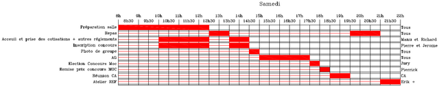
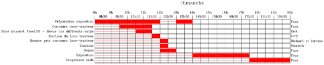

Un week-end bien chargé nous attend. Pour que tout le monde s’y retrouve, voici le planning et la liste des activités.

## Emploi du temps

**Emploi du temps du samedi**

**Emploi du temps du dimanche**

Adhérents FreeLUG, vous pouvez arriver le samedi 27 février matin dès 10h00. Pour le public, nos portes sont ouvertes le dimanche 28 février de 14h00 à 17h30.

Pour rappel, l’assemblée générale se déroule à la maison des associations de Veneux-les-Sablons (77), rue du port.

L’Assemblée Générale débute à 15h00 le samedi, précédée par une photo de groupe. Soyez à l’heure !

## Tombola

Une tombola avec différents lots est proposée durant le week-end. Le tirage au sort des gagnants se tiendra le dimanche avant le déjeuner.

## Concours

**Concours du locotracteur**

Il s’agit en réalité de deux concours :  
**–** Un concours de manœuvre de wagons avec son locotracteur ou un locotracteur prêté, sur un petit réseau de triage qui sera construit et prévu à cet effet. L’épreuve se déroule le dimanche matin de 9h30 à 11h30.  
**–** Un concours d’esthétique de locotracteur (voir l’article [Construire un locotracteur](https://www.freelug.org/spip.php?article1039)).

**SNOT QUI PEUT**

Cette année le concours de création met en avant les techniques de construction avancées tel que le SNOT. Le principe est donc simple : réaliser une création sur une base de 8x8 tenons (format vignette) avec comme seule contrainte de ne mettre aucune pièce, visible ou non, avec le(s) tenon(s) vers le haut ou tube(s) vers le bas (minifig incluse). Le thème est libre, ainsi que le nombre de pièces et de couleurs.

Les modèles devront être exposés le samedi et le gagnant sera récompensé le samedi soir.

**Où est Charlie ?**

Vous êtes fan de minifigs, mettez-les en scène dans un ou plusieurs modules "[Où est Charlie ?](https://www.freelug.org/spip.php?article858)" et remportez peut-être un Darth Vador chromé !

## Formation et information

Cette année nous vous proposons de vous expliquer comment fonctionne les différents outils informatiques mis à votre service par l’association (listes, zone de rédaction, wiki, galerie photos). Cet atelier se tient le dimanche matin dès 10h30.

Un autre atelier sur l’organisation de la REF est organisé le samedi soir, à l’issue du repas. Il pourra aussi être abordé la gestion d’exposition en tant que coordinateur.

Cet atelier a pour but de faire partager l’expérience des plus aguerris.

## Activités libres

Pour occuper le temps libre qu’il vous reste (si il vous en reste ;) ) :

**Échange de notices**

Amenez vos notices en double ou inutiles et échangez-les avec les autres adhérents !  
**–** [Que faire des notices en double ?](/articles/1061/)

**Jeux de société**

Affrontez les autres adhérents dans le [labyrinthe du Minotaurus](https://www.freelug.org/spip.php?article976) ou sur [les pentes de la pyramide de Ramses](https://www.freelug.org/spip.php?article1009)

**Techball**

Initiez-vous au [Techball](https://www.freelug.org/spip.php?article862) ou venez mesurer votre module à ceux des autres joueurs.

**Triffouillis des briques**

Pensez à amener vos [Triffouillis sur les différents thèmes](https://www.freelug.org/spip.php?article1040), et pourquoi pas de la pièce détachée pour des brainstormings improvisés !

## Repas

**–** _Repas du samedi midi_ : 12h30  
**–** _Repas du samedi soir_ : 19h30  
**–** _Repas du dimanche midi_ : 12h00

## Exposition

L’exposition publique débute le dimanche après-midi à 14h00 et se termine à 17h30.

Venez présenter vos créations ou modèles !
