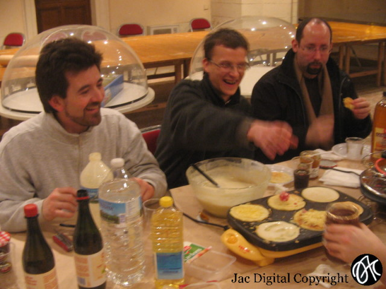
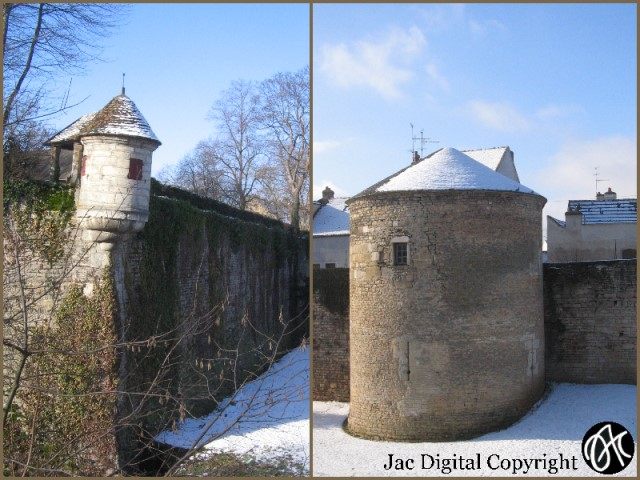
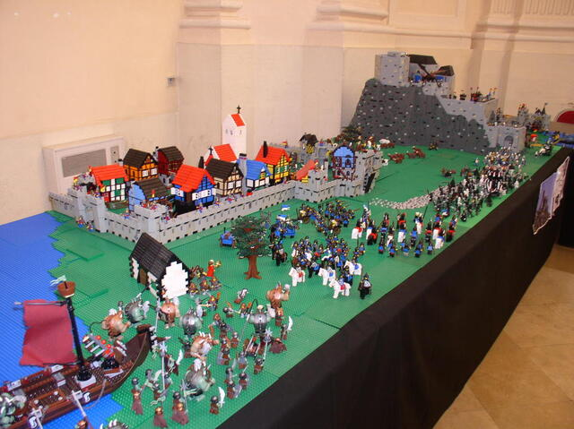
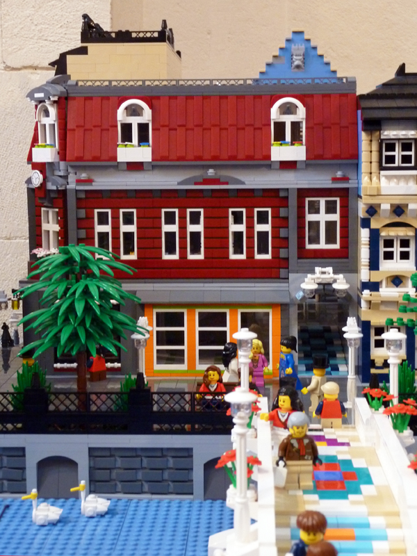
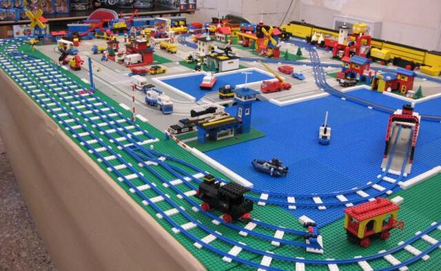
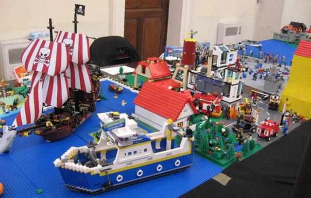
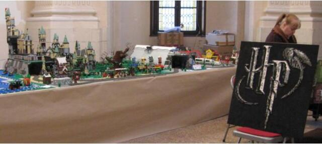
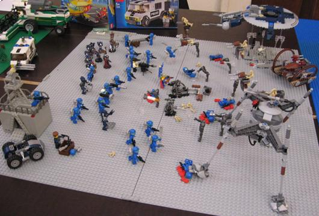
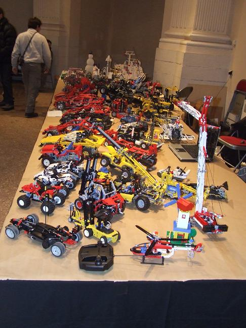

2010 la deuxième Festi’beaune est finie. L’association Festi’briques remercie tous les exposants, les associations amies (Fanabriques, FreeLUG) d’avoir oeuvré pour cette exposition totalement axée sur notre jouet préféré : les briques LEGO.

Nous sommes heureux aussi d’avoir permis à certains de faire leur première exposition. Le grand saut ! Attention une fois qu’on y a goûté...

En tout cas, nous serons heureux de vous voir ou revoir pour la troisième édition en 2011 (exposants, visiteurs, jeunes et moins jeunes, ce week-end est le vôtre !).

_L’équipe organisatrice de Festibriques_

* * *

Pour ma deuxième participation à cette exposition consacrée uniquement à la brique LEGO, j’avais fait en sorte de présenter quelque chose de fini. L’année dernière, mon île Space Pirate était seulement en construction, faute de temps et d’idées. Ca sera pour une prochaine fois. J’avais donc sorti pour la dernière fois mes stands de course de camions. C’est toujours un régal de jouer ou de voir jouer les (grands) enfants au lancer du dé... Par contre, je n’ai pris aucune photo de "feu" les stands, tant pis.

Merci à tous les organisateurs (comme ça je n’oublie personne :) ) pour l’accueil. Tout était impeccable. Un week-end passé dans la bonne humeur et la franche rigolade. Même la salle était réchauffée par l’ambiance.

**La partie crèpes de Vendredi soir. Merci de m’avoir attendue.**

Une très belle exposition qui donne envie de la refaire encore et encore. le cadre est fantastique. On sort de la salle et on est envahi par une ambiance médiévale et viticole. J’ai fait une balade matinale blanche très agréable autour des remparts de la très belle ville de Beaune (21).

**Les remparts de Beaune.**

_Jérôme/JAC_

* * *

Cette superbe exposition de Beaune m’a permis de présenter pour la quatrième fois mon Château de Quéribus. Cette fois-ci, comme au LEGOWorld, il était présenté dans un diorama Castle que j’ai pu réaliser grâce à l’aide précieuse de Fred/Fénix.

Nous avions improvisé un village fortifié avec trois "Médieval Market" de différentes couleurs, quelques maisons médiévales réalisées par Fred et des murailles à base de sets LEGO des années 80/90.  
Nous avons aussi installé une plage pour permettre aux redoutables orcs de débarquer grâce à leur drakkar !  
Heureusement, entre l’armée des Black Falcon de Fenix et mes soldats Fantasy Era, l’invasion de squelettes démoniaques a été évitée !

Quéribus de le diorama Castle de Tribolego et Fenix

J’ai adoré ce week-end en compagnie d’Afols de toutes provenances (Fanabriques, Festibriques, FreeLUG et SeTechnic). J’ai pu aussi m’essayer à "LEGO Indiana Jones" sur XBox 360... J’ai tellement aimé que je me le suis acheté ! (sur PC)

Pour finir je remercie les organisateurs et les autres exposants, c’était un week-end au poil !

_Pierre/TriboLego_

* * *

Pour ma première participation à Festibriques, j’ai amené mes deux modules City dans le style corner café. Ils n’en ont maintenant plus que le nom, puisque le bâtiment "Corner Café" a fait place à une nouvelle construction :

**ModulesCC**

Remplacement du corner café

J’ai particulièrement apprécié le soin apporté par les organisateurs pour rendre cette exposition si agréable. Le seul point noir a été la météo, mais ça, on n’y peut rien !  
J’ai pu longuement discuter avec les autres exposants, déjà rencontrés ou non, et même monter un set Technic ! en conclusion, un super week-end ! à l’année prochaine !

_Laurent_

* * *

Ayant une double étiquette sur cette exposition et participé à l’organisation, je n’ai pas ramené grand chose. J’ai présenté une mini bataille Hoth ainsi que le Republic Dropship avec l’AT-OT Walker, et à côté il y a avait l’Etoile Noire en version Minifig.

Sinon, que du bonheur durant ces deux jours : des nouvelles têtes, de nouvelles choses à voir, et encore plein de discussions intéressantes et de bonnes rigolades. J’ai particulièrement apprécié le samedi soir avec raclette et quizz.

Merci à JeanG pour son grand investissement dans cette exposition, et l’année prochaine pour une nouvelle édition !

_Pierre/PierroLego_

* * *

Déjà la deuxième édition de Festibeaune ! du 100% LEGO. Cette année, on peut dire que l’on a eu la quantité et la qualité de la diversité dans notre univers LEGO. On a vu du Bionicle, du Technic, du Castle, du city, du Harry Potter, du Duplo avec leur acrylonitrile butadiène styrène, du Vintage et son acétate de cellulose !　Bon là, il fallait être là pour sourire devant de tels mots de chimie :). On a même eu droit à une borne de jeux vidéo pour tester les jeux de la gamme LEGO. La synergie de trois associations (Fanabriques, FreeLUG et Festibriques) et la présence d’"indépendants", pour une exposition fabuleuse.

Malgré le froid, la neige, les creux des visites et les rush l’ambiance fut, euh... indescriptible. Comment traduire, faire ressentir la convivialité, les échanges ? Pour un passionné comme moi, c’est une bulle qui dure le temps d’un salon ! Merci à vous tous qui font de ces moments ce qu’ils sont ! Et c’est vrai qu’une fois que l’on y a goûté, c’est dur de se limiter.

Vivement la prochaine ! Alors pour Festibeaune 2011, réfléchissez-y et vous serez accueillis avec un grand plaisir !

_Frédéric/Fenix21000_

* * *

Nous étions nombreux à faire le déplacement d’Alsace. Huit personnes dont 5 exposants. Bel accueil des bourguignons.  
La salle au cachet particulier nous a permis d’exposer du city (Félix), du pirates (Paul) et du Vintage (Thierry).  
Le public bien sympa n’a pas hésité à poser des questions.  
Le samedi soir, grosse raclette et jeux (quizz, tombola) nous ont bien fait plaisir.

Le petit hôtel du coin aux frais des organisateurs était le bienvenu.  
J’ai fait la connaissance d’autres AFOLS - Super.  
Merci donc aux organisateurs pour nous permettre de faire vivre le plaisir de la brique au plus grand nombre.

Et comme dit Gégé, Jamais deux sans trois.

On espère tous à l’année prochaine.

_Thierry_

**Vintage\_TM**

Layout vintage de Thierry et Eliane Meyer, dont la maintenance est assurée par Tom Meyer, qui émerveille petits par la simplicité des montages d’époque et grands parce que celà leur rappelle leur jeunesse.

**Paul\_et\_Felix**

Layout Pirates et City de Paul et Felix Meyer : la relève semble assurée.

* * *

Notre première participation à Festi’briques fut un week-end bien dense : départ de Griesheim près Molsheim vers 7h15, arrivée à Beaune sous la neige vers 10h30, mise en place du layout Harry Potter jusqu’à 15h, raclette animée par Fenix après fermeture de l’exposition à 19h, courte nuit reposante dans un hôtel première classe, retour dans la salle pour 8h45, grosse journée d’exposition de 9h à 17h30, démontage frénétique achevé à 19h et finalement retour à la maison vers 22h15.

Cette exposition m’a donné l’occasion de ressortir (pour le dernière fois avant démontage) le layout Harry Potter des cartons dans lesquels il dormait depuis Fana’briques 2009. Le remontage de certaines portions a été un peu laborieux mais heureusement mon épouse m’a efficacement aidé et tout était fonctionnel samedi vers 15h. Quant à Alexandre, cette exposition lui a permis de montrer sa version LEGO de Warhammer 40000 et de discuter Bionicle avec Henri une grosse partie du week-end.

En tout cas, ce fut une super expérience humaine en terme de rencontre avec les membres de Festi’Briques, les autres exposants majoritairement FreeLUGiens et le public avec lequel j’adore toujours autant interagir.

_Daniel de la famille Stoeffler_

**Harry\_Potter**

Layout du monde de Harry Potter de Daniel et Clara Stoeffler avec Poudlard Express, saule cogneur, basilic grinçant et mosaique.

**SW\_vs\_W40k**

Layout d’Alexandre Stoeffler représentant l’improbable confrontation entre l’armée des droides de la fédération du commerce et une escouade de space marines de Warhammer 40000.

* * *

C’était un excellent rendez-vous de passionnés, un week-end mémorable où tous les styles de construction en briques LEGO se sont croisés, pour le bonheur de tous. Ces 48h m’ont permis de partager cette passion pour la toute première fois avec un public attentif et de faire des rencontres avec des exposants adorables. Un grand merci à JeanG, pour son organisation, sa gentillesse, enfin pour tout quoi car sans lui tout cela n’aurait pas été possible.

Vivement la prochaine !

_Olivier/Elvisnake de SeTechnic_

* * *

Je viens mettre ma petite note personnelle sur ce week-end de folie.

En effet, c’était ma première exposition ouverte au public (j’avais déjà fait un rassemblement avec les membres de SeTechnic à l’été 2009), ce fut donc une grande première. Beaucoup d’appréhension, de stress (à cause du train entre autres) mais au final du grand régal.

**L’espace Technic de SeTechnic**

J’ai pu rencontrer de nombreux AFOLs et surtout un public qui nous comprenait, nous les AFOLs. J’ai pu voir de nombreux sets et gammes différentes que je connaissais pas plus que ça mais surtout le château du Queribus : un MUST.

Je remercie tout le monde et bien sûr JeanG qui nous a invités à combler un vide en Technic (j’ai été aidé de mon acolyte Elvisnake).

A l’année prochaine !

_Romuald/Ramoutcho\_7387 de SeTechnic_

## Galerie photos

**–** [Galerie de Jac](http://photos.freelug.org/main.php/v/JAC/Exposition/Expositions2010/Festibriques/)  
**–** [Galerie de Xavier](http://photos.freelug.org/main.php/v/XavierD/Expo+Beaune/)  
**–** [Galerie de Daniel](http://photos.freelug.org/main.php/v/DanSto/Evenements/Festibriques_2010/)  
**–** [Galerie de Pierrolego](http://photos.freelug.org/main.php/v/pierrel/exposition/2010/festibriques/)  
**–** [Galerie photos de Fenix21000](http://www.brickshelf.com/cgi-bin/gallery.cgi?f=419390)  
**–** [Galerie de Ramoutcho (SeTechnic)](http://www.brickshelf.com/cgi-bin/gallery.cgi?f=421332)

## Vidéos

[Layout Harry Potter](http://www.youtube.com/watch?v=i1fzEWRFP2w)
