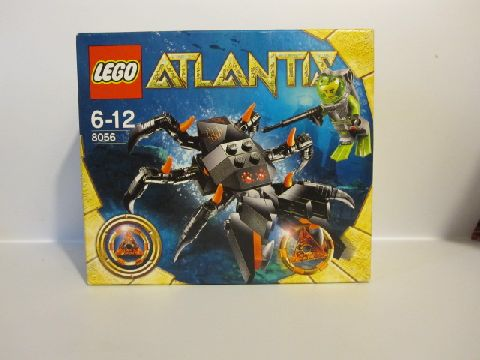
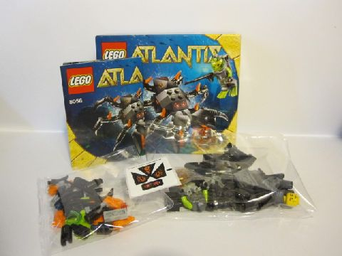
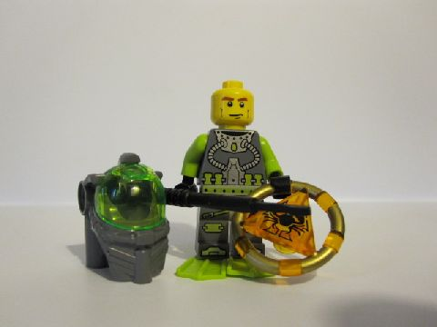
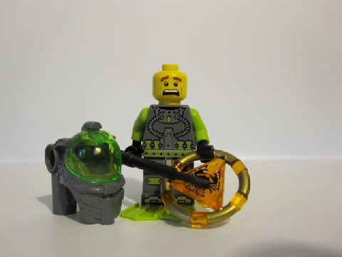
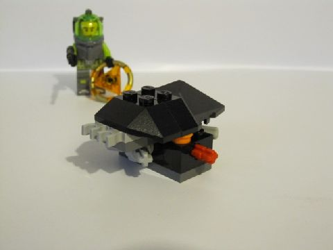
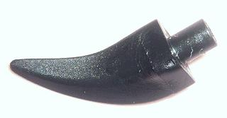
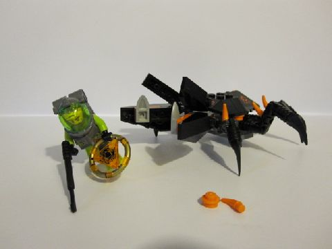

**–** Référence : 8056  
**–** Nom : Le crabe des profondeurs  
**–** Nombre de pièces : 68  
**–** Prix : 7,50 euro sur le [S@H](http://shop.lego.com/ByTheme/Product.aspx?p=8056&cn=616&d=70)

Contrairement aux boîtes du [Guerrier Manta](/articles/1065/) ou du [propulseur sous-marin](/articles/1066/), la boîte du crabe indique d’emblée la présence d’une clé de l’ancienne cité de l’Atlantis ainsi que sa couleur, ici orange.

Une fois ouverte, la boîte laisse apparaitre la notice, deux sachets de pièces et une planche d’autocollants.

Commençons par le montage du plongeur, ce dernier possède une tête double face.

Avec cette clef, à moi le trésor de l’Atlantis.

ARGgggggg un requin........

Poursuivons par le montage du crabe. Pas de grande surprise au montage si ce n’est qu’il me rappelle un peu celui de [l’Arachnide Combattant](/articles/724/) pour le système de fixation des pattes.

**Etape 10**

A l’étape 10, le corps du crabe a pris forme, encore 4 étapes et le crabe sera fini. Les pattes se terminent par des [pointes souples](http://www.bricklink.com/catalogItemIn.asp?P=87747&in=S) créées pour la série.

(Source Bricklink)

Une petite critique sur ce set : le manque de mouvement des pinces du crabes, limité à l’horizontale.

Voilà, la suite sera le set 8057 : Le scooter des profondeurs

Le modèle fini et ses extra parts.
