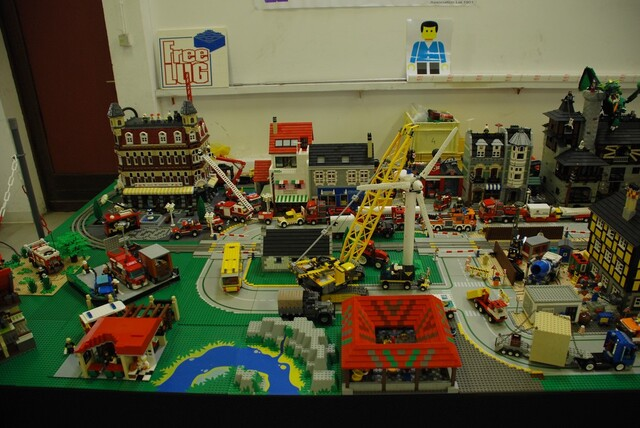
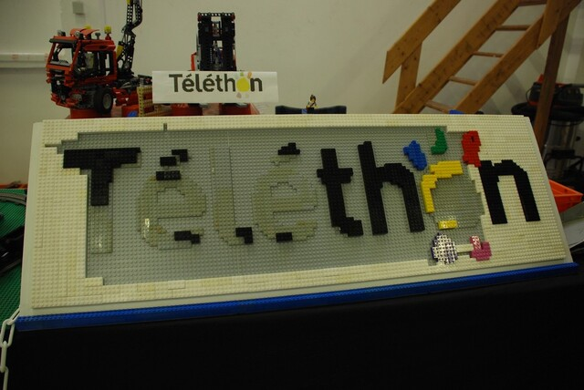
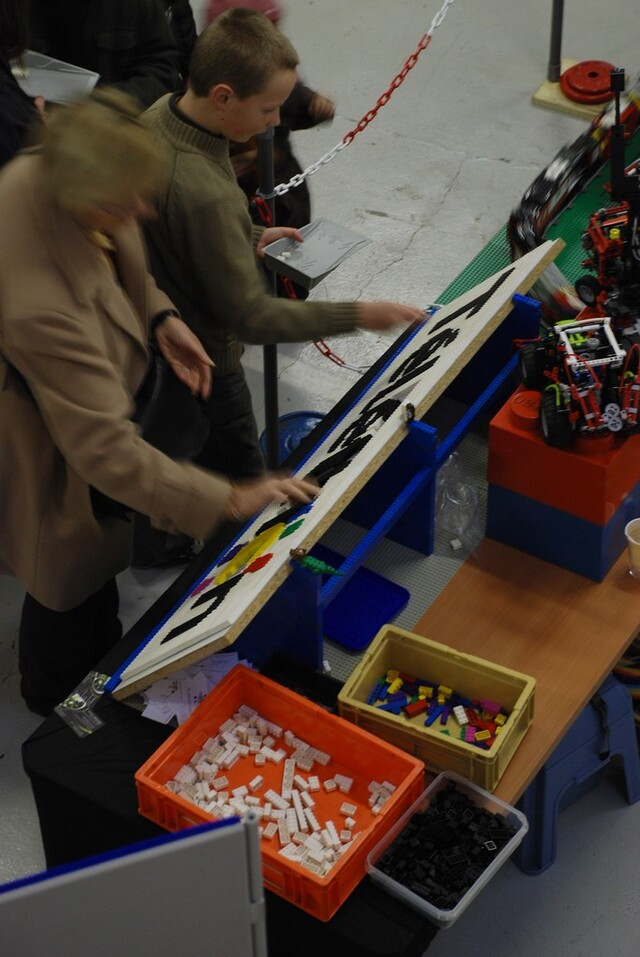
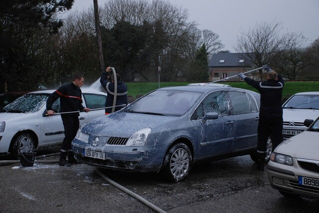
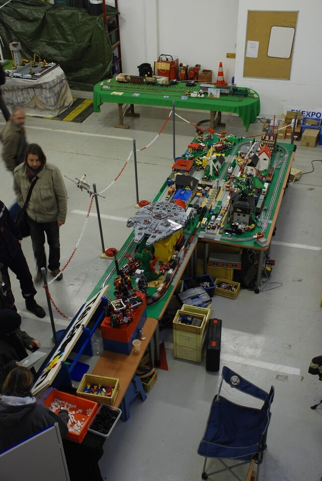
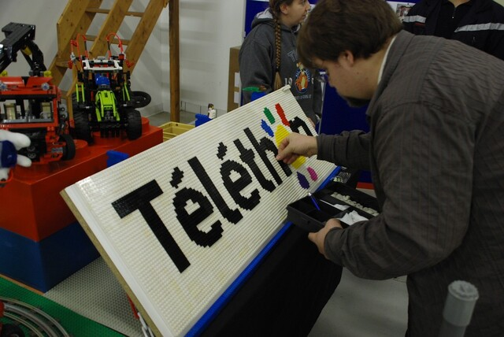
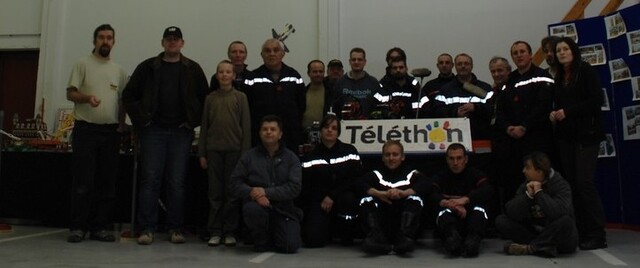

Comme convenu avec les Pompiers de Criquetot l’Esneval (76), nous sommes arrivés le matin, à l’aube, et surtout à la fraiche...

Il faisait très froid le samedi matin, et nous avons apprécié que le chauffage soit en route dans le garage de la caserne.

Du coup, pour la première fois, nous avons pu rentrer les voitures, et la remorque jusqu’à notre emplacement. Montage des tables, mise en place des bâtiments et du réseau de trains, nous avons pu présenter une exposition assez rapidement, et mis en place dès l’ouverture au public, le Fil Rouge.

Nous avons proposé de construire une mosaïque LEGO pour reconstituer le logo du TELETHON en fonction des dons des visiteurs.

Le barème était simple : 1 tenon pour 10 centimes d’euro.  
Par contre, la logistique et le montage ont été bien plus complexes que prévu.

Les participants ne montant pas la mosaïque comme moi je l’avais prévue, Florence et Médérik ont passé leur journée à assister les artistes en briques et à corriger leurs erreurs.

Heureusement que j’avais prévu plus de petites briques (1x1, 1x2, 1x3, etc.) pour pouvoir palier à ce problème.  
Certaines personnes n’ayant pas forcément envie de monter les briques, mais nous avons trouvé de l’assistance.

Les pompiers aussi ont fait l’animation, avec un lavage auto improvisé. Mieux que l’éléphant bleu...

Une vue d’ensemble de notre stand.

Nous avons réussi à compléter le logo, et même commencé à faire une deuxième couche.

Une très agréable journée...

Nous avons été recontactés pour participer en 2010 !

[Les photos](http://www.brickshelf.com/cgi-bin/gallery.cgi?f=410237)
