Avec le retour de la gamme aéroportuaire cette année, LEGO nous propose un set qui sort de l’ordinaire par son contenu : un hélicoptère avec une limousine !

## La boîte

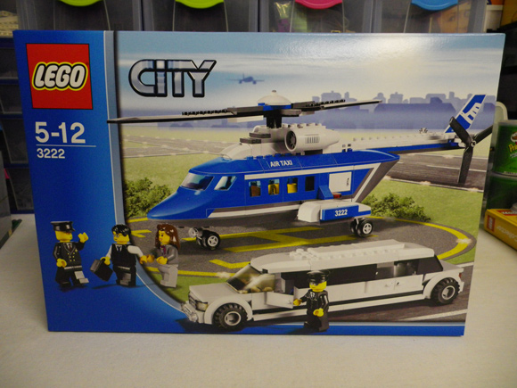

**la boîte**

**–** numéro du set : 3222  
**–** nom du set : l’hélicoptère et la limousine  
**–** gamme : CITY  
**–** année : 2010  
**–** nombre de pièces : 267  
**–** nombre de minifigs : 4  
**–** prix moyen constaté : environ 30€

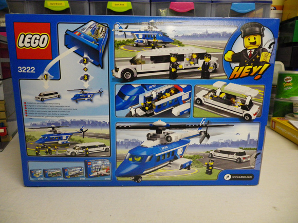

**l’arrière de la boîte**

Rien d’extraordinaire sur la boîte. C’est du classique.  
On voit bien que l’intérieur de l’hélicoptère et de la limousine est accessible.

## Le montage

On ouvre la boîte...

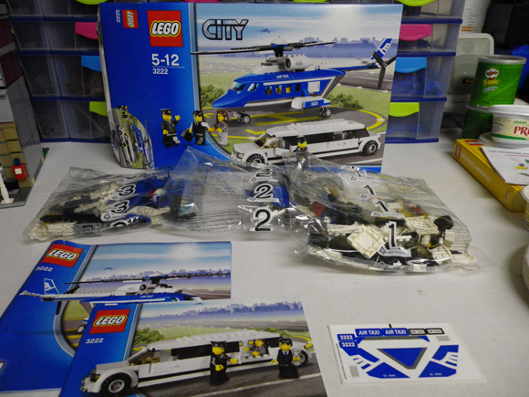

**le contenu**

Et on découvre deux notices, trois sachets numérotés et une planche d’autocollants.

Puis on commence le montage par la limousine.

La base de la limousine est fait de deux châssis de voitures...

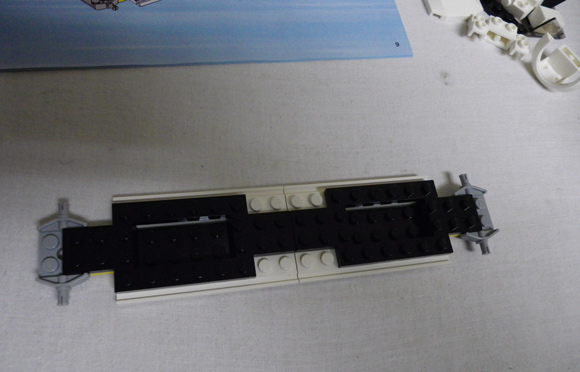

**le châssis**

Puis après ça se construit tranquillement. Six portes pour la limousine...

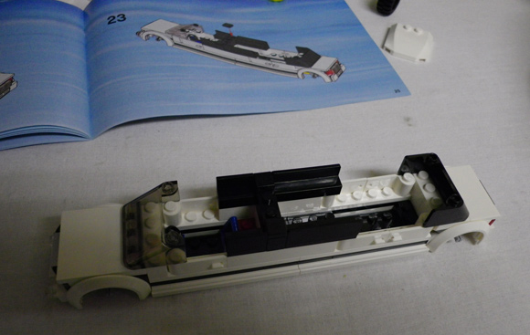

**en construction...**

Et puis on arrive à la fin quand le moteur démarre et embarque ses passagers...

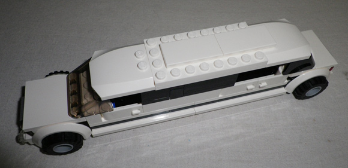

**limousine finie**

L’intérieur de la limousine est un peu équipé. Il y a deux verres pour le champagne et une télé avec la diffusion des aventures de Clutch Powers ;-)

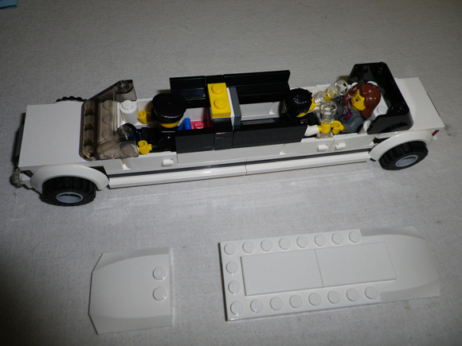

**intérieur de la limousine**

**–** Après la limousine, on attaque le montage de l’hélicoptère...

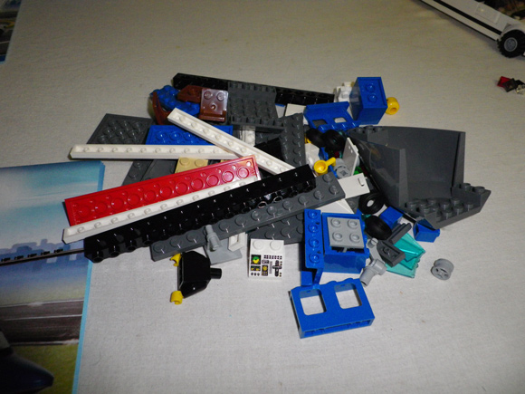

**pièces pour l’hélico...**

Rien de particulier pour le montage de l’hélicoptère. Quand on arrive à la fin du sachet numéro 2, on a déjà fait la moitié de l’hélicoptère.

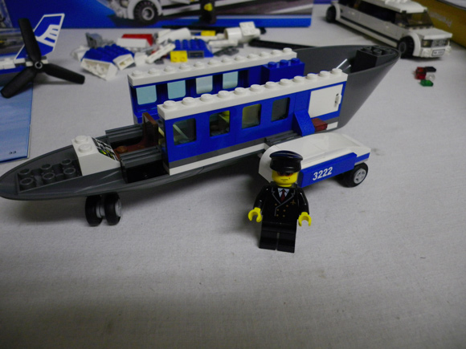

**fin du 1er sachet de l’hélico...**

Puis on fini cet hélicoptère privé sans difficulté.

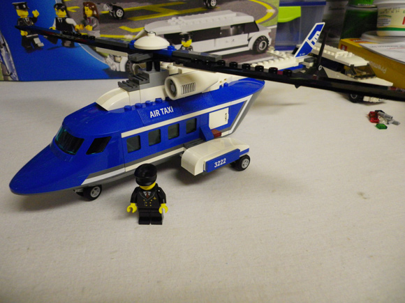

**hélico fini**

Il ne manque plus que les passagers et c’est parti. Comme dans la limousine, il y a 2 tasses. Là c’est pour prendre de l’aspirine après avoir un peu trop bu de champagne !

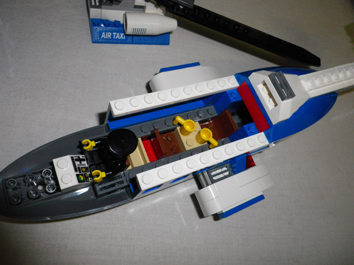

**intérieur de l’hélico**

## Conclusion

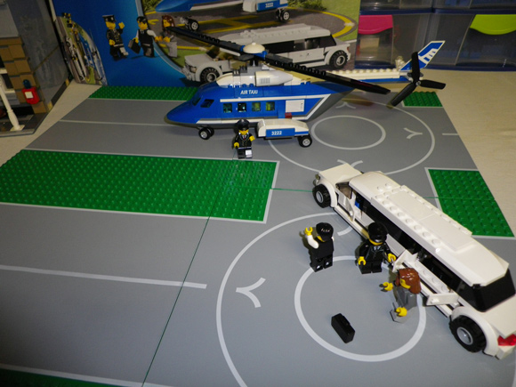

**à l’héliport....**

Donc, en conclusion, un set bien sympa.

Une vrai limousine, longue et de la même largeur des voitures, 6 portes, intérieur détaillé. Il y a seulement les vitres fumées qui sont en noir. Mais pour moi, ça me va comme ça !

L’hélicoptère, tout aussi détaillé, est sympa lui aussi, enfin il est simple mais accompagne très bien la limousine.

4 minifigs dans ce set, c’est parfait !

Que demander de plus...
