Changement de lieu cette année. Après six assemblées générales à Saint-Michel-sur-Orge, nous avons déplacé l’AG à Veneux-les-Sablons, dans une grande salle prêtée gracieusement par la municipalité.

## Déroulement du week-end

Grande salle, donc plus de place pour les LEGO : le week-end de l’assemblée générale est un moment favorisés de l’association où de nos nombreux se retrouvent pour partager leur passion.

Entre l’arrivée des premiers au matin pour préparer la salle, faire les dernières courses, puis les repas, le déroulement de l’assemblée à proprement parler, les concours et l’ouverture au public, les deux jours ont été bien occupés.

Et avec tout ces participants, il y avait de quoi discuter !

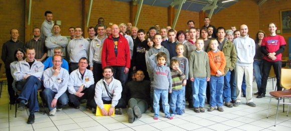

## L’Assemblée Générale

Avec des gars sérieux comme ça (calvitie, barbe) [^1], je pense que l’association va être bien gérée.

[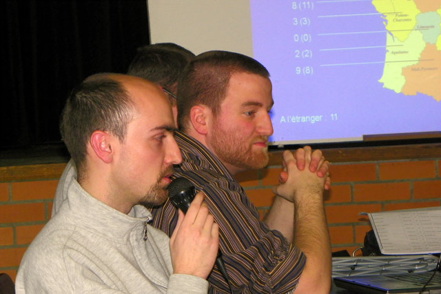](https://www.freelug.org/IMG/jpg/AG_2010_Prez.jpg)

Bon, apparemment, le public (les membres - à jour de cotisation) est tout aussi sérieux (bras croisés).

[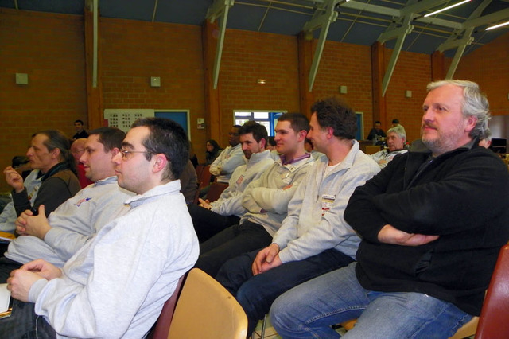](https://www.freelug.org/IMG/jpg/AG_2010_AGPublique.jpg)

Bon, le sérieux n’a pas duré, heureusement : nous sommes allés jouer avec nos chères petites briques :-D

## Le concours de locotracteurs

Parmi les activités du week-end, il y avait un concours, ou plutôt devrais-je dire deux.

Le premier demandait un travail en amont et consistait à présenter un train LEGO de sa création sur le thème des locotracteurs.

Vous pouvez voir ci-dessous quelques-unes des créations.

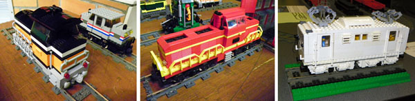

Le second concours eut lieu le dimanche et consistait à manoeuvrer des wagons sur un triage.

Il est apparu que ce genre de concours est très amusant et addictif quand vous mettez en place un triage symétrique et que vous jouez directement contre un adversaire, face-à-face, plutôt que sous la pression du chronomètre.

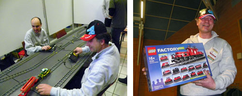

Retrouver d’[autres images et une vidéo](http://photos.freelug.org/main.php/v/6studs/Expos/AG2010/shunters/).

## Le concours de créations

Comme chaque année, un petit concours de créations permet de faire travailler l’imagination des adhérents. Cette année, le thème était "SNOT qui peut", où la construction ne devait posséder aucune brique tenon vers le haut.

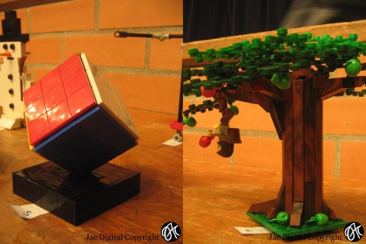

## L’exposition

Nouveauté de cette année, en contrepartie du prêt de la salle, mais aussi pour nous faire connaître et partager notre passion, nous avons ouvert nos portes le dimanche après-midi pour présenter une petite exposition.

Une vingtaine d’adhérents ont donc proposé de multiples thèmes au public venu découvrir ces petites briques colorées.

Petit tour de salle...

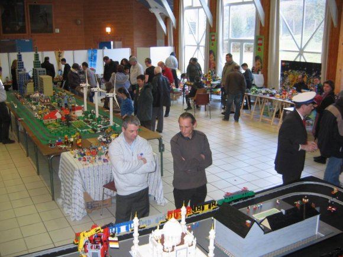

Superbe diorama "city" par les Havrais, et notamment Méderik qui présentait son ensemble de réalisations pour le WarBattleBricks

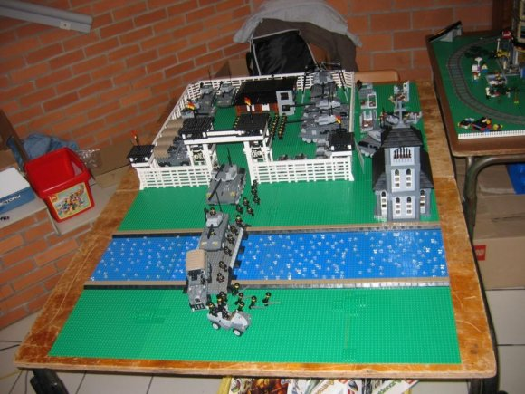

Les plus jeunes de nos visiteurs ont pu s’amuser avec les briques Duplo de Brigitte qui reçut l’aide d’Alain et de Danièle.

[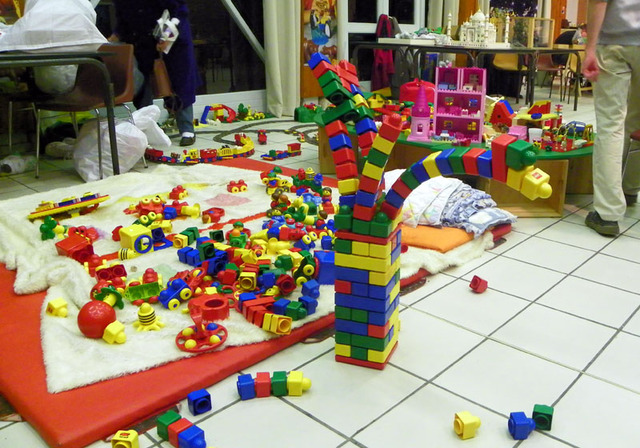](https://www.freelug.org/IMG/jpg/AG_2010_Duplo_Primo_by_Brigitte.jpg)

Denis exposait sa formidable grande roue

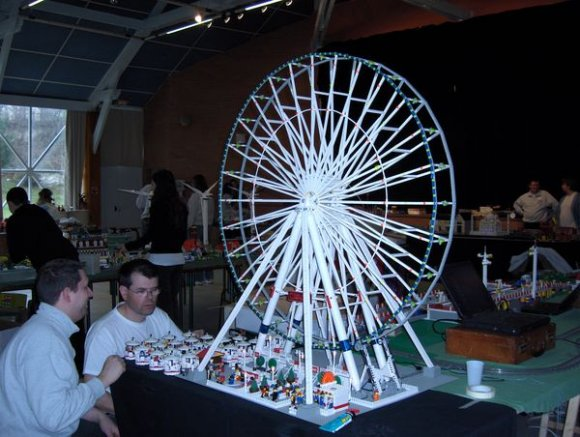

Jean-Claude aidé de sa fille occupait le centre de la salle avec un diorama City, Sylvain proposait ses créations Technic

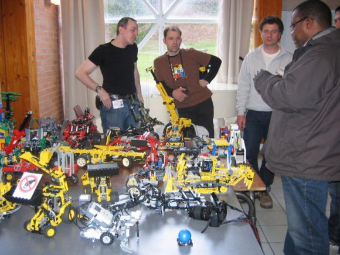

Manu présentait une nouvelle variante de sa mine Power Miners, et les nouveautés Atlantis. Plus toutes les autres choses apportées par Daniela, Jérémy, Julien, Jac, etc.

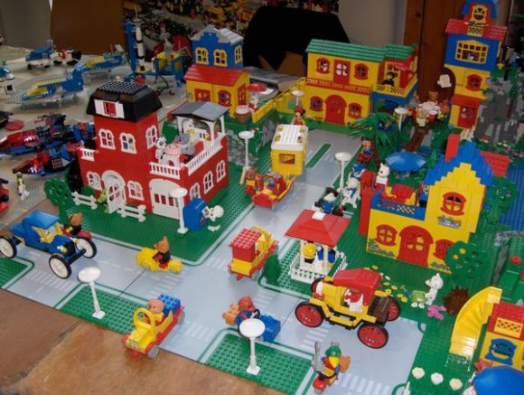

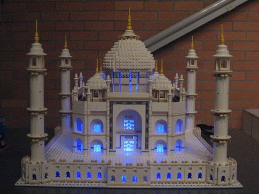

## Et les à-côtés

Ce fût également l’occasion pour de nombreuses personnes de récupérer leurs achats issus de la commande groupée.

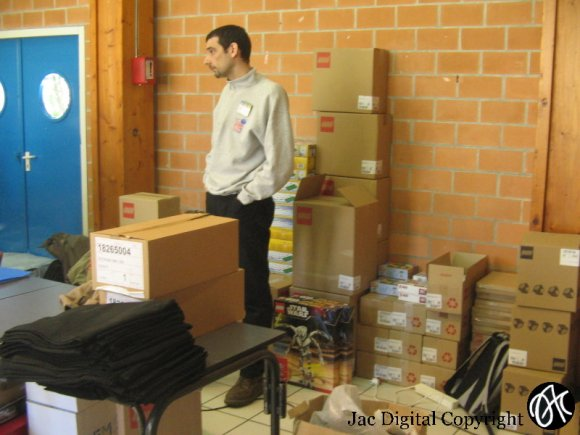

Ou de construire un Faucon Millenium UCS, de jouer au Techball

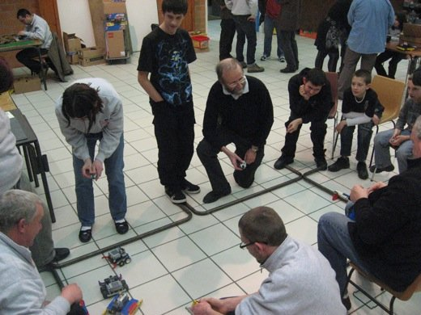

d’échanger des tas de notices, de jouer aux jeux de société

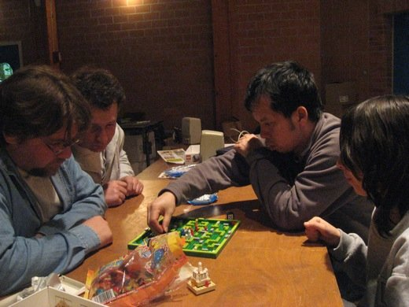

Et on n’oubliera pas les repas, qui ponctuent le week-end.

[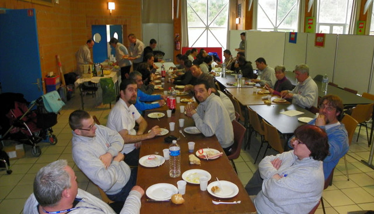](https://www.freelug.org/IMG/jpg/AG_2010_Repas.jpg)

Comme vous pouvez le constater, une grande richesse et grande variété attendaient à la fois les membres présents et les visiteurs.

Un grand merci à tous ceux qui ont participé, et également à la municipalité de Veneux-les-Sablons pour son soutien et son enthousiasme !

## Galeries photos

Tout mettre dans l’article serait trop long, visionnez plutôt les galeries pour tout découvrir !  
**–** [Didier "SixStudS"](http://photos.freelug.org/main.php/v/6studs/Expos/AG2010)  
**–** [Richard "Charlie"](http://photos.freelug.org/main.php/v/Charlie/AG2010/)  
**–** [Eric "f1tvf"](http://photos.freelug.org/main.php/v/f1tvf/expositions/ag2010/)  
**–** [Jac](http://photos.freelug.org/main.php/v/JAC/Assemblee+Generale/AG-2010/)  
**–** [Daniela](http://photos.freelug.org/main.php/v/Daniela+et+Sylv1/AG/AG+2010/)  
**–** [Samuel](http://photos.freelug.org/main.php/v/samuel/AG2010/)  
**–** [Danièle](http://photos.freelug.org/main.php/v/dannylou/)

[^1]: On avait dit qu’on se ne moquait pas du physique
