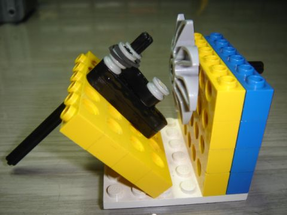
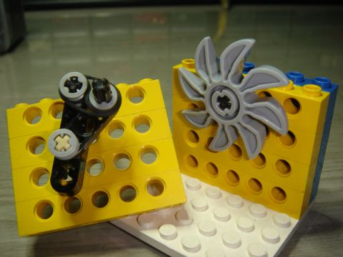
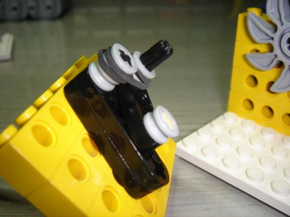
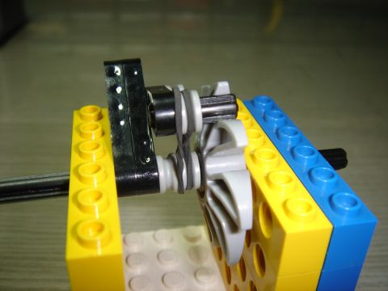
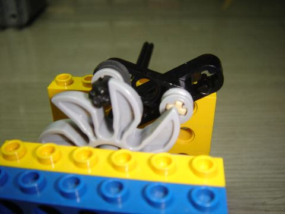
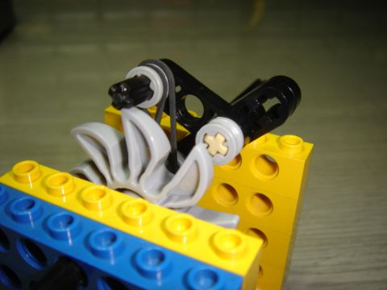

Il y a quelques temps, j’ai eu besoin d’une roue libre.  
Pour rappel, la roue libre est ce qui permet à votre vélo de continuer à rouler alors que vous ne pédalez plus.  
C’est un mécanisme qui n’a qu’un seul sens d’entrainement.

Une image valant 1000 mots, voici ce que je vous propose :

**les 2 parties**

**semi-éclaté**

**partie mobile**

Ce qui donne, une fois assemblé :

**vue de côté**

Vous voyez la position en entrainement :

**entrainée**

et la position en "roue libre" :

**en roue libre**

Évidement, comme vous le pressentez, il y a du frottement (et oui, ça fait du bruit). Pour cela, on joue sur la tension de l’élastique.

La partie qui fait la jonction ici est un axe L2. On peut toutefois utiliser un axe L3 si le L2 sort trop souvent de la thin plate L3 (ce qui arrive effectivement parfois avec cet axe L2 à force de frottements).

Une petite vidéo pour finir :

Video Player

[Vidéo de la publication d’origine](https://www.freelug.org/IMG/avi/Roue_libre_resize.avi)

**Vidéo roue libre en action**

Voilà pour mon premier article !

Dans le prochain, nous étudierons la densité de courant au sein d’un ensemble batterie/moteur XL Power Functions au niveau de l’équateur, le tout sous l’influence d’un four à chaleur tournante et d’un CD de Francky Vincent, par un jour de tempête solaire (Yeah !!!).

A bientôt,

Sly
