Revue du modèle 8058, le gardien des profondeurs ou "Guardians of the Deep" en anglais. Présentation, montage, et commentaires sur ce modèle.

La gamme Atlantis est à l’honneur chez LEGO, puisque le premier dessin animé LEGO sur ce thème vient d’être diffusé.

Bien que j’ai acquis ce modèle avant de le voir à la télévision, c’est un modèle de requin qui n’a rien d’un petit alvin ! On pourrait presque se dire qu’il vient tout droit de la préhistoire, tant ces dents sont impressionnantes !

Ce n’est évidement pas le premier requin réalisé par LEGO. Si il existe plusieurs versions que ce soit en DUPLO ou en LEGO, il y a moins de modèles réalisés par montage.

[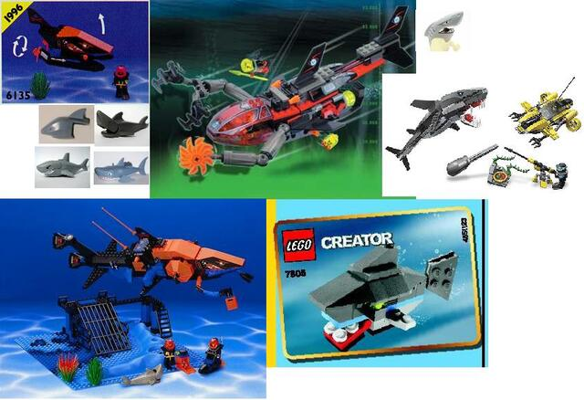](https://www.freelug.org/IMG/jpg/6135-1.jpg)

**photos requins**

Quelques photos de requins LEGO

Commençons donc cette revue de façon traditionnelle par la photo de la boîte :

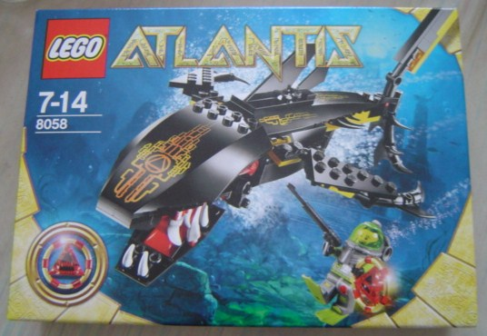

**Boite 8058**

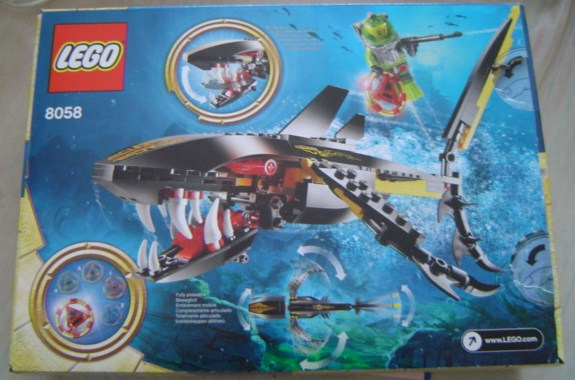

**boite face arrière**

Ensuite l’ouverture :

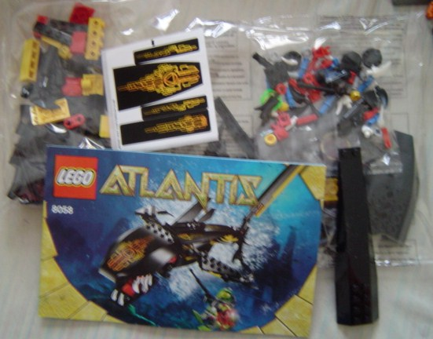

**Contenu de la boite**

Trois sachets, une notice, une pièce séparée, une planche d’autocollants qui va servir à décorer le requin aux couleurs mythiques d’Atlantis en tant que créature des grandes profondeurs.

Examinons maintenant quelques pièces particulières figurant dans l’inventaire :

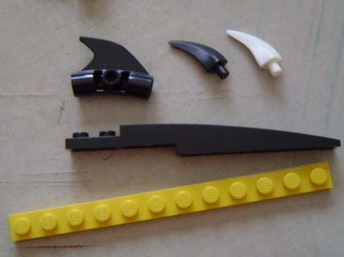

**Pièces spécifiques**

plate 1x12 jaune  
dents noires et blanches  
nageoire  
slope curved 1x10

**–** La fameuse dent qui existe dans ce modèle dans deux couleurs, noire et blanche !  
**–** La nageoire acérée ;  
**–** La nouvelle plate 1x12 ;  
**–** Et également une nouvelle pièce arrondie très longue (1x10).

Ces nouvelles pièces sont une des raisons pour laquelle j’ai acquis ce modèle.

Le montage ! Une fois n’est pas coutume, j’ai monté la minifig en premier, logique puisque c’est toujours la première étape ! Seulement d’habitude je monte le modèle avant la minifig qui est la dernière étape pour moi ! :)

Les choses sérieuses commencent : le requin !

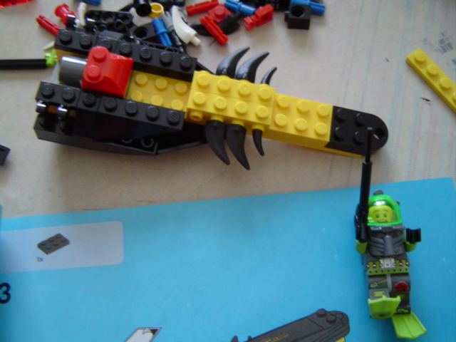

**montage du requin**

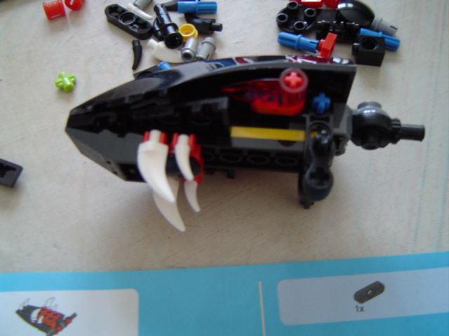

**La tête du requin**

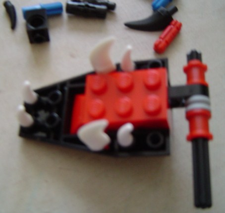

**La tête du requin partie 2**

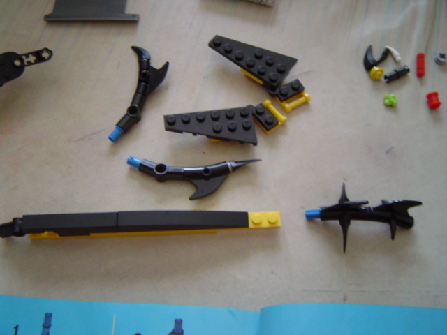

**Nageoires**

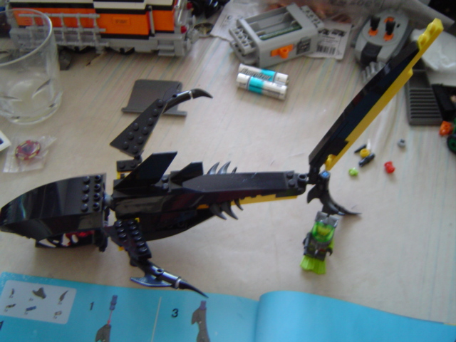

**requin montage presque fini**

Et la photo finale avec une petite plaque bleue toute neuve même pas encore déballée.  
Car si les plaques bleues sont de retour, je pense que nous pouvons dire merci à Atlantis !

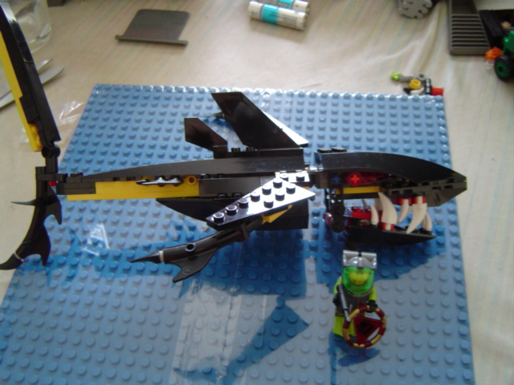

**Montage fini**

Sans les autocollants ! Car ce modéle aura une autre destinée... :-)

Le requin est bien sûr articulé, tête et nageoires peuvent bouger. Des yeux rouges de tueur ! Le corps est assez svelte, il doit être affamé ? Mais l’équipe de plongeurs Atlantis possèdent toute la magie LEGO pour lui échapper !  
Il y aussi un artefact Atlantis qui permet d’ouvrir le portail dimensionnel qui permet d’aller dans la ville d’Atlantis.

Ah oui, j’oubliais la touche finale, depuis l’[article d’Erik en début d’année](/articles/1057/), cela va devenir une tradition, les extras parts :

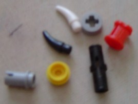

**Extra parts**

Gros effort de ma part pour monter ce modèle, puisque je l’ai redémonté aussitôt !  
Et oui besoin de pièces pour un autre montage ! :)
