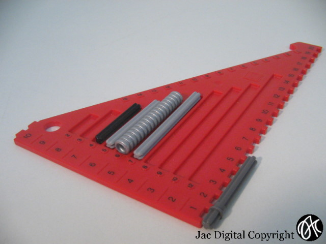
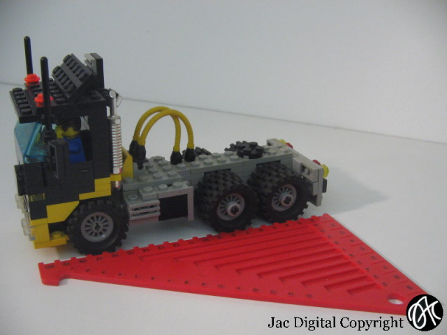
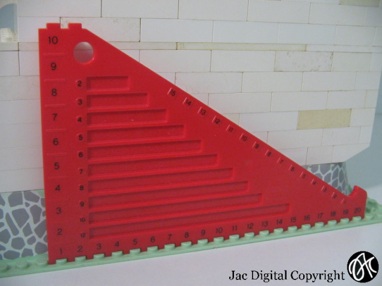
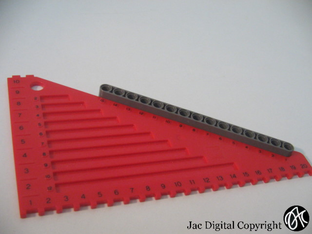

Voilà un nouvel objet tout bizarre, inventé par les designers du groupe LEGO. On dirait une sorte d’équerre, car il en a la forme, mais sans que l’on en voit vraiment l’utilité pour nos briques !

En promotion sur le [s@h](http://shop.lego.com/Default.aspx), je rajoute cet objet bizarre à mon panier. Il complètera ma petite collection de produit dérivés LEGO. Car, à la base on pourrait le mettre dans cette catégorie. Mais en fait, il s’agit d’une pièce utile, comme les [démontes-briques](/articles/149/). Même si sa vraie utilité est discutable par certains AFOLs.

D’ailleurs, à quoi sert-il vraiment, ce "rapporteur" droit ?

Tout d’abord, pas d’erreur, c’est bien un produit LEGO. La couleur rouge est bien connue. Puis si on en doute encore, le logo est gravé sur une des faces.

Il y a des lignes creusées sur le devant de la pièce. C’est pour mesurer la longueur des axes Technic. Inutile me direz vous, mais à certains moments, la confusion peut se faire entre un axe de longueur 5 ou 6. Et puis, on peut se reporter à la notice et vraiment comparer le dessin. La mesure peut aussi se faire avec la partie basse de la pièce, puisque la longueur des axes Technic correspond au nombre de tenons qu’ils couvrent. De la même manière, il est possible de mesurer la longueur des tuyaux.

**Mesure des axes.**

La partie basse sert à compter les tenons. On peut en mesurer 20. Cela sera plus simple pour faire les additions, si notre modèle dépasse cette longueur. C’est bien utile, car il n’est pas toujours facile de connaître la longueur en tenons d’un camion, ou d’une locomotive, surtout pour correspondre aux gabarits.

**Pile poil 20 tenons de long !!**

La partie verticale permet de mesurer la hauteur de nos constructions. Mais pour cela, il ne faut pas dépasser 10 briques. Sinon, il faudra mesurer en plusieurs fois. De plus, la partie servant à prendre la longueur en tenons gène un peu la mesure de hauteur de briques...

**Mesure de la hauteur.**

Une partie inclinée rejoint la base de la pièces, avec comme une queue de serpent en bout. Mystère ! Tiens, les barres "studless" se pose très bien sur cette forme. La mesure est idéale et très pratique. On peut aussi comparer avec les notes des notices de montage.

**Pour les barres sans tenons Technic.**

Au final, je trouve que c’est un objet très pratique et rigolo de part sa forme, finalement. Mais il ne supplantera pas nos démontes-briques dans l’utilisation courante... C’est clair ! Par contre, en l’utilisant, on lui trouvera sûrement d’autres fonctions. D’ailleurs, vous en avez peut être déjà trouvé.
