Il est toujours difficile de partir d’une bonne base pour faire un MOC [^1]. Pourtant il suffit de prendre un set officiel et le modifier un tout petit peu pour que cela devienne un MOC à sa propre sauce !

Depuis toujours, j’ai modifié mes sets pour me les approprier, pour les rendre plus réels... Dans cet article, je vais vous présenter quelques-unes de mes modifications...

## Les véhicules

Donc on peut déjà tout simplement changer les couleurs... Ici la voiture [8402](http://www.bricklink.com/catalogItem.asp?S=8402-1).

Bien évidement, là, on va dépendre des pièces que l’on dispose, de trouver les bonnes pièces dans les bonnes couleurs et encore faut-il qu’elles existent...

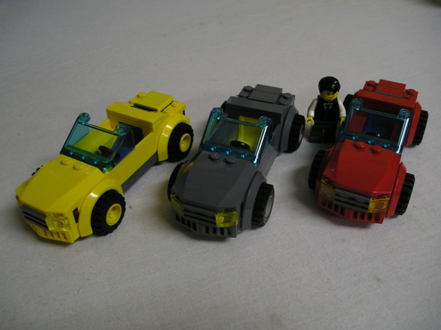

Ensuite voilà la toupie [7990](http://www.bricklink.com/catalogItem.asp?S=7990-1), j’ai d’abord modifié l’arrière pour y inclure la goulotte...

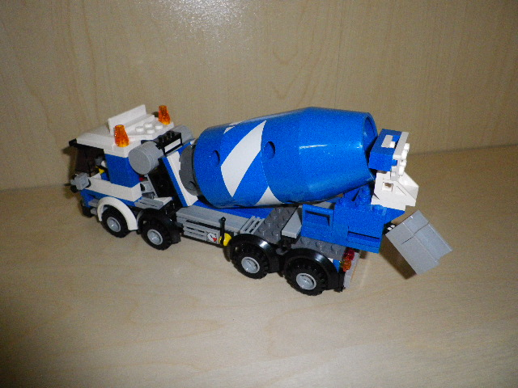

Puis récemment, dans la gamme Atlantis, est sortie la toupie bleu en rouge dans le set [8075](http://www.bricklink.com/catalogItem.asp?S=8075-1). Voici donc la version officielle 7990 en rouge...

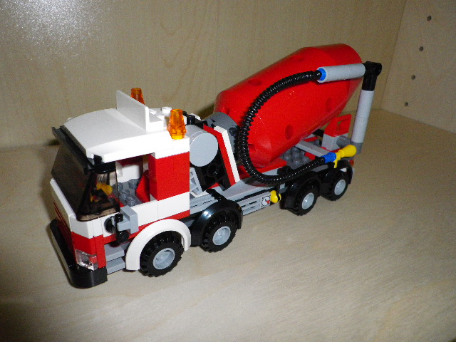

Et là ma version avec un mix... L’avant est du set officiel, l’arrière est repris des versions de Pierre Normandin avec micro moteur pour faire tourner la toupie.

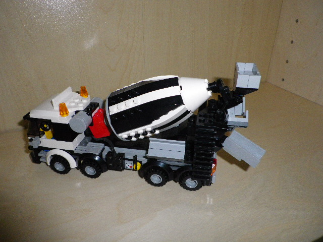

Maintenant c’est le camion [7998](http://www.bricklink.com/catalogItem.asp?S=7998-1) en version 6 de large (il est à l’origine de 8 tenons de large).  
Personnellement, je le préfère comme ça, cela fait plus réel par rapport aux autres véhicules CITY dans la ville.

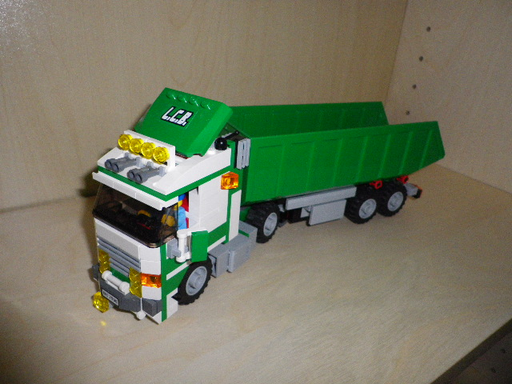

Ici c’est un truc vite fait à partir du set [7991](http://www.bricklink.com/catalogItem.asp?S=7991-1), j’ai juste modifié l’arrière par une benne...

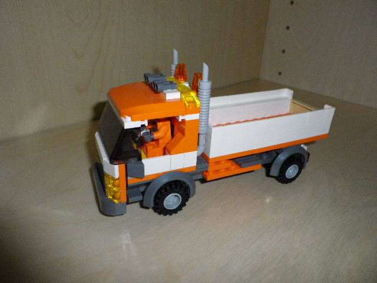

Voici la pelleteuse [7248](http://www.bricklink.com/catalogItem.asp?S=7248-1), j’ai mis au centre la pièce turntable 4x4, changé les chenilles. Puis j’ai fait un brise roche hydraulique, et adapté un godet TECHNIC pour l’installer sur cette pelle...

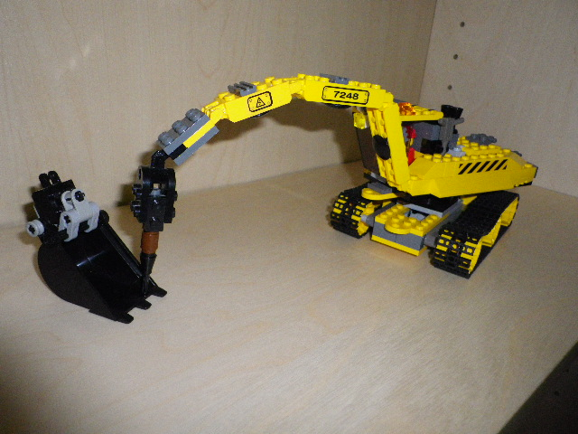

Maintenant c’est le célèbre camion [7733](http://www.bricklink.com/catalogItem.asp?S=7733-1) en version semi-remorque. J’ai rallongé la cabine et mis des portes à l’arrière de la remorque.

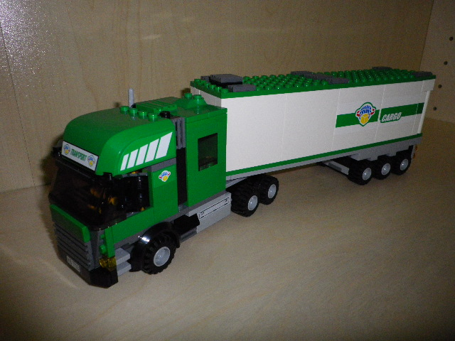

J’ai réalisé une toute petite modification sur le tout nouveau camion citerne [3180](http://www.bricklink.com/catalogItem.asp?S=3180-1). J’ai juste rajouté une plate rouge de haut sur la remorque pour réhausser un poil la citerne que je trouvais un peu trop basse par rapport à la cabine...

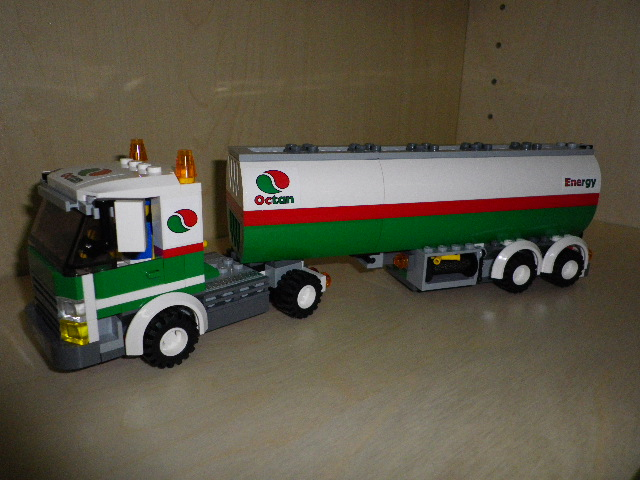

## Les bâtiments

Alors là, c’est un truc classique, monter la maison à l’envers... Donc voici la maison CREATOR [4956](http://www.bricklink.com/catalogItem.asp?S=4956-1) en version maisons mitoyennes.

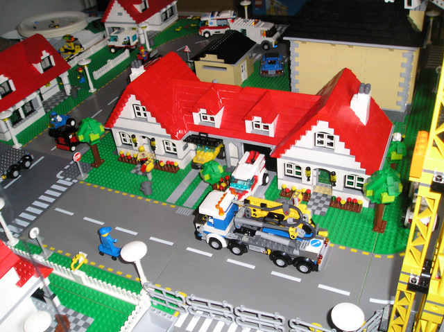

Quand le Corner Cafe, set [10182](http://www.bricklink.com/catalogItem.asp?S=10182-1) est sorti, j’ai tout de suite voulu faire l’angle inversé, c’est à dire le bâtiment mais en angle intérieur... Donc voici ce que l’on fait avec trois Corner Cafe... Un angle ouvert, un angle fermé, et un droit !

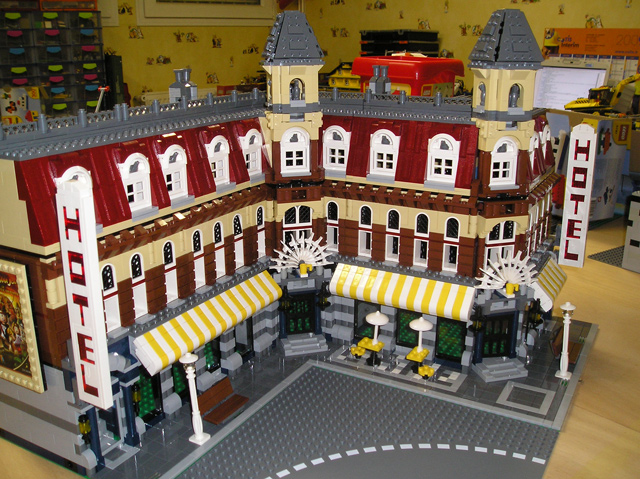

Là je suis parti de trois boîtes [7997](http://www.bricklink.com/catalogItem.asp?S=7997-1) la gare, et puis quelques pièces ;-)

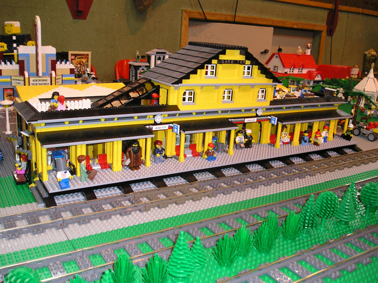

Voici une version du Medieval Market, set [10193](http://www.bricklink.com/catalogItem.asp?S=10193-1), à mettre au milieu des autres bâtiments modulaire dans une ville.

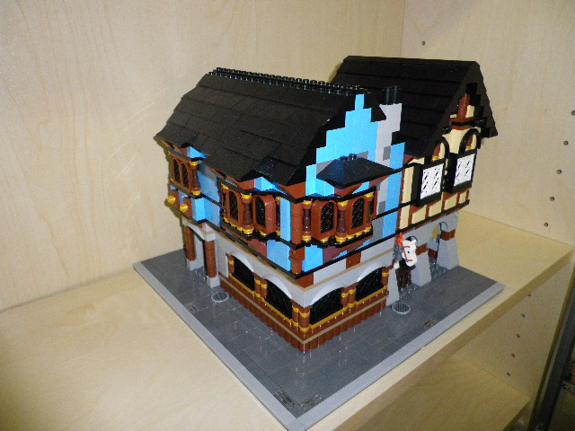

## Divers

Je n’ai jamais aimé la tour de la grue [7905](http://www.bricklink.com/catalogItem.asp?S=7905-1), je ne la trouve pas du tout réaliste... Enfin, c’est mon avis...  
Donc quelle ne fut pas ma surprise de découvrir les nouvelles pièces de structures métalliques sorti avec la grue à chenille [7632](http://www.bricklink.com/catalogItem.asp?S=7632-1) ! J’ai donc juste modifié la tour avec ces nouvelles pièces et un peu rallongé la flèche...

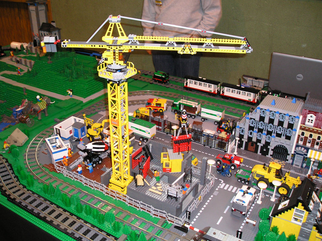

Et puis à mon avis c’est l’une des premières modifications que l’on fait quand on est enfant, ce sont de faire nos propres Minifigs. Juste deux photos...

Là, ce sont les petits soldats tout vert de ToyStory [7595](http://www.bricklink.com/catalogItem.asp?S=7595-1) que j’ai modifié pour les utiliser au milieu de mes autres Minifigs.

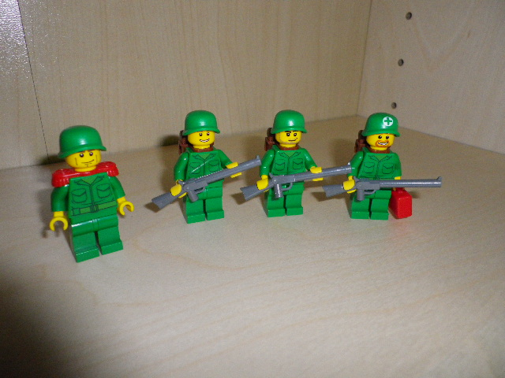

Et là trois autres Minifigs. Le buste de la minifig de droite vient de la gamme Basket NBA, j’ai enlevé les bras d’origine pour mettre des vrais bras de Minifigs.

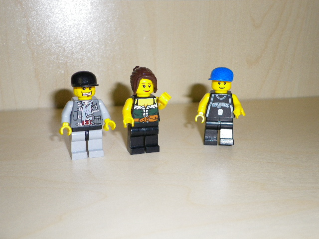

## Conclusion

Comme vous pouvez le voir, le sujet est infini. J’espère juste vous avoir donné plein de nouvelles idées. Pour ma part je vais continuer à faire mes modifications. C’est généralement comme ça que j’arrive à faire des trucs de plus en plus sympa.

Et puis n’oubliez pas...

ELTEP !

[^1]: MOC : My Own Creation, ma création personnelle en français. En gros c’est dès que l’on crée un nouveau modèle, c’est une nouvelle création.
