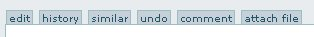
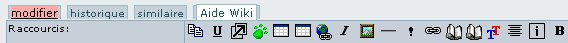
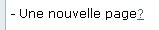

Le wiki est un outil de travail collaboratif. Il est employé à FreeLUG pour plusieurs usages, dès lors que plusieurs personnes sont susceptibles d’intervenir pour enrichir le contenu ou que les modifications sont fréquentes.

Exemples d’usage, non exhaustifs :  
**–** préparation à une exposition ;  
**–** préparation d’un restolego ;  
**–** préparation d’une commande groupée ;  
**–** travail de rédaction et de réflexion collaborative ;  
**–** pense-bête ;  
**–** etc.

## Principe du wiki

Le wiki est un outil où chaque inscrit peut ajouter ou modifier des pages. Un historique est conservé, permettant ainsi de revenir en arrière en cas d’erreur d’édition.

[Wiki FreeLUG](http://wiki.freelug.org/tiki-index.php?page=FreeLUG)

Pour éditer ou créer une page sur le wiki de FreeLUG, il faut disposer d’un compte.

## Se créer un compte

La création du compte n’est pas automatique. Il faut se créer un compte soi-même (lien "register" dans le cadre en haut à gauche).

Saisissez un identifiant, un mot de passe, et une adresse email valide. Un email automatique est envoyé et vous demande via un lien de confirmer l’inscription au wiki.

A partir de ce moment, une fois connecté, vous pourrez apporter des modifications au wiki.

## Editer une page

Vous souhaitez vous inscrire à une exposition, mettre à jour ou enrichir le contenu d’une page, il faut cliquer sur le lien "edit" qui se trouve en haut de chaque page.



Attention, si le bouton "edit" est rouge, cela signifie qu’une personne est déjà en train de modifier la page. Veuillez patienter votre tour !

Le contenu de la page s’affiche dans un formulaire dont vous pouvez éditer le contenu.

Le haut de la page se présente ainsi.



La barre d’outils vous permet de faire de la mise en page (lien, image, texte en gras ou italique...). En cliquant sur "Aide Wiki", vous affichez en bas de page les éléments de syntaxe pour mettre en forme la page (titre, etc.).

Une fois le travail réalisé, vous pouvez avoir un aperçu de la page avant de l’enregistrer définitivement.

Vous pouvez également annuler les modifications.

  
**Quelques exemples**  
**–** Pour ajouter une image dans la page :

`{img src=http://photos.freelug.org/main.php?g2_view=core.DownloadItem&g2_itemId=48&g2_serialNumber=2}`

**–** Pour ajouter un lien cliquable vers une page du site, une galerie, etc. :

`[http://www.freelug.org|Site de l'association FreeLUG]`

**–** Un tableau est délimité au début et à la fin par deux barres ||. Chaque retour à la ligne correspond à une ligne dans le tableau, chaque colonne est séparée une barre |

```
||
ligne 1 col 1 | ligne 1 col 2 | ligne 1 col 3
ligne 2 col 1 | ligne 2 col 2 | ligne 2 col 3
ligne 3 col 1 | ligne 3 col 2 | ligne 3 col 3
||
```

## Créer une page

Pour créer une nouvelle page, il faut se placer dans la page dans laquelle on souhaite voir apparaitre le lien de la nouvelle page, puis passer en édition de cette page.

Il suffit ensuite de placer le titre de sa page entre des doubles parenthèses, comme :

`((Une nouvelle page))`

Une fois la modification de la page enregistrée, vous devriez voir apparaitre "Une nouvelle page" suivi d’un point d’interrogation cliquable. Cliquez-dessus et vous pourrez alors éditer pour la première fois votre nouvelle page.



Quelques conseils sur les titres des pages :  
**–** un même titre ne pouvant être utilisé qu’une seule fois, utilisez un titre suffisamment précis pour éviter tout risque de doublon. Par exemple, pour une exposition, mettez systématiquement l’année en plus du nom.  
**–** évitez les noms de page avec des accents ou trop d’espaces, cela produit des adresses URL avec des tas de caractères peu lisibles. Favorisez un nom de page sans espace et accents, suivi d’une barre verticale et un intitulé plus lisible, comme suit :

`((UnTitreComplique|Un titre compliqué d'essai))`

L’URL contiendra "UnTitreComplique" mais le lien affiché dans la page sera "Un titre compliqué d’essai".

## Modèles de page

Puisqu’une grande partie des pages est dédiée à des usages similaires, voici quelques exemples de modèles de page prêts à copier :  
**–** [\[WIKI\] Page d’organisation d’une exposition](/articles/1049/)

Mais vous pouvez aussi vous inspirez des pages déjà existantes en les éditant et en regardant comment elles ont été écrites.
