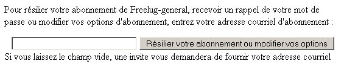
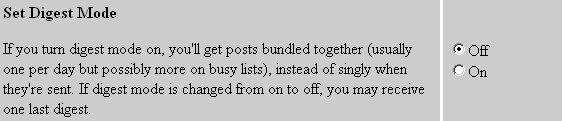
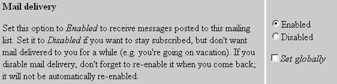
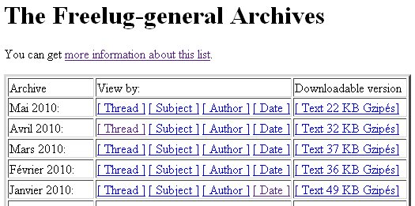
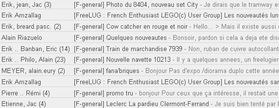
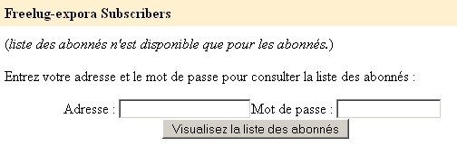
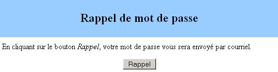
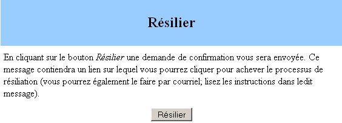

Moyen de communication à FreeLUG, les listes de discussion sont un outil dont l’utilisation nécessite quelques recommandations.

## Les listes FreeLUG

**La liste publique ouverte à tous les passionnés de la brique LEGO**

Tout passionné peut s’y inscrire, membre de l’association ou non . On y discute évidemment LEGO : actualité, nouveautés, conseils, identification de pièces ou sets, MOC, etc.

[Page de gestion de son inscription à la liste générale](http://lists.freelug.org/cgi-bin/mailman/listinfo/freelug-general)

**Les listes réservées aux adhérents**

Plusieurs listes de discussion sont réservées aux adhérents de l’association :  
**–** une liste de discussion entre membres ;  
**–** une liste pour les annonces officielles du CA vers tous les adhérents ;  
**–** des listes régionales pour la préparation des expositions ;  
**–** des listes pour des groupes de travail particuliers (traduction, statuts, etc.).

## Paramétrage des listes

L’inscription aux listes de discussion est automatique pour chaque nouvel adhérent à l’association. A l’exception de la liste officielle du CA vers tous les adhérents, chaque adhérent peut de désinscrire des listes, et à leur initiative s’inscrire aux listes régionales.

Pour les non adhérents, seule la liste de discussion générale leur est accessible.

Les listes de discussion FreeLUG se base sur le système [mailman](http://www.gnu.org/software/mailman/index.html).

Depuis la [page de gestion](http://lists.freelug.org/cgi-bin/mailman/listinfo/freelug-general), il est possible de paramétrer son abonnement à la liste. Ce lien est rappelé en bas de chaque email expédié sur la liste.

|  |
| --- |
|  |

Il est possible de s’inscrire en mode "_digest_" pour ne recevoir qu’un résumé par jour qui reprend les différents emails échangés dans la journée.

|  |
| --- |
|  **–** On : le mode digest est activé   **–** Off : le mode digest est désactivé |

Il est également possible de désactiver la réception des emails (par exemple, si vous partez en vacances et ne disposez pas d’une connexion Internet ou si vous préférez lire les emails depuis les archives en ligne).

|  |
| --- |
|  **–** Enabled : vous recevez les messages postés sur la liste   **–** Disabled : vous ne recevez plus les messages de la liste |

## Utilisation des listes

  
**Archives**

Tous les emails échangés sur les listes sont archivés en ligne. Seuls les inscrits aux listes peuvent y accéder.  
Les emails sont triés par date, auteur, sujet ou par fil de discussion.

|  |
| --- |
|  |

Ainsi, ce qui ne veulent pas recevoir de mails peuvent tout à fait consulter ce qui est échangé en consultant les archives en ligne, tout comme pour un forum.

  
**Fil de discussion, ou _thread_**

Les listes de discussion gèrent les fils de discussion. Si vous souhaitez répondre à un sujet en cours, faites simplement répondre au mail. Si vous souhaitez aborder un nouveau sujet, créez un nouveau mail. Ne répondez surtout pas à un mail en cours, en changeant le titre par exemple. Cela casse les fils de discussion.

Si pour la plupart des lecteurs, vous visualisez les emails échangés de façon linéaire dans le temps, ce n’est pas le cas de tout le monde.

Par exemple, Gmail (la messagerie de Google), les webmails comme Zimbra ou tout simplement les archives des listes gèrent les fils de discussion. Casser un tel fil rend plus difficile la lecture. Par analogie, sur un forum, lorsque vous souhaitez démarrer un nouveau sujet, vous créez un nouveau topic. Vous ne répondez pas à un topic existant.

|  |
| --- |
|  **Regroupement des fils de discussion sous Gmail** |

Et n’oubliez pas, lorsque vous faites répondre à un message, c’est toute la liste qui le reçoit. Pour des réponses personnelles, faites bien attention au destinataire !

Lorsque le sujet d’un fil de discussion commence à dériver sur un autre thème, n’hésitez pas à créer un nouveau fil de discussion (création d’un nouveau mail et non un "répondre") avec un sujet cohérent à la nouvelle discussion. Pour faire le parallèle avec un forum, cela reviendrait à déplacer la discussion hors-sujet d’un topic sur un nouveau topic créé pour l’occasion.

  
**Taille des emails**

Afin de ne pas encombrer les boîtes emails, et notamment les personnes n’ayant pas une connexion à haut débit, les pièces jointes ne sont pas autorisées sur les listes de discussions (exception est faite pour les listes de préparation des expositions).

Ainsi, une taille limite est imposée. Au delà, le message est mis en attente de validation par un administrateur.

Si vous souhaitez transférer un élément (image, document word, etc.), les adhérents de l’association peuvent par exemple utiliser la galerie photos.

De même, lorsque vous répondez à un fil de discussion, pensez à supprimer tous les contenus inutiles (signatures, anciennes conversations...) afin de réduire la taille du message.

  
**Format du message**

Une bonne façon de réduire la taille du message est d’écrire ses emails au format texte brut, plutôt qu’au format HTML, surtout que celui-ci peut être plus ou moins bien interprété par vos correspondants.

  
**Règles d’usage**

Bien évidemment, la netiquette s’applique sur les listes de discussion. Reportez-vous au [règlement intérieur](/articles/135/#section2). Tout non respect du règlement peut entrainer une mise en modération.

## Liste des inscrits

Pour les listes régionales de préparation des expositions, il est également possible de trouver la liste des personnes inscrites sur la liste. Pratique pour le coordinateur d’une exposition afin de s’assurer que chaque participant est bien inscrit sur la liste dédiée.

|  |
| --- |
|  |

## Rappel du mot de passe

Par défaut, le mot de passe d’inscription aux listes est renvoyé automatiquement tous les premiers de chaque mois. Il est également possible de le redemander, toujours depuis la page d’interface de gestion.

|  |
| --- |
|  |

## Résiliation

Et si vous souhaitez résilier définitivement votre abonnement, ça se fait aussi depuis la page de gestion.

|  |
| --- |
|  |

## En conclusion

Vous l’aurez compris, n’hésitez pas à fouiller la page de gestion de son inscription aux listes pour y trouver toutes les possibilités offertes.
