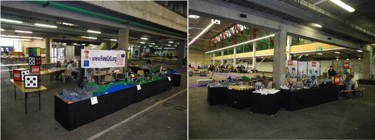
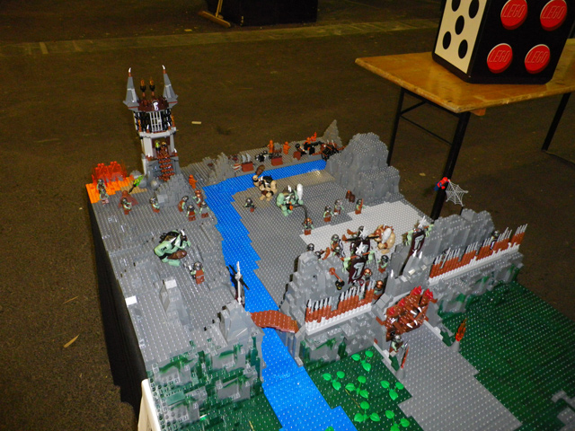
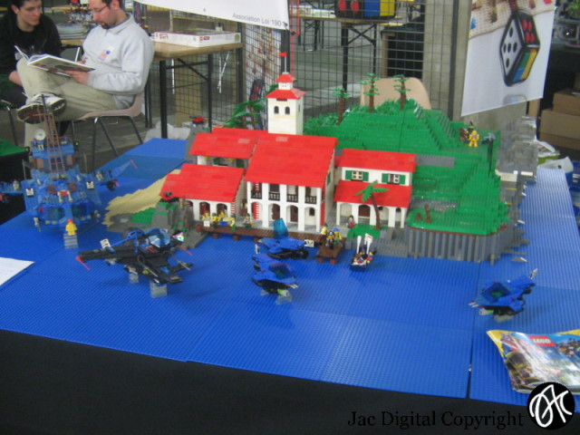
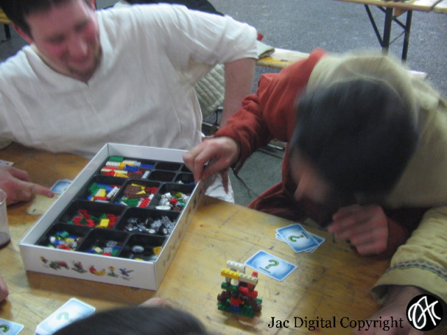
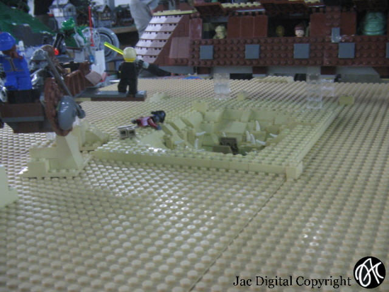
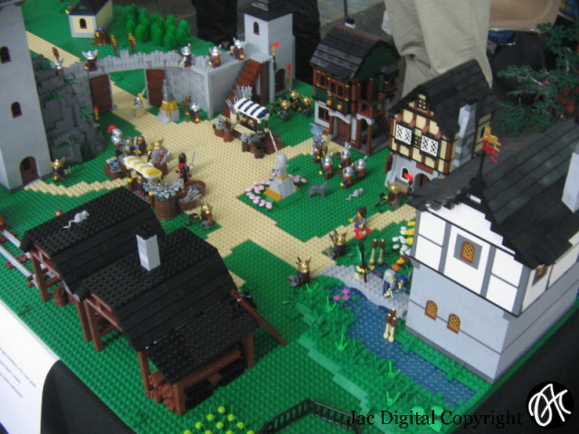

Deux jours de jeu et de construction, presque sans dormir, ce n’est pas si long que ça !

**vue d’ensemble du stand**

Et de deux...!

Pour la deuxième année consécutive [^1], nous sommes revenus à Saint-Etienne pour présenter nos LEGO.

Cette année, on a pu y voir quelques modèles Star Wars, des dioramas Star Wars, un joli diorama Space Pirate (qui mériterait d’être fini ! ;-D ), un grand diorama pour une bataille de nains contre des orcs, puis nous avons pris un espace pour présenter les tout nouveaux jeux de société LEGO.

Personnellement je me suis consacré à la création d’une région d’orcs. Beaucoup de gris foncé, mais un peu de bleu pour une petite rivière qui fait tourner un pilon...

**la partie des orcs**

Ce diorama nains/orcs s’est voulu évolutif, seul le dimanche après-midi fut plus calme et la bataille vite achevée parce que nous étions surtout attablés du côté des jeux...

D’ailleurs ces jeux de sociétés ont bien plu tant auprès du public qu’auprès des autres exposants, de belles parties ont eut lieu...

Ce fut donc un très agréable week-end, passé en bonne compagnie !

Merci à Xavier pour l’aide et le montage des tables, merci à LEGO France de nous avoir fait parvenir quelques PLV et nouveaux jeux, merci aux organisateurs de nous accueillir, merci à Jac, Laurent et Etienne d’être venus !

Et puis, à l’année prochaine ?

_Pierre / Pierrolego_

* * *

En 2009, j’avais fait juste un passage éclair à Saint-Etienne pour cette exposition particulière. Pour 2010, je m’étais préparé à y passer les deux journées, ouverture non stop de 9h le samedi à 18h le dimanche ! Un week-end de l’imaginaire, c’est le top pour nous qui sommes sans cesse à la recherche du jeu et de l’animation, les dioramas ne sont pas fixes et le jeu de société est roi. Ca tombe à pic, avec la nouvelle gamme LEGO.

Dix ans que j’avais ça en tête et ça y est, je me décide enfin à la construire, ma base "space pirate". Certains diront qu’il serait temps, mais, ça ne se construit pas comme ça. Je voulais que, en voyant l’ile, on ait l’impression de se retrouver devant un village colonial en bord de mer. Alors qu’il n’en est rien...

**La base Space Pirate**

Grâce à l’envoi de la part de LEGO France, nous avons pu présenter une partie des jeux disponible en magasin. L’ambiance étant à ce mode de loisir, dans le hall d’exposition, nous avons très vite pris le pas sur le jeu, au détriment de la grande bataille entre les nains et les goblins. Beaucoup de visiteurs et d’exposants ont élu domicile sur nos tables pour tester le [Minotaurus](https://www.freelug.org/spip.php?article976) ou le [Creationary](https://www.freelug.org/spip.php?article1042). Ce dernier nous a permis d’ailleurs de contempler des créations mémorables et innommables, mais tout cela dans la bonne humeur !

**Un zoo !!**

_Jérôme/JAC_

* * *

Déjà le second week-end de l’imaginaire et les LEGO sont toujours présents. Cette année je devais changer ma bataille clone wars pour éviter que les gens se lassent, cependant j’étais en grand manque d’inspiration ou de moyens dans mes projets. J’ai donc fait rapidement une petite muraille pour ma bataille, ainsi qu’un petit Sarlacc surélevé et tout le reste fut de l’improvisation le vendredi et le samedi. Le résultat est satisfaisant mais j’ai sous-estimé la place et beaucoup de vaisseaux sont restés dans les cartons.

L’ambiance a été très sympa, on a bien ri, le sommeil a manqué surtout pour la reprise du lundi.

Merci à l’organisation, ce fut une bonne exposition, en espérant revenir l’année prochaine :) et merci aux FreeLUGiens ;)

**Le méchant Sarlac !!**

_Etienne/Kitfisto_

* * *

Pour ma deuxième participation, j’ai de nouveau collaboré au diorama commun évoluant au cours du week-end. Je me retrouve du côté des nains avec la présentation d’une mine au sens large : il y a principalement les bâtiments extérieurs (forge, stockage, habitations...) et les défenses. La place centrale est réservée à la vente des objets réalisés : armes, outils, chaînes... On trouve quand même sur le côté l’entrée de la mine avec les wagonnets chargés de minerai.

Nous avons été très sollicités pour que le diorama évolue, suite à la prestation de l’année dernière. Mais avec les jeux de société à côté, ce n’était pas toujours évident de faire bouger tout ce petit monde !

J’aime beaucoup cet événement, de part la diversité des visiteurs et des exposants, toujours étonnés de voir que "c’est des LEGO !", "ils font ça en LEGO maintenant", "t’as vu le Faucon Millenium ?"...

Enfin, j’adresse un grand merci aux organisateurs qui oeuvrent à rendre ce week-end complètement hors du temps, avec les costumes et le repas d’époque, les démonstrations de combat à l’arme blanche... C’est génial ! A l’année prochaine !

**Le village des nains de Laurent.**

_LaurentT_

## Galerie photos

**–** [Jérôme/JAC](http://photos.freelug.org/main.php/v/JAC/Exposition/Expositions2010/WE-imaginaire/)  
**–** [Laurent](http://photos.freelug.org/main.php/v/LaurentT/Expositions/Saint+Etienne+2010/)  
**–** [Pierrolego](http://photos.freelug.org/main.php/v/pierrel/exposition/2010/nocturnes/)  
**–** [Le site des Nocturnes Foréziennes](http://www.nocturnes-foreziennes.org/)

[^1]: [Résumé de notre première participation en 2009](/articles/903/)
