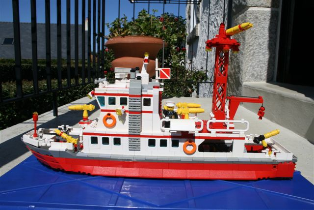
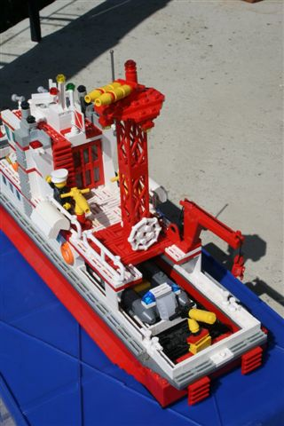
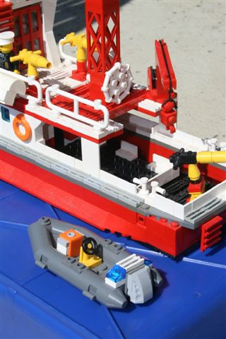
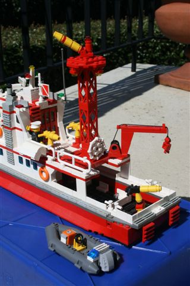

Après le [ferry norvégien "HJELMELAND"](/articles/1115/), voici un bateau de pompiers indispensable dans un port pour lutter contre les incendies en mer.

**Le bateau des pompiers sur la longueur.**

Cette maquette longue de 48 tenons et large de 12 tenons, est la reproduction d’un bateau fait par un Adult Fan des LEGO (Afol) américain, coup de coeur en 2007. Mais par rapport à la première reproduction, Jean-Marc a ajouté un zodiac logé sous le pont qui supporte un grand mât. Cela permet de placer un canon à eau plus haut et plus efficace.

**L’arrière avec le mat rouge.**

Ce bateau est équipé de 7 canons à eau dont 2 sur la partie supérieure du mât rouge, armés par 2 officiers et des cadets du feu partis en formation.

Une petite grue permet de sortir et rentrer le zodiac.

**Pour sortir le Zodiac....**

**Zodiac sortie, on range le bras spécial.**

Ce bateau a une place réservée au nouveau port du diorama de Jean-Marc. Vous pouvez le contempler réellement lors de ses nombreuses expositions.
