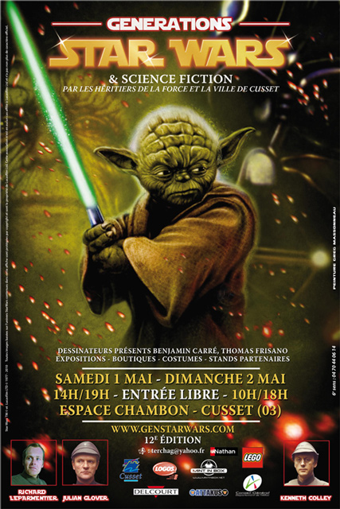
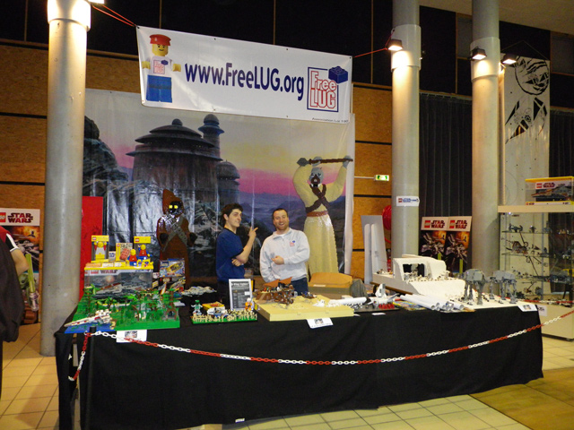
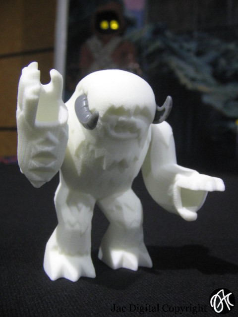
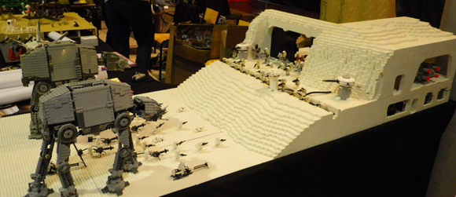
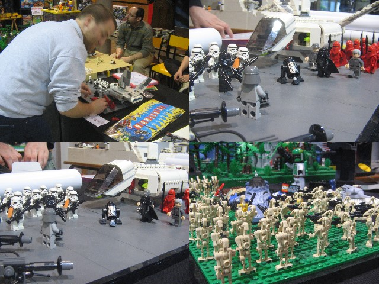
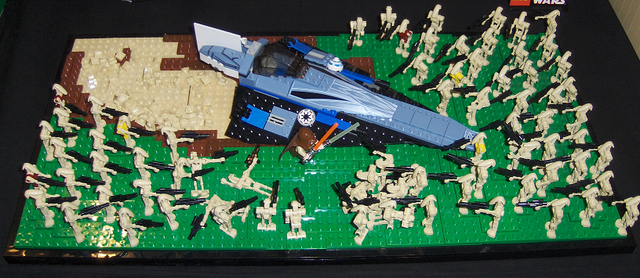
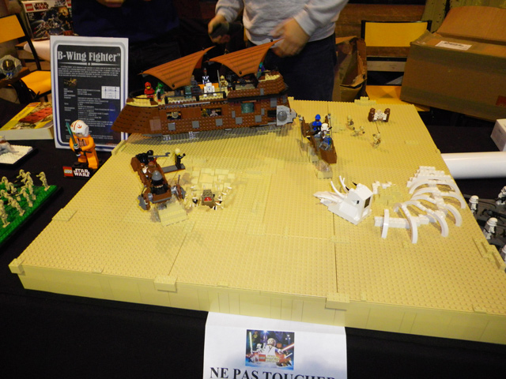
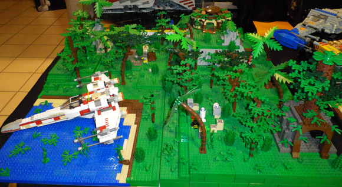
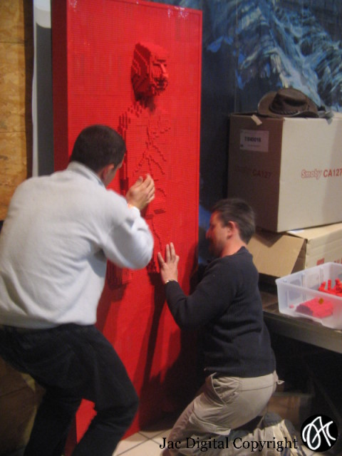
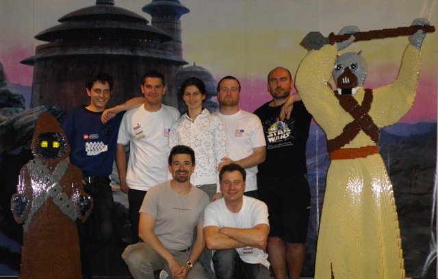

La douzième édition du salon Générations StarWars et Science Fiction a eu lieu les 1 et 2 mai 2010. C’était comme toujours à l’espace Chambon de Cusset dans l’Allier, que tous les fans de Star Wars se sont retrouvés...

**L’affiche de l’exposition !**

5400 visiteurs en une journée et demi. Il aurait fallu pousser les murs de la salle. Heureusement que l’on retenait les barrières, sinon, notre stand aurait été ramené entre le mur et les personnage échelle 1 !

**Au centre, les 2 figurines géantes prêté par LEGO France...!**

C’est toujours un plaisir de recevoir, coordonner et faire en sorte que tout se passe bien entre les organisateurs et nous...

Cette année nous avons eu droit à des prêts sympa de la part de LEGO France : deux personnages à l’échelle 1, deux belles vitrines pour présenter le [Vénator 8039](http://guide.lugnet.com/set/8039) et des modèles de près-série. Nous avons pu découvrir une des premières ébauches du Wampa qui sortira sous peu.

**Prémoulage du Wampa**

Merci à tous pour cette bonne ambiance durant le salon, mais surtout un grand coup de chapeau à notre JLB qui a fait la route malgré un rhume fatigant.

**La bataille de Hoth (par J1B)**

J’espère vous retrouver l’année prochaine pour une prochaine édition.

_Jérôme/Qui Gon JAC_

* * *

Quelle belle exposition !

Il est toujours agréable de voir comment l’univers de Star-Wars réunit petits et grands que ce soit autour des films ou maintenant de l’Univers Étendu qui gagne de l’importance auprès des plus jeunes grâce à la série animée "The Clone Wars".

**Les magnifiques modules de Tribolego**

A l’occasion de cette deuxième participation pour moi à Cusset, j’ai pu présenter deux petites scénettes, une représentant Darth-Vader faisant une revue de ses troupes et une représentant un Jedi essayant de se dépêtrer d’un champ de bataille plein de droïdes après s’être craché avec son Jedi-Starfighter. Gageons que ses deux sabres laser (orange et "glow-in-the-dark"), mais surtout la force lui permettra de s’en tirer !

**Un jedi seul terrasse tous les droides... ! (par Tribolego)**

Nous tenons tous les deux à remercier JAC pour son accueil chez lui et tous les participants et visiteurs FreeLUG pour leur compagnie toujours aussi agréable !

_Emilie et Pierre/Tribolego_

* * *

Un salon pareil ne se loupe pas !

Et j’ai eu la chance d’y participer cette année encore. Ma participation n’a pas été bien grande, j’ai surtout amené les LEGO et aidé mon frère à monter son petit diorama avec le Sarlac.

Un week-end avec que du Star Wars, ça change des traditionnels salon de modélistes.

Un grand merci à Jac, qui nous a accueilli et a su nous contenir !

Et puis à l’année prochaine ?

_Pierre/PierroLego_

* * *

C’est le genre d’exposition idéale pour moi car c’est sur Star Wars, rempli de gens qui aiment Star Wars et qui comprennent nos dioramas. Avec les superbes sculptures que LEGO a envoyé, notre stand "avait de la gueule". Les œuvres des uns et des autres, que ce soit de la base Hoth de Jean-Louis ou le très réussi Han solo de Fred en passant par les petits dioramas de Pierre et JAC, notre stand a énormément plu comme à chaque fois d’ailleurs !  
Il fallait même tenir les barrières si on voulait pas que les personnes s’approchent.

**Scène finale sur Tatooine avec le Sarlac (par Etienne)**

Merci à JAC même si le coordinateur était un peu perdu certain soir, et aux autres pour cet agréable week-end, vivement l’année prochaine.

_Etienne/KitFisto_

* * *

Voilà une exposition Star Wars de plus ! Et Cusset c’est le lieu de mes premières armes. Cette année la place fut comptée donc nous avons réalisé des petits dioramas. Mais cela n’enlève rien à la fascination des visiteurs devant nos créations.

**Les marais de Dagobah (par Fred)**

Personnellement j’ai fait un diorama d’un module sur Dagobah. Mais souhaitant ne pas venir avec une voiture à moitié pleine, j’ai pris la décision de faire quelque chose en plus (entre 10 000 et 15 000 pièces). Problème de place en surface étant une contrainte, je me suis dit qu’une création en hauteur pourrait facilement trouver sa place ! D’où Han Solo pris dans la carbonite (en rouge car encore chaude ! mais la carbonite n’est pas un principe de congélation ? ) enfin bref pourquoi pas en rouge ! Ce rouge que l’on a dans nos vracs à pas savoir quoi en faire...

**Pas facile à faire tenir, les pièces verticale !!!**

Il n’y a pas à dire, les expositions c’est une ambiance à part ! un week-end entier à parler et vivre LEGO.

Voilà encore une belle coopération entre deux associations FreeLUG et Festi’briques.

Merci les amis pour ce super week-end et encore merci à mon maître Qui Gon Jac.

_Frederic/Phenix21000_

**Où sont les personnages LEGO....?**

Rendez-vous l’année prochaine, les 30 avril et 1er mai 2011, pour la 13ème édition de Générations Star Wars !

[Les Héritiers de la Force](http://www.genstarwars.com/blog2/)

## Galerie photos

**–** [Galerie de JAC](http://photos.freelug.org/main.php/v/JAC/Exposition/Expositions2010/SW-Cusset/)  
**–** [Galerie Fenix](http://www.brickshelf.com/cgi-bin/gallery.cgi?f=430174)  
**–** [Galerie de Pierrolego](http://photos.freelug.org/main.php/v/pierrel/exposition/2010/cusset2010/)
