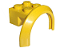
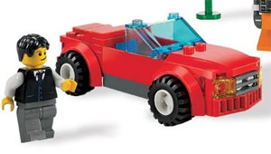
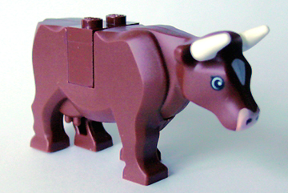
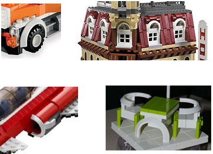
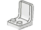
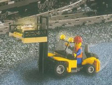
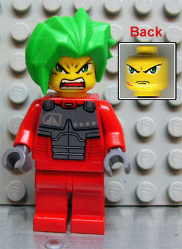
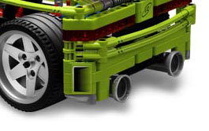
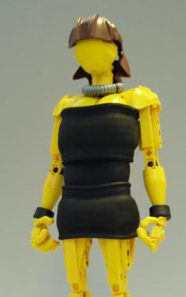

Une possibilité qu’ils ont est de créer une nouvelle pièce, dont le rôle - c’est à dire la fonction - sera de répondre à ce besoin. On peut citer comme exemple la plaque 1x2 modifiée en passage de roue ([Vehicle, Mudguard 4 x 2 1/2 x 2 with Arch Round](http://www.bricklink.com/catalogItem.asp?P=50745)).

Lors de la création de la pièce, pour répondre à la fonction, on donne une structure, une forme, à la pièce. La forme est intrinsèque à la pièce alors que la fonction est extrinsèque. Le passage de roue n’est passage de roue que lorsqu’on la place dans un contexte plus large : un véhicule.

Dans cet exemple, on voit que la structure découle de la fonction. Ce n’est pas toujours le cas. Prenons l’exemple de la vache. La vache est vache de par sa forme. La pièce "vache" est une pièce hautement spécifique. Il y a très peu de chance que vous puissiez utiliser la pièce vache un jour pour faire l’hélice d’un hélicoptère ou le dôme d’un bâtiment. Au contraire, la brique de base est générique. Elle va servir de brique pour un mur, de châssis à une voiture, de corps à un éléphant, de réservoir à un vaisseau spatial, etc.

Dans un jeu de construction les éléments génériques sont à la base du jeu, ils sont présents dès le départ, et sont nombreux. Puis viennent des pièces plus spécifiques (caractéristique qui va de paire avec le manque de versatilité), restreintes à des emplois précis, ce qui peut être jugé comme regrettable comme c’est le cas avec certaines [métapièces](https://www.freelug.org/spip.php?article271).

Certaines pièces sont à mi-chemin. Relativement génériques mais possédant néanmoins déjà une certaine spécificité. C’est le cas des plaques et des briques modifiées.

Mais revenons un instant au passage de roue. C’est la fonction initiale de cette pièce. Mais les designers sont encouragés à réemployer au maximum les pièces plutôt que d’en créer de nouvelles quand cela est possible. Cela conduit à des emplois qu’on peut qualifier de "détournés", comme un fauteuil ou des pieds de table (Création de Deborah Higdon), un fronton de fenêtre ou une entrée d’air pour un jet.

La pièce existait déjà et ce n’est plus la fonction qui a imposé la forme. Pas plus d’ailleurs que la forme n’ait imposé la fonction. C’est juste un "hasard recherché" qui a conduit à cette solution.

On le voit donc, le lien entre fonction et forme n’est pas toujours aussi prégnant, il est même souvent ténu. Au point même que l’on pourrait remettre en cause les dénominations données aux pièces dans certains systèmes (LDraw, BrickLink...) qui font références à UNE de leurs fonctions alors que seule la forme, intrinsèque, est sans ambigüité.

Les détournements d’usage des pièces, possibilités offertes ou décuplées par les techniques de montage avancées comme le SNOT, font partie de ces détails qui rendent une création extraordinaire. Alors ne vous focalisez pas sur une fonction, mais, au contraire, imaginez les possibilités offertes par les formes.

Tout ceci peut paraître bien théorique, je le conçois, c’est pourquoi nous allons maintenant l’illustrer avec quelques exemples.

Commençons par le fameux siège de minifig. Faire un siège avec un passage de roue est possible, pourrions nous faire un passage de roue avec un siège ? Tout à fait et ce n’est pas moi qui le dit, mais les designers LEGO eux-mêmes dans ce set (4512) :

Les couleurs sont parfois importantes pour détourner un usage : les cheveux des figurines ExoForce dans leur version verte servent de laitue dans le set 10190 (Market Street).

Il parait même que la carotte a été produite en brune pour faire une crotte de cheval dans le Medieval Market - je ne suis pas allé vérifier ;-)

Le changement d’échelle favorise aussi les détournements comme le [saut Belville](http://www.bricklink.com/catalogItemIn.asp?P=70973bucket&colorID=66&in=A) qui sert de sorties d’échappement en Racer/Technic.

Parfois, la pièce doit être spectaculairement déformée pour être détournée comme c’est le cas avec ces pneus Technic qui se transforme en dôme ou en jupe une fois retournés.

En vrac, voici quelques autres exemples non illustrés :  
**–** viaduc avec des rails ;  
**–** sextant utilisé en porte lampe (épicerie) ;  
**–** les grosses roues space, en guise de réacteurs ;  
**–** le part-buffle pour faire un radar ;  
**–** les cerises + serpents rouges pour faire des boyaux ;  
**–** la barbe tan qui sert de décoration sur le manège ;  
**–** les deux bassines qui se transforment en tonneau sur le toit de la caserne "1932" ;  
**–** le pare brise de bus qui se transforme en arrêt de bus ;  
**–** les deux cerises qui se transforment en corne d’escargot.

Avant de nous quitter, nous vous encourageons vivement à partager vos trouvailles en réponse à cet article.
