Ma méthode de fabrication de lampadaires avec des LEDs, pour éclairer un diorama.

## Principe

Ceci n’est pas un cours d’électronique mais mon expérience lors de la fabrication de lampadaires avec des LEDs ;-)

**ATTENTION : la manipulation d’un fer à souder et de cutters présente des risques de blessures, ne pas faire sans la présence d’un adulte et avec précaution.**

Pour les risques électriques, en utilisant le transformateur LEGO, il n’y en a pas, la tension est faible. Le seul risque est pour les LEDs : si trop de tension, elles grillent.

Rassurez-vous, si la LED est mis à l’envers (oui, elles ont un (+) et un (-)) mais que la tension est ok, elle ne grille pas, mais elle ne s’allume pas non plus.

Pour utiliser une LED, il faut baisser la tension car elle ne supporte pas le 9V.

Chaque couleur de LED a une tension différente, il faut utiliser la formule :

```
R = (Ucc - Uf) / I
```

avec  
**–** R = Résistance à mettre en série avec la LED  
**–** Ucc = Tension d’alimentation  
**–** Uf = Chute de tension directe en Volts de la LED  
**–** I = Intensité maximale en Ampères que supporte la LED

Tension suivant les couleurs  
**–** LED Rouge : 1,7 V  
**–** LED Orange : 2,0 V  
**–** LED Jaune : 2,1 V  
**–** LED Vert : 2,0 V  
**–** LED Bleu : 3,6 V  
**–** LED Blanc : 3,6 V  
**–** LED Rose : 3,4 V  
**–** LED Cyan : 3,4 V  
**–** LED Ambre : 2,8 V  
**–** LED Turquoise : 3,6 V  
**–** LED Violet : 3,6 V  
**–** LED Ultra Violet : 3,8 V

Un exemple pour une LED rouge :  
**–** Tension ( Ucc) d’alimentation = 9 V  
**–** LED rouge avec ( Uf ) de 1,7V  
**–** Intensité ( I ) maximale de la LED = 0,02A (ce qui fait 20mA)

```
R = (9V - 1,7V =7,3V) / 0,02A = 365 ohms
```

On prend la résistance la plus proche (mais toujours au moins la valeur juste au dessus) : j’utilise une résistance de valeur 470 Ohms (comme cela je n’achète qu’un type et j’en avais en stock), cela doit être ok avec toutes les LEDs. Sur certaines, il n’y aura pas la luminosité maximale mais cela me convient.  
Pour tester les LEDs (comme j’utilise un stock de récupération), j’ai un cordon LEGO coupé branché sur un variateur avec une résistance, ou alors sans résistance mais il ne faut pas dépasser la première graduation, sinon une LED jaune éclaire rouge à peine 1 seconde puis plus rien...

## Matériel

Les outils  
**–** Cutter  
**–** Ciseau à bois  
**–** Fer à souder  
**–** Mini-perceuse avec fraise  
**–** Pince et étau

L’électronique :  
**–** Fils électriques  
**–** LEDs  
**–** Gaine thermo-rétractable  
**–** Résistances

Les briques LEGO  
**–** Plate 2x4  
**–** Plate 2x4 Technic

## Réalisation

Dans cet exemple j’utilise des LEDs de 5 mn de diamètre car cela va dans les trous LEGO.

_1) Plate supérieure :_  
**–** Videz la plate 2x4 Technic de ses « tenons ». J’utilise un vieux ciseau à bois et une mini-perceuse pour cela  
**–** Limez au maximum la 2x4 pour permettre le passage de la LED et de la gaine  
**–** Creusez une petite encoche pour le passage du fil

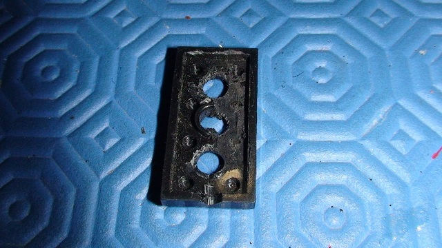

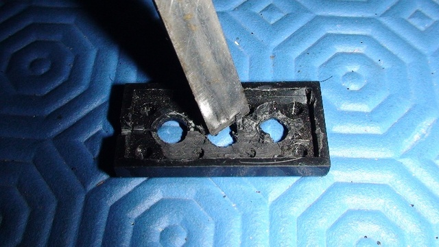

_2) Plate inférieure :_  
**–** Enlevez presque complètement les tenons de la plate 2x4  
Sauf les 2 du haut, juste coupés en 2 (c’est plus facile pour le collage)  
**–** Limez pour l’emplacement de la résistance

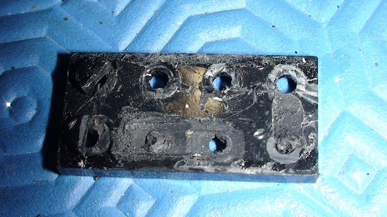

_3) Les LEDs :_  
**–** Placez les LEDs (les 2 dans le même sens)

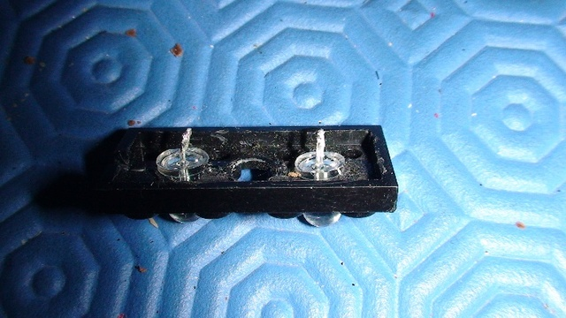

La partie plate de la LED et le coté du (-)

_4) Fil du (-) :_  
**–** Dénudez sur 5 cm

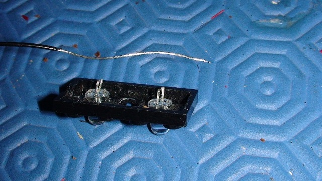

  
**–** Enroulez sur les pattes des LEDs en commençant par celle opposée à l’encoche

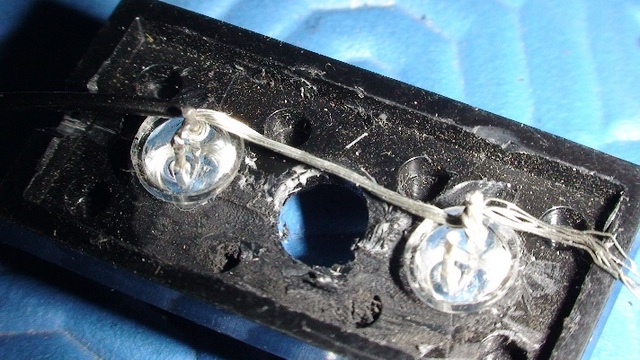

  
**–** La soudure viendra après

_5) Fil du (+) et résistance :_  
**–** Enroulez la patte de la résistance sur les pattes des LEDs en commençant coté de l’encoche

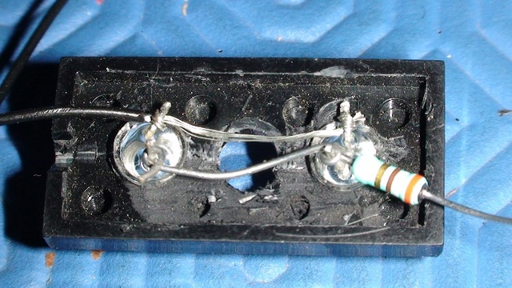

_6) Pattes des LEDs :_  
**–** Courbez les pattes des LEDs

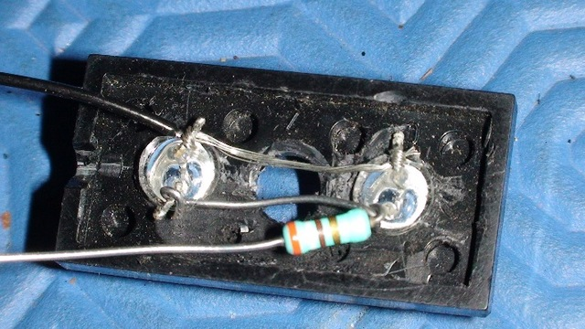

_7) Fil du (+) :_  
**–** Dénudez le fil sur 1 cm, enroulez-le sur la patte de la résistance  
**–** Soudez (en courbant bien les pattes, on doit pouvoir se passer de souder)

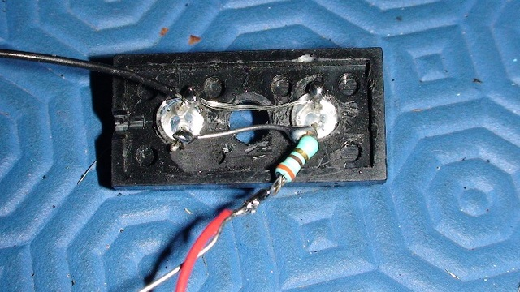

_8) Gaine thermo (ou ruban isolant) :_  
**–** Coupez 2 cm et la mettre sur la résistance

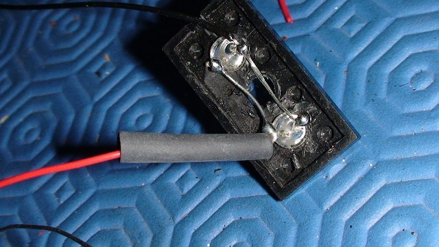

  
**–** Chauffez-la (je fais cela rapidement au briquet)

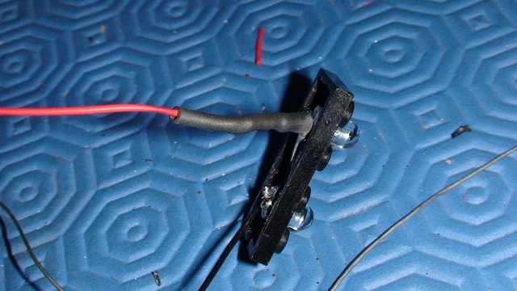

_9) Positionnement :_  
**–** Placez les fils et la résistance

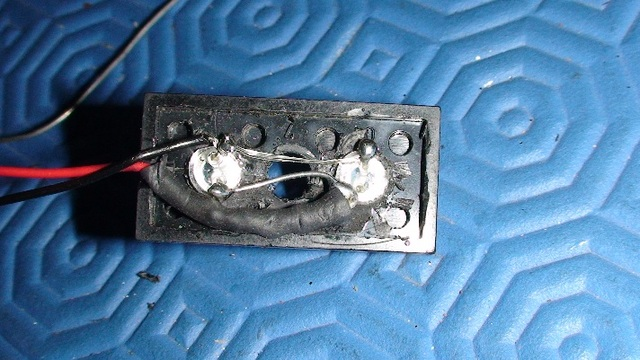

_10) Collage :_  
**–** Collez les deux plates en les maintenant fortement

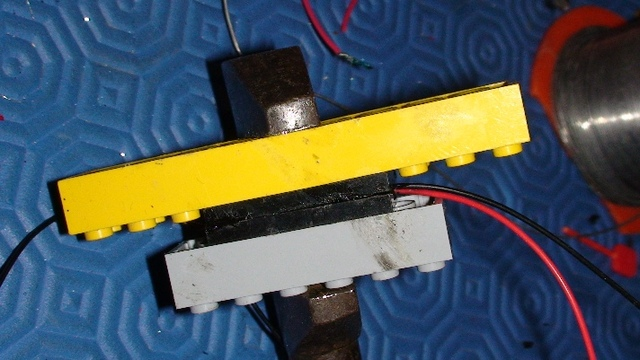

_11) Connecteur :_  
**–** Soudez un connecteur (on peut toujours utiliser des petits dominos)

## Résultat

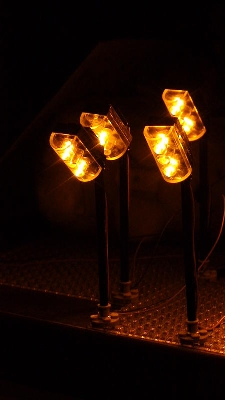

En exposition

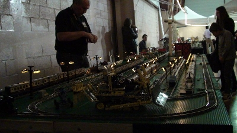

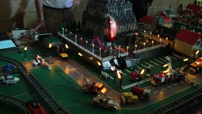

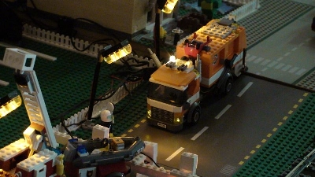

## Remarques

**–** Pour les âmes sensibles ce montage peut aussi se faire sans charcuter des briques, juste en passant la led dans un trou Technic.  
**–** Il existe aussi maintenant des LEDs acceptant directement un maximum de 5 V ou de 12V. D’après mes tests, Les LEDs 12V fonctionnent avec une alimentation 9 V. L’inconvénient est qu’elles sont plus chères (0,60 €) bien qu’elles n’ont pas besoin de résistance. Pour moi surtout, je n’en ai pas trouvé en récupération ;-)  
**–** on peut aussi utiliser des transformateurs non LEGO de récupération. Certains fournissent du 1,5V et donc sont directement utilisables.

Plus d’informations sur les LEDs :  
[http://fr.wikipedia.org/wiki/Diode\_électroluminescente](http://fr.wikipedia.org/wiki/Diode_%C3%A9lectroluminescente)
