Pour cette cinquième édition de la maquette, la municipalité de Saint-Martin-des-Champs, pour la première fois, a mis à la disposition du club Organisateur toutes les salles disponibles du complexe sportif du Gouélou (1500m2).

Toutes les créations LEGO des 23 participants ont donc pris place sur les 53 mètres de tables dans une belle et lumineuse salle de 300m2 environ.

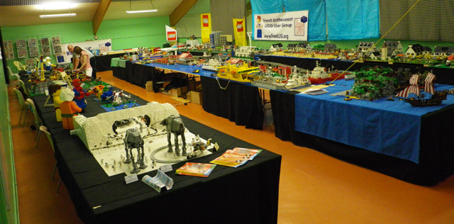

Après l’installation des tables vendredi matin avec Vincent de BeLUG, arrivé la veille, nous avons commencé le montage de nos dioramas en attendant l’arrivée progressive des adhérents de FreeLUG, Legopirate, SeTechnic.

Vers 16h30, arrivée de la commission de sécurité (pompiers, mairie, police) qui s’est attardée à nos dioramas. Feu vert accordé et surtout félicitations.

Samedi matin, arrivée des derniers participants, petit discours officiel de bienvenue de votre coordinateur local qui est aussi vice président du club organisateur.

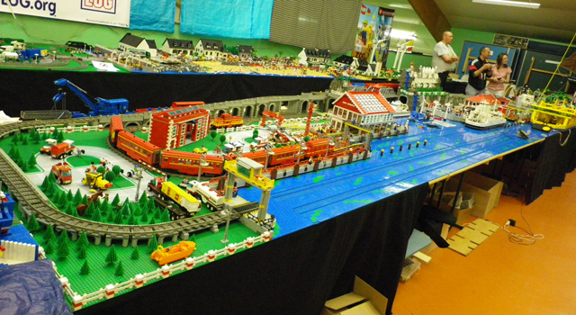

14 heures, le salon commence, et déjà, le public, malgré la chaleur, est émerveillé par nos créations légotiques.  
Pour les enfants, un concours a été organisé pour trouver le nombre de briques sur une maxifig de Dominick, une boîte était en jeu, même chose le lendemain.

A 18 heures, fin du premier jour du salon, tous les exposants sont conviés au vin d’honneur et à 20h, début du repas chez moi (25 personnes).

Le lendemain matin, les exposants reprennent le chemin du salon où attendait le public de plus en plus nombreux malgré la chaleur encore...

Vers midi, remise des coupes pour les 13 disciplines de la maquette et coups de coeur. Saluons au passage, Erik qui a été récompensé pour ses 4 maisons anciennes de Lannion (22).

A 18 heures, fin du salon et démontage.

En conclusion, je remercie mon club et la mairie d’avoir mis à notre disposition une très belle salle, je remercie tous les exposants qui sont venus de près et de loin, et qui sont repartis avec de beaux souvenirs du Finistère ensoleillé et chaleureux. Mention particulière à Erik qui a fait un détour par Angers pour récupérer thierry .Je remercie Jouéclub, sponsor officiel, pour les boîtes en lot du concours du week-end.  
Je remercie Daniela et d’autres personnes (???) qui ont donné un coup de main à mon club. Je remercie Erik, Dominick, Thierry, Paul, Pierre représentants de leur association ou forums. Je remercie Dominick et sa famille pour la préparation du concours.

Pour ma part, chef d’orchestre aux multiples fonctions (exposant, officiel, maitre de maison), je pense avoir bien rempli ma mission malgré quelques petits soucis de santé. A l’heure qu’il est, il est trop tôt de dire pour 2012. Vous serez informés, soyez en sûrs !

KENAVO , legotez bien,

A bientôt avec de nouvelle créations pour nos petits BREIZH !

_votre coordinateur, Jean-Marc_

PS : mon club de la maquette a reçu une invitation polonaise pour leur salon (région de Cracovie), reste le problème financier à supporter par nos amis polonais...

* * *

Nous sommes arrivés vendredi soir avec Erik et Daniela à Saint-Martin-des-Champs et c’est avec un vif plaisir que nous avons retrouvé Jean-Marc qui était déjà à pied d’œuvre pour monter son gigantesque diorama. Jusqu’au samedi matin, les arrivées se sont succédées, les tables se sont garnies de Mocs, de sets et de dioramas, tous plus beaux les uns que les autres.

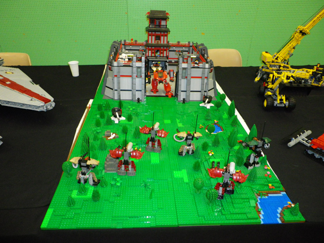

L’accueil par le club de maquettisme local a été très sympathique et les rencontres ont été très enrichissantes.

Samedi soir, nous avons tous été invités à diner chez Jean -Marc. 25 personnes environ se sont retrouvées autour de deux tables pour un repas inoubliable.

Malgré un soleil de plomb et une chaleur écrasante qui a duré tout le week-end, le salon a été une belle réussite. L’ami Jean-Marc a été à l’honneur dans les quotidiens locaux.

C’est avec regrets que nous avons quitté cette superbe région lundi matin.

Je tiens à remercier Pierrick et le club de maquettisme de Saint-Martin-des-Champs pour leur accueil, ainsi que tous nos amis de FreeLUG, Legopirate et SeTechnics, pardon si j’en oublie, pour leurs prestations. Plus personnellement je tiens à remercier Erik, Daniela, Brigitte et Alain.

_Thierry - Mindrunner_

* * *

Chose promise, chose due. [Après le château de Tonquédec présenté à Ploulec’h](/articles/617/), je suis revenu exposer en Bretagne, cette fois-ci avec une reproduction des trois maisons de Lannion bien connues.

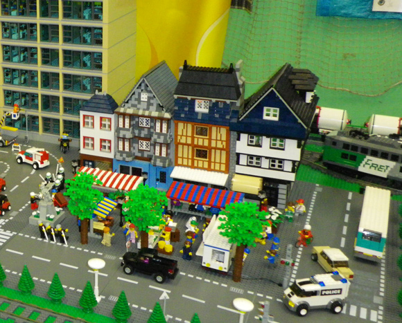

Une quinzaine d’exposants LEGO se sont retrouvés sous l’impulsion de Jean-marc, avec pour moi de nouvelles rencontres.

Beaucoup de choses présentées, avec de la diversité : une jolie exposition qui illustre la richesse du LEGO. Mon coup de coeur est pour l’île pirates de Mickael, type de décor qui m’a toujours fait rêver en LEGO. J’ai hâte de voir sa suite à Fana’briques ! :)

Un grand bravo à tous, exposants et organisateurs !

_Erik - brickerik_

* * *

Actualité oblige, nous avons proposé aux visiteurs un stand pour bien se préparer à la future Coupe du Monde, avec :  
**–** un [NXTBall](/articles/1017/) - sorte de match entre robots,  
**–** un [stade de foot](http://guide.lugnet.com/set/3569) LEGO, personnalisé par ma fille Corentine.

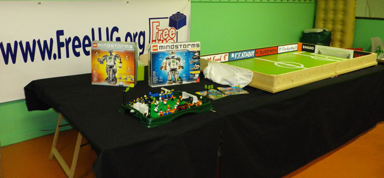

Le NTXBall, déjà présenté à [l’exposition de Cholet](/articles/1022/), a encore connu le succès auprès des ados, toujours très fiers de gagner contre les parents.  
Certains, parmi les plus jeunes, ont eu aussi du mal à quitter le terrain de foot de Corentine, et beaucoup ont été surpris de voir que LEGO avait produit ce genre de sets.

Sinon, malgré la chaleur étouffante, le salon a permis d’admirer des "assemblages de briques" formidables, largement à la hauteur des autres maquettes - exceptionnelles pour certaines - exposées dans l’autre partie du salon.

Comme beaucoup, nous avons notamment beaucoup apprécié les diorama Bretons :)

Bravo à toute l’organisation, avec un grand merci à Jean-Marc pour son accueil chaleureux et efficace.

_Corentine & Ghislain (Dagobot)_

* * *

Malgré mon emploi du temps plus que chargé, j’ai décidé au dernier moment de participer au salon de la maquette de Saint-Martin. 150 m² rien que pour nous, une belle salle de jeux !

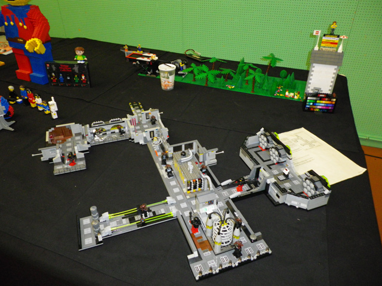

Je présentais :  
**–** le Space Hulk,  
**–** la Maxifig bouffon, qui as eu pas mal de succès,  
**–** un GBB, les visiteurs sont très attirés dès qu’un Moc est en mouvement, surtout quand une minifig basketteuse lance des balles dans la fenêtre d’une maison,  
[vidéo](http://www.youtube.com/watch?v=LwswXCSiHh8)  
**–** et ma collection de plus d’un millier de minifigs qui ne cesse de s’étoffer (Merci Erik, Dominick, Mikebato, Brigitte, Arnaud), il va encore falloir fabriquer des vitrines !

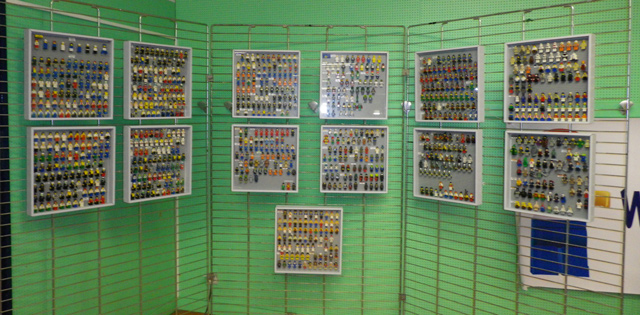

J’ai passé un très bon week-end, d’heureuses rencontres et revoyures.

Encore une belle organisation de Jean-Marc et de toute l’équipe du club de Saint-Martin,

merci à tout le monde

_Ronan_

* * *

Cette expo était pour moi l’occasion de passer quelques jours en Bretagne. Et surtout de participer à cette exposition avec une salle remplie de LEGO !

De mon côté, j’ai participé au grand diorama CITY avec Vincent, Jean-Claude et Erik. J’ai continué à agrandir ma zone commerciale déjà présentée à [Bourgoin-Jallieu en 2009](/articles/881/) que j’ai complétée avec un garage et concessionnaire automobile ainsi qu’une station service. J’ai aussi ramené quelques bâtiments modulaires.

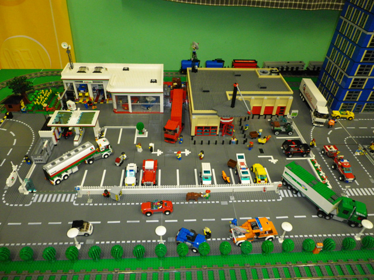

Sinon une superbe exposition, avec de nouvelles connaissances. Il y avait une grande diversité de choses à voir. Merci aux organisateurs pour leur accueil.

Et un très grand merci à Jean-Marc pour son accueil et le repas de samedi soir !

C’est quand la prochaine ? ;-)

_Pierre L. (Pierrolego)_

* * *

Après une longue route sous le soleil du Nord, de la Normandie, je suis enfin arrivé chez Jean-Marc en cette soirée du jeudi 20.

Pas le temps d’aller chez Jean-Marc même que nous sommes allés vider notre coffre respectif dans la salle.

Petite soirée tranquille à manger quelques pâtes et steak accompagné de yoghourt. J’ai passé un peu de temps à préparer ma toute nouvelle signalisation ferroviaire. Mais voilà, au bout de 5 min, un problème électrique a détruit une platine et la communication entre la platine principale et le PC a rendu l’âme... Les feux ne pouvaient plus clignoter. Dommage car j’aurai aimé les mettre sur le réseau.

Je ne me suis pas couché trop tard, étant fatigué du voyage. 800kms tout de même...

Le lendemain, jour de montage, il a fallu monter les tables et les positionner avant de pouvoir y mettre nos maquettes. Dans le courant de l’après midi, plusieurs exposants sont arrivés. Le montage allait bon train.

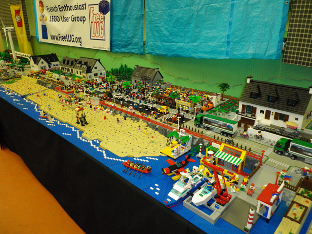

Le samedi matin, les derniers exposants sont arrivés, même avant moi, qui en ai bien profité pour dormir un max. Le public est arrivé en nombre, malgré le beau temps et la chaleur qui régnait, surtout dans la salle. Le regard des adultes mais aussi des enfants qu’ils nous ont porté tout au long de l’exposition m’a vraiment agréablement surpris tout autant qu’amusé : voir de grands enfants que nous sommes, des passionnés du LEGO, mais pas comme ils le pensaient aussi. Nous, fans, nous savons de quoi nous parlons.

L’ambiance avec les exposants donnait très bien. Beaucoup sont venus nous voir au premier étage et on a eu l’occasion de voir que nous sommes nous aussi capables de faire du maquettisme avec, bien sûr, les contraintes que la brique nous impose.

Nous avons de quoi boire et manger, le tout dans une ambiance bon enfant, aussi bien en journée qu’en soirée.  
Même surtout en soirée vu que nous étions tous attablés, pour ceux qui restaient bien sûr. D’autres ont préféré aller chez eux ou encore à l’hôtel. Tant pis pour eux.  
Allez, le samedi soir à 25 chez Jean-Marc, pour s’amuser tout ensembles et (accessoirement) manger, à nouer de jolis liens. Je crois d’ailleurs que l’on a mangé un hachis parmentier, carottes, taboulé pendant... 3 jours, non ? Mais c’était très bien tout de même !

Je garde encore et toujours le souvenir du regard de Madame le Maire de Morlaix. Elle a vraiment été impressionnée. Ca s’est bien vu. La remise d’une médaille a été très touchante. Elle est accrochée avec les rares autres et avec les colliers LEGO me rappelant ainsi les expos que j’ai déjà pu faire et les souvenirs que j’en ai eu.

Je repasserai certainement en Bretagne du coté de Morlaix d’ici à 2012. Surement que nous aurons l’occasion de nous revoir. Quoiqu’il en soit, une exposition est programmée pour 2012. Je ne peux pas dès à présent assurer ma présence. C’est bien trop tôt. De là à dire que je ne viendrais pas, il y a un pas que seul le cas de force majeure me fera franchir. En espérant se revoir, peut être cet été du coté de Lorient ?

_Vincent de BELUG_

* * *

Mickael présentait une superbe île pirates,

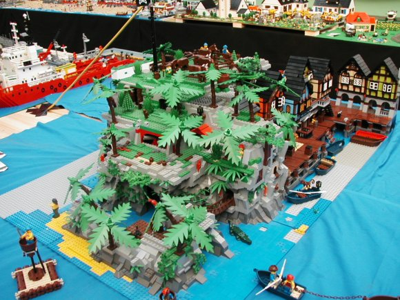

Dominick un diorama StarWars - Hoth ainsi que des maxifigs

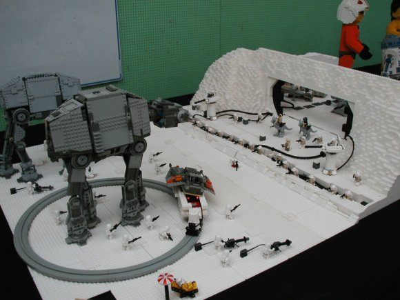

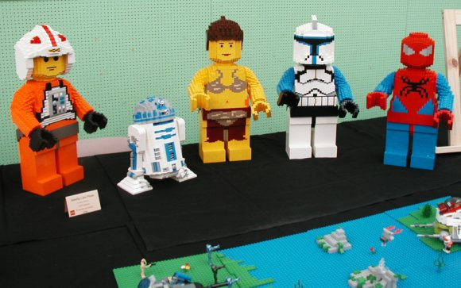

Paul des modèles Technic ainsi qu’un splendide Venator UCS.

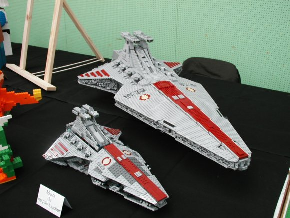

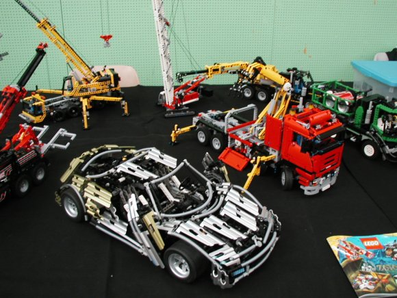

Et enfin Brigitte qui proposait un coin construction

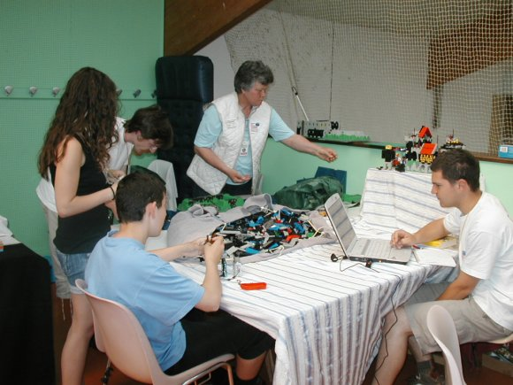

* * *

**Galeries photos**  
**–** [Jean-Marc](http://photos.freelug.org/main.php/v/barr__/expositions/2010/stmartin/)  
**–** [Ronan](http://photos.freelug.org/main.php/v/ronan/Saint-Martin-des-Champs/)  
**–** [Erik](http://photos.freelug.org/main.php/v/brickerik/expositions/2010/saintmartin/)  
**–** [Ghislain](http://photos.freelug.org/main.php/v/Dagobot/expo_saint_Martin_2010/)  
**–** [Pierre](http://photos.freelug.org/main.php/v/pierrel/exposition/2010/stmartin10/)  
**–** [Paul](http://www.brickshelf.com/cgi-bin/gallery.cgi?f=432574)  
**–** [Topic sur Legopirate](http://www.legopirate.fr/forum/phpBB3/viewtopic.php?p=131638#p131638)  
**–** [Topic sur SeTechnic](http://www.setechnic.com/Forum/topic3107.html)
