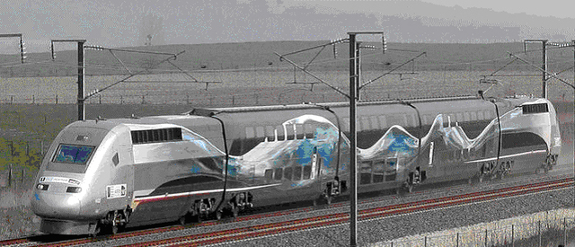
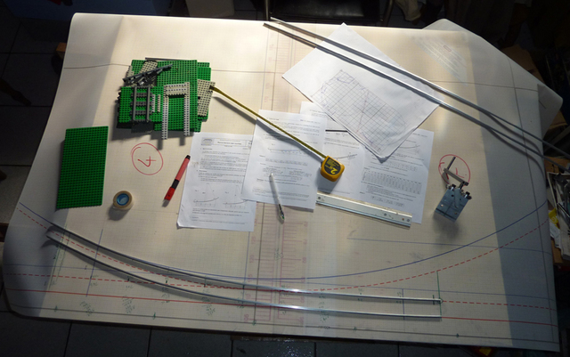
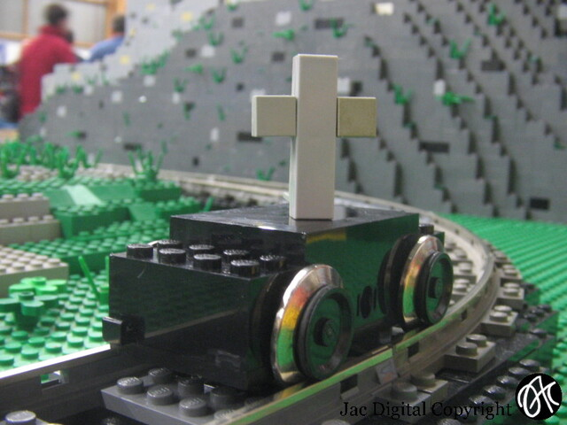

Il s’agit, dans le cadre d’expositions, de faire un layout « ligne Train Grande Vitesse » afin de battre le record du monde de vitesse du T.G.V. en LEGO.

Ce concept se développe donc autour de plusieurs axes :  
**–** la voie elle-même (notée LGV) : sa géométrie et les alimentations électriques ;  
**–** les trains à grande vitesse qui rouleront sur cette ligne pour battre le record ;  
**–** le chronométrage et l’homologation du record ;  
**–** la décoration de la LGV.

## La ligne grande vitesse

**Géométrie de la ligne**

La LGV est faite de rails spéciaux (pour les spécialistes : rails en aluminium code 250), constituée d’un aller-retour totalement droit et plat entre les deux virages.

Les virages de chaque extrémité sont d’un rayon de 1450 mm et en dévers (max 13°). Les attaques de courbes sont des clotoides.

Gabarit roulant 8 tenons y compris les deux virages. Tunnels, ponts et autres viaducs ne sont pas sur la zone des 10 mètres de mesure de la vitesse pure. La longueur de la ligne droite est de 30 mètre ce qui avec les virages devrait donner une longueur totale d’environ 33 mètres.  
Aucun aiguillage, tile, décoration, etc. sur la ligne LGV.  
Il n’y a pas de rail d’alimentation central pour les moteurs 12V.

**Alimentation électrique**

Une alimentation électrique puissante de 0 à 60 V / 15 Ampères est mise en place. La voie du record est alimentée de façon à minimiser les chutes de tension : alimentation multipoints tous les 3 ou 4 modules.

**Pupitre de commande**

Le pupitre de commande sera conçu de façon à afficher clairement 3 zones d’alimentation électrique :  
**–** zone verte de 0 à 9 volts ;  
**–** zone orange de 9 à 12 volts ;  
**–** zone rouge au dessus de 12 volts.

Un arrêt d’urgence coup de poing sera mis en place.

La commande est mise au centre de la partie chronométrage (au milieu des 10 mètres) sur une table à la même hauteur que les autres (deux plaques 32 de profondeur)

## Sécurité générale

Des barrières solides doivent être mises en place afin d’interdire efficacement au public la possibilité de toucher les rails (et en particulier aux enfants).  
En dehors des périodes officielles de course, l’alimentation est bridée à 9 V.  
En cas de manque de barrières, il est possible de compléter par de la rubalise.

Les enfants qui souhaitent concourir doivent obligatoirement être accompagnés d’un parent lors des courses. Dans ce cas, la course se fait sous la responsabilité du(des) parent(s) présent(s).

## Les trains grande vitesse

Deux catégories sont ouvertes :  
**–** une catégorie "record officiel" ;  
**–** une catégorie "prototype".

**Catégorie "record officiel"**

Cette catégorie accepte soit certains trains officiels LEGO soit des MOC reconnaissables de T.G.V. ou autres trains à grande vitesse réels, c’est à dire ayant une vitesse commerciale supérieure à 200 Km/heure dans la réalité.

_Trains LEGO officiels_

Seuls seront admis le 7745 et le 4511 constitué de deux motrices et 3 voitures. Les rames LEGO doivent être _complètes_ c’est à dire sans pièces enlevées et non modifiées (sauf éventuellement quelques boggies remplacés par des moteurs).

La commission technique sera seule juge de la conformité.

_MOC_

Par définition, un train grande vitesse est un train roulant à plus de 200 Km/h en vitesse commerciale dans la réalité.

Un train grande vitesse présenté doit exister dans la réalité. Le constructeur du train devra fournir à la commission technique les photos du train réel ayant servi de modèle.

Une commission technique composée d’experts statuera sur l’éligibilité de chaque rame T.G.V. à participer aux tentatives de record sur les critères suivants :  
**–** la rame doit être composée de 2 motrices et 3 voitures minimum soit 5 éléments en tout ;  
**–** la rame doit être immédiatement reconnaissable comme étant un train à grande vitesse existant (preuves photos à l’appui) et être proportionnée correctement ;  
**–** la rame doit être construite uniquement avec des pièces LEGO, motorisation comprise ;  
**–** aucune pièce ne doit être collée y compris au moyen d’autocollants ou autres pelliculages de décoration pour le matériel roulant (caisse des locomotives et des voitures) ;  
**–** aucune pièce ne doit être coupée ;  
**–** largeur minimum des motrices et des voitures de la rame : 6 tenons ;  
**–** aucune modification n’est permise sur une rame après son homologation par la commission d’expert (ou alors la rame doit repasser devant la commission avant sa tentative) ;  
**–** Nota : les moteurs LEGO sont considérées comme un assemblage de pièces LEGO : ils peuvent donc être désassemblés ou réassemblés.

_A propos de la motorisation_

Pour la catégorie "record officiel" le nombre de boggies moteur est strictement limité à dix aussi bien pour les modèles LEGO que pour les MOC.

Nota : un boggie est la composition de deux essieux et 4 roues. L’organisation ne fournit pas les moteurs. Chaque participant vient avec ses moteurs qu’il pourra faire fonctionner jusqu’à 60V sous son entière responsabilité.

L’organisation ne remboursera aucun moteur.

**Catégorie "prototype"**

Tout est libre mais uniquement avec des pièces LEGO.

## Le chronométrage pour le "record officiel" de vitesse T.G.V.

Le chronométrage se fera sur une longueur de exactement 10 mètres sur la voie extérieure du module. La mesure du temps se fait par détection de passage du train au moyen de cellules.

Le train à grande vitesse le plus rapide est celui qui met le moins de temps pour parcourir les 10 mètres.

Pour chaque course de tentative de record, la rame doit être conduite par son propriétaire. Une course de tentative de record se fait au moins sur 3 tours :  
**–** 1er tour de chauffe (obligatoire) ;  
**–** 2ème tour pour mesure de la vitesse ;  
**–** 3ème tour pour rentrer au "garage".

Lors des séquences de record, chaque T.G.V. ne peut faire qu’une tentative puis doit rentrer au garage pour laisser le T.G.V. suivant tenter le record.

Les courses de tentatives de record "homologables" ne se feront que dans les périodes horaires définies par l’organisation (au minimum 1 période par demi-journée d’exposition publique).

L’affichage du résultat (vitesse atteinte sur les 10 mètre pour le run) se fait sur ordinateur connecté à un vidéo-projecteur pour le public.

## Le train le plus rapide sur un tour complet

La nouveauté de Fana’briques 2010 !

Deux catégories sont ouvertes :  
**–** une catégorie "record officiel" ;  
**–** une catégorie "prototype".

Il s’agit d’un concours où le train le plus rapide (de chaque catégorie) sur un tour gagne le concours. Aucune assistance extérieure est autorisée lors du tour complet chronométré pour ce concours.

Le départ est un départ arrêté

## La décoration de la ligne

Profondeur maximale de deux modules soit une profondeur utile d’exposition de 5 plaques 32\*32.

Ce qui veux dire que chaque exposant dispose d’une profondeur théorique de 6 plaques 32\*32. Théorique, car en fait, la LGV va occuper une plaque 32 coté public donc il reste en fait 5 plaques de 32 en profondeur pour l’exposant.

_NOTA_ : il est quand même demandé à chaque exposant d’habiller totalement en plaque les 6 plaques de profondeur de la couleur des plaques de son module.  
La LGV sera posée **sur** la plaque de devant. L’exposant ne doit rien construire sur ces plaques.

## La commission technique

Elle est composée d’experts n’ayant pas de "T.G.V." en compétition :  
**–** un "Président" de la commission ;  
**–** deux membres organisateurs du record ;  
**–** un membre de l’organisation de l’exposition ;  
**–** un membre à prendre parmi les exposants présents.

Soit un total de 5 personnes.

## Le plus de Monsieur Plus : LGV ouverte pour concours enfants.

Nous proposons aussi que la LGV puisse être ouverte pour un concours (ou juste pour le fun) aux enfants. Dans ce cas, nous assurons uniquement l’encadrement technique, toutes les autres modalités étant à définir par l’exposition dans le cadre de son programme d’animation.

L’ouverture de la LGV aux enfants :  
**–** ne doit pas pénaliser le Record de vitesse et le concours sur un tour ;  
**–** est faite sous l’entière responsabilité de l’exposition.
