Ayant été cherché cette boîte ce midi, et devant la monter rapidement [avant son exposition](/articles/1095/), je rédige l’article le plus rapide de ma vie. Ayant été désigné - on m’a dit que celui qui monte la boîte pour l’exposition doit faire en même temps la revue - donc acte.

La boîte contient 669 pièces :  
**–** 6 sachets numérotés  
**–** 1 sachet de rails flexibles  
**–** des rails courbes  
**–** la planche d’autocollants  
**–** une boîte carton contenant certains accessoires et la motorisation  
**–** et 4 notices

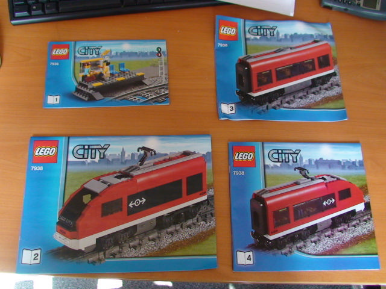

## Notice n°1 : Le quai - sachet n°1

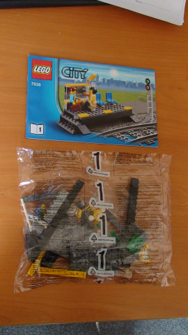

On commence par les voyageurs

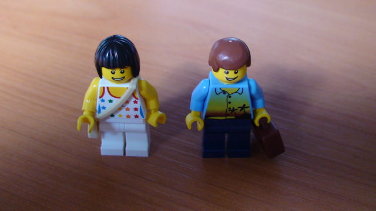

Une pendule pour voir dans combien de temps le prochain train arrive

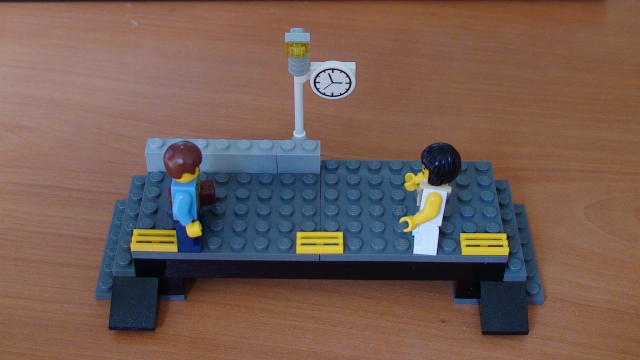

Avec le plan et les horaires (on ne dirait pas vu la taille du quai mais c’est une gare internationale)

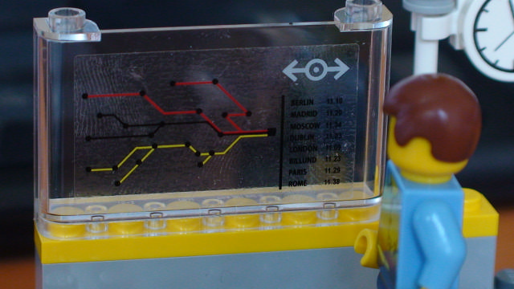

Moi je veux aller à Billund ;-)

Enfin des sièges car l’attente devrait être longue

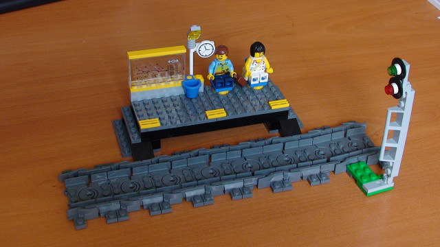

Votre attention s’il vous plait. Le train 7938 est en cours de construction. Il sera affiché dans quelques instants. Veuillez nous excuser pour la gêne occasionnée. Merci de votre compréhension.

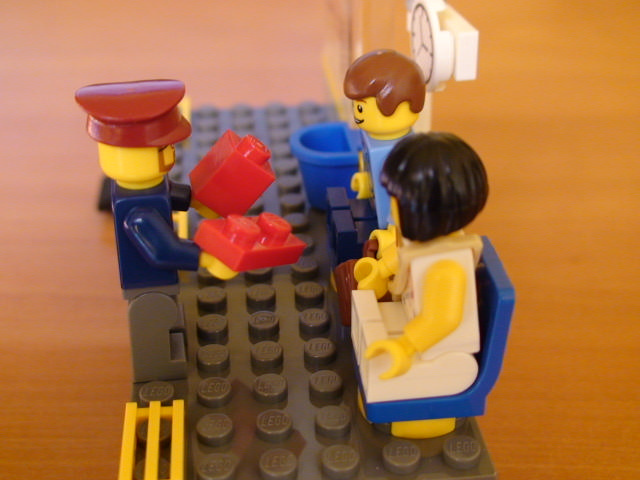

Ouvrons la boîte en carton qui servira pour toutes les autres étapes

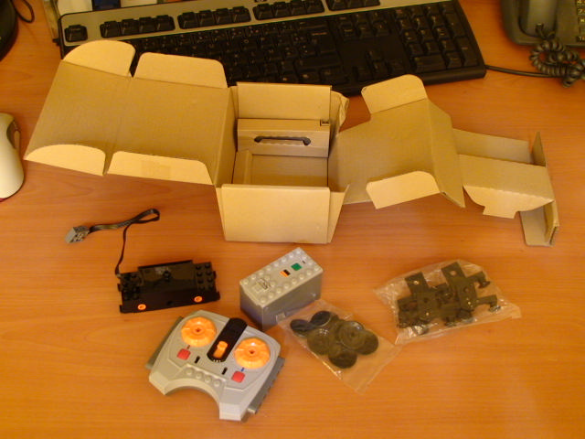

## Notice 2 : La motrice - sachet n°2 et n°3

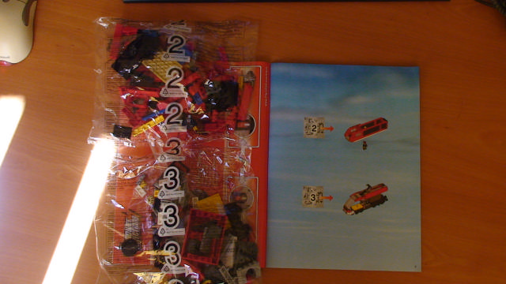

On accélère, les passagers attendent.

Sachet n°2

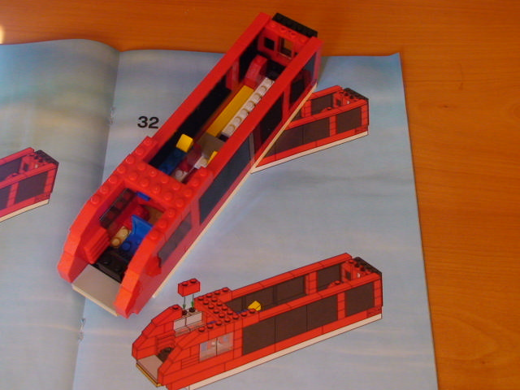

Sachet n°3

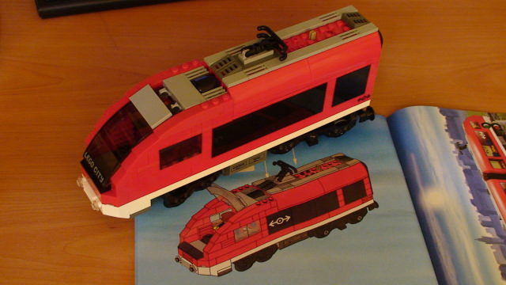

## Notice n°3 : La voiture passagers - sachet n°4

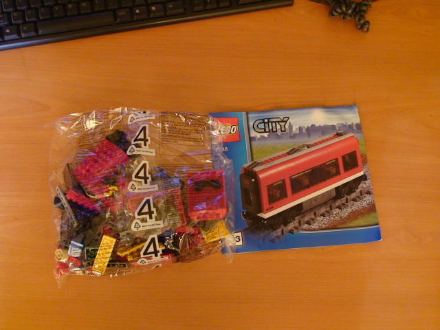

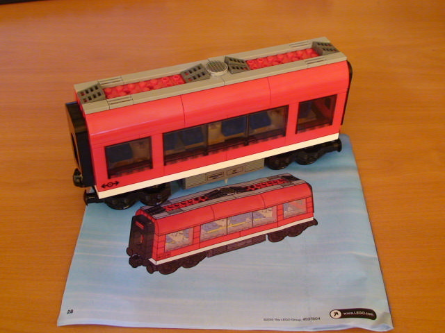

## Notice n°4 : Voiture Passagers + poste de conduite - sachet n° 5 et n°6

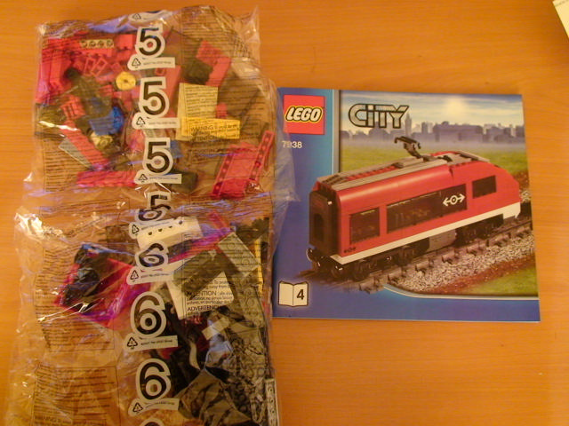

Sachet n°5

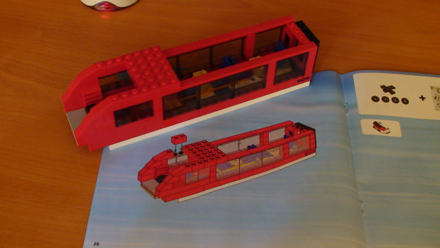

Sachet n°6

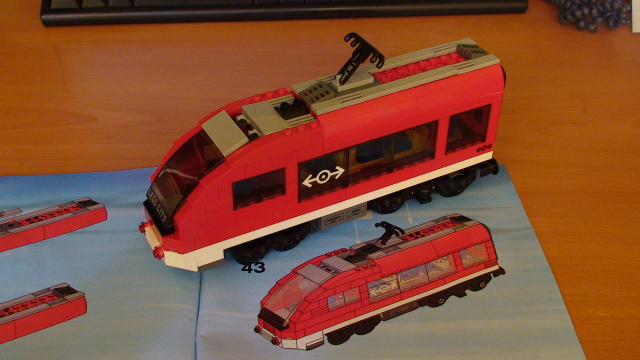

Le montage terminé, les passagers vont pouvoir prendre le train

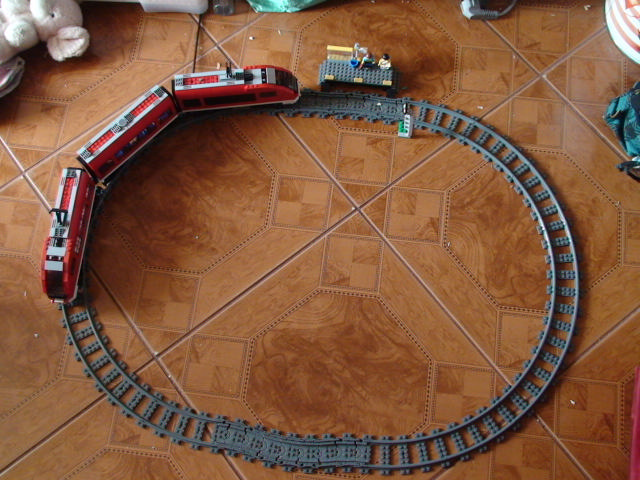

Enfin il arrive

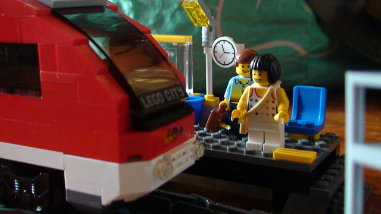

Il y a de la place...

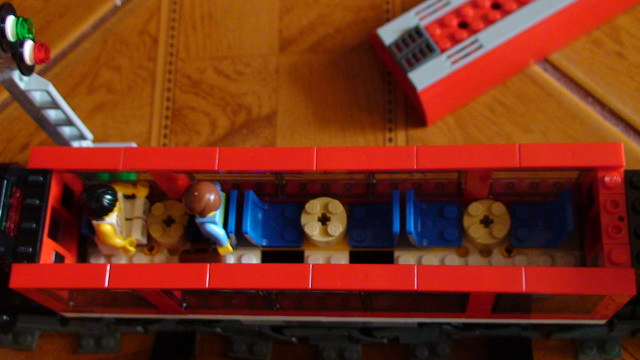

Mais autant continuer à discuter.

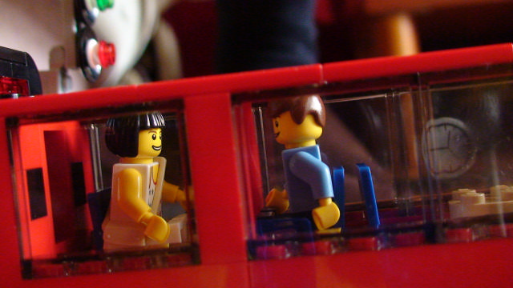

Merci à LEGO France pour la mise à disposition de cette boîte à l’association. Si vous voulez voir ce train en action, venez nous rejoindre à partir de jeudi au [Mondial du Modélisme 2010 - 17 au 20 juin (parc des expositions à la porte de Versailles)](/articles/1095/).

J’ai pris pas mal de plaisir à monter ce beau train qui contient peu de meta-pieces.

Je n’ai pas pris le temps de mettre des piles pour le faire rouler.
