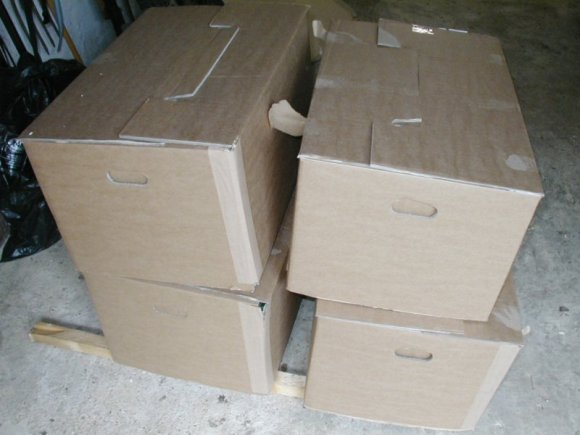
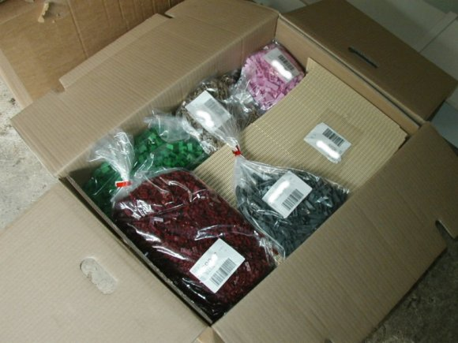
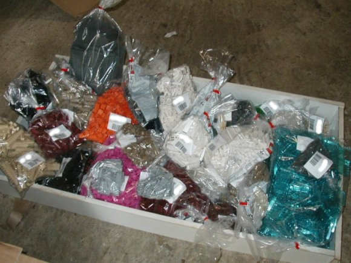
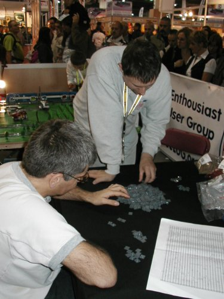
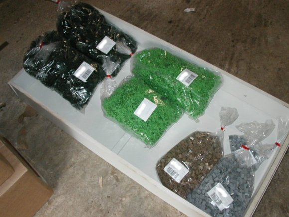

Le LUGBULK est une opération de vente de briques en grosse quantité par LEGO à destination des LUGs, groupes de passionnés LEGO répondant à certains critères de sélection. FreeLUG y participe.

La première commande LUGBULK a été passée en février 2010, et nous avons enfin été livré en juin.

Les 50 types de pièces commandées ont été livrées dans quatre cartons, dont un uniquement avec des BURP.

Le tri a été réalisé lors du Mondial du Modélisme. Entre 4 et 5 heures ont été nécessaires à tantôt 2, tantôt 3 personnes, pour recompter et dispatcher les 23218 pièces qui constituaient la commande.

Les premiers lots ont été remis aux personnes sur place, les suivants se feront lors de [Fana’briques](/articles/1084/) ou encore de la [REF](/articles/1103/).

Nous ne sommes pas autorisés à communiquer publiquement les prix des pièces, mais ils sont très avantageux. Résultat, alors que la première commande n’était pas encore arrivée, l’engouement pour la seconde commande LUGBULK a augmenté puisqu’il y a désormais 50% de participants supplémentaires inscrits au programme via FreeLUG, soit un total de 48 membres.

[Les photos de la commande](http://photos.freelug.org/main.php/v/FreeLUG/Promotions_speciales/lugbulk2010_01/)
